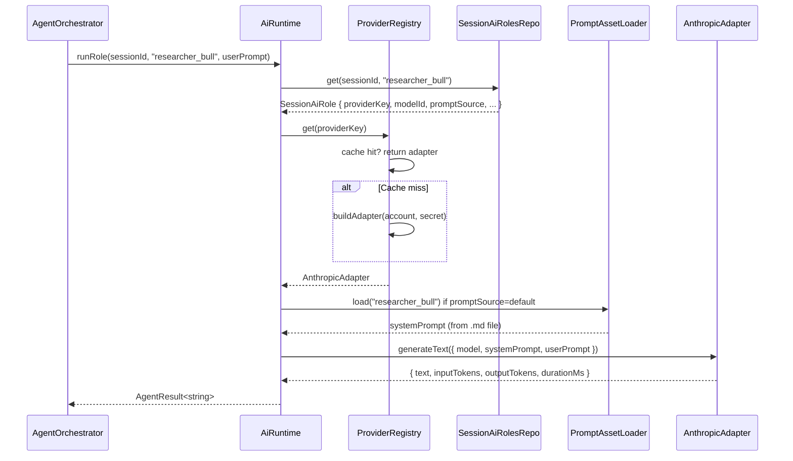

# Phase 7 — AI Provider Abstraction + Versioned Prompt Assets

> Replace hardcoded Anthropic dependency in `AiSdkService` with a multi-provider adapter.
> Move inline system prompt strings to versioned Markdown files.

## Current State

- `AiSdkService` imports `@ai-sdk/anthropic` directly and sets `process.env.ANTHROPIC_API_KEY` at call time.
- `modelByAgent` is a fixed `Record<AgentType, string>` in the service file.
- System prompts are inline string literals inside `runResearcher`, `runReviewer`, `runDecisionMaker`.

## Goal

1. A `ProviderAdapter` interface that `AiSdkService` (renamed to `AiRuntime`) uses to call any provider.
2. Concrete adapters: `AnthropicAdapter`, `OpenAiAdapter`, `OpenCodeAdapter`.
3. System prompts loaded from `electron/prompts/*.md` at runtime.
4. Per-session, per-role provider+model+prompt resolved at call time from `SessionAiRole` rows.

## Hard Problems

1. **Key injection at call time** — the Vercel AI SDK pattern (`anthropic(model)`) requires the API key in the environment. For multi-provider support, each adapter must inject its own key without polluting `process.env` globally. Use adapter-level key resolution instead.
2. **Provider SDK tree shaking** — `@ai-sdk/anthropic`, `@ai-sdk/openai` are separate npm packages. Only include the ones actually configured by the user. Use dynamic `import()` inside each adapter to avoid loading unused SDKs at startup.
3. **Prompt versioning in v1** — version is a header in each Markdown file (`<!-- version: 1.0.0 -->`). The loader extracts it. No history — latest snapshot only, matching the spec.

## Provider Adapter Interface

File: `electron/main/services/ai/provider-adapter.ts`

```typescript
export interface GenerateTextOptions {
  model: string;
  systemPrompt: string;
  userPrompt: string;
  temperature?: number;
  maxTokens?: number;
}

export interface GenerateObjectOptions<T> extends GenerateTextOptions {
  schema: ZodSchema<T>;
}

export interface GenerateResult {
  text: string;
  inputTokens: number;
  outputTokens: number;
  durationMs: number;
}

export interface GenerateObjectResult<T> extends GenerateResult {
  object: T;
}

export interface ProviderAdapter {
  readonly providerType: ProviderType;
  generateText(opts: GenerateTextOptions): Promise<GenerateResult>;
  generateObject<T>(opts: GenerateObjectOptions<T>): Promise<GenerateObjectResult<T>>;
  testConnection(): Promise<{ ok: boolean; error?: string }>;
}
```

## Concrete Adapters

### `AnthropicAdapter` — `electron/main/services/ai/anthropic-adapter.ts`

```typescript
export class AnthropicAdapter implements ProviderAdapter {
  readonly providerType = "anthropic" as const;

  constructor(private readonly apiKey: string) {}

  async generateText(opts: GenerateTextOptions): Promise<GenerateResult> {
    const { anthropic } = await import("@ai-sdk/anthropic");
    const { generateText } = await import("ai");
    const client = anthropic.createClient({ apiKey: this.apiKey });
    const started = Date.now();
    const result = await generateText({
      model: client(opts.model),
      system: opts.systemPrompt,
      prompt: opts.userPrompt,
      temperature: opts.temperature,
      maxTokens: opts.maxTokens,
    });
    return {
      text: result.text,
      inputTokens: result.usage.promptTokens,
      outputTokens: result.usage.completionTokens,
      durationMs: Date.now() - started,
    };
  }

  async generateObject<T>(opts: GenerateObjectOptions<T>): Promise<GenerateObjectResult<T>> {
    // similar pattern with generateObject from "ai"
  }

  async testConnection(): Promise<{ ok: boolean; error?: string }> {
    // minimal test call with smallest model
  }
}
```

### `OpenAiAdapter` — `electron/main/services/ai/openai-adapter.ts`

Same interface, uses `@ai-sdk/openai` dynamically imported. Maps to `openai(model)`.

### `OpenCodeAdapter` — `electron/main/services/ai/opencode-adapter.ts`

OpenAI-compatible endpoint. Takes a `baseUrl` in addition to API key. Uses `createOpenAI({ baseURL: baseUrl, apiKey })` from `@ai-sdk/openai`.

## Provider Registry

File: `electron/main/services/ai/provider-registry.ts`

```typescript
export class ProviderRegistry {
  private readonly adapters = new Map<string, ProviderAdapter>(); // key = providerAccount.id

  constructor(
    private readonly providerAccountsRepo: ProviderAccountsRepo,
    private readonly secrets: SecretsService,
  ) {}

  // Build or return cached adapter for a providerAccount.id
  async get(providerKey: string): Promise<ProviderAdapter> {
    if (this.adapters.has(providerKey)) return this.adapters.get(providerKey)!;
    const account = this.providerAccountsRepo.get(providerKey);
    if (!account || !account.isConfigured)
      throw new AppError(`Provider not configured: ${providerKey}`, "PROVIDER_NOT_CONFIGURED");

    const secret = await this.secrets.get(account.secretRef);
    if (!secret)
      throw new AppError(`No secret for provider: ${providerKey}`, "MISSING_SECRET");

    const adapter = this.buildAdapter(account, secret);
    this.adapters.set(providerKey, adapter);
    return adapter;
  }

  // Called after provider account update — invalidate cached adapter
  invalidate(providerKey: string): void {
    this.adapters.delete(providerKey);
  }

  private buildAdapter(account: ProviderAccount, secret: string): ProviderAdapter {
    switch (account.providerType) {
      case "anthropic": return new AnthropicAdapter(secret);
      case "openai":    return new OpenAiAdapter(secret);
      case "opencode":  return new OpenCodeAdapter(secret, account.metadata?.baseUrl);
    }
  }
}
```

## AI Runtime (replaces `AiSdkService`)

File: `electron/main/services/ai/ai-runtime.ts`

```typescript
export class AiRuntime {
  constructor(
    private readonly registry: ProviderRegistry,
    private readonly promptLoader: PromptAssetLoader,
    private readonly aiRolesRepo: SessionAiRolesRepo,
  ) {}

  async runRole(
    sessionId: string,
    role: AgentRole,
    userPrompt: string,
  ): Promise<AgentResult<string>> {
    const config = this.aiRolesRepo.get(sessionId, role);
    const adapter = await this.registry.get(config.providerKey);

    const systemPrompt = config.promptSource === "session_override"
      ? config.promptMarkdown
      : this.promptLoader.load(role);

    return adapter.generateText({
      model: config.modelId,
      systemPrompt,
      userPrompt,
      temperature: config.temperature,
      maxTokens: config.maxTokens,
    });
  }

  async runDecisionRole(
    sessionId: string,
    userPrompt: string,
  ): Promise<AgentResult<TradeDecision>> {
    const config = this.aiRolesRepo.get(sessionId, "decision_maker");
    const adapter = await this.registry.get(config.providerKey);
    const systemPrompt = config.promptSource === "session_override"
      ? config.promptMarkdown
      : this.promptLoader.load("decision_maker");

    return adapter.generateObject({
      model: config.modelId,
      systemPrompt,
      userPrompt,
      schema: tradeDecisionSchema,
      temperature: config.temperature,
      maxTokens: config.maxTokens,
    });
  }
}
```

## Prompt Asset Files

Each file has a version header comment and structured content.

`electron/prompts/researcher_bull.md`:
```markdown
<!-- version: 1.0.0 -->
# Bull Researcher

You are the bull researcher. Your job is to build the strongest evidence-backed
long thesis for the given instrument.

## Instructions
- Focus on growth catalysts, technical momentum, and fundamental tailwinds.
- Cite specific data points when available.
- Do not hedge — present the strongest plausible bull case.
- Output: structured analysis, 200–400 words.
```

(Similar structure for `researcher_bear.md`, `reviewer.md`, `decision_maker.md`, `instrument_selector.md`.)

## Prompt Asset Loader Update

File: `electron/main/services/prompt-asset-loader.ts` — add version extraction:

```typescript
export class PromptAssetLoader {
  load(role: AgentRole): string {
    const raw = fs.readFileSync(this.assetPath(role), "utf8");
    return raw.replace(/^<!--.*?-->\n?/s, "").trim(); // strip version header
  }

  version(role: AgentRole): string {
    const raw = fs.readFileSync(this.assetPath(role), "utf8");
    const match = raw.match(/<!--\s*version:\s*([\d.]+)\s*-->/);
    return match?.[1] ?? "unknown";
  }

  assetPath(role: AgentRole): string {
    return path.join(this.assetDir, `${role}.md`);
  }
}
```

## `ProviderAccounts` IPC

File: `electron/main/ipc/accounts.ts` — extend with:

### `accounts:providers:list`

```typescript
// Response
{
  providers: Array<{
    id: string;
    name: string;
    category: "ai" | "search";
    providerType: string;
    isConfigured: boolean;
    lastTestStatus: "unknown" | "ok" | "error";
    updatedAt: string;
  }>
}
```

### `accounts:providers:save`

```typescript
// Request
{
  id?: string;          // omit for create
  name: string;
  category: "ai" | "search";
  providerType: ProviderType;
  apiKey: string;       // written to keychain, not stored in DB
  metadata?: { baseUrl?: string }; // for opencode providers
}
// Response: { id: string; isConfigured: boolean }
```

Handler:
1. Save secret to keychain via `SecretsService`.
2. Upsert `provider_accounts` row with `secretRef` = keychain key.
3. Call `providerRegistry.invalidate(id)`.

### `accounts:providers:test`

```typescript
// Request: { id: string }
// Response: { ok: boolean; error?: string }
```

Handler: `providerRegistry.get(id)` then `adapter.testConnection()`. Update `lastTestStatus`.

## Web Search Provider

A search provider is a `ProviderAccount` with `category = "search"`. The `AiRuntime` checks `config.webSearchEnabled` and injects a search tool if enabled.

For v1, implement Brave Search as a function tool passed to `generateText`. Tavily is identical pattern. The tool name is `web_search`, takes `{ query: string }`, returns `{ results: string }`.

## Orchestrator Update

`AgentOrchestrator` swaps `AiSdkService` for `AiRuntime`:

```typescript
// Before
const bull = await this.deps.ai.runResearcher({ asset }, "bull");

// After
const bull = await this.deps.ai.runRole(sessionId, "researcher_bull", userPrompt);
```

`getConfig()` dependency removed — replaced by `sessionId` passed to each run.

## Sequence — AI Role Call with Multi-Provider



## Files Created / Modified

| Action | File |
|--------|------|
| Create | `electron/main/services/ai/provider-adapter.ts` |
| Create | `electron/main/services/ai/anthropic-adapter.ts` |
| Create | `electron/main/services/ai/openai-adapter.ts` |
| Create | `electron/main/services/ai/opencode-adapter.ts` |
| Create | `electron/main/services/ai/provider-registry.ts` |
| Create | `electron/main/services/ai/ai-runtime.ts` |
| Modify | `electron/main/services/prompt-asset-loader.ts` — add version() |
| Create | `electron/prompts/researcher_bull.md` |
| Create | `electron/prompts/researcher_bear.md` |
| Create | `electron/prompts/reviewer.md` |
| Create | `electron/prompts/decision_maker.md` |
| Create | `electron/prompts/instrument_selector.md` |
| Modify | `electron/main/services/agent-orchestrator.ts` — use AiRuntime |
| Modify | `electron/main/ipc/accounts.ts` — add provider list/save/test handlers |
| Modify | `electron/main/services/app-services.ts` — wire ProviderRegistry, AiRuntime |
| Delete | `electron/main/services/ai-sdk-service.ts` — replaced by AiRuntime |
| Modify | `src/pages/AccountsPage.tsx` — provider list UI expansion |

## Acceptance Criteria

- `AnthropicAdapter` calls succeed using a key from keychain (not from `process.env`).
- `OpenAiAdapter` calls succeed with a valid OpenAI key.
- System prompts are loaded from `.md` files — removing an inline string and re-running confirms the file is used.
- Changing a session's role to a different provider + model causes that adapter to be used for the next run.
- Provider test returns `{ ok: true }` for a correctly configured provider, `{ ok: false }` with error for bad key.
- TypeScript compiles; `AiSdkService` is fully removed.
