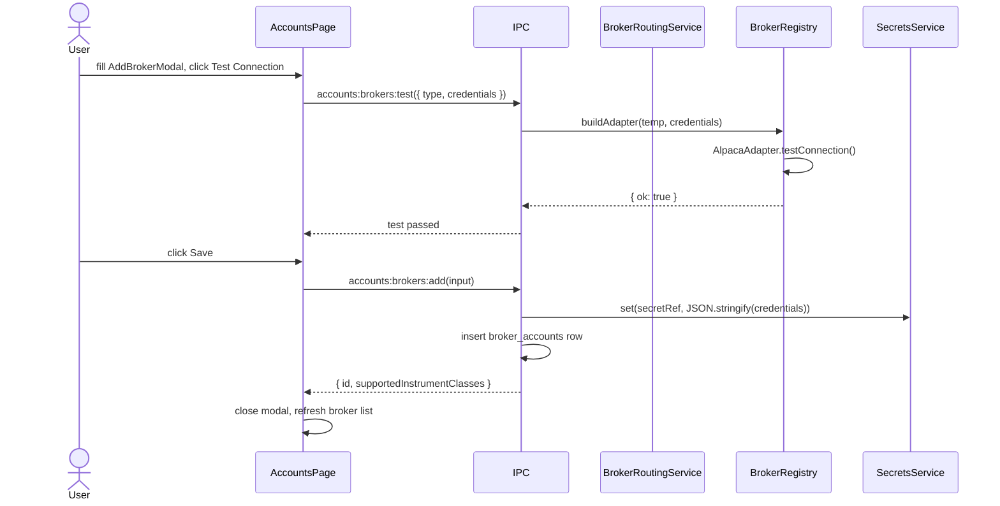
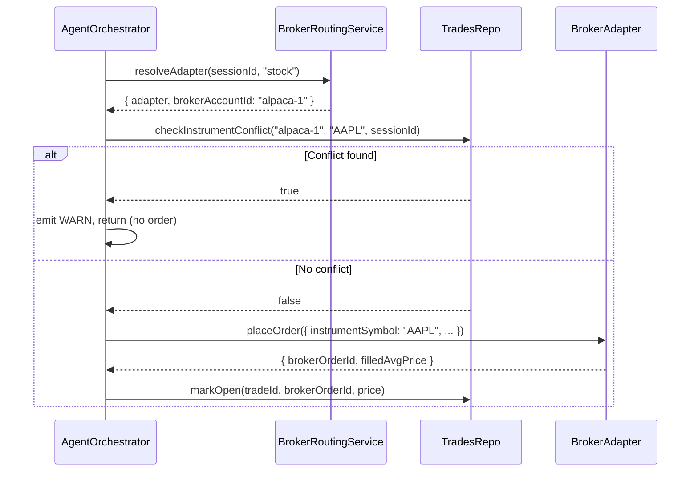

# Phase 8 — Broker Accounts + Instrument Routing

> Replace single Alpaca singleton with a multi-broker account model.
> Per-session broker assignments + per-instrument-class default routing.

## Current State

- One hardcoded Alpaca adapter, credentials stored in keychain under a single key.
- `BrokerService` holds a single `BrokerAdapter` resolved at startup.
- No concept of broker account IDs — trades have no `broker_account_id`.

## Goal

1. Multiple `broker_accounts` rows, each with its own keychain secret.
2. Each broker account declares which `InstrumentClass[]` it supports.
3. Each session is assigned one or more broker accounts + a default per instrument class.
4. The orchestrator resolves the correct broker at trade-time from the session's routing config.
5. Instrument collision check: deny trade if same `(broker_account_id, instrument_symbol)` is open/pending in another active session.

## Hard Problems

1. **Broker adapter dynamic instantiation** — unlike AI providers, broker adapters are stateful (they hold an active WebSocket for trade updates). Each `BrokerAccount` needs its own adapter instance. The registry must not share instances across accounts.
2. **Instrument collision** — already designed in Phase 2 as `TradesRepo.checkInstrumentConflict()`. The orchestrator must call this before `placeOrder()`, using the resolved `brokerAccountId`.
3. **Preflight at session start** — verify all assigned brokers for the session are reachable and that at least one broker is compatible with each instrument class in the session.

## Broker Adapter Interface Update

File: `electron/main/broker/broker-adapter.ts`

```typescript
export interface BrokerOrder {
  instrumentSymbol: string;
  instrumentType: InstrumentClass;
  side: "BUY" | "SELL";
  sizeUsd: number;
  stopLossPrice?: number;
  takeProfitPrice?: number;
}

export interface BrokerOrderResult {
  brokerOrderId: string;
  filledAvgPrice: number;
}

export interface BrokerAdapter {
  readonly brokerType: string;
  readonly supportedInstrumentClasses: InstrumentClass[];

  testConnection(): Promise<{ ok: boolean; error?: string }>;
  placeOrder(order: BrokerOrder): Promise<BrokerOrderResult>;
  cancelOrder(brokerOrderId: string): Promise<void>;
  getPositions(): Promise<BrokerPosition[]>;
}

export interface BrokerPosition {
  instrumentSymbol: string;
  instrumentType: InstrumentClass;
  side: "long" | "short";
  sizeUsd: number;
  unrealizedPnl: number;
}
```

## Broker Registry

File: `electron/main/broker/broker-registry.ts`

```typescript
export class BrokerRegistry {
  // key = brokerAccount.id
  private readonly adapters = new Map<string, BrokerAdapter>();

  constructor(
    private readonly brokerAccountsRepo: BrokerAccountsRepo,
    private readonly secrets: SecretsService,
  ) {}

  async get(brokerAccountId: string): Promise<BrokerAdapter> {
    if (this.adapters.has(brokerAccountId)) return this.adapters.get(brokerAccountId)!;
    const account = this.brokerAccountsRepo.get(brokerAccountId);
    if (!account) throw new AppError("Broker account not found", "NOT_FOUND");
    const creds = await this.secrets.get(account.secretRef);
    const adapter = this.buildAdapter(account, creds);
    this.adapters.set(brokerAccountId, adapter);
    return adapter;
  }

  invalidate(brokerAccountId: string): void {
    this.adapters.delete(brokerAccountId);
  }

  private buildAdapter(account: BrokerAccount, creds: string): BrokerAdapter {
    const parsed = JSON.parse(creds); // { keyId, secretKey, ... }
    switch (account.brokerType) {
      case "alpaca": return new AlpacaAdapter(parsed, account.mode);
      case "mock":   return new MockBrokerAdapter();
      default: throw new AppError(`Unknown broker type: ${account.brokerType}`, "UNKNOWN_BROKER");
    }
  }
}
```

## Alpaca Adapter Update

File: `electron/main/broker/alpaca-adapter.ts`

Update `placeOrder` to accept `BrokerOrder` (with `instrumentSymbol` instead of `asset`):

```typescript
async placeOrder(order: BrokerOrder): Promise<BrokerOrderResult> {
  // instrument_type gate: Alpaca supports stocks only in v1
  if (order.instrumentType !== "stock")
    throw new AppError("Alpaca adapter supports stocks only", "UNSUPPORTED_INSTRUMENT");
  // ... existing Alpaca order logic, but using order.instrumentSymbol
}
```

Declare `supportedInstrumentClasses = ["stock"] as const`.

## Session Broker Routing Service

File: `electron/main/services/broker/broker-routing-service.ts`

```typescript
export class BrokerRoutingService {
  constructor(
    private readonly brokerAccountsRepo: BrokerAccountsRepo,
    private readonly sessionBrokerAssignmentsRepo: SessionBrokerAssignmentsRepo,
    private readonly brokerRoutingRepo: BrokerRoutingRepo,
    private readonly registry: BrokerRegistry,
  ) {}

  // Returns the broker adapter to use for a given session + instrument class
  async resolveAdapter(
    sessionId: string,
    instrumentClass: InstrumentClass,
  ): Promise<{ adapter: BrokerAdapter; brokerAccountId: string }> {
    // 1. Get session's broker assignments
    const assignments = this.sessionBrokerAssignmentsRepo.list(sessionId);
    // 2. Filter to those supporting instrumentClass
    const compatible = assignments.filter(a => {
      const account = this.brokerAccountsRepo.get(a.brokerAccountId);
      return account?.supportedInstrumentClasses.includes(instrumentClass);
    });
    if (compatible.length === 0)
      throw new AppError("No compatible broker for this instrument class", "NO_BROKER");

    // 3. Prefer session-level default if set, otherwise first compatible
    const routing = this.brokerRoutingRepo.getForSession(sessionId, instrumentClass);
    const brokerAccountId = routing?.defaultBrokerAccountId ?? compatible[0].brokerAccountId;
    const adapter = await this.registry.get(brokerAccountId);
    return { adapter, brokerAccountId };
  }

  // Preflight: verify all assigned brokers are reachable and cover all session instrument classes
  async preflightSession(sessionId: string, instrumentClasses: InstrumentClass[]): Promise<void> {
    for (const cls of instrumentClasses) {
      await this.resolveAdapter(sessionId, cls); // throws if no compatible broker
    }
    // Test connectivity of all assigned brokers
    const assignments = this.sessionBrokerAssignmentsRepo.list(sessionId);
    for (const a of assignments) {
      const adapter = await this.registry.get(a.brokerAccountId);
      const result = await adapter.testConnection();
      if (!result.ok)
        throw new AppError(`Broker ${a.brokerAccountId} connection failed: ${result.error}`, "BROKER_UNREACHABLE");
    }
  }
}
```

## Orchestrator Integration

The orchestrator must:
1. Accept `sessionId` as a dependency.
2. Resolve broker via `BrokerRoutingService.resolveAdapter()` per trade.
3. Call `TradesRepo.checkInstrumentConflict()` before `placeOrder()`.

```typescript
// In runTradeCycle(instrument: string, instrumentClass: InstrumentClass):
const { adapter, brokerAccountId } = await this.deps.brokerRouting.resolveAdapter(
  this.sessionId,
  instrumentClass,
);

// Check collision before placing
const conflict = this.deps.tradesRepo.checkInstrumentConflict(
  brokerAccountId,
  instrument,
  this.sessionId,
);
if (conflict) {
  this.emitEvent("WARN", trade.id, "Another active session already has this broker trading the same instrument.");
  return;
}

const order = await adapter.placeOrder({
  instrumentSymbol: instrument,
  instrumentType: instrumentClass,
  side: risk.value.side,
  sizeUsd: risk.value.sizeUsd,
});
```

## IPC API

### `accounts:brokers:list`

```typescript
// Response
{
  brokers: Array<{
    id: string;
    name: string;
    brokerType: string;
    supportedInstrumentClasses: InstrumentClass[];
    mode: BrokerMode;
    updatedAt: string;
  }>
}
```

### `accounts:brokers:add`

```typescript
// Request
{
  brokerType: string;
  name: string;
  mode: BrokerMode;
  credentials: Record<string, string>;  // keyId, secretKey, etc.
}
// Response: { id: string; supportedInstrumentClasses: InstrumentClass[] }
```

Handler:
1. Build a temporary adapter from credentials and call `testConnection()`.
2. On success: write credentials to keychain, insert `broker_accounts` row.
3. Return new broker account id + supported classes.

### `accounts:brokers:remove`

```typescript
// Request: { id: string }
```

Handler: delete from keychain, delete `broker_accounts` row (cascade deletes assignments and routing rows), call `registry.invalidate(id)`.

### `accounts:brokers:test`

```typescript
// Request: { id: string }
// Response: { ok: boolean; error?: string }
```

### `accounts:routing:get`

```typescript
// Response: { routing: BrokerRouting[] }
// One entry per instrument class that has a default assigned
```

### `accounts:routing:update`

```typescript
// Request: { routing: Array<{ instrumentClass: InstrumentClass; defaultBrokerAccountId: string }> }
// Response: { savedAt: string }
```

## Accounts Page UI Changes

File: `src/pages/AccountsPage.tsx`

### Right Column — Broker Accounts Card

```
BrokerAccountsCard
├── Broker list (repeatable rows)
│   ├── Broker name
│   ├── Broker type badge
│   ├── Supported instrument classes badges
│   ├── Mode badge (Paper | Live)
│   ├── Test button
│   ├── Edit button (opens AddBrokerModal)
│   └── Remove button (confirmation required)
└── Add Broker button → opens AddBrokerModal
```

### `AddBrokerModal`

```
├── Broker type dropdown (Alpaca, Mock, ...)
├── Name input
├── Mode (Paper | Live)
├── Credentials fields (dynamic per broker type)
└── Test Connection button (required before save)
```

### Right Column — Routing Rules Card

```
RoutingRulesCard
├── Stocks default broker dropdown
├── Crypto default broker dropdown (disabled if no crypto broker)
├── Futures default broker dropdown (disabled if no futures broker)
└── Edit Routing button
```

### Right Column — Capital Allocation Card

```
CapitalAllocationCard
├── Allocation mode: Per-session only | Shared global pool
└── Shared pool amount (shown when shared global pool selected)
```

## Sequence — Add Broker + Route



## Sequence — Trade Placement with Routing + Collision Check



## Files Created / Modified

| Action | File |
|--------|------|
| Modify | `electron/main/broker/broker-adapter.ts` — update interface |
| Modify | `electron/main/broker/alpaca-adapter.ts` — update to new interface |
| Modify | `electron/main/broker/mock-adapter.ts` — update to new interface |
| Create | `electron/main/broker/broker-registry.ts` |
| Create | `electron/main/services/broker/broker-routing-service.ts` |
| Create | `electron/main/db/repositories/session-broker-assignments-repo.ts` |
| Create | `electron/main/db/repositories/broker-routing-repo.ts` |
| Modify | `electron/main/services/agent-orchestrator.ts` — use BrokerRoutingService |
| Modify | `electron/main/ipc/accounts.ts` — add broker list/add/remove/test/routing handlers |
| Modify | `electron/main/services/session-service.ts` — call preflightSession |
| Modify | `electron/main/services/app-services.ts` — wire BrokerRegistry, BrokerRoutingService |
| Modify | `src/pages/AccountsPage.tsx` — broker list, routing card, capital allocation card |
| Create | `src/components/accounts/AddBrokerModal.tsx` |

## Acceptance Criteria

- Two broker accounts can be configured simultaneously without conflict.
- The Alpaca adapter correctly identifies `supportedInstrumentClasses = ["stock"]`.
- `BrokerRoutingService.resolveAdapter()` returns the correct broker for a session.
- Session start preflight fails if no compatible broker exists for a declared instrument class.
- `TradesRepo.checkInstrumentConflict()` blocks a second trade on the same `(broker, symbol)` across sessions.
- Removing a broker invalidates its registry entry and removes all routing rules referencing it.
- Capital allocation card saves to `workspace_preferences` and is restored on reload.
