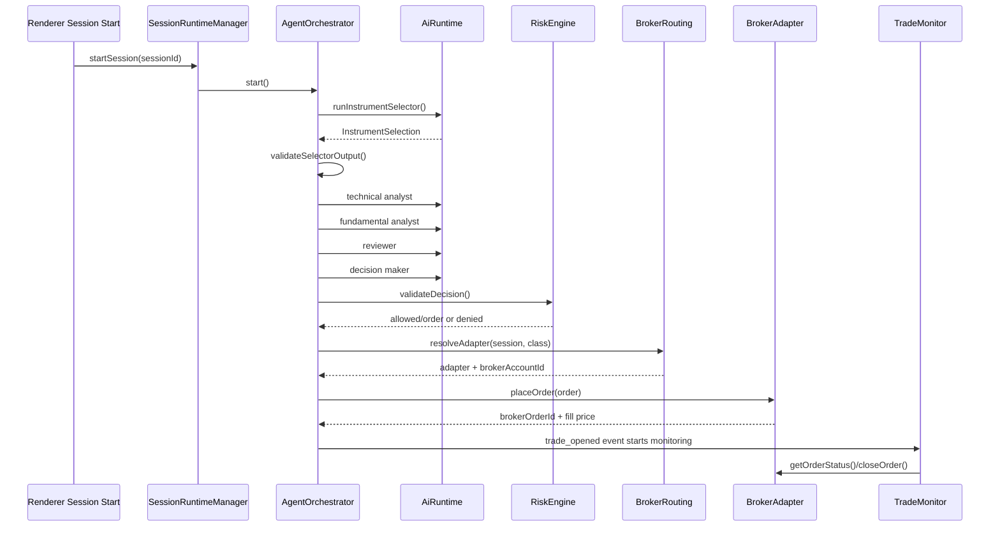
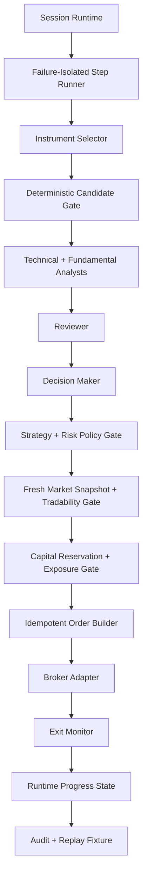

# Agent Execution Production Readiness - Deep Plan

> **Date:** 2026-05-12
> **Status:** Draft
> **Owner:** Kenneth Atchon
> **Audience:** Engineers, reviewers, future maintainers
> **Scope:** End-to-end autonomous agent trading loop, selector flow, presets, mock market data, risk gates, execution safeguards, and production-readiness gaps

## 1. Executive Summary

Exva's core value is the autonomous execution loop: discover instruments, research them, make a trade/no-trade decision, run risk controls, route the order, monitor exits, and repeat without human input. The current codebase has the skeleton of that loop in place: `SessionRuntimeManager`, per-session `AgentOrchestrator`, AI role execution, selector tools, broker routing, preflight checks, `RiskEngine`, capital reservations, persisted agent traces, and a mock broker. That is meaningful progress.

The system is not production-ready. The `docs/hello.json` failure was a parser contract bug: the model called `submit_candidates` with valid arguments, but the provider trace recorded the terminal tool result as `null`; `parseInstrumentSelection()` only parsed `resultJson`, so it rejected a valid terminal action. That is fixed with a three-level fallback: `resultJson` → `argsJson` → `trace.assistantText`. The larger audit shows deeper gaps: missing pre-order price/size collars, weak post-trade stop enforcement, incomplete shared-capital reservation for no-approval autonomous trades (the entire reservation lifecycle is skipped, not just one step), unrealistic synthetic market data, mock broker that always produces positive PnL, a no-instrument retry timer that fires at 3 minutes while the user-visible message says 30, insufficient replay/backtest coverage, weak market-data freshness checks, Reddit API calls that will fail in production without authentication, and no live-readiness kill-switch protocol.

Industry guidance for automated trading emphasizes documented risk controls, credit/capital thresholds, erroneous-order prevention, restricted instrument checks, direct control of safeguards, regular review, software testing, validation, quick-disable mechanisms, post-deployment monitoring, and records of testing/remediation. Those expectations appear in SEC Market Access Rule 15c3-5 and FINRA algorithmic trading guidance. Even though Exva is a local retail desktop app rather than a broker-dealer market-access platform, these are the right benchmark for a system that can place orders autonomously. Sources: SEC 17 CFR 240.15c3-5 requires documented risk controls for financial and regulatory risks, credit/capital thresholds, erroneous-order controls, restricted access, post-trade reports, and regular reviews ([eCFR](https://www.ecfr.gov/current/title-17/chapter-II/part-240/section-240.15c3-5)); FINRA Regulatory Notice 15-09 recommends algorithmic trading controls across risk assessment, code development, testing, trading systems, compliance, quick disable, limited pilot rollout, monitoring, validation, and recordkeeping ([FINRA Notice 15-09](https://www.finra.org/rules-guidance/notices/15-09)).

No plan can make an AI trading system "actually make money" with certainty. The production target should be narrower and measurable: the system must avoid preventable catastrophic losses, prove it follows strategy and risk constraints, generate auditable decisions, survive provider/broker/data failures, and only graduate to live capital after paper trading and backtests show statistically credible performance. Profitability must be proven empirically per strategy, market regime, instrument class, and cost model; it cannot be assumed from agent reasoning.

## 2. Problem Statement

The app is breaking in the exact area that matters most: autonomous execution. The latest failure in `docs/hello.json` shows the selector successfully researching symbols and calling `submit_candidates`, then the runtime throwing `VALIDATION_FAILED`. That means a valid AI action was lost at the model-provider trace boundary and blocked session startup.

The deeper issue is that many production controls are still implicit or partial. `RiskEngine.validateDecision()` in `electron/main/services/risk/risk-engine.ts` checks: daily API spend, daily P&L, profit target, max concurrent trades, position size, prediction-market exposure, and confidence threshold (`waitForOpenThreshold`). It does not enforce price collars, slippage bounds, stale quote rejection, market-hours eligibility, side-bias compliance, stop/take-profit presence, duplicate order idempotency, total notional exposure by broker/account/instrument, or max order rate. `TradeMonitor` in `electron/main/services/orchestration/trade-monitor.ts` enforces max-hold days and prediction-market resolution/exposure, but it does not compute live stop-loss/take-profit triggers for stocks/crypto/futures — even though the `moderate` preset configures `stopLossType: "trailing_atr"` and `atrStopMultiplier: 2`, those values are never read by the monitor.

The mock data currently demonstrates happy-path trade generation but remains too toy-like for production rehearsal. `MockBrokerAdapter` in `electron/main/services/broker/adapters/mock-adapter.ts` produces deterministic trend-biased 30-bar daily OHLCV (not the 4h bars the default strategy expects), exposes no bid/ask/spread in `MarketSnapshot` (which only contains `price` and `timestamp`), and always returns hardcoded positive PnL on close (`price * 0.002`). Mock Reddit posts are hardcoded to three permanently bullish positions (NVDA/PLTR/SOL). Mock trending symbols are hardcoded to NVDA/PLTR/TSLA. Mock news is scenario-aware (4 bias variants in `MOCK_NEWS_BY_SCENARIO`) but uses the same 3 template headlines per bias regardless of symbol. There is no simulation of gaps, halts, partial fills, rejected orders, market closures, rate limits, stale data, corporate actions, borrow constraints, or exchange-specific behavior. The live Reddit search path calls `www.reddit.com/r/{subs}/search.json` without authentication — a request that will fail in production since Reddit deprecated unauthenticated API access in June 2023.

The current implementation also overweights AI reasoning relative to deterministic controls. OWASP's LLM security guidance calls out prompt injection, insecure output handling, excessive agency, and overreliance as core LLM application risks ([OWASP LLM Top 10](https://owasp.org/www-project-top-10-for-large-language-model-applications/)). Exva has schema validation and role-specific tool policies, but still needs stronger separation between untrusted market/social content and privileged tool instructions, deterministic policy checks after every AI decision, and replayable evidence for why each trade was allowed.

## 3. Goals, Non-Goals, and Invariants

### Goals

| # | Goal | Success Looks Like |
|---|------|--------------------|
| G1 | Fix current selector crash | `docs/hello.json`-style terminal tool calls parse from `argsJson` when `resultJson` is `null`; regression test covers it. Done. |
| G2 | Make execution loop deterministic at safety boundaries | The AI can propose; deterministic code decides whether orders are legally placeable under risk, broker, instrument, data freshness, and session constraints. |
| G3 | Make mock mode production-like | Mock broker/data can simulate trend, mean-reversion, volatility spikes, stale data, gaps, rejected orders, partial fills, slippage, spreads, outages, and bad news; losing scenarios are represented. |
| G4 | Prove autonomous operation without human input | A no-approval paper session can run selector → analysts → reviewer → decision → risk → broker → monitor → close → next cycle repeatedly with no manual intervention. |
| G5 | Prove safeguards work | Tests and scenario replays show daily loss, max notional, max concurrent trades, price collars, stale data, duplicate orders, and emergency stop all block execution. |
| G6 | Make profitability testable, not assumed | Backtest/paper-trade reports include win rate, expectancy, max drawdown, Sharpe-like risk-adjusted return, average slippage, AI/data costs, and decision rejection reasons. |
| G7 | Make every cycle auditable | Each cycle has a single `cycleId`, full prompt/tool/decision trace, market-data snapshot, risk-decision record, broker order record, and replay fixture. |

### Non-Goals

| # | Non-Goal | Why It Is Out Of Scope |
|---|----------|------------------------|
| N1 | Guaranteeing profits | Profitability requires empirical evidence; live market uncertainty cannot be eliminated. |
| N2 | High-frequency trading | Current architecture is Electron/local SQLite/LLM-driven and fits swing/paper/live retail workflows, not microsecond trading. |
| N3 | Becoming a regulated broker control system | Exva should borrow safety patterns from SEC/FINRA guidance, but it is not implementing broker-dealer compliance infrastructure. |
| N4 | Replacing all AI decisions with deterministic strategies | The app's product thesis is AI-assisted decisioning; deterministic code should guard, not eliminate, AI proposals. |
| N5 | Live trading before paper proof | Live order placement should remain gated until paper scenarios and safeguards pass. |

### Invariants

| # | Invariant | Why It Must Hold |
|---|-----------|------------------|
| I1 | Broker credentials stay outside the DB | Existing keychain boundary is a core desktop security requirement. |
| I2 | AI output never directly bypasses deterministic risk checks | LLM excessive agency and overreliance are known LLM app risks ([OWASP](https://owasp.org/www-project-top-10-for-large-language-model-applications/)). |
| I3 | Paper/mock and live modes remain explicitly separated | Live capital cannot share ambiguous mock behavior or synthetic assumptions. |
| I4 | Every autonomous order has an audit trail | Automated trading guidance emphasizes documented controls, testing, monitoring, and review ([FINRA Notice 15-09](https://www.finra.org/rules-guidance/notices/15-09)). |
| I5 | Pausing/stopping must prevent new orders | A quick-disable mechanism is a recommended control for algorithmic systems ([FINRA Notice 15-09](https://www.finra.org/rules-guidance/notices/15-09)). Note: stopping prevents new orders but does not close existing positions — see H8. |
| I6 | No hidden fallback to live execution | Missing routing/config must fail closed, not silently choose a broker. |

## 4. Current State

### 4.1 Component Map

| Area | Current Files | Responsibility |
|------|---------------|----------------|
| Runtime ownership | `electron/main/services/session/session-runtime-manager.ts`, `session-runtime.ts` | Creates one runtime per active/paused session, owns orchestrator and monitor, pauses active sessions on startup rehydration. |
| Orchestration | `electron/main/services/orchestration/agent-orchestrator.ts` | Selector, cache, AI pipeline, risk, approval, broker routing, order placement, cycle restart. Selector retry fires after `NO_INSTRUMENT_RETRY_MS = 3 * 60 * 1000` (3 min). |
| Research burst | `electron/main/services/orchestration/research-burst-service.ts`, `market-hours-service.ts` | Resolves selected instruments then filters tradability via `MarketHoursService.filterTradable()`. |
| AI runtime | `electron/main/services/ai/ai-runtime/runtime.ts`, `adapters/run-agent-execute.ts`, `harness-tools.ts` | Builds prompt packs/tools, calls provider adapters, stores traces, parses role outputs. Forces `search_web` as step 0 tool via `prepareStep` when search provider is available. |
| Selector parser | `electron/main/services/ai/ai-runtime/instrument-selection-parser.ts` | Parses selector terminal output. Three-level fallback: `resultJson` → `argsJson` → `trace.assistantText`. |
| Risk | `electron/main/services/risk/risk-engine.ts`, `capital-reservation-service.ts` | Session and order gating, shared pool reservations. Capital reservation only runs in the `humanApprovalRequired` path; no-approval sessions skip all reservation steps. |
| Broker | `electron/main/services/broker/broker-routing-service.ts`, `broker-registry.ts`, adapters | Resolve account by session/instrument class and place/close/get status. Instrument conflict check is intra-session only (`checkInstrumentConflict(brokerAccountId, symbol, sessionId)`). |
| Mock data | `electron/main/services/broker/adapters/mock-adapter.ts`, `electron/main/services/ai/tools/market-tools.ts`, `search-reddit-tool.ts`, `trending-symbols-tool.ts` | Synthetic OHLCV/quote/news/social/trending data. See Section 4.2 for detailed mock limitations. |
| Strategy/presets | `electron/shared/domain.ts`, `electron/shared/presets.ts`, `electron/main/services/session/session-strategy-context-service.ts` | Research style, trade rules, risk profile, timeframe, prompt context. |
| Post-trade analysis | `electron/main/services/orchestration/trade-autopsy-service.ts` | AI-generated trade summaries using `claude-haiku-4-5-20251001` against persisted agent messages and final PnL. |

### 4.2 Execution Flow Today



The flow is structurally correct for a local autonomous agent. The main weaknesses are that many boxes trust upstream data too much, capital reservation is gated on human approval, and the monitor does not enforce stop/take-profit rules.

### 4.3 Current Mock Data Limitations

| Data Source | Mock Implementation | Limitation |
|-------------|---------------------|------------|
| OHLCV | `MockBrokerAdapter.getMockOhlcv()` — 30 daily bars using seeded LCG noise | Hard-coded daily bars only; no 4h/1h support; description says "up to 200" but only 30 are generated |
| Quote | `MockBrokerAdapter.getMarketSnapshot()` — price seeded from symbol chars | `MarketSnapshot` type has no `bid`/`ask`/`spread` fields; no staleness simulation |
| Close PnL | `MockBrokerAdapter.closeOrder()` — returns `price * 0.002` | Always positive; mock sessions can never simulate a losing trade |
| Market news | `MOCK_NEWS_BY_SCENARIO` — 3 template headlines per bias (bullish/bearish/sideways/volatile) | Templates are generic (`{symbol} breaking out`) — same 3 headlines per bias regardless of symbol or catalyst |
| Reddit posts | `MOCK_REDDIT_POSTS` — 3 hardcoded entries | Always NVDA/PLTR/SOL in bullish framing; no query-specific or bearish/neutral posts |
| Trending symbols | `MOCK_TRENDING_SYMBOLS` — 3 hardcoded entries | Always NVDA/PLTR/TSLA; sentiment and volumes never change |
| Reddit (live) | `search-reddit-tool.ts` calls `www.reddit.com/r/{subs}/search.json` | Reddit deprecated unauthenticated API access June 2023; live calls will fail with 403 or 429 |
| Synthetic OHLCV fallback | `buildSyntheticBars()` in `market-tools.ts` | Produces 30 daily bars trending downward toward the spot price (drift goes back in time); biases technical analysis bearish |

### 4.4 Current Selector Failure Root Cause (Fixed)

`docs/hello.json` shows `submit_candidates` called at step 6 with two instruments in `toolArgs`, then `toolResult: null`, then `parseInstrumentSelection()` throws because it parsed `tc.resultJson` only.

Fix applied in `electron/main/services/ai/ai-runtime/instrument-selection-parser.ts`: the parser now tries three sources in order for each `submit_candidates` call:
1. `tc.resultJson` — standard provider output
2. `tc.argsJson` — terminal tool args when result is null (the `docs/hello.json` case)
3. `trace.assistantText` — final fallback if no `submit_candidates` tool call is found in the trace at all

Malformed JSON at any level is silently skipped; the parser fails closed if no valid terminal payload exists anywhere.

### 4.5 Current Preset Configuration

| Preset Layer | Current Default | Strength | Weakness |
|--------------|-----------------|----------|----------|
| Global preset | `Trend Momentum` (`trend_momentum` in `presets.ts`) | Coherent style/rules/risk/timeframe bundle. | Default risk is `moderate` which has `humanApprovalRequired: false`, so live readiness needs stronger deterministic gates first. |
| Research style | `trend_hunt` | Discovery is price-action first with catalysts preferred. | No hard minimum for liquidity, spread, volatility regime, market cap, or source quality. |
| Trade rules | `breakout_long` | Clear long-only breakout mechanics. | Side bias is not deterministically enforced after decision output — `createTradeFromDecision()` defaults `side` to `"BUY"` when the model omits it. |
| Risk | `moderate` — `maxPositionUsd: 500`, `maxConcurrentTrades: 3`, `waitForOpenThreshold: 0.8`, `stopLossType: "trailing_atr"`, `atrStopMultiplier: 2`, `humanApprovalRequired: false` | Caps position size, limits concurrency, requires confidence ≥ 0.8. | `stopLossType`/`atrStopMultiplier` values are read during sizing but **never enforced by `TradeMonitor`** (C3). No price collar, slippage cap, stale data rejection, total broker exposure cap, or mandatory stop/take-profit enforcement. |
| Timeframe | `swing` — `primaryTradingTimeframe: "4h"`, `targetHoldDays: 3–14`, `holdingStyle: "multi_day_swing"` | 4h/multi-day target; monitor polls every 60 seconds for this holding style. | Market tools return daily bars in mock mode (`timeframe: "1d"`); prompt says 4h but data is 1d. |

### 4.6 Current Safeguards That Exist

| Safeguard | Current Implementation | Status |
|-----------|------------------------|--------|
| Session preflight | Provider credentials, broker reachability (`broker-reachability-check.ts`), capital pool, selector config, instrument conflict, task boundary. | Useful baseline. |
| Startup resume gate | Active sessions rehydrate as paused in `SessionRuntimeManager.rehydrateFromDb()`. | Good safety default. |
| AI spend guard | `checkStats()` in `RiskEngine` checks `daily_api_spend >= config.max_api_spend_usd`. | Partial; total data/search spend is separately tracked via `ApiCallLogRepo` but not folded into the API spend gate. |
| Selector first search | `prepareStep` forces `search_web` as the first tool call (step 0) when a search provider is available. | Good for discovery. |
| Selector validation | `validateSelectorOutput()` requires: non-empty symbol, enabled instrument class, non-empty rationale, successful `get_quote` call, discovery evidence (symbol-specific news or any web search), strategy non-contradiction via regex on rationale text. | Good but see M3 — any web search counts as discovery evidence even if not symbol-specific. |
| Risk decision | Checks stats (API spend, daily P&L, profit target), position size cap, concurrent trade cap, prediction-market exposure cap, confidence threshold. | Partial — no side bias, price collar, stale data, or idempotency checks. |
| Broker conflict | `checkInstrumentConflict(brokerAccountId, symbol, sessionId)` checks same broker+symbol within the same session only. | Intra-session only; cross-session conflicts on the same broker account are not detected. |
| Human approvals | Optional persisted approval records and recheck path via `runApprovalRecheck()`. | Good for HITL mode; no-approval mode skips all capital reservation (see C4). |
| Trade monitor | Polls open trades. Interval: `intraday_flat` = 5s, `multi_day_swing` = 60s, `weeks_position`/`custom` = 300s. Enforces `maxHoldDays` and prediction-market resolution/exposure. | Partial; lacks stop-loss, trailing-ATR, take-profit, and slippage exits despite these being configured in presets. |

## 5. Production Readiness Findings

### Critical Findings

| # | Finding | Evidence | Impact | Required Fix |
|---|---------|----------|--------|--------------|
| C1 | Terminal selector parser rejected valid tool calls | `parseInstrumentSelection()` parsed only `resultJson`; `docs/hello.json` had valid `toolArgs` and `toolResult: null`. | Session startup fails even after valid selector completion. | **Fixed**: three-level fallback now in `instrument-selection-parser.ts`. Regression test added. |
| C2 | No deterministic pre-order price/slippage collar | `RiskEngine.validateDecision()` receives no quote price, bid/ask, or expected fill. `DecisionRiskInput` type has no price fields. | AI can place orders at bad/stale prices or during gaps. | Add quote snapshot to `DecisionRiskInput`; add price collar and max slippage check before `placeOrder()`. |
| C3 | Stop loss/take profit are config fields, not enforced exits | `TradeMonitor.tick()` calls only `enforceMaxHoldDays()` and `enforcePredictionMarketPolicy()`. `moderate` preset sets `stopLossType: "trailing_atr"` and `atrStopMultiplier: 2` but nothing reads these at runtime. | Open positions sit through stop levels in autonomous mode. | Add `ExitPolicyEvaluator` inside `TradeMonitor.tick()`: reads `stopLossType`, `stopLossPct`, `atrStopMultiplier` from strategy context and computes exit trigger against current price. |
| C4 | Shared global pool reservation is skipped entirely for no-approval trades | In `runTradeCycle()`, `reserveForApproval()` and `convertOrderToPosition()` are both inside the `if (config.human_approval_required)` branch. No-approval sessions call neither. | Sessions with `humanApprovalRequired: false` (e.g. `moderate`, `aggressive` presets) can exceed the global pool. | Move capital reservation before `placeRoutedOrder()`; decouple from approval ID; add order-level reservation lifecycle that works without human approval. |
| C5 | Mock data is not close enough to real execution | `closeOrder()` returns `price * 0.002` (always positive); no bid/ask in `MarketSnapshot`; Reddit live calls fail unauthenticated; synthetic OHLCV is daily-only. | Paper testing gives false confidence. | Build scenario-based market simulator; fix `closeOrder()` PnL; add bid/ask to quote type; add Reddit OAuth or flag as unsupported in live mode. |
| C6 | No profitability proof loop | No backtest/replay harness around complete agent cycle. | Cannot distinguish promising strategy from prompt luck. | Add deterministic replay fixtures, paper-trade scorecards, and promotion criteria. |

### High Findings

| # | Finding | Evidence | Impact | Required Fix |
|---|---------|----------|--------|--------------|
| H1 | Side bias not deterministically enforced after decision | `createTradeFromDecision()` at line 758 of `agent-orchestrator.ts`: `side: decision.side ?? "BUY"`. Risk engine never checks decision side against `strategy.rules.sideBias`. | Strategy can drift from configured rules if model outputs wrong side. | Add `validateStrategyCompliance()` after decision parse; reject if `side` contradicts `sideBias`. |
| H2 | Data freshness is not enforced | `MarketSnapshot` has a `timestamp` field but `RiskEngine` never checks quote age against a max-age threshold. | Trades can execute on old prices/news. | Add `maxQuoteAgeMs` per instrument class and timeframe; reject if `Date.now() - new Date(snapshot.timestamp).getTime() > maxQuoteAgeMs`. |
| H3 | AI selector cache can reuse stale instruments until definition hash changes | `instrumentCacheRepo.get(session.id)` is only invalidated when `definitionHash` changes. Hash is derived from session/strategy definition, not from market data or time. | Old candidates can be traded after market regime changes, session resume, or market open. | Add TTL field to `instrument_cache`; invalidate on session resume, market open, or when cache age exceeds strategy timeframe window. |
| H4 | Market-hours handling is too thin for production | `ResearchBurstService.resolve()` calls `MarketHoursService.filterTradable()` once during instrument resolution, but there is no just-in-time check before `placeRoutedOrder()`. | Race between filter and order can place after market state changes. | Add final tradability check immediately before broker route in `placeRoutedOrder()`. |
| H5 | Analyst pipeline is sequential and expensive without early deterministic filters | `runTradeCycle()` calls technical/fundamental/reviewer/decision for every instrument that passes selector validation, regardless of liquidity or spread. | Higher AI cost and poorer trade quality for instruments that a simple threshold would reject. | Add deterministic candidate scorer after `validateSelectorOutput()` and before `runAiPipeline()`. |
| H6 | Prompt-injection risk from web/Reddit/news content | `search-reddit-tool.ts` returns raw post body truncated to 1200 chars; `fetch-url-tool.ts` returns raw page content. Both flow directly into agent context. The Reddit tool does add `note: "External content; extract instrument names, catalysts, and theses only."` but this is advisory, not enforced. | External pages/posts can inject instructions into agent context. | Strip HTML, inject stronger role-framing boundaries around untrusted content blocks, and require citation/evidence mapping before tool results affect tool calls. |
| H7 | Order idempotency is not explicit | `placeRoutedOrder()` has no client order ID. On crash/retry, the same instrument cycle can re-enter the queue and place a second order. | Retries or crashes can duplicate orders at the broker. | Add `cycleId + tradeId` as client order ID header in broker adapter calls; implement de-dupe check before placing. |
| H8 | No emergency stop protocol closes or cancels safely | `AgentOrchestrator.stop()` clears the p-queue, detaches the trade-closed listener, and releases approval capital. It does not call `closeOrder()` on any open positions. | User may think stop means risk is neutralized when positions remain open and unmonitored. | Add explicit stop modes: `stop_new_orders` (current behavior), `cancel_pending`, `flatten_all_paper`, `flatten_all_live_confirmed`. Document which mode fires on which user action. |

### Medium Findings

| # | Finding | Evidence | Impact | Required Fix |
|---|---------|----------|--------|--------------|
| M1 | Mock Reddit and trending data are static; mock news is scenario-aware but generic | `MOCK_REDDIT_POSTS` (3 bullish entries: NVDA/PLTR/SOL), `MOCK_TRENDING_SYMBOLS` (3 entries: NVDA/PLTR/TSLA) are hardcoded. `MOCK_NEWS_BY_SCENARIO` has 4 bias variants but 3 identical template strings per bias that do not vary by symbol. | Selector always receives the same bullish signal regardless of configured session or scenario. | Add scenario-specific Reddit/trending fixtures with conflicting and bearish cases; make news templates symbol- and catalyst-specific. |
| M2 | Mock OHLCV is daily while default strategy asks for 4h | `getMockOhlcv()` spaces bars by `DAY_MS`; `get_ohlcv` tool returns `timeframe: "1d"`. `buildSyntheticBars()` also produces daily bars. Swing preset specifies `primaryTradingTimeframe: "4h"`. | AI reasons on the wrong time horizon; technical patterns computed on 1d bars will differ from 4h. | Add `timeframe` parameter to `get_ohlcv` tool input schema; generate intraday bars using sub-day intervals. |
| M3 | Research evidence validation treats any web search as symbol-specific discovery | `hasDiscoveryEvidence()` returns true if `hadSearch` (any `search_web` call exists), even if no news-specific `get_news` call matched the symbol. | A generic market-overview search satisfies evidence without any symbol-specific result. | Require either a successful `get_news` call with `args.symbol === instrument.symbol`, or a `search_web` call whose result references the symbol's ticker in the returned text. |
| M4 | No minimum liquidity/spread/volume gates | Neither `validateSelectorOutput()` nor `RiskEngine` computes liquidity thresholds. The mock `MarketSnapshot` has no bid/ask/spread fields. | Trades can select illiquid instruments; there is no enforcement mechanism even if thresholds were configured. | Add `bid`, `ask`, `spreadPct`, and `volume` to `MarketSnapshot`; add per-class liquidity policy checked in candidate gate. |
| M5 | No model-quality acceptance tests | Tests cover parsing/prompt mechanics, not agent decision quality under scenarios. | Model regressions or prompt changes are invisible until a live session fails. | Add golden scenario evals with expected no-trade/trade ranges over a fixed set of market scenarios. |
| M6 | Logs contain full prompts/tool results, but no red-team replay suite | Observability improved, but traces are not converted into replay fixtures automatically. | Debugging remains manual; a failing scenario discovered in production cannot be easily reproduced in CI. | Add "save cycle as fixture" and deterministic replay runner. |
| M7 | Runtime errors can crash the whole execution loop | `AgentOrchestrator.start()` rethrows selector failures as `AppError("VALIDATION_FAILED")`. Errors in `enqueueTradeCycles()` are only logged — session remains technically running but produces no new cycles. | A single provider/parser/tool/broker error can make further autonomous execution impossible until manual restart. | Add failure-isolated execution steps with persisted retry state, backoff, and user retry controls (see Section 10.4). |
| M8 | Session cards do not show live execution progress | `src/components/sessions/SessionTable.tsx` renders the `focused` badge, uptime metric, and lifecycle action buttons. No current AI stage or stuck/error state is surfaced. | Users cannot tell whether the selector, analysts, reviewer, decision maker, risk gate, broker, or monitor is currently active. | Add session-stage progress model, progress bar, active role chips, retry/error badge, and drill-in controls (see Section 10.5). |
| M9 | No-instrument retry message is wrong | `NO_INSTRUMENT_RETRY_MS = 3 * 60 * 1000` (line 51 of `agent-orchestrator.ts`) fires after 3 minutes, but the emitted user-visible event message reads "Re-evaluating in 30 minutes." | Users wait for activity that already happened; support confusion. | Either change the constant to `30 * 60 * 1000` or change the message to "Re-evaluating in 3 minutes" — pick one and make them match. |

## 6. Desired End State

The target architecture keeps the current local-first Electron app, SQLite persistence, per-session runtime manager, and broker adapters. The change is to promote deterministic execution controls to first-class components around the AI pipeline.



The AI remains responsible for hypothesis generation and qualitative judgment. Deterministic code owns all irreversible actions: whether the instrument is tradable, whether the order fits strategy, whether current market data is fresh, whether capital is available, whether price/slippage is acceptable, whether a duplicate order exists, and whether the trade must be closed. Runtime errors must fail the current step loudly, persist a retryable failure record, and leave the session runtime alive unless the user explicitly stops it or a fatal safety condition is reached.

## 7. Gap Analysis

| Area | Current State | Target State | Required Change |
|------|---------------|--------------|-----------------|
| Selector parsing | Three-level fallback (resultJson → argsJson → assistantText) | Same, now documented and tested | Done. |
| Candidate validation | Rationale, class, quote, broad-search discovery, side-word check | Symbol-specific evidence, liquidity, volatility, source quality, freshness | Add `CandidateValidationService`. |
| Risk engine | Size/concurrency/confidence/session stats | Full pre-order risk policy | Expand `DecisionRiskInput` to include quote, spread, slippage, exposure, side bias, stop contract. |
| Capital reservation | Approval-centric (entirely skipped for no-approval sessions) | Every autonomous order reserves capital atomically before broker call | Decouple reservation from approval ID; add order-level reservation lifecycle. |
| Broker order | Basic place order, no client order ID | Idempotent order with `cycleId+tradeId` client key and accepted/rejected lifecycle | Extend `BrokerOrder`/adapters with `clientOrderId` field. |
| Exit monitor | Broker status + max hold + prediction policy | Stop-loss, trailing ATR, take-profit, time-based, stale broker status | Add `ExitPolicyEvaluator` inside `TradeMonitor`. |
| Mock broker | Always-positive fills, no spread, no bid/ask | Scenario simulator with faults, spreads, fills, closures, losers | Replace hardcoded `price * 0.002` PnL; add bid/ask to `MarketSnapshot`; add failure injection. |
| Mock data | Static Reddit/trending; generic scenario news; daily-only OHLCV | Scenario packs with realistic conflicting evidence and intraday bars | Add fixtures and generators; add `timeframe` input to `get_ohlcv`. |
| Reddit live mode | Unauthenticated fetch, will fail in production | Either authenticated OAuth flow or flagged as unsupported | Add auth or add explicit `NOT_SUPPORTED_IN_LIVE_MODE` guard. |
| No-instrument retry | Timer = 3 min, message = 30 min (mismatch) | Timer and message agree | Fix the constant or the message string. |
| Backtesting | None | Replay complete cycles and market timelines | Add replay harness and scorecards. |
| Live readiness | No explicit gate | Paper-only until checklist passes | Add `LiveReadinessService`. |
| Error handling | Errors bubble through runtime start or queue callbacks | Step-level failed state with retry/backoff and continued loop availability | Add `ExecutionStepRunner` and persisted `session_execution_steps`. |
| Session observability | Status badge + uptime/trade metrics only | Stage progress bar, active AI role, cycle ID, last error, retry CTA, drill-in trace | Add runtime progress events and `SessionTable` card UI. |

## 8. Options Considered

### Option A: Patch Bugs Only

| Dimension | Assessment |
|-----------|------------|
| Build complexity | Low. |
| Migration risk | Low. |
| Runtime risk | High because missing safeguards remain. |
| Reversibility | High. |
| Team fit | Good for short-term unblock only. |
| Testability | Limited. |
| Maintainability | Poor because incidents continue as one-off fixes. |

This option is insufficient. It fixes `docs/hello.json` and M9 but does not make the autonomous loop safe or production-like.

### Option B: Deterministic Guardrail Layer Around Current AI Pipeline

| Dimension | Assessment |
|-----------|------------|
| Build complexity | Medium. |
| Migration risk | Medium; mostly additive services and tests. |
| Runtime risk | Much lower because AI proposals are gated. |
| Reversibility | Good if feature-flagged/paper-first. |
| Team fit | Best fit for current codebase. |
| Testability | High with scenario fixtures. |
| Maintainability | Good; separates AI judgment from hard controls. |

This is the recommended path. It preserves the current app architecture and adds the controls expected of autonomous order systems.

### Option C: Build Full Backtesting/Research Platform First

| Dimension | Assessment |
|-----------|------------|
| Build complexity | High. |
| Migration risk | Medium. |
| Runtime risk | Lower long-term, but delayed safety fixes. |
| Reversibility | Medium. |
| Team fit | Too broad for current break/fix urgency. |
| Testability | Excellent after completion. |
| Maintainability | Good but costly. |

This is valuable but should follow the immediate guardrail and simulator work. Building a full platform before fixing order safety delays the most important risk reduction.

## 9. Recommendation

Adopt Option B: add deterministic guardrails and realistic simulation around the existing execution loop, then build replay/backtest scorecards as the graduation path to live trading.

This wins over bug-only work because the app's core promise is autonomous action with real financial downside. It wins over a full platform rewrite because the current architecture is serviceable and already contains the right seams: `AgentOrchestrator`, `RiskEngine`, broker adapters, `TradeMonitor`, and persisted traces.

The recommendation depends on one assumption: Exva is targeting retail swing/paper/live automation, not high-frequency trading. If that assumption changes, Electron/local SQLite/LLM-driven execution is the wrong architecture.

## 10. Detailed Design

### 10.1 New Services

```text
electron/main/services/orchestration/
  execution-step-runner.ts
  runtime-progress-service.ts
  candidate-validation-service.ts
  order-policy-gate.ts
  cycle-replay-service.ts

electron/main/services/risk/
  market-risk-policy.ts
  exit-policy-evaluator.ts
  exposure-policy.ts

electron/main/services/broker/mock/
  mock-market-simulator.ts
  mock-scenario-fixtures.ts
  mock-execution-faults.ts

src/components/sessions/
  SessionExecutionProgress.tsx
```

### 10.2 Candidate Validation Contract

```ts
interface CandidateValidationInput {
  sessionId: string;
  cycleId: string;
  instrument: ResolvedInstrument;
  strategy: SessionStrategyContext;
  selectorTrace: ToolStepTrace[];
  now: string;
}

interface CandidateValidationResult {
  allowed: boolean;
  reasons: string[];
  evidence: Array<{ source: string; symbolMatched: boolean; publishedAt?: string }>;
  marketSnapshot?: {
    price: number;
    bid?: number;
    ask?: number;
    spreadPct?: number;
    volume?: number;
    timestamp: string;
    stale: boolean;
  };
}
```

Rules must include: symbol-specific evidence (not just `hadSearch`), enabled class, broker route availability, quote success, freshness (quote age < max threshold per class/timeframe), liquidity (volume > minimum for class), spread (spreadPct < maximum for class), volatility regime, and strategy compatibility.

### 10.3 Order Policy Gate

Before `placeRoutedOrder()` in `AgentOrchestrator`, require all of:

| Gate | Required Check |
|------|----------------|
| Runtime | Session status still active; no stop requested. |
| Strategy | Decision `side` matches `sideBias` in `strategy.rules`; setup type matches allowed decision metadata. |
| Data | Quote `timestamp` age < max-age threshold (e.g. 60s for intraday, 300s for swing). OHLCV timeframe matches session or accepted fallback. |
| Price | Expected fill within ±N% collar of last quote price (e.g. ±2% for stocks); max spread below threshold (e.g. 0.5% for stocks). |
| Capital | Session cap, global cap (`shared_global_pool`), per-broker exposure, per-instrument exposure. Must pass even when `humanApprovalRequired: false`. |
| Broker | Broker supports instrument class, account mode matches session mode (paper vs. live), market is open/tradable. |
| Idempotency | No existing open or pending order for the same `cycleId + tradeId + brokerAccountId`. |
| Exit contract | Trade has an enforceable exit policy (at least one of: `stopLossPct`, `atrStopMultiplier`, `takeProfitPct`, `maxHoldDays`) before order is sent. |

### 10.4 Failure-Isolated Step Runner

The orchestrator should stop treating the full cycle as one large failure domain. Each execution stage must run as a named step with a durable status and retry policy. A selector provider failure should fail `selector`, not crash the runtime manager or make future session execution impossible.

```ts
type ExecutionStage =
  | "selector"
  | "candidate_validation"
  | "analyst_technical"
  | "analyst_fundamental"
  | "reviewer"
  | "decision_maker"
  | "risk_gate"
  | "broker_order"
  | "monitoring";

type ExecutionStepStatus = "pending" | "running" | "succeeded" | "failed" | "retrying" | "skipped";

interface ExecutionStepState {
  sessionId: string;
  cycleId: string;
  stage: ExecutionStage;
  status: ExecutionStepStatus;
  attempt: number;
  startedAt: string | null;
  completedAt: string | null;
  nextRetryAt: string | null;
  lastErrorCode: string | null;
  lastErrorMessage: string | null;
  retryable: boolean;
}
```

Rules:

| Rule | Behavior |
|------|----------|
| Step failure | Persist failed step, emit progress event, leave runtime alive. |
| Retryable failures | Provider/search/broker transient errors: exponential backoff with jitter, max 3 attempts. Starting intervals: 30s, 90s, 270s. |
| Non-retryable failures | Validation/policy failures (wrong class, risk rejected, config error): mark session as `attention_required`, not crashed. |
| User retry | User can retry the failed stage from the session card. IPC action: `session:retryStep`. |
| User skip | Only allowed for non-critical research stages (e.g. `analyst_technical` empty output); never for `risk_gate` or `broker_order`. |
| Fatal safety failure | Stop new orders, keep observability alive, preserve open-position monitoring unless user explicitly confirms stop. |

Persist this in a new `session_execution_steps` table with `cycleId`, `stage`, `status`, `attempt`, `nextRetryAt`, `lastErrorCode`, and `lastErrorMessage`. Prefer the table because the UI needs a cheap latest-state query for all session cards.

New IPC actions required: `session:getExecutionProgress`, `session:retryStep`, `session:pauseAfterCurrentStep`, `session:clearFailedStep`.

### 10.5 Session Card Progress and Observability

The Sessions page should show the execution loop as a live rail inside each session card. The existing `SessionTable.tsx` card has name/objective, badges, metrics, meta strip, and lifecycle buttons. Add a compact progress strip between the top row and meta strip.

| Element | Behavior |
|---------|----------|
| Stage progress bar | Shows percent through current cycle: selector → validation → technical → fundamental → reviewer → decision → risk → broker → monitoring. |
| Active AI chip | Shows currently running role/model, e.g. `technical analyst · gpt-4o-mini`. |
| Cycle ID short code | Shows `cycleId.slice(0, 8)` and links to DevPanel trace. |
| Last step status | Shows `running`, `retrying in 42s`, `failed`, `waiting for broker`, `monitoring open trade`. |
| Retry button | Visible on retryable failed stage. Calls `session:retryStep`. |
| Pause-after-step toggle | Lets the user pause after current step instead of immediately interrupting. |
| View trace button | Opens DevPanel filtered to current `sessionId/cycleId/stage`. |

The visual language should remain consistent with the current industrial/dark Exva cards. Avoid a playful wizard UI; this is operational telemetry for money-moving automation.

| Stage | Percent | User Label |
|-------|---------|------------|
| selector | 10 | Finding instruments |
| candidate_validation | 20 | Validating candidates |
| analyst_technical | 35 | Technical analyst |
| analyst_fundamental | 50 | Fundamental analyst |
| reviewer | 65 | Reviewing thesis |
| decision_maker | 78 | Making decision |
| risk_gate | 88 | Risk checks |
| broker_order | 96 | Broker execution |
| monitoring | 100 | Monitoring position |

### 10.6 Mock Market Simulator

Mock data must become scenario-driven and time-aware. The current `MockBrokerAdapter` must be supplemented (or replaced in paper mode) with a simulator that includes:

- Bid/ask/spread in `MarketSnapshot` (requires adding `bid`, `ask`, `spreadPct` fields to the type)
- Realistic PnL on close: entry price tracked per order, exit price determined by scenario progression
- Intraday bar generation (4h, 1h) with configurable intervals
- Scenario-specific news, Reddit posts, and trending data (not globally static)
- Fault injection: partial fill (fills 40–80% of requested size), order rejection, broker timeout, stale quote (timestamp 10+ minutes old)

```ts
type MockScenarioKind =
  | "clean_breakout"
  | "failed_breakout"
  | "sideways_chop"
  | "gap_down_after_entry"
  | "news_reversal"
  | "stale_quote"
  | "wide_spread"
  | "partial_fill"
  | "broker_reject"
  | "rate_limit";
```

Each scenario defines: quote stream, OHLCV bars by timeframe, news/social/trending payloads, broker fills/rejections, and expected policy outcome. Mock mode must include losing trades. A mock system that always trends upward and always produces positive PnL teaches nothing about robustness.

### 10.7 Profitability Evaluation

Add a paper/replay scorecard per strategy:

| Metric | Why It Matters |
|--------|----------------|
| Net P&L after AI/data costs | AI spend can erase small edges; current mock always returns `price * 0.002`. |
| Win rate and average win/loss | Shows expectancy, not just count of winners. |
| Max drawdown | Validates loss limits and psychological/financial survivability. |
| Profit factor | Gross wins divided by gross losses. |
| Trade frequency | Detects overtrading or undertrading. |
| Rejection reasons | Shows whether safety gates are too loose/tight. |
| Slippage/spread impact | Critical for real fills; currently zero in mock. |
| Regime split | Trend, chop, volatility, news shock. |

Promotion rule example: a strategy cannot be live-enabled until it passes at least 100 paper/replay cycles across 8 scenario classes, has no safeguard bypasses, has positive expectancy after costs, and has max drawdown under the configured loss limit.

## 11. Implementation Plan

### Phase 0: Immediate Selector Fix

**Done.** `instrument-selection-parser.ts` updated with three-level fallback. Regression test added in `__tests__/instrument-selection-parser.test.ts`.

Also fix M9: align `NO_INSTRUMENT_RETRY_MS` with the user-visible message in `handleResolvedInstruments()` at line 833 of `agent-orchestrator.ts`.

### Phase 1: Failure-Isolated Runtime Steps

Objective: errors fail the current step loudly without crashing the whole session event loop.

Changes:
- Add `ExecutionStepRunner` around selector, validation, analyst, reviewer, decision, risk, broker, and monitor handoff stages in `agent-orchestrator.ts`.
- Add `session_execution_steps` table with `cycleId`, `stage`, `status`, `attempt`, `nextRetryAt`, `lastErrorCode`, `lastErrorMessage`.
- Replace broad rethrows in `AgentOrchestrator.start()` with step failures that emit events and keep runtime status recoverable.
- Add retry policy: retryable provider/search/broker transient errors get exponential backoff (30s/90s/270s); validation/policy failures fail closed.
- Add IPC actions: `session:getExecutionProgress`, `session:retryStep`, `session:pauseAfterCurrentStep`, `session:clearFailedStep`.

Done criteria:
- A failing selector/provider/tool call marks only that stage failed and leaves the session visible/retryable.
- User can retry the failed stage without restarting the app.
- Open trade monitoring continues even when a new research cycle fails.

### Phase 2: Session Card Progress and Controls

Objective: expose the live execution loop in the Sessions UI.

Changes:
- Add `SessionExecutionProgress` component under `src/components/sessions/`.
- Insert between top row and meta strip in `SessionTable.tsx`.
- Subscribe Sessions page/store to progress events keyed by `sessionId + cycleId`.
- Show stage progress rail, active role/model, last step status, retry CTA, pause-after-step control, View Trace link.

Done criteria:
- Session card shows `Finding instruments`, `Retrying selector in 42s`, `Risk checks`, `Monitoring position` without opening DevPanel.
- Failed stages show an obvious but non-catastrophic state with Retry and View Trace actions.

### Phase 3: Deterministic Policy Gate

Objective: ensure AI decisions cannot directly create unsafe orders.

Changes:
- Add `OrderPolicyGate` service called before `placeRoutedOrder()` in `agent-orchestrator.ts`.
- Expand `DecisionRiskInput` to include quote timestamp, bid/ask, spread, slippage estimate, side, and exit policy.
- Enforce side bias check against `strategy.rules.sideBias`.
- Add final runtime-status and market-hours check immediately before broker routing.
- Fix M9: correct no-instrument retry timer/message mismatch.

Done criteria:
- Tests prove bad side, stale quote, wide spread, oversized exposure, missing exit policy, and paused runtime all reject.

### Phase 4: Capital Reservation for Full Autonomy

Objective: make no-human-approval sessions respect shared capital.

Changes:
- In `runTradeCycle()`, move capital reservation before `placeRoutedOrder()`, decoupled from `approvalIdForCapital`.
- Decouple `convertOrderToPosition()` from `approvalIdForCapital` check (currently at line 360 of `agent-orchestrator.ts`: `if (workspace.capitalAllocationMode === "shared_global_pool" && approvalIdForCapital)`).
- Convert reservation to position after successful broker order regardless of approval mode.
- Release reservation on broker reject, order cancel, trade close, runtime stop.

Done criteria:
- Two active `moderate` preset sessions (both `humanApprovalRequired: false`) cannot exceed shared global pool.

### Phase 5: Realistic Mock Simulator

Objective: make mock data close enough to real broker/data behavior to harden the loop.

Changes:
- Add `bid`, `ask`, `spreadPct` fields to `MarketSnapshot` in `broker-adapter.ts`.
- Fix `MockBrokerAdapter.closeOrder()` to compute PnL from entry price and direction instead of `price * 0.002`.
- Add intraday bar generation to `MockBrokerAdapter.getMockOhlcv()` with `timeframe` parameter.
- Add `timeframe` input parameter to `get_ohlcv` tool in `market-tools.ts`.
- Add scenario-specific Reddit fixtures keyed by `MockScenarioKind`.
- Fix `buildSyntheticBars()` drift direction (currently drifts down toward spot; should drift up).
- Add broker fault injection: partial fill, rejection, timeout, stale quote.
- Add Reddit live mode guard: if `!deps.mockPosts && isMockSession`, throw or return explicit `NOT_SUPPORTED` error instead of attempting unauthenticated fetch.

Done criteria:
- Scenario tests cover clean breakout, failed breakout, sideways no-trade, gap stop-out, broker reject, stale quote, wide spread, partial fill, losing trade.

### Phase 6: Exit Policy Enforcement

Objective: ensure open trades autonomously close according to configured rules.

Changes:
- Add `ExitPolicyEvaluator` called inside `TradeMonitor.tick()` after `enforceMaxHoldDays()`.
- Read `strategy.riskConfig.stopLossType`, `stopLossPct`, `atrStopMultiplier`, `takeProfitPct` from `SessionStrategyContextService`.
- For `fixed_pct`: exit if current price < `entry_price * (1 - stopLossPct / 100)`.
- For `trailing_atr`: compute ATR from OHLCV, trail stop by `atrStopMultiplier × ATR` from high-water-mark.
- Persist exit reason and market snapshot at close.

Done criteria:
- Mock scenarios trigger stop-loss, take-profit, trailing stop, max-hold, and event-resolution exits.

### Phase 7: Replay and Paper Scorecards

Objective: make profitability and safety measurable.

Changes:
- Add cycle replay fixture export from persisted traces.
- Add replay runner that executes without live providers.
- Add scorecard report per strategy/preset.

Done criteria:
- `Trend Momentum` can be evaluated across scenario suite with P&L, drawdown, rejection, cost, and latency metrics.

### Phase 8: Live Readiness Gate

Objective: prevent accidental live trading before proof.

Changes:
- Add `LiveReadinessService` that checks all required controls, broker permissions, paper pass criteria, emergency stop configuration, and acknowledgement.
- Keep live trading disabled until readiness is true.

Done criteria:
- Live start fails closed with explicit missing checklist items.

## 12. Testing and Verification Strategy

| Layer | Required Tests |
|-------|----------------|
| Parser | Terminal tool result null; args fallback; assistantText fallback; malformed args rejected; empty candidates accepted. |
| No-instrument retry | Timer constant matches the message string; retry fires at the documented interval. |
| Step runner | Selector/provider/broker errors mark only the current stage failed, keep runtime alive, schedule retry, and allow manual retry. |
| Progress UI | Session card renders each stage, retrying countdown, failed state, active role/model, and trace link for focused/draft/active/paused sessions. |
| Candidate gate | Missing rationale, stale quote, broad search-only evidence, wrong class, low liquidity, high spread. |
| Risk gate | Position cap, daily loss, profit target, confidence, side bias, max exposure, price collar. |
| Capital | Shared pool across sessions with and without approvals; no-approval sessions block when pool is exhausted. |
| Mock broker PnL | Losing trades produce negative `realizedPnlUsd`; partial fills produce fills < `sizeUsd`. |
| Broker mock | Fill, partial fill, rejection, stale status, close failure, rate limit. |
| Trade monitor | Stop loss, trailing ATR, take profit, max hold, prediction resolution. |
| Exit policy | `fixed_pct` triggers at correct price; `trailing_atr` trails correctly from high-water-mark. |
| End-to-end | Full no-human paper run through open/close/restart cycle with `moderate` preset. |
| Replay | Same fixture produces deterministic decisions and policy results. |

Verification commands:
```bash
bun run typecheck
bunx vitest electron/main/services/ai/ai-runtime/__tests__/instrument-selection-parser.test.ts
bunx vitest electron/main/services/orchestration/  # new suite per phase
```

## 13. Risks and Failure Modes

| # | Risk | Likelihood | Impact | Detection | Mitigation | Rollback |
|---|------|------------|--------|-----------|------------|----------|
| R1 | AI chooses a plausible but unsafe trade | High | High | Policy rejection logs | Deterministic policy gate | Disable live; paper only |
| R2 | Broker places duplicate orders after retry/crash | Medium | Critical | Duplicate broker order IDs or positions | `cycleId+tradeId` client order ID | Cancel duplicate; stop runtime |
| R3 | Mock mode overfits to happy-path data (always bullish, always profitable) | High | High | No losing trades in scorecard | Adversarial scenarios; fix `closeOrder()` PnL | Reset simulator defaults |
| R4 | Data stale but accepted | Medium | High | Quote age metric | Freshness gate with max-age per class/timeframe | Reject order |
| R5 | Stop loss not triggered | Medium | High | Open trade price violates stop threshold | Exit evaluator in `TradeMonitor.tick()` | Manual close / emergency stop |
| R6 | Shared pool exceeded by no-approval sessions | High (today) | High | Reservation sum > pool | Reserve all autonomous orders before broker call | Stop sessions, release reservations |
| R7 | Prompt injection through web/social content | Medium | Medium/High | Weird tool calls or instruction following from external content | Untrusted evidence wrappers and schema gates | Disable affected tool/provider |
| R8 | One failed step kills the whole loop | High (today) | High | Session stuck/error after one provider/tool exception | Failure-isolated step runner, persisted retry state | Retry failed step or pause session without app restart |
| R9 | User cannot see or control what the agents are doing | High (today) | Medium | Session card only shows lifecycle status, not stage | Progress rail, active role chip, retry CTA, View Trace | Fallback to existing DevPanel/event feed |
| R10 | Reddit live calls fail unauthenticated | Certain in production | Medium | 403/429 responses; selector has no discovery evidence | Mock guard for paper sessions; OAuth for live | Disable Reddit tool until authenticated |
| R11 | No-instrument retry misleads user (3 min timer, 30 min message) | Certain today | Low/Medium | User confusion, support inquiries | Fix constant or message to match | One-line fix in `agent-orchestrator.ts` |

## 14. Operational Rollout

1. Ship parser fix and M9 retry message fix immediately.
2. Ship failure-isolated step runner and session-card progress before deeper risk work, because every later safeguard needs recoverable execution and visible status.
3. Keep all new guardrails enabled in paper/mock first.
4. Add simulator scenarios and make them part of CI-style local verification.
5. Require paper scorecard before live toggle can be enabled.
6. For live rollout, start with: human approval required, one broker, one instrument class, one max open trade, small max position, and stop-new-orders emergency mode.
7. Only remove human approval after no-approval paper mode passes replay and paper metrics.

## 15. Open Questions

| # | Question | Why It Matters | Owner | Resolution Needed By |
|---|----------|----------------|-------|----------------------|
| Q1 | Which broker/instrument class is first real live target: Alpaca stocks, Coinbase crypto, futures, or Polymarket? | Determines market-hours, order types, quote schema (bid/ask availability), and risk gates. | Kenneth | Before Phase 3 final design. |
| Q2 | What paper performance threshold is enough to enable live mode? | Needed for `LiveReadinessService`. | Kenneth | Before Phase 7. |
| Q3 | Should live emergency stop flatten positions automatically or only stop new orders by default? | Auto-flatten can reduce risk or create unwanted realized losses. | Kenneth | Before Phase 6. |
| Q4 | What max slippage/spread thresholds should each preset use? | Required for price collars. Default suggestions: stocks 0.3%, crypto 0.8%, futures 0.2%. | Kenneth | Phase 3. |
| Q5 | Should no-instrument retry be 3 minutes or 30 minutes? | Current code = 3 min; current message = 30 min. One must change. | Kenneth | Phase 0 follow-up. |
| Q6 | Which failures are retryable automatically vs. require user review? | Prevents infinite retries for config/model-policy failures while allowing transient provider/broker recovery. | Kenneth | Phase 1. |
| Q7 | Should the session card show all historical stages or only the current/latest cycle? | Determines whether progress UI stays compact or becomes a mini timeline. | Kenneth | Phase 2. |
| Q8 | Should the Reddit tool require OAuth in live mode, or should it be disabled? | Reddit's unauthenticated JSON API is broken in production since June 2023. | Kenneth | Phase 5. |

## 16. Appendix: Industry Benchmark Summary

| Benchmark | Relevant Requirement | Exva Implication |
|-----------|----------------------|------------------|
| SEC Market Access Rule 15c3-5 | Pre-set credit/capital thresholds, erroneous-order prevention, regulatory controls, restricted access, post-trade reports, regular review. Source: [17 CFR 240.15c3-5](https://www.ecfr.gov/current/title-17/chapter-II/part-240/section-240.15c3-5). | Add capital/exposure gates, price collars, restricted instruments, reports, reviewable audit trail. |
| FINRA Regulatory Notice 15-09 | Risk assessment, change management, testing, validation, quick disable, pilot rollout, real-time monitoring, compliance communication. Source: [FINRA Notice 15-09](https://www.finra.org/rules-guidance/notices/15-09). | Add scenario tests, live readiness gate, emergency stop, paper pilot, scorecards. |
| OWASP LLM Top 10 | Prompt injection, insecure output handling, excessive agency, overreliance. Source: [OWASP LLM Top 10](https://owasp.org/www-project-top-10-for-large-language-model-applications/). | Treat external content as untrusted, validate AI outputs, keep deterministic policy gates. |

## 17. Appendix: Fixed Immediate Error

Changed files:
- `electron/main/services/ai/ai-runtime/instrument-selection-parser.ts`
- `electron/main/services/ai/ai-runtime/__tests__/instrument-selection-parser.test.ts`

Fix summary:

`submit_candidates` is a terminal tool. When a provider trace records the terminal action in `toolArgs` with a null `toolResult`, the original parser would throw. The fix adds a three-level fallback: for each `submit_candidates` call in chronological trace order, attempt to parse `tc.resultJson`, then `tc.argsJson`, then `trace.assistantText`. The first level that parses successfully against `instrumentSelectionSchema` is returned. Malformed JSON at any level is silently skipped. The parser fails closed (throws `AppError("VALIDATION_FAILED")`) only if no valid terminal payload is found anywhere in the trace.

The original two-level description (resultJson → argsJson) was incomplete. The third fallback (`assistantText`) handles providers that emit the final answer as plain text without using the tool call mechanism at all.

## 18. Appendix: Additional Code-Level Findings

These are concrete bugs or discrepancies found during codebase audit that are not covered elsewhere.

| # | File | Finding | Fix |
|---|------|---------|-----|
| A1 | `agent-orchestrator.ts` line 51 and 833 | `NO_INSTRUMENT_RETRY_MS = 3 * 60 * 1000` but emitted message says "Re-evaluating in 30 minutes." | Change constant to `30 * 60 * 1000` or change message to "in 3 minutes." |
| A2 | `mock-adapter.ts` `closeOrder()` | `realizedPnlUsd = price * 0.002` is always positive regardless of entry price, direction, or scenario. | Track entry price per order; compute PnL as `(closePrice - entryPrice) * sizeUsd / entryPrice` for longs, inverted for shorts. |
| A3 | `mock-adapter.ts` `getMockOhlcv()` | Returns 30 bars (hardcoded `barCount = 30`), but `get_ohlcv` tool description says "up to 200 daily bars." | Reconcile the cap; pass `barCount` through the tool input schema. |
| A4 | `market-tools.ts` `buildSyntheticBars()` | The synthetic OHLCV fallback drifts the price backward in time (close approaches spot from above), producing a downward-trending chart. | Reverse the drift direction: `close = spot * (1 + drift)` where `drift` increases with bar index. |
| A5 | `search-reddit-tool.ts` | Live path calls `www.reddit.com/r/{subs}/search.json` without authentication. Reddit deprecated unauthenticated API access June 2023; requests return 403 or 429. | Add OAuth bearer token support or add explicit guard: if no auth configured and not in mock mode, return `{ error: "Reddit search requires authentication in live mode." }`. |
| A6 | `agent-orchestrator.ts` `placeRoutedOrder()` | `checkInstrumentConflict(brokerAccountId, symbol, sessionId)` scopes the conflict check to the current session only. Two sessions trading the same symbol on the same broker account are not detected as conflicting. | Add a cross-session conflict check or document this limitation explicitly. |
| A7 | `agent-orchestrator.ts` line 360 | `convertOrderToPosition()` guard: `if (workspace.capitalAllocationMode === "shared_global_pool" && approvalIdForCapital)` — both the approval path and the `shared_global_pool` check are required, so no-approval sessions never convert reservations to positions either. This is the complete scope of C4. | Decouple from `approvalIdForCapital`. |
