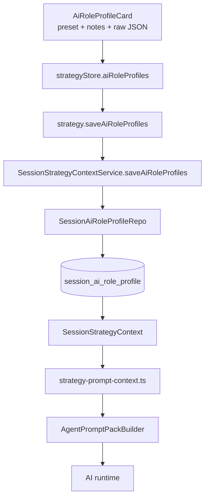
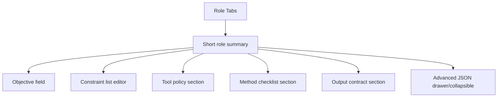

# AI Role Profile JSON Refactor — Plan

> **Date:** 2026-05-11
> **Status:** Draft
> **Deciders:** Kenneth Atchon

## 1. Problem Statement

The current AI role profile model is split across three separate concepts in `electron/shared/domain.ts` and `electron/main/db/schema.ts`: `operatingPresetId`, free-text `notes`, and free-form `operatingSpec`. That split is creating both product and code problems. On the product side, the Strategy page forces users to edit a plain notes textarea plus a raw JSON textarea in `src/components/strategy/AiRoleProfileCard.tsx`, which is exactly the kind of low-signal, high-friction surface that feels ugly to maintain and ugly to use. On the code side, new sessions are seeded from `electron/shared/default-ai-role-operating-notes.ts`, a long prose-heavy file whose content is duplicated into every session row even though much of it is really default role behavior, not session-specific configuration. Worse, the runtime does not even consume that long prose cleanly: `electron/main/services/ai/strategy-prompt-context.ts` truncates notes before prompt injection and stringifies `operatingSpec` into a compact line, so we are paying the complexity cost of a large notes system without getting consistent runtime value from it. If we do nothing, AI role profiles will stay split across multiple storage fields, UI editing will stay awkward, and every future improvement will keep fighting a model that does not match how we actually want to configure role behavior.

## 2. Goals & Non-Goals

**Goals**

| # | Goal | Success Looks Like |
|---|------|--------------------|
| G1 | Collapse role profile state into one JSON document | `SessionAiRoleProfile` stops splitting meaning across `notes`, `operatingSpec`, and `operatingPresetId` |
| G2 | Remove notes as a first-class concept | No user-facing notes textarea, no `notes` column, no `default-ai-role-operating-notes.ts` |
| G3 | Keep the JSON typed but extensible | Known fields are validated and easy to edit, while unknown keys are preserved without DB/schema churn |
| G4 | Make the UI structured instead of raw-first | Common fields are edited through normal controls; raw JSON becomes an advanced escape hatch, not the main workflow |
| G5 | Keep prompt behavior explicit | Prompt-building code renders role profile sections intentionally instead of concatenating `notes=` and `spec=` strings |
| G6 | Avoid future schema churn for every profile tweak | Adding a new profile key should not require DB changes or a new top-level persistence field |

**Non-Goals**

| # | Non-Goal | Reason |
|---|----------|--------|
| N1 | Backward-compatibility bridges for old role profile rows | The repo already accepts development-time breaking changes and local DB resets |
| N2 | A full rewrite of bundled prompt assets | Prompt assets should stay concise role identity docs; this plan only changes the profile layer around them |
| N3 | Adopting a generic schema-generated form framework by default | The data model is known and Exva already has a custom Strategy UI; we should not add a heavy abstraction unless the simplest hand-built path fails |
| N4 | Reworking unrelated strategy/risk/timeframe sections | This plan is scoped to AI role profiles and their prompt/runtime plumbing |

## 3. Background & Context

Current state in code:

- `electron/shared/domain.ts` defines `SessionAiRoleProfile` as `{ operatingPresetId, operatingSpec, notes }`.
- `electron/main/db/schema.ts` persists those fields in `session_ai_role_profile` as `operating_preset_id`, `operating_spec_json`, and `notes`.
- `electron/main/db/repositories/session-repo.ts` seeds every new session with default role notes from `electron/shared/default-ai-role-operating-notes.ts`.
- `src/components/strategy/AiRoleProfileCard.tsx` exposes three direct editing surfaces: preset id input, notes textarea, and raw JSON textarea.
- `src/store/strategyStore.ts`, `electron/main/ipc/strategy.ts`, `electron/preload/exva-api.ts`, and `src/lib/exva.ts` all carry the same split shape through the renderer/main boundary.
- `electron/main/services/ai/strategy-prompt-context.ts` truncates notes and flattens the profile into `preset=...; notes=...; spec=...` before prompt injection.
- `electron/main/services/ai/prompt-asset-loader.ts` appends `electron/prompts/_shared-context-howto.md` to every prompt asset even though that file is describing runtime prompt-envelope behavior, not role-specific prompt content.

This means the current model has three separate problems at once:

1. The stored shape is awkward.
2. The editing UX is awkward.
3. The prompt rendering path is lossy and not aligned with the authoring surface.

### Current Data Flow



The user-visible file that currently seeds this system, `electron/shared/default-ai-role-operating-notes.ts`, is also carrying too much conceptual load. It is acting as:

- a default behavior definition,
- a prompt supplement,
- a persistence seed source,
- and effectively a pseudo-schema for what the role profile should mean,

while not being structured enough for good UI editing or safe enough for meaningful validation.

### Why This Hurts Now

- The product wants JSON to remain the source of truth, but not as an unstructured textarea-only workflow.
- The current `notes` field is redundant with the role prompt assets and too opaque for the UI.
- The current JSON field is too open for the UI but too under-modeled for the runtime.
- Any future role-profile improvements will keep touching DB shape, prompt rendering, defaults, store state, and UI copy unless we clean the model boundary now.

## 4. Research Summary

**Open structured objects instead of endless fixed fields**

- JSON Schema's object model explicitly supports known properties plus open-ended extras via `additionalProperties` and `unevaluatedProperties`.
- The key insight for Exva is that we do not have to choose between a fully strict schema and an unvalidated blob. We can validate a stable set of known keys while still allowing additional keys to exist without changing the storage shape.
- That fits the requirement to keep JSON easy to evolve without new DB columns or repeated persistence-contract changes.
- Sources:
  - https://json-schema.org/understanding-json-schema/reference/object

**Exva's current Zod stack already supports typed-known plus open-extra validation**

- Zod documents three relevant patterns: strict objects, loose objects, and `.catchall()` for validating unknown keys. It also notes that plain objects strip unrecognized keys by default, which means we must opt into passthrough behavior deliberately.
- The useful pattern here is a loose object with strongly typed known sections and a permissive catchall for future keys. That lets Exva keep TypeScript-friendly structure for common fields while preserving additional JSON the UI does not yet know about.
- Because Exva already uses Zod heavily in `electron/shared/schemas.ts`, this is a low-friction fit for the current stack.
- Source:
  - https://zod.dev/api

**Generated schema-first form frameworks are real prior art, but not the best default fit here**

- `react-jsonschema-form` explicitly says it is best when you want to generate forms for arbitrary data "sight unseen," and suggests looking elsewhere if you already know your data and mainly want a toolkit.
- JSON Forms shows the same tradeoff from another angle: it separates data schema and UI schema, which is powerful, but it means another layer of indirection and renderer configuration to maintain.
- The insight for Exva is that schema-driven UI is useful as a reference model, but a fully generic form engine would add complexity that the current Strategy page likely does not need. Exva already knows the role-profile concepts it wants to expose. A hand-built editor driven by a lightweight field registry is a better stack fit.
- Sources:
  - https://rjsf-team.github.io/react-jsonschema-form/docs/
  - https://jsonforms.io/docs

## 5. Options Considered

**Option A: Do the minimum and keep the current model**

Keep `operatingPresetId`, `notes`, and `operatingSpec` as separate fields. Shorten the prose file, rename it, and maybe improve helper copy around the JSON textarea.

| Dimension | Assessment |
|-----------|------------|
| Complexity | Low |
| Performance | No meaningful change |
| Reliability | Same current weaknesses |
| Cost | Lowest immediate cost |
| Reversibility | Very easy |
| Stack fit | Fits current code, preserves current mismatch |
| Team readiness | Immediate |

Risks:

- The underlying model stays split and awkward.
- The UI still asks users to think in raw prose plus raw JSON.
- The prompt path still has to compress mixed fields into a lossy format.

Open questions:

- None worth answering, because this option does not solve the actual problem.

**Option B: Collapse to a single raw JSON column, but keep JSON editing raw-first**

Remove `notes` and maybe `operatingPresetId`, store only one JSON blob per role, and expose that blob in a single textarea editor.

| Dimension | Assessment |
|-----------|------------|
| Complexity | Low-medium |
| Performance | Slightly simpler than current shape |
| Reliability | Better persistence model, still weak editing UX |
| Cost | Moderate |
| Reversibility | Easy |
| Stack fit | Good fit technically |
| Team readiness | High |

Risks:

- The main UX problem remains: users still hand-author JSON in a textarea.
- Validation can only happen after parsing, not while users think through the configuration.
- We would likely need another follow-up refactor to make the surface usable.

Open questions:

- Is a raw JSON-only editor acceptable if the product complaint is explicitly that editing JSON in the UI is hard? Probably not.

**Option C: Recommended — single typed-open `profileJson` document plus structured editor and advanced JSON escape hatch**

Replace the current split shape with one JSON document per role. Give that document stable typed sections for the fields we actually care about, allow unknown keys to pass through, render known sections intentionally in prompts, and keep a collapsible advanced JSON editor for power users.

| Dimension | Assessment |
|-----------|------------|
| Complexity | Medium |
| Performance | Negligible overhead |
| Reliability | High once the model boundary is simplified |
| Cost | Higher than raw JSON-only, lower than introducing a generic form engine |
| Reversibility | Moderate; types, DB schema, tests, and prompts change together |
| Stack fit | Strong; fits Exva's Zod + custom React UI stack |
| Team readiness | High |

Risks:

- We can over-model the JSON and recreate rigidity under a new name.
- We need clear rules for how unknown keys affect prompt rendering.
- UI/editor syncing must avoid losing unknown keys when structured fields are edited.

Open questions:

- Which fields deserve first-class controls in v1, and which stay advanced-only?
- How should unknown keys appear in prompts: compact JSON block, generic bullets, or ignored unless explicitly mapped?

## 6. Recommendation

**We recommend Option C: collapse AI role profiles into one `profileJson` document per role, remove `notes` entirely, and replace the current raw-first UI with a structured editor plus an advanced JSON escape hatch.**

This is the smallest change that actually fixes the shape problem and the UX problem at the same time. It beats the status quo because it removes a useless split between prose notes and free-form JSON. It beats the raw JSON-only option because the user pain is not just persistence shape; it is the fact that the current UI makes JSON authoring unpleasant. It also avoids the cost of a full generated-form framework, which is unnecessary for a page whose data model we already understand.

The recommendation has four concrete design decisions:

1. `SessionAiRoleProfile` should persist only `profileJson`, not `notes`, `operatingSpec`, or a standalone `operatingPresetId` column.
2. Stable default role behavior should live in concise default JSON objects plus bundled role prompt assets, not giant prose notes seeded into every session row.
3. The JSON schema should validate known sections but preserve unknown keys.
4. The renderer should offer normal controls for common sections and an advanced raw JSON editor only as a secondary path.

### Recommended Target Shape

```ts
export const aiRoleProfileDocumentSchema = z
  .object({
    version: z.literal(1),
    objective: z.string().max(240).optional(),
    constraints: z.array(z.string().min(1)).default([]),
    toolPolicy: z.record(
      z.string(),
      z.looseObject({
        mode: z.enum(["disabled", "optional", "preferred", "required"]).optional(),
        notes: z.string().optional(),
      }),
    ).default({}),
    method: z.looseObject({
      checklist: z.array(z.string().min(1)).optional(),
      requiredEvidence: z.array(z.string().min(1)).optional(),
      avoid: z.array(z.string().min(1)).optional(),
    }).default({}),
    output: z.looseObject({
      format: z.enum(["memo", "structured_json", "candidate_list", "custom"]).optional(),
      requiredSections: z.array(z.string().min(1)).optional(),
      minWords: z.number().int().nonnegative().nullable().optional(),
      maxWords: z.number().int().nonnegative().nullable().optional(),
      terminalAction: z.string().optional(),
    }).default({}),
  })
  .catchall(z.unknown());

export type AiRoleProfileDocument = z.infer<typeof aiRoleProfileDocumentSchema>;

export interface SessionAiRoleProfile {
  sessionId: string;
  role: AgentRole;
  profileJson: AiRoleProfileDocument;
  updatedAt: string;
}
```

This is intentionally not fully strict. The known sections give the UI and runtime stable anchors. The catchall gives Exva space to add or experiment with extra keys without new top-level schema migrations.

### Example JSON

```json
{
  "version": 1,
  "objective": "Produce a disciplined technical memo for swing-long setups.",
  "constraints": [
    "Never invent missing price levels.",
    "Prefer insufficient evidence over forced conviction."
  ],
  "toolPolicy": {
    "search_web": { "mode": "optional", "notes": "Use only for fresh catalyst or market-context gaps." },
    "get_news": { "mode": "preferred" }
  },
  "method": {
    "checklist": [
      "Anchor to session timeframe and intended hold.",
      "Review structure, momentum, relative strength, and volume.",
      "Call out invalidation when evidence supports it."
    ],
    "requiredEvidence": ["trend", "volume", "horizon fit"]
  },
  "output": {
    "format": "memo",
    "requiredSections": ["Setup Summary", "Evidence", "Risks/Invalidation", "Horizon Fit"],
    "minWords": 700,
    "maxWords": 1400
  }
}
```

## 7. Implementation Plan

### Phase 1: Define the new boundary and rename the concepts

Goal: stop treating role profile behavior as three separate persistence concepts.

Done criteria:

- Finalize the replacement of `notes` + `operatingSpec` + `operatingPresetId` with one `profileJson` document.
- Decide which behaviors belong in bundled prompt assets versus per-session JSON.
- Lock the JSON section names before persistence and UI work start.

Deliverables:

- [ ] Replace the current conceptual contract with `SessionAiRoleProfile.profileJson`
- [ ] Delete the idea of first-class `notes`
- [ ] Decide whether any preset identifier should survive only as optional JSON metadata rather than a separate column
- [ ] Introduce a new shared module, e.g. `electron/shared/ai-role-profile.ts`, that owns:
  - document types
  - Zod schema
  - default documents
  - prompt-render helpers for known sections

Dependencies:

- None

Risks and detection:

- Risk: prompt defaults and session profile responsibilities stay blurry.
- Detect by reviewing one example role end-to-end before coding the full cutover.

Rollback plan:

- None. This phase is naming and target-contract definition only.

### Phase 2: Replace persistence, IPC, preload, and store contracts

Goal: make the new JSON document the only persisted role-profile payload.

Recommended storage change:

```ts
export const sessionAiRoleProfile = sqliteTable(
  "session_ai_role_profile",
  {
    sessionId: text("session_id").notNull().references(() => sessions.id, { onDelete: "cascade" }),
    role: text("role").notNull(),
    profileJson: text("profile_json").notNull().default("{}"),
    updatedAt: text("updated_at").notNull(),
  },
  (table) => ({
    pk: primaryKey({ columns: [table.sessionId, table.role] }),
  }),
);
```

Done criteria:

- DB schema uses one JSON column.
- Main/renderer types no longer mention `notes` or `operatingSpec`.
- The save/load path stays one document end-to-end.

Deliverables:

- [ ] Update `electron/main/db/schema.ts` and migrations to replace the current three-column payload with `profile_json`
- [ ] Update `electron/main/db/repositories/mappers.ts` and `session-ai-role-profile-repo.ts` to parse/serialize only `profileJson`
- [ ] Update `electron/shared/domain.ts` and `electron/shared/schemas.ts`
- [ ] Update `electron/main/services/session/session-strategy-context-service.ts`
- [ ] Update `electron/main/ipc/strategy.ts`, `electron/preload/exva-api.ts`, `src/lib/exva.ts`, and `src/store/strategyStore.ts`
- [ ] Update template payloads and strategy snapshot shape to carry the new document
- [ ] Bump `StrategySnapshot.version` because prompt-facing serialized structure is changing

Dependencies:

- Phase 1 target contract

Risks and detection:

- Risk: one part of the app still expects `notes` or `operatingSpec`.
- Detect with repo-wide type errors plus grep targets for `notes`, `operatingSpec`, and `operatingPresetId` in the role-profile path.

Rollback plan:

- None. Breaking changes are allowed; use a direct destructive migration or local DB reset rather than compatibility bridges.

### Phase 3: Replace default role notes with structured defaults

Goal: delete the prose-heavy seed file and replace it with concise structured defaults.

Done criteria:

- `electron/shared/default-ai-role-operating-notes.ts` is gone.
- New sessions seed structured default JSON per role.
- Default role identity remains primarily in prompt assets, not in giant per-session notes blobs.

Deliverables:

- [ ] Delete `electron/shared/default-ai-role-operating-notes.ts`
- [ ] Create `electron/shared/ai-role-profile-defaults.ts` or fold defaults into `electron/shared/ai-role-profile.ts`
- [ ] Seed new sessions with `DEFAULT_AI_ROLE_PROFILE_JSON[role]`
- [ ] Delete `electron/prompts/_shared-context-howto.md`
- [ ] Remove `appendSharedHowto()` and `SHARED_HOWTO_FILE` from `electron/main/services/ai/prompt-asset-loader.ts`
- [ ] Keep bundled prompt markdown files concise and role-specific, with profile JSON reserved for session-tunable behavior

Recommended default split:

- Prompt assets: stable role identity and core responsibilities
- `profileJson`: session-tunable constraints, tool posture, method checklist, output contract
- Runtime prompt-envelope guidance: code-owned text near `AgentPromptPackBuilder`, not a filesystem prompt asset

Dependencies:

- Phase 2 persistence contract

Risks and detection:

- Risk: we accidentally move too much role identity into DB defaults and recreate the old duplication problem.
- Detect by checking whether default JSON is short, structured, and obviously session-tunable.

Rollback plan:

- None. Keep the new defaults small and opinionated rather than rebuilding the old notes system.

### Phase 4: Rewrite prompt rendering around structured profile sections

Goal: make prompt injection intentional and readable instead of flattening mixed fields into one string.

Recommended approach:

- Introduce `renderAiRoleProfileMarkdown(profileJson)`.
- Render known sections explicitly.
- If unknown keys exist, append them under an `Additional profile JSON` block so they are not silently dropped.
- Move the shared "how context is provided" explanation out of prompt assets and into a code-owned constant/helper near `electron/main/services/ai/prompt-pack-builder.ts`, because the prompt envelope is assembled there.

Example output shape:

```md
## Role profile
- Objective: Produce a disciplined technical memo for swing-long setups.

## Constraints
- Never invent missing price levels.
- Prefer insufficient evidence over forced conviction.

## Tool policy
- search_web: optional — Use only for fresh catalyst or market-context gaps.
- get_news: preferred

## Method checklist
- Anchor to session timeframe and intended hold.
- Review structure, momentum, relative strength, and volume.

## Output contract
- Format: memo
- Required sections: Setup Summary, Evidence, Risks/Invalidation, Horizon Fit
- Target length: 700-1400 words

## Additional profile JSON
```json
{ "custom_key": "custom value" }
```
```

Done criteria:

- Prompt rendering is driven by structured sections.
- Unknown JSON keys are preserved and visible.
- No code path depends on `notes=` or `spec=` string concatenation.

Deliverables:

- [ ] Replace `compactRoleProfile()` in `electron/main/services/ai/strategy-prompt-context.ts`
- [ ] Introduce a code-owned prompt-envelope guidance block near `electron/main/services/ai/prompt-pack-builder.ts`
- [ ] Update prompt-pack tests and strategy-prompt-context tests
- [ ] Ensure snapshot serialization mirrors the new `profileJson` structure cleanly

Dependencies:

- Phases 1-3

Risks and detection:

- Risk: unknown keys are preserved in DB but never influence prompts.
- Detect with tests that verify extra keys show up under the fallback block.

Rollback plan:

- None. The new renderer should be introduced in one cutover with updated tests.

### Phase 5: Replace the Strategy UI with a structured editor and advanced JSON mode

Goal: stop making the raw JSON textarea the primary authoring surface.

Recommended UI shape for `AiRoleProfileCard`:



Recommended editing model:

- A lightweight field registry drives which JSON paths get first-class controls.
- The registry is UI metadata, not the persistence schema.
- Editing structured fields patches the in-memory `profileJson` object.
- The advanced JSON editor always reflects the current object and can add unknown keys.
- Unknown keys must survive structured edits.

Suggested field-registry shape:

```ts
type RoleProfileFieldSpec = {
  path: string;
  label: string;
  control: "text" | "textarea" | "string_list" | "select" | "number";
  roles?: AgentRole[];
  options?: string[];
};
```

Done criteria:

- The primary UI no longer shows `Notes`.
- The main workflow does not require users to hand-write JSON.
- Advanced JSON remains available for power users and unknown keys.

Deliverables:

- [ ] Rewrite `src/components/strategy/AiRoleProfileCard.tsx`
- [ ] Update `src/store/strategyStore.ts` to patch `profileJson` by path or helper functions
- [ ] Add helpers for array-list editing and JSON sync
- [ ] Keep role tabs and selector-role lock behavior that already exists

Dependencies:

- Phase 2 type contract
- Phase 4 prompt rendering behavior, so the UI knows which fields are meaningful

Risks and detection:

- Risk: structured edits overwrite or drop unknown keys from advanced JSON.
- Detect with component/store tests that round-trip mixed known/unknown payloads.

Rollback plan:

- None. The old notes/raw-JSON split should be removed in the same UI cutover.

### Phase 6: Verification and cleanup

Goal: remove the old mental model completely and prove the new one survives prompt/runtime usage.

Done criteria:

- No role-profile path references `notes`, `operatingSpec`, or the old default-notes file.
- New structured profile defaults load, save, serialize, and render into prompts.
- Strategy UI edits survive reloads.

Deliverables:

- [ ] Update repo tests for mapper/service/store/prompt behavior
- [ ] Add tests that preserve unknown keys through load/save/edit cycles
- [ ] Add tests for prompt rendering of both known structured fields and fallback unknown JSON
- [ ] Remove dead types, dead comments, and dead helper copy tied to `notes`

Recommended verification:

- `bun run typecheck`
- `bunx vitest` on prompt-context, prompt-pack, session-repo, and strategy-store related suites
- Manual Strategy page verification for one session across multiple roles

Dependencies:

- All prior phases

Risks and detection:

- Risk: tests still pass while the UI silently strips advanced JSON.
- Detect with a manual round-trip test that adds an unknown key, saves, reloads, and confirms it remains.

Rollback plan:

- None. Finish the cleanup in the same slice so the repo only has one role-profile model afterward.

## 8. Risk Register

| # | Risk | Likelihood | Impact | Mitigation |
|---|------|-----------|--------|------------|
| R1 | We over-design the JSON and recreate rigidity | Medium | Medium | Keep the known schema small and open via catchall/loose objects |
| R2 | Unknown keys are lost during structured edits | Medium | High | Treat `profileJson` as the source of truth and write round-trip tests for known + unknown keys |
| R3 | Prompt rendering becomes inconsistent across roles | Medium | Medium | Centralize rendering in one helper and test each role's defaults |
| R4 | Too much default behavior moves into DB-seeded JSON again | Low | Medium | Keep stable role identity in prompt assets and keep default JSON concise |
| R5 | The UI registry becomes a hidden second schema | Medium | Medium | Keep the registry purely presentational and let advanced JSON handle everything else |

## 9. Success Criteria

| Goal | Metric | Baseline | Target | How Measured |
|------|--------|----------|--------|--------------|
| G1 | Role-profile persistence fields | 3 payload fields (`operatingPresetId`, `notes`, `operatingSpec`) | 1 payload field (`profileJson`) | Type/schema/DB review |
| G2 | Notes-specific codepaths | Present in DB, defaults, UI, prompt rendering | Zero | Grep for `notes` in role-profile files |
| G3 | Unknown-key preservation | Not guaranteed in structured editing because no structured editing exists | Preserved across load/save/edit/reload | Automated round-trip tests |
| G4 | Structured UI coverage | Raw JSON textarea is the main editor | Common fields editable without raw JSON | Manual Strategy-page verification |
| G5 | Prompt rendering clarity | `preset=...; notes=...; spec=...` flattening | Sectioned role-profile markdown with fallback extras block | Prompt-context tests |

Leading indicators:

- `default-ai-role-operating-notes.ts` is deleted early.
- `SessionAiRoleProfile` shape collapses cleanly in shared types.
- Prompt-context tests become simpler to read.

Lagging indicators:

- A user can update role behavior from the Strategy page without touching raw JSON for normal cases.
- Advanced JSON survives save/reload with unknown keys intact.

## 10. Open Questions

| # | Question | Owner | Needed By | Status |
|---|----------|-------|-----------|--------|
| O1 | Which fields belong in the v1 structured editor versus advanced JSON only? | Kenneth | Before Phase 5 | Open |
| O2 | Should unknown keys render as a compact JSON block, a generic bullet list, or only under an explicit `custom` section? | Kenneth | Before Phase 4 | Open |
| O3 | Do we want an optional `meta.presetId` inside `profileJson`, or should preset naming disappear completely in this refactor? | Kenneth | Before Phase 1 ends | Open |

## 11. Alternatives Rejected

| Option | Why Rejected |
|--------|-------------|
| Keep `notes` and just shorten/rename the default file | Cosmetic cleanup only; it does not fix the split model or the UI pain |
| Single raw JSON textarea with no structured controls | Simpler persistence, but it leaves the main UX complaint untouched |
| Full generic form engine (`react-jsonschema-form` or JSON Forms) | Valid prior art, but too much abstraction and UI-schema overhead for a page whose data model is already known |
