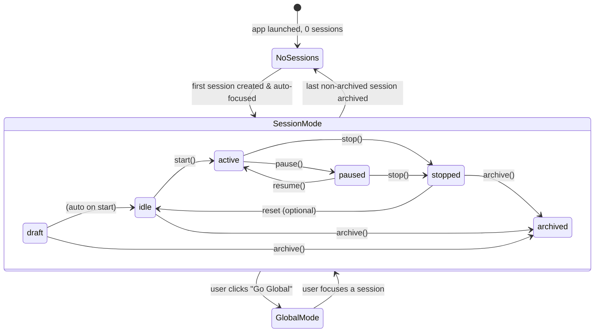

# Phase 1 — Session Ownership Model

> Establish the canonical domain types and invariant rules that every subsequent phase builds on.
> No DB writes. No UI changes. Pure TypeScript types + documented rules.
>
> Implements: docs/plan/CODING_GUIDELINES.md

## Goal

Replace implicit "one global session" mental model with an explicit `WorkspaceSession` domain object. All later phases import from this foundation.

## Hard Problems

1. **Status lifecycle** — `draft → idle → active ↔ paused → stopped → archived` must be a strict state machine. Illegal transitions (e.g. `archived → active`) must be rejected at the type and service boundary.
2. **Focused-session invariant** — at most one non-archived session can be focused at any time. Enforced by the DB layer (transaction), not just app logic.
3. **Edit-lock derivation** — "editable" is a derived boolean (`status ∈ {draft, idle, stopped}`), not a stored flag. Compute it, never store it.

## Workspace Context State Machine



## Domain Types

Create `electron/shared/domain.ts`:

```typescript
// Instrument types — replaces ad-hoc "stock" strings everywhere
export type InstrumentClass = "stock" | "crypto" | "futures";

// Session lifecycle
export type SessionStatus =
  | "draft"
  | "idle"
  | "active"
  | "paused"
  | "stopped"
  | "archived";

export type SelectionMode = "manual_shortlist" | "ai_selected_universe";
export type ExecutionMode = "paper_only" | "live_allowed";
export type ResearchDepth = "light" | "balanced" | "deep";
export type StrategyProfile =
  | "passive_income"
  | "growth"
  | "conservative"
  | "custom";

/** Bar size the session uses for analysis, agent prompts, and (later) data pulls. */
export type TradingTimeframe =
  | "1m"
  | "5m"
  | "15m"
  | "30m"
  | "1h"
  | "4h"
  | "1d"
  | "1w";

/** How long positions are intended to be held — steers researcher/reviewer/decision prompts. */
export type HoldingStyle =
  | "intraday_flat" // flat by session end / no overnight by default
  | "multi_day_swing" // days to a few weeks
  | "weeks_position" // weeks+ / slower thesis
  | "custom"; // user explains in notes only
export type WorkspaceViewMode = "session" | "global";
export type CapitalAllocationMode = "per_session_only" | "shared_global_pool";

// AI roles
export type AgentRole =
  | "researcher_bull"
  | "researcher_bear"
  | "reviewer"
  | "decision_maker"
  | "instrument_selector";

export type PromptSource = "default" | "session_override";
export type ProviderType = "anthropic" | "openai" | "opencode";
export type SearchProviderType = "brave" | "tavily";
export type BrokerMode = "paper" | "live";

// Derived helper — never stored
export function isSessionEditable(status: SessionStatus): boolean {
  return status === "draft" || status === "idle" || status === "stopped";
}

// Legal lifecycle transitions
const LEGAL_TRANSITIONS: Partial<Record<SessionStatus, SessionStatus[]>> = {
  draft: ["idle", "archived"],
  idle: ["active", "archived"],
  active: ["paused", "stopped"],
  paused: ["active", "stopped"],
  stopped: ["idle", "archived"],
};

export function canTransition(from: SessionStatus, to: SessionStatus): boolean {
  return LEGAL_TRANSITIONS[from]?.includes(to) ?? false;
}
```

## Core Entity Interfaces

Add to `electron/shared/domain.ts`:

```typescript
export interface WorkspaceSession {
  id: string;
  name: string;
  objective: string;
  status: SessionStatus;
  isFocused: boolean;
  selectionMode: SelectionMode;
  instrumentClasses: InstrumentClass[];
  instrumentScope: string;
  defaultSearchProviderId: string | null;
  capitalLimitUsd: number;
  executionMode: ExecutionMode;
  createdAt: string;
  updatedAt: string;
}

export interface SessionSelectorSettings {
  sessionId: string;
  aiPickerEnabled: boolean;
  updatedAt: string;
}

export interface SessionStrategy {
  sessionId: string;
  strategyProfile: StrategyProfile;
  maxPositionUsd: number;
  stopLossPct: number;
  takeProfitPct: number;
  maxConcurrentTrades: number;
  researchDepth: ResearchDepth;
  dailyLossLimitUsd: number;
  profitTargetUsd: number;
  maxAiSpendUsd: number;
  humanApprovalRequired: boolean;
  /** Primary chart / decision cadence (e.g. swing on 4h vs day-trade on 5m). */
  primaryTradingTimeframe: TradingTimeframe;
  /** Coarse hold intent; pair with optional day bounds below. */
  holdingStyle: HoldingStyle;
  /** Soft target for typical hold length (calendar days); null = unspecified. */
  targetHoldDays: number | null;
  /** Optional hard ceiling (calendar days) for UI + future orchestrator exit rules; null = no cap in v1. */
  maxHoldDays: number | null;
  /** Free text shown in Strategy UI and injected into agent context (e.g. "avoid FOMC week entries"). */
  timeframeNotes: string;
}

export interface SessionAiRole {
  sessionId: string;
  role: AgentRole;
  providerKey: string; // references provider_accounts.id
  modelId: string;
  temperature: number;
  maxTokens: number;
  webSearchEnabled: boolean;
  promptSource: PromptSource;
  promptMarkdown: string;
  promptAssetPath: string | null;
}

export interface ProviderAccount {
  id: string;
  name: string;
  category: "ai" | "search";
  providerType: ProviderType | SearchProviderType;
  secretRef: string; // keychain key, not the secret itself
  metadataJson: string | null;
  isConfigured: boolean;
  lastTestStatus: "unknown" | "ok" | "error";
  updatedAt: string;
}

export interface BrokerAccount {
  id: string;
  name: string;
  brokerType: string; // adapter key, e.g. "alpaca"
  supportedInstrumentClasses: InstrumentClass[];
  mode: BrokerMode;
  secretRef: string;
  updatedAt: string;
}

export interface BrokerRoutingDefault {
  instrumentClass: InstrumentClass;
  defaultBrokerAccountId: string;
}

export interface SessionBrokerRoutingOverride {
  sessionId: string;
  instrumentClass: InstrumentClass;
  brokerAccountId: string;
}

export interface WorkspacePreferences {
  id: 1; // singleton row
  globalIncludeArchived: boolean;
  defaultSearchProviderId: string | null;
  capitalAllocationMode: CapitalAllocationMode;
  globalCapitalPoolUsd: number | null;
  updatedAt: string;
}

export interface SessionTemplate {
  id: string;
  name: string;
  description: string | null;
  sourceSessionId: string | null;
  templatePayloadJson: string; // serialized SessionTemplatePayload
  instrumentClasses: InstrumentClass[];
  updatedAt: string;
}

// P1.10 — explicit shape of session_templates.template_payload_json.
// Validated via Zod schema on `template:create` and `template:use`.
export interface SessionTemplatePayload {
  version: 1;
  identity: {
    objective: string;
    selectionMode: SelectionMode;
    instrumentClasses: InstrumentClass[];
    instrumentScope: string;
    executionMode: ExecutionMode;
    capitalLimitUsd: number;
    defaultSearchProviderId: string | null;
  };
  selectorSettings: {
    aiPickerEnabled: boolean;
  };
  strategy: Omit<SessionStrategy, "sessionId">;
  aiRoles: Array<Omit<SessionAiRole, "sessionId">>;
  brokerAssignments: Array<{ brokerAccountId: string }>;
  brokerOverridesByInstrumentClass: Partial<Record<InstrumentClass, string>>;
}
// Excluded from the payload (per spec): runtime state, trade rows, agent_runs,
// events, capital_reservations, instrument_cache, session name (uniqueness),
// is_focused, status, createdAt, updatedAt.

export interface TradeApproval {
  id: string;
  sessionId: string;
  tradeId: string;
  brokerAccountId: string;
  instrumentSymbol: string;
  instrumentClass: InstrumentClass;
  proposedSide: "BUY" | "SELL";
  proposedSizeUsd: number;
  decisionSummaryJson: string;
  status: "pending" | "approved" | "rejected";
  requestedAt: string;
  resolvedAt: string | null;
  decisionNote: string | null;
}

export interface CapitalReservation {
  id: string;
  sessionId: string;
  approvalId: string | null;
  tradeId: string | null;
  amountUsd: number;
  reason: "approval" | "open_order" | "open_position";
  status: "reserved" | "consumed" | "released";
  createdAt: string;
  releasedAt: string | null;
}
```

## `AppError` — Canonical Error Type (P0.1)

Create `electron/shared/errors.ts`. This is the only error type services throw and the only error shape the renderer sees.

```typescript
export type AppErrorCode =
  | "VALIDATION_FAILED"
  | "INVALID_TRANSITION"
  | "LOCKED"
  | "NOT_FOUND"
  | "PROVIDER_NOT_CONFIGURED"
  | "MISSING_SECRET"
  | "BROKER_UNREACHABLE"
  | "ROUTING_AMBIGUOUS"
  | "NO_BROKER"
  | "UNSUPPORTED_INSTRUMENT"
  | "UNKNOWN_BROKER"
  | "SESSION_NOT_ACTIVE"
  | "SELECTOR_NOT_CONFIGURED"
  | "SEARCH_PROVIDER_REQUIRED"
  | "INSTRUMENT_CONFLICT"
  | "CAPITAL_POOL_EXCEEDED"
  | "PREFLIGHT_FAILED"
  | "UNKNOWN";

export class AppError extends Error {
  constructor(
    message: string,
    public readonly code: AppErrorCode,
    public readonly details?: Record<string, unknown>,
  ) {
    super(message);
    this.name = "AppError";
  }
}

export interface SerializedAppError {
  message: string;
  code: AppErrorCode;
  details?: Record<string, unknown>;
}

export function serializeError(err: unknown): SerializedAppError {
  if (err instanceof AppError) {
    return { message: err.message, code: err.code, details: err.details };
  }
  return { message: "Internal error", code: "UNKNOWN" };
}
```

Rules:

- Services throw `AppError` only. Repos may throw raw SQLite errors; the calling service wraps them.
- IPC handlers wrap their handler body in `try { ... } catch (err) { return { error: serializeError(err) } }`.
- Renderer code distinguishes failures by `code`, never by string-matching `message`.

## Edit-Lock Matrix (P0.2)

Every IPC channel that mutates session-scoped state checks `isSessionEditable(status)` server-side before writing. UI-side `disabled` state is UX only and not trusted.

| Channel                         | Locked when status ∈                                                                                                                                                           | Error code              |
| ------------------------------- | ------------------------------------------------------------------------------------------------------------------------------------------------------------------------------ | ----------------------- |
| `session:update`                | `active`, `paused`                                                                                                                                                             | `LOCKED`                |
| `strategy:save`                 | `active`, `paused`                                                                                                                                                             | `LOCKED`                |
| `session:instrumentCache:clear` | `active`, `paused`                                                                                                                                                             | `LOCKED`                |
| `session:archive`               | `active`, `paused` (must stop first)                                                                                                                                           | `INVALID_TRANSITION`    |
| `accounts:routing:update`       | service-side check: reject if any active session depends on the changed routing default without an override                                                                    | `LOCKED`                |
| `accounts:brokers:remove`       | service-side check: reject if any active session has the broker assigned                                                                                                       | `LOCKED`                |
| `accounts:providers:save`       | service-side check: reject when secret rotation would invalidate an in-flight runtime call (best-effort: allow but call `registry.invalidate()` after current cycle completes) | `LOCKED`                |
| `workspace:prefs:patch`         | always allowed; `capitalAllocationMode` change reservoir-validates against currently-reserved capital and rejects with `CAPITAL_POOL_EXCEEDED` if a switch would over-commit   | `CAPITAL_POOL_EXCEEDED` |

Every later phase that adds a session-mutating channel adds a row to this matrix in this file.

## Invariant Rules (documented — enforced in Phases 2+)

| Rule                                                                                                                                   | Where Enforced                                              |
| -------------------------------------------------------------------------------------------------------------------------------------- | ----------------------------------------------------------- |
| At most one row has `is_focused = true` among non-archived sessions                                                                    | DB transaction in `SessionRepo.setFocus()`                  |
| `is_focused` cannot be `true` on an archived session                                                                                   | DB CHECK constraint + service guard                         |
| Strategy and AI role edits blocked when `status IN ('active','paused')`                                                                | IPC handlers (`ipc/session.ts`, `ipc/config.ts`) return 409 |
| Session start blocked if any required field is null                                                                                    | `SessionService.preflightStart()`                           |
| New trade blocked if same `(broker_account_id, instrument_symbol)` is open/pending in another active session                           | `TradesRepo.checkInstrumentConflict()`                      |
| Web search resolution uses session default first, then workspace default; save/start blocked if role enables search and neither exists | `SessionService` + `AiRuntime`                              |
| `workspace_preferences` always has exactly one row (id=1)                                                                              | DB `INSERT OR IGNORE` on migration                          |
| Shared global pool reserves capital across approvals and live orders when enabled                                                      | `CapitalReservationService`                                 |
| If both hold-day fields are set, `maxHoldDays >= targetHoldDays`; both must be ≥ 0 when non-null                                       | `strategy:save` validation (Phase 5)                        |
| `intraday_flat` with `primaryTradingTimeframe` in `1d` / `1w` is allowed but UI may warn (mismatch)                                    | Renderer warning only in Phase 5                            |

## Files Created / Modified in This Phase

| Action | File                                                                              |
| ------ | --------------------------------------------------------------------------------- |
| Create | `electron/shared/domain.ts`                                                       |
| Create | `electron/shared/errors.ts` — `AppError`, `AppErrorCode`, `serializeError` (P0.1) |
| Modify | `electron/shared/channels.ts` — update `AgentType` reference to `AgentRole`       |
| Modify | `src/lib/types.ts` — re-export from `domain.ts` where possible                    |

## Acceptance Criteria

- `domain.ts` exports all types above with no circular dependencies.
- `canTransition()` rejects illegal moves (unit tests).
- `isSessionEditable()` returns false for `active` and `paused`.
- No runtime behavior changed — this phase is types only.
