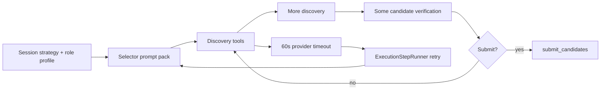

# Selector Discovery And Verification Tuning — Plan

> **Date:** 2026-05-16
> **Status:** Draft
> **Deciders:** Kenneth

## 1. Problem Statement

Exva's current `instrument_selector` can discover real information, but it does not reliably converge from discovery into decision-ready verification. The incident documented in `docs/reviews/selector-timeout-run-review-2026-05-16.md` shows the exact failure shape: the selector started healthy, had working search and market tools, repeatedly gathered relevant evidence, then kept broadening research until every 60-second provider attempt timed out. The visible error was `PROVIDER_UNREACHABLE`, but the real failure was selector non-convergence. We need to fix this without flattening the selector into a shallow trending-symbol picker and without splitting the workflow into a second verifier agent for now. The system still needs deep discovery, less-known findings, and candidate verification inside a single selector run. The change is needed now because the current behavior wastes provider budget, delays or blocks session startup, and makes retries repeat the same research drift instead of converting existing evidence into a shortlist.

## 2. Goals & Non-Goals

**Goals**

| #   | Goal                                           | Success Looks Like                                                                                                                             |
| --- | ---------------------------------------------- | ---------------------------------------------------------------------------------------------------------------------------------------------- |
| 1   | Preserve single-agent discovery + verification | `instrument_selector` still performs both discovery and verification in one run; no new agent loop is introduced.                              |
| 2   | Bias discovery toward new information          | Each additional discovery action adds new symbols, new source types, or new evidence dimensions, instead of repeating the same candidate set.  |
| 3   | Bias verification toward important information | Verification focuses on evidence that materially changes ranking or eligibility: catalyst quality, tradability, price structure, and risk fit. |
| 4   | Force bounded progression                      | Selector moves from discovery to verification to `submit_candidates` or explicit empty result within a bounded number of steps/attempts.       |
| 5   | Make tuning configurable                       | Discovery/verification budgets and novelty thresholds live in selector settings, not hardcoded prompt prose only.                              |
| 6   | Improve retry behavior                         | Retry runs reuse prior evidence and narrow remaining gaps instead of restarting broad rediscovery from scratch.                                |

**Non-Goals**

| #   | Non-Goal                                                   | Reason                                                                                                |
| --- | ---------------------------------------------------------- | ----------------------------------------------------------------------------------------------------- |
| 1   | Split discovery and verification into separate agents      | User explicitly wants to avoid a two-agent loop for now.                                              |
| 2   | Remove broad discovery entirely                            | The product still needs less-obvious ideas, not just obvious trending names.                          |
| 3   | Solve selector quality mainly by swapping models           | Model selection may help later, but the core issue is workflow control and evidence discipline.       |
| 4   | Replace model judgment with a fully deterministic screener | Exva still wants model-driven synthesis across diverse sources, not a rules-only stock picker.        |
| 5   | Redesign the full multi-role orchestration stack           | This plan is scoped to selector behavior, selector retries, and adjacent observability/configuration. |

## 3. Background & Context

The selector today is intentionally powerful, but its control envelope is too weak.

Current code shape:

- `electron/prompts/instrument_selector.md` defines a minimal base role and delegates most behavior to session context; for this plan, selector behavior changes should preferentially land in AI role-profile surfaces rather than the prompt asset.
- `electron/shared/ai/default-ai-role-profiles.ts` sets the selector objective, tool policy, and a method that explicitly says to fan out across discovery angles before narrowing.
- `electron/shared/ai/ai-role-profile.ts` only exposes one selector-specific runtime knob today: `noInstrumentRetryMinutes`.
- `electron/main/services/ai/prompt-pack-builder.ts` builds the final prompt, including `<trusted_session_context>`, `<tool_availability>`, and `<selector_output_contract>`.
- `electron/main/services/ai/ai-runtime/runtime.ts` forces step 0 to call `search_web` when available, but after that leaves the tool loop mostly open-ended.
- `electron/main/services/ai/adapters/run-agent-execute.ts` applies step caps, spend caps, terminal tool stop conditions, and a weak `loopFingerprintGuard()` that only detects three identical recent tool-call fingerprints.
- `electron/main/services/orchestration/execution-step-runner.ts` retries selector-stage failures with exponential backoff, but retries do not currently change task shape or carry a narrowed retry context.
- `electron/main/services/orchestration/agent-orchestrator.ts` caches successful selector output, but failed selector attempts are not reused as structured retry context.

Relevant current behavior from docs and code:

- Selector step 0 is forced to `search_web` (`docs/architecture/ai-runtime-and-harness.md`, `runtime.ts`).
- Selector tools include `search_web`, `search_reddit`, `get_trending_symbols`, `fetch_url`, `get_news`, `get_quote`, `get_ohlcv`, `submit_candidates`.
- Harness caps are currently broad for every role: `maxSteps: 50`, `spendUsd: 1.0` in `electron/main/services/ai/ai-runtime/ai-runtime-types.ts`.
- The selector parser already expects exactly one terminal action path: `submit_candidates` in `instrument-selection-parser.ts`.

The practical failure shown in the review doc is not “tools unavailable.” It is “too much successful discovery without a strong definition of novelty, importance, or when to stop.”

Current-state flow:

The hard problem is not simply “make the selector stop sooner.” The hard problem is “make the selector discover information that is both novel and decision-relevant, while keeping enough breadth to surface non-obvious candidates.”

## 4. Research Summary

**Topic 1: Relevance vs diversity in retrieval**

- Maximum Marginal Relevance (MMR) is a standard technique for balancing relevance with diversity rather than optimizing for pure similarity alone. The key idea is that a useful result set should not contain five near-duplicates when a user needs broader coverage. Elastic’s write-up is focused on search systems, but the principle maps directly to selector discovery: discovery output should maximize both fit to the session and difference from already-seen candidates or sources.
- Key insight: novelty should not mean randomness. It should mean “new information at acceptable relevance.” That is the right design target for selector discovery.
- Sources:
  - https://www.elastic.co/search-labs/blog/maximum-marginal-relevance-diversify-results
  - https://www.cs.cmu.edu/~jgc/publication/The_Use_MMR_Diversity_Based_LTMIR_1998.pdf

**Topic 2: Tool calling accuracy depends on tight tool surfaces and strong descriptions**

- OpenAI’s function-calling guidance emphasizes that tool definitions count against context, that initial tool surfaces should be kept small, and that function descriptions must be explicit about when a tool should and should not be used. The guide also explicitly recommends fewer than ~20 tools at the start of a turn as a soft suggestion and encourages deferring or narrowing tools when possible.
- Key insight: Exva does not need fewer selector tools globally, but it does need fewer tools exposed at the same moment. Discovery and verification can stay in one agent if the active tool surface is phased.
- Sources:
  - https://platform.openai.com/docs/guides/function-calling

**Topic 3: Reasoning models do better with direct goals, bounded context, and preserved state across tool loops**

- OpenAI’s reasoning best-practices guide recommends simple, direct prompts, explicit success criteria, and preserving relevant context across function-calling turns so the model does not restart reasoning from scratch. It also highlights that reasoning models are strong at planning and decision-making, but workflows often pair a planner with more bounded execution steps.
- Key insight: Exva should keep the selector as the planner/decider for now, but retries must carry forward prior evidence and shift into a narrower mode. Broad rediscovery on retry is the opposite of what these models need.
- Sources:
  - https://platform.openai.com/docs/guides/reasoning-best-practices

**Topic 4: Tool use adds token overhead and loop cost even when tool calls succeed**

- Anthropic’s tool-use docs emphasize that tool definitions and tool-use blocks increase prompt size and cost, and that the tool loop is fundamentally a multi-step coordination mechanism between the model and the application. Tool-enabled prompts are not free; they are a budgeting problem as much as a capability problem.
- Key insight: selector depth is not just a model-quality problem. It is an economics and latency problem. Discovery breadth must be explicit and finite.
- Sources:
  - https://docs.anthropic.com/en/docs/agents-and-tools/tool-use/overview

## 5. Options Considered

**Option A: Keep the current single selector and only tighten hard stop limits**

What it is: leave the prompt and tool flow mostly unchanged, but reduce `maxSteps`, reduce retries, and possibly force `submit_candidates` earlier.

| Dimension      | Assessment                                        |
| -------------- | ------------------------------------------------- |
| Complexity     | Low                                               |
| Performance    | Better latency and cost immediately               |
| Reliability    | Better termination, weak evidence quality control |
| Cost           | Low engineering cost                              |
| Reversibility  | High                                              |
| Stack fit      | Excellent                                         |
| Team readiness | Immediate                                         |

Risks:

- High risk of turning the selector into a shallow “pick obvious names quickly” workflow.
- Does not define what counts as new information or important verification evidence.
- Retries would still be semantically identical, just shorter.

Open questions:

- How low can step limits go before the selector stops surfacing non-obvious candidates?

**Option B: Split discovery and verification into separate agents now**

What it is: introduce a discovery agent that builds a candidate pool and a verifier agent that scores/filters it before handoff.

| Dimension      | Assessment                                                                 |
| -------------- | -------------------------------------------------------------------------- |
| Complexity     | High                                                                       |
| Performance    | Potentially good once tuned, but more orchestration overhead               |
| Reliability    | Clearer responsibilities, but more moving parts and new loop failure modes |
| Cost           | Highest engineering cost                                                   |
| Reversibility  | Medium                                                                     |
| Stack fit      | Moderate; requires orchestration changes across AI runtime and step runner |
| Team readiness | Medium                                                                     |

Risks:

- Adds the exact cross-agent loop the user wants to avoid for now.
- Requires new state handoff format, eval coverage, and failure handling.
- Could delay fixing the immediate selector timeout issue.

Open questions:

- How would candidate-pool ownership and retry semantics work without adding more complexity than the current bug?

**Option C: Keep one selector, but add novelty-aware staged control and retry narrowing**

What it is: preserve the current single selector role, but wrap it in stronger configuration and deterministic control. Discovery and verification remain in one agent, yet the runtime tracks novelty, restricts tool surfaces by phase, limits repeated low-signal searches, and changes retry mode from “start over” to “reuse prior evidence and fill remaining gaps.”

| Dimension      | Assessment                                                                                     |
| -------------- | ---------------------------------------------------------------------------------------------- |
| Complexity     | Medium                                                                                         |
| Performance    | Better than today; should materially reduce timeout loops                                      |
| Reliability    | Strong; preserves breadth while adding bounded progression                                     |
| Cost           | Moderate engineering cost                                                                      |
| Reversibility  | High; changes are mostly role-profile config, prompt-pack rendering, and local runtime control |
| Stack fit      | Strong fit with current `runInstrumentSelector`, `prepareStep`, and role-profile design        |
| Team readiness | High                                                                                           |

Risks:

- Novelty heuristics can become too aggressive and suppress legitimate follow-up research.
- Phase budgets can be tuned too tightly and miss obscure but valid candidates.
- Retry reuse needs careful design so stale or bad evidence is not amplified.

Open questions:

- Which selector state should stay local to an attempt vs persist across retries?
- How should “importance” be measured in deterministic guardrails without replacing model judgment?

## 6. Recommendation

**We recommend Option C: keep a single selector agent, but add novelty-aware discovery control, evidence-focused verification, and retry narrowing.**

This is the best fit because it directly addresses the failure mode from the review while preserving the product behavior the user wants: deep discovery plus verification in one agent. It is better than the status quo because it changes semantics, not just budgets. It is better than a two-agent split because it avoids a new orchestration loop and can be implemented largely inside existing selector surfaces: role profile config, role-profile rendering, prompt-pack rendering, tool wrappers, `prepareStep`, and retry context injection.

The recommendation depends on these assumptions:

- the current model is capable of high-quality selector output when the loop is bounded and guided better
- Exva can add small amounts of selector-local state without reworking the full orchestration architecture
- retries can access enough prior selector evidence from existing traces or execution-step metadata to avoid rediscovery

Conditions that would change the recommendation:

- if bounded single-agent tuning still cannot reliably surface non-obvious ideas without timing out
- if retry-context reuse becomes more complex than introducing a dedicated verifier agent
- if model/provider latency remains too high even after narrowing the tool loop

## 7. Implementation Plan

> **Implementation note (2026-05-16):** A core slice from Phases 1-5 is now implemented in code: selector role-profile tuning knobs, stronger selector role-profile guidance, malformed/meta discovery-query guards, selector attempt summary logging, phased selector tool exposure via `prepareStep`, and stronger loop-repetition detection. The plan items still open are the deeper Phase 4 work around richer tool-result novelty annotations / diversification and the Phase 6-7 retry narrowing + eval harness work.

**Phase 1: Instrument The Selector Loop**

Goal and done criteria: add enough observability to measure novelty, repetition, and convergence before changing behavior. Done when one selector run emits a structured summary with query counts, duplicate counts, unique symbols, repeated symbol checks, and whether `submit_candidates` was seen.

Deliverables:

- Add selector-attempt summary logging in `electron/main/services/ai/adapters/run-agent-execute.ts` or adjacent selector helper code.
- Capture normalized search query fingerprints, source domains, seen symbols, repeated symbol verification counts, and no-new-info streaks.
- Add regression tests around malformed/meta queries and repeated low-signal loops.

Dependencies:

- None beyond current selector code.

Risks and detection:

- Risk: instrumentation only in logs is too hard to compare across runs. Detect by attempting replay analysis on the incident log and one clean selector run.

Rollback plan:

- Remove or gate the extra selector telemetry; no product behavior changes yet.

**Phase 2: Add Selector Tuning Knobs To Role Profile Settings**

Goal and done criteria: make selector progression configurable instead of hidden in prose. Done when selector defaults can be changed through `profileJson`/role-profile defaults without code edits.

Deliverables:

- Extend `selectorRoleSettingsSchema` in `electron/shared/ai/ai-role-profile.ts` with:
  - `maxDiscoverySteps`
  - `maxVerificationSteps`
  - `maxNoNewInfoSteps`
  - `maxRepeatedSymbolChecks`
  - `minCandidatesBeforeVerification`
  - `forceSubmitAfterStep`
- Seed sane defaults in `electron/shared/ai/default-ai-role-profiles.ts`.
- Render these settings in role-profile markdown / additional JSON so the model sees them.

Dependencies:

- Phase 1 instrumentation so defaults are chosen from observed behavior, not guesses.

Risks and detection:

- Risk: too many knobs create configuration sprawl. Detect by checking whether every new field is used by runtime logic in the next phase.

Rollback plan:

- Keep fields optional and unused until runtime support ships; schema additions are additive.

**Phase 3: Redefine “New Information” And “Important Information” In AI Role Profile + Tool Contract**

Goal and done criteria: make the selector’s mental model explicit without depending on prompt-asset edits. Done when the selector AI role profile and prompt-pack tests encode that discovery must add novelty and verification must add decision-relevant evidence.

Deliverables:

- Update selector AI role profile content in `electron/shared/ai/default-ai-role-profiles.ts` and related role-profile rendering paths so discovery rules become:
  - a discovery step is only justified if it adds new symbols, a new source class, or a new evidence dimension
  - trending names are a seed, not the shortlist
  - repeated checks on the same symbol are only allowed when they fill a specific unresolved gap
- Define important verification evidence as:
  - catalyst quality/freshness
  - tradability/liquidity/coverage
  - price-structure fit for the session horizon
  - disqualifying contradictory evidence
- Add prompt-pack / role-profile rendering tests for the new selector contract.

Dependencies:

- Phase 2 profile settings.

Risks and detection:

- Risk: role-profile prose alone is ignored under long tool loops. Detect by testing whether malformed/meta query rates drop without runtime guards. If not, Phase 4 remains mandatory.

Rollback plan:

- Revert role-profile text only.

**Phase 4: Add Runtime Novelty Guards To Discovery Tools**

Goal and done criteria: keep the same tools, but make them reject or annotate low-signal discovery behavior. Done when empty/meta/self-referential queries are blocked and discovery calls surface novelty hints.

Deliverables:

- Introduce a selector-local `SelectorAttemptState` in the selector runtime/tool layer that tracks:
  - normalized query fingerprints
  - seen symbols
  - seen domains/source types
  - repeated verification counts per symbol
  - no-new-info streak
- Wrap `search_web`, `search_reddit`, `fetch_url`, and `get_trending_symbols` so they:
  - reject empty or self-referential queries
  - detect near-duplicate query families
  - annotate results with novelty hints (new symbols, repeated symbols, repeated domains)
  - optionally diversify result lists by domain/source type using MMR-like reranking logic
- Wrap `get_quote`, `get_news`, and `get_ohlcv` so the attempt state knows when verification is redundant.

Dependencies:

- Phase 1 instrumentation and Phase 2 settings.

Risks and detection:

- Risk: aggressive duplicate detection blocks legitimate refinements. Detect by tracking false-positive guard hits in tests and dev runs.

Rollback plan:

- Run guards in warn-only mode first; then switch selected rules to hard-fail once validated.

**Phase 5: Stage Tool Exposure Inside The Same Selector Run**

Goal and done criteria: discovery and verification remain in one agent, but each phase gets a narrower tool surface. Done when the selector can no longer spend all 50 steps on unbounded discovery.

Deliverables:

- Expand `prepareStep` usage in `electron/main/services/ai/ai-runtime/runtime.ts` from “force step 0 search_web” to a phase schedule:
  - discovery window: `search_web`, `search_reddit`, `get_trending_symbols`, `fetch_url`
  - verification window: `get_quote`, `get_news`, `get_ohlcv`, `fetch_url`
  - commit window: `submit_candidates` (with broad discovery disabled unless no viable candidates remain)
- Use selector settings and attempt state to decide phase transitions:
  - enough candidates seen
  - no-new-info streak hit
  - repeated-symbol checks exceeded
  - force-submit step reached
- Strengthen `loopFingerprintGuard()` so it detects semantic repetition, not only identical last-three tool-call strings.

Dependencies:

- Phase 4 novelty state.

Risks and detection:

- Risk: discovery window too short misses obscure ideas. Detect by comparing unique-symbol counts and shortlist quality in replay/eval runs.

Rollback plan:

- Gate phased tool narrowing behind a selector profile flag or default-off config.

**Phase 6: Retry Narrowing Instead Of Retry Rediscovery**

Goal and done criteria: retryable selector failures should reuse evidence instead of starting over. Done when a retry prompt includes prior seen symbols, prior failed queries, and remaining gaps.

Deliverables:

- Extend retry path so the next selector attempt receives a structured retry context built from the latest failed selector trace or step metadata.
- Add a retry-only prompt block, for example `<selector_retry_context>`, containing:
  - symbols already discovered
  - symbols already verified
  - malformed or duplicate queries to avoid
  - missing evidence dimensions per surviving candidate
- Change retry instructions to:
  - no broad rediscovery if viable candidates already exist
  - search only for missing or contradictory evidence
  - submit an empty shortlist if evidence remains weak after the bounded retry budget

Dependencies:

- Phase 5 phase schedule and Phase 1 metrics.

Risks and detection:

- Risk: retries anchor too hard on bad early candidates. Detect by measuring whether retry runs ever introduce fresh candidates when the first pool was clearly weak.

Rollback plan:

- Fall back to current retry behavior if retry-context parsing fails.

**Phase 7: Validate With Replay And Focused Evals**

Goal and done criteria: prove the selector both converges and still finds less-obvious information. Done when targeted tests and replay scenarios pass.

Deliverables:

- Build replay/eval cases from:
  - the 2026-05-16 timeout run
  - one normal stock-momentum case
  - one crypto-relative-strength case
  - one no-good-candidates case
- Add assertions for:
  - terminal `submit_candidates` or valid empty result
  - no malformed/meta queries
  - reduced repeated-symbol churn
  - at least one discovery path that is not purely trending-symbol-driven

Dependencies:

- All prior behavior changes.

Risks and detection:

- Risk: tests only cover mocked data and miss live-provider drift. Detect by keeping one manual paper-session smoke test in rollout.

Rollback plan:

- Feature-flag rollout; revert to prior selector settings if regressions appear.

## 8. Risk Register

| #   | Risk                                                        | Likelihood | Impact | Mitigation                                                                                                     |
| --- | ----------------------------------------------------------- | ---------- | ------ | -------------------------------------------------------------------------------------------------------------- |
| 1   | Novelty guards reject valid follow-up research              | Medium     | High   | Start in warn-only mode; tune against replay logs before hard enforcement.                                     |
| 2   | Phase budgets become too tight and miss obscure candidates  | Medium     | High   | Keep budgets configurable in role profile; compare unique-symbol coverage before/after.                        |
| 3   | Retry narrowing overfits to bad first-pass candidates       | Medium     | Medium | Allow one bounded rediscovery burst only when surviving candidates remain weak.                                |
| 4   | Extra selector state adds complexity without enough gain    | Medium     | Medium | Keep state local to selector runtime/tool layer; avoid new persistence tables unless Phase 6 proves necessary. |
| 5   | Search-result diversification hurts precision               | Low        | Medium | Apply MMR-like rerank only to discovery result lists and keep relevance-weighted tuning configurable.          |
| 6   | Role-profile text changes alone do not move behavior enough | High       | Medium | Treat role-profile text changes as paired with runtime guards, not as the only fix.                            |

## 9. Success Criteria

| Goal                | Metric                                                                                 | Baseline                                                                                                  | Target                                                                            | How Measured                             |
| ------------------- | -------------------------------------------------------------------------------------- | --------------------------------------------------------------------------------------------------------- | --------------------------------------------------------------------------------- | ---------------------------------------- |
| Bounded progression | Selector runs ending with terminal outcome (`submit_candidates` or valid empty result) | Incident run: 0/5 selector-stage attempts reached terminal tool                                           | >= 95% in replay/eval suite                                                       | Replay tests + targeted paper-session QA |
| Less repetition     | Malformed/meta/empty discovery queries per selector run                                | Incident run: at least 7 obvious malformed/meta queries (`645`, `761`, `783`, `869`, `891`, `929`, `974`) | 0 in replay/eval suite                                                            | Query guard metrics                      |
| Retry quality       | Retry runs that start from prior evidence instead of full rediscovery                  | Incident run: 5 retries all restarted broad rediscovery                                                   | 100% of retryable selector retries carry prior evidence context                   | Retry trace inspection + tests           |
| Time-to-decision    | Selector stage attempts needed before terminal outcome                                 | Incident run: 5 stage attempts                                                                            | <= 2 attempts for replay/eval scenarios                                           | Session execution step records           |
| Discovery depth     | Unique symbols considered before final shortlist                                       | Incident run: mostly recycled `NVDA`, `PLTR`, `TSLA`, `SOL` with a few late additions                     | >= baseline unique-symbol count while reducing repeated verification churn by 50% | Attempt summary metrics                  |
| Decision relevance  | Final shortlisted candidates with both discovery and verification evidence             | Incident run: no shortlist emitted                                                                        | 100% of shortlisted candidates have at least 2 evidence categories attached       | Selector validation / test assertions    |

Leading indicators:

- malformed query count trends to zero
- duplicate query-family count drops
- no-new-info streaks trigger phase transition instead of timeout

Lagging indicators:

- selector timeout incidents drop sharply
- session startup/research loops complete with stable shortlist emission

## 10. Open Questions

| #   | Question                                                                                                                                                                   | Owner   | Needed By                        | Status |
| --- | -------------------------------------------------------------------------------------------------------------------------------------------------------------------------- | ------- | -------------------------------- | ------ |
| 1   | Should retry context be reconstructed from existing `tool_calls_json`, or should selector-attempt metadata be persisted explicitly on step rows?                           | Kenneth | Before Phase 6                   | Open   |
| 2   | How should we define “less-known but valuable” in a measurable way beyond generic novelty?                                                                                 | Kenneth | Before final success-metric lock | Open   |
| 3   | Should MMR-like diversification happen at query result level only, or also at candidate-pool ranking time?                                                                 | Kenneth | Before Phase 4 implementation    | Open   |
| 4   | Do we want the selector to submit an explicit empty shortlist earlier when it cannot produce high-quality candidates, or keep using retries as the main no-candidate path? | Kenneth | Before Phase 5                   | Open   |
| 5   | Are the current provider/model defaults still acceptable once loop control is fixed, or should selector use a different default model after this tuning work lands?        | Kenneth | Before rollout                   | Open   |

## 11. Alternatives Rejected

| Option                                                 | Why Rejected                                                                                                   |
| ------------------------------------------------------ | -------------------------------------------------------------------------------------------------------------- |
| Status quo + only lower caps                           | Too likely to produce shallow obvious-name behavior without fixing novelty or verification quality.            |
| Immediate split into discovery and verification agents | More architectural churn than needed, introduces a new inter-agent loop the user explicitly does not want yet. |
