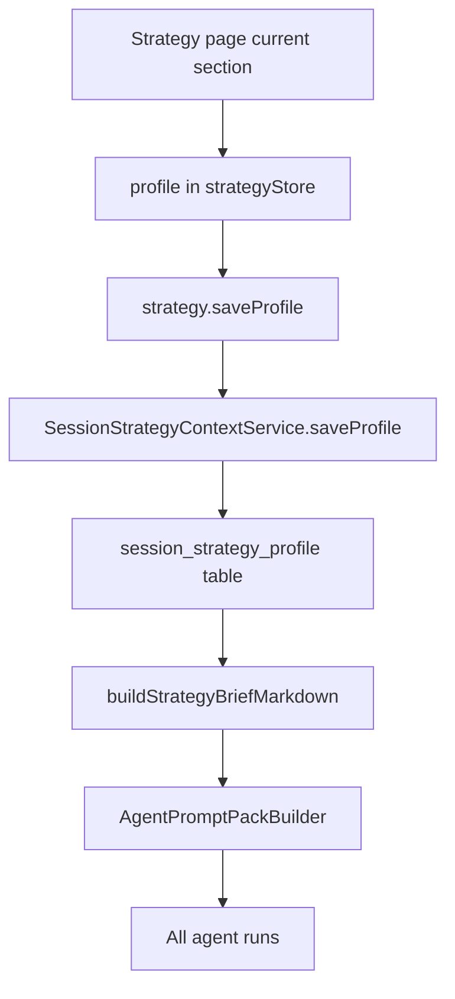
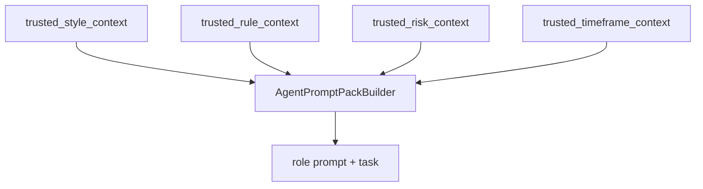

# Strategy Style / Rules Split & Strategy Tab Rewrite — Plan

> **Date:** 2026-05-10
> **Status:** Implemented (local DB-backed verification partially blocked by `better-sqlite3` ABI mismatch)
> **Deciders:** Kenneth Atchon

## 1. Problem Statement

The current Strategy page is mixing two different concepts into one section: the trading style the AI should pursue, and the concrete trade rules that govern entries, exits, and scaling. In the current model, `strategyType`, `sideBias`, `entryStyle`, `exitStyle`, `scalingMode`, and `customInstructions` all live in the same `SessionStrategyProfile` object, are shown under one `Strategy Intent` card in `src/pages/StrategyConfig.tsx`, and are serialized into one prompt-facing strategy brief by `buildStrategyBriefMarkdown()` in `electron/shared/domain.ts`. This creates two problems. First, it makes switching the AI between styles like trend-hunting, catalyst momentum, and institutional-quality trading awkward, because style is entangled with setup rules. Second, the current preset UI is a horizontally scrolling strip of large cards, which wastes space on desktop and scales poorly as more presets are added. If we do nothing, the Strategy page will keep getting more crowded, the AI will keep receiving blended guidance, and future preset expansion will make the surface harder to understand instead of easier.

## 2. Goals & Non-Goals

**Goals**

| # | Goal | Success Looks Like |
|---|------|--------------------|
| G1 | Separate style from rules | Strategy data model has a dedicated style section with its own DB fields, API payloads, store state, and prompt context |
| G2 | Make style switching cheap | A user can switch between style presets without rewriting rule fields or AI prompts |
| G3 | Clarify naming | The current "strategy" subsection is renamed so it no longer implies it owns the whole trading plan |
| G4 | Rewrite preset layout | Desktop Strategy UI no longer relies on a horizontal scrolling preset strip |
| G5 | Support two preset families | The page supports style presets and rules presets independently |
| G6 | Keep AI guidance coherent | Prompt packs cleanly separate style guidance from rule guidance so the model does not receive muddled recommendations |

**Non-Goals**

| # | Non-Goal | Reason |
|---|----------|--------|
| N1 | Rewriting all AI role prompts in this phase | This plan only defines the config/domain split needed so prompt cleanup can be precise |
| N2 | Changing risk or timeframe ownership | `SessionRiskConfig` and `SessionTimeframeConfig` already have a good separation and stay intact |
| N3 | Building historical preset analytics | Preset performance attribution can come later once the domain split exists |
| N4 | Preserving dev-time backward compatibility | The repo already accepts local DB resets during development, so we can prefer a clean schema over compatibility layers |

## 3. Background & Context

Current state in code:

- `src/pages/StrategyConfig.tsx` renders four top-level sections: `strategy`, `risk`, `timeframe`, and `ai_roles`.
- The current `strategy` section contains the `Strategy Intent` card and the horizontally scrolling `PresetRow` (`src/pages/StrategyConfig.tsx:444-503`).
- `src/store/strategyStore.ts` stores only `profile`, `riskConfig`, `timeframe`, `aiRoles`, and related page state.
- `electron/shared/domain.ts` defines `SessionStrategyProfile` with `strategyType`, `sideBias`, `entryStyle`, `exitStyle`, `scalingMode`, `strategyBriefMarkdown`, and `customInstructions`.
- `electron/shared/schemas.ts` mirrors that shape in `sessionStrategyProfilePayloadSchema`.
- `electron/main/services/session/session-strategy-context-service.ts` returns `StrategyPageData` with no separate style object.
- `electron/main/services/ai/strategy-prompt-context.ts` and `electron/shared/domain.ts:691-768` compress all strategy-facing semantics into one brief/snapshot.

This is why the current surface feels overloaded. The page is trying to express:

- the complete trading plan,
- the high-level style or edge being pursued,
- the rule mechanics of a setup,
- the risk guardrails,
- the time horizon,
- and the AI-role prompt/model configuration,

while only giving one top-level subsection the generic label `Strategy`.

### Current Data Flow



This means style and rules are not just visually mixed; they are stored, validated, summarized, and injected together.

## 4. Research Summary

**Modular trading-system separation**

- QuantConnect's Algorithm Framework is explicit about separation of concerns: Alpha generates signals, Portfolio Construction sizes positions, Risk Management adjusts targets, and Execution places trades. Their docs also emphasize that models should not communicate directly and that responsibilities should not overlap.
- The relevant insight for Exva is not the exact module breakdown, but the design discipline: "style/edge thesis" should not live in the same bucket as sizing/risk/execution mechanics if we want components to be swappable and understandable.
- This supports making style a first-class domain object instead of hiding it inside a general strategy profile.
- Sources:
  - https://www.quantconnect.com/docs/v2/writing-algorithms/algorithm-framework/overview
  - https://www.quantconnect.com/docs/v2/writing-algorithms/algorithm-framework/alpha/key-concepts
  - https://www.quantconnect.com/docs/v2/writing-algorithms/algorithm-framework/risk-management/key-concepts

**Desktop UX and horizontal scrolling**

- Nielsen Norman Group's guidance remains clear: horizontal scrolling on desktop is easy to miss, fights the user's mental model, and hides content behind weak information scent.
- That maps directly to the current preset row. A horizontally scrolling set of preset cards is acceptable for secondary browsing, but poor for a primary configuration control that should be immediately visible and editable.
- This supports replacing the current scroll-strip with a compact selector plus an always-visible summary panel.
- Source:
  - https://www.nngroup.com/articles/horizontal-scrolling/

**Compact selector and layered-content component patterns**

- shadcn/ui's `Combobox` and `Tabs` primitives support a compact selector plus a single active content panel pattern, which is a much better fit than a row of large cards when the list of presets is expected to grow.
- `Combobox` supports searchable flat or grouped lists, while `Tabs` supports showing one panel at a time with a small, predictable trigger area.
- This supports a design where style and rules each have a compact preset picker, with their details rendered in a small summary card below rather than inside the picker itself.
- Sources:
  - https://ui.shadcn.com/docs/components/combobox
  - https://ui.shadcn.com/docs/components/tabs

## 5. Options Considered

**Option A: Do nothing except tweak prompt text**

Keep the existing Strategy section, keep `SessionStrategyProfile` as-is, and try to solve the problem by rewriting prompts or stuffing more nuance into `customInstructions`.

| Dimension | Assessment |
|-----------|------------|
| Complexity | Low |
| Performance | No meaningful change |
| Reliability | High technically, low product clarity |
| Cost | Lowest immediate engineering cost |
| Reversibility | Easy |
| Stack fit | Fits current code, but preserves current ambiguity |
| Team readiness | Immediate |

Risks:

- Product ambiguity stays in the data model, so prompt fixes become fragile.
- Preset growth worsens the UI without addressing the underlying mismatch.
- Users still cannot switch style independently from rule mechanics.

Open questions:

- Can prompt-only changes compensate for a domain model that still mixes concerns? Probably not for long.

**Option B: Add a style textarea/preset but keep it inside `SessionStrategyProfile`**

Add a new `styleInstructions` field and maybe `stylePresetId`, but keep them inside the existing `profile` object and existing Strategy card.

| Dimension | Assessment |
|-----------|------------|
| Complexity | Medium-low |
| Performance | No meaningful change |
| Reliability | Medium |
| Cost | Moderate |
| Reversibility | Good |
| Stack fit | Strong additive fit |
| Team readiness | High |

Risks:

- The domain remains conceptually muddy: one profile now holds both style and rules.
- UI clutter gets worse because another concern is added into the same section.
- Future prompt builders still need to tease apart two concepts from one payload.

Open questions:

- Would additive fields inside one object simply postpone a cleaner split by one more refactor? Likely yes.

**Option C: Recommended — split style into its own domain surface and rewrite the page around it**

Create a dedicated style section with its own table, types, schemas, IPC saves, store state, presets, and prompt context. Rename the current `strategy` subsection to `Rules`, and rewrite the preset UI into compact selectors plus active-summary cards.

| Dimension | Assessment |
|-----------|------------|
| Complexity | Medium |
| Performance | Negligible overhead |
| Reliability | High once migrated because boundaries are clear |
| Cost | Higher than prompt-only changes, but still bounded to one page/domain area |
| Reversibility | Moderate; schema and types change |
| Stack fit | Strong fit with existing split objects for risk/timeframe/AI roles |
| Team readiness | High; existing code already uses dedicated profile/risk/timeframe repositories and IPC handlers |

Risks:

- Name churn across types, schemas, templates, and prompt builders can create temporary confusion.
- If style fields are too detailed, we can over-model taste instead of storing actionable guidance.
- Preset interactions need clear precedence rules when both style and rules presets are present.

Open questions:

- How many style fields are necessary for v1 before presets become over-engineered?
- Should style presets be allowed to influence AI role defaults later, or stay strictly in prompt context for now?

## 6. Recommendation

**We recommend Option C: split style into a dedicated domain surface and rename the current Strategy subsection to Rules.**

This is the smallest change that actually solves the real problem instead of moving it around. Exva already separates risk and timeframe into dedicated objects and save handlers. Style deserves the same treatment because it is conceptually different from setup rules. This recommendation wins over the status quo because it removes ambiguity from both the UI and the prompt context. It wins over the additive-in-one-profile option because it creates a stable model for future preset growth instead of piling more fields into an already overloaded object.

Key assumptions:

- Style can be expressed with a small, opinionated set of fields plus freeform notes.
- Rules should remain the home for setup mechanics like side bias, entry/exit, scaling, and any setup-specific overrides.
- Development can tolerate a clean schema migration or local DB reset if that keeps the model simpler.

Conditions that would change the recommendation:

- If style presets are proven to affect only prompt prose and never UI logic, a prompt-only style object might be enough.
- If the page is going to be fully redesigned into a guided wizard in the very next phase, a deeper page-level split might be more appropriate than sectional refactoring.

## 7. Implementation Plan

### Phase 1: Rename the concepts and define the target domain

Goal: establish the new vocabulary before schema and UI work starts.

Done criteria:

- Decide final user-facing names.
- Decide final TypeScript/DB object names.
- Decide whether to do direct rename migration vs. additive migration.

Deliverables:

- [x] Rename current Strategy page sections in the plan/spec language to: `Style`, `Rules`, `Risk`, `Timeframe`, `AI Roles`
- [x] Rename current card label `Strategy Intent` to `Trade Rules`
- [x] Rename current field labels:
  - `Strategy type` -> `Setup type`
  - `Custom instructions` -> `Rule notes`
- [x] Keep `Side bias`, `Entry style`, `Exit style`, and `Scaling mode` as rule fields
- [x] Decide code naming target:
  - `SessionStrategyProfile` -> `SessionTradeRules`
  - `strategyType` -> `setupType`
  - `customInstructions` -> `ruleNotes`

Dependencies:

- None

Risks and detection:

- Risk: we rename only labels and not domain types, leaving mismatch.
- Detect by reviewing doc, type, schema, and IPC names together before implementation starts.

Rollback plan:

- None needed; this phase is documentation and naming only.

### Phase 2: Add a dedicated style model and storage layer

Goal: style becomes a first-class persisted object.

Recommended new domain object:

```ts
interface SessionTradingStyle {
  sessionId: string;
  stylePresetId: TradingStylePresetId;
  discoveryMode: "trend_scan" | "catalyst_scan" | "quality_watchlist" | "event_contract_scan" | "custom";
  evidenceMode: "narrative_first" | "price_action_first" | "confirmation_first" | "probability_edge" | "balanced";
  catalystMode: "required" | "preferred" | "not_required";
  fundamentalStrictness: "sanity_check" | "balanced" | "deep_confirmation" | "not_applicable";
  styleNotes: string;
  updatedAt: string;
}
```

Recommended style presets for v1:

- `trend_hunt`
- `catalyst_momentum`
- `institutional_quality`
- `mean_reversion_dislocation`
- `prediction_event_edge`
- `custom`

Recommended rules presets for v1:

- `breakout_long`
- `pullback_trend`
- `event_entry`
- `reversal_fade`
- `probability_edge`
- `custom`

Done criteria:

- Dedicated style table exists.
- Shared types and zod schemas include style.
- Strategy page payloads include style.
- Templates/duplication carry style data.

Deliverables:

- [x] Add `session_trading_style` table in `electron/main/db/schema.ts` and migrations
- [x] Add `SessionTradingStyle` type and `TradingStylePresetId` enum in `electron/shared/domain.ts`
- [x] Add zod schemas in `electron/shared/schemas.ts`
- [x] Add style repo under `electron/main/db/repositories/`
- [x] Extend `StrategyPageData` and `StrategyGetResponse` to include `style`
- [x] Add IPC get/save channels for style alongside profile/risk/timeframe
- [x] Include style in session template payloads and duplicate flows

Implementation note:

- The shipped style schema adds `mean_reversion_scan` as a `discoveryMode` so the `mean_reversion_dislocation` preset can stay first-class without overloading `custom`.

Dependencies:

- Phase 1 naming decision

Risks and detection:

- Risk: style fields overlap too much with rules.
- Detect by mapping every field to a single question: "what edge are we pursuing?" vs. "how do we structure a trade?"

Rollback plan:

- Since this repo accepts dev resets, rollback is reverting the migration and restoring the previous payload shape before broader page changes land.

### Phase 3: Refactor the Strategy page store, service, and prompt builder

Goal: runtime and save flows understand the style/rules split.

Done criteria:

- `strategyStore` loads, edits, validates, and saves style independently from rules.
- Prompt building emits separate style and rules blocks.
- AI receives coherent context with no blended phrasing.

Deliverables:

- [x] Extend `src/store/strategyStore.ts` with `style` state and `updateStyle()`
- [x] Add `saveStyle()` path to `SessionStrategyContextService`
- [x] Rename the current `profile` concept to `rules` through the store/service/API surface
- [x] Replace monolithic brief-building with separate renderers:
  - `buildTradingStyleMarkdown(style)`
  - `buildTradeRulesMarkdown(rules)`
- [x] Update `AgentPromptPackBuilder` and `strategy-prompt-context.ts` to inject distinct blocks

Recommended prompt shape:



Dependencies:

- Phase 2 types and storage

Risks and detection:

- Risk: prompt builder still emits one generic "strategy" brief and loses the benefit of the split.
- Detect with prompt-pack unit tests asserting distinct sections and snapshots.

Rollback plan:

- Revert the new renderer functions and collapse style/rules back into the old brief if prompt tests show degraded output quality before UI ships.

### Phase 4: Rewrite the Strategy tab layout

Goal: replace the current large horizontal preset strip and overloaded Strategy subsection with a compact, scalable desktop layout.

Recommended layout:

```mermaid
flowchart TD
  Page[Strategy page]
  Page --> Tabs[Sections: Style | Rules | Risk | Timeframe | AI Roles]
  Tabs --> StylePanel[Style panel]
  Tabs --> RulesPanel[Rules panel]
  StylePanel --> StylePicker[Compact style preset combobox/select]
  StylePanel --> StyleSummary[Selected preset summary card]
  StylePanel --> StyleOverrides[Small override form]
  RulesPanel --> RulesPicker[Compact rules preset combobox/select]
  RulesPanel --> RulesSummary[Selected preset summary card]
  RulesPanel --> RulesForm[Rule fields form]
```

Recommended Style panel:

- Preset picker at top using `Combobox` or `Select`
- One compact summary card below with:
  - preset badge
  - one-line thesis
  - 3-4 bullets describing discovery/evidence/catalyst posture
- Override fields under the summary card
- No horizontal scrolling

Recommended Rules panel:

- Small preset picker above the form
- `Trade Rules` card title
- Form fields:
  - `Setup type`
  - `Side bias`
  - `Entry style`
  - `Exit style`
  - `Scaling mode`
  - `Rule notes`
- Candidate new rules fields to consider in this phase:
  - `entryConfirmation` enum
  - `liquidityFloorUsd` nullable number
  - `avoidEarningsWindowDays` nullable number

Why this layout:

- It eliminates the desktop horizontal-scroll anti-pattern.
- It makes the active preset legible without requiring giant cards.
- It scales from 5 presets to 15+ presets without destroying the page width.
- It lets Style and Rules evolve independently.

Done criteria:

- No horizontal preset strip remains.
- Style and Rules panels each have compact preset selection.
- Current selected preset is visible without opening the picker.

Deliverables:

- [x] Remove `PresetRow` horizontal card strip from `src/pages/StrategyConfig.tsx`
- [x] Add `style` section tab and rename `strategy` tab to `rules`
- [x] Build compact preset selectors using existing shadcn primitives
- [x] Add summary cards instead of card-per-preset browsing
- [x] Keep mobile behavior stacked and single-column

Dependencies:

- Phase 2 and 3 payload/store changes

Risks and detection:

- Risk: selector + summary becomes too abstract compared with visible cards.
- Detect by checking whether the active preset remains understandable at a glance without opening the picker.

Rollback plan:

- If the compact picker is unclear, keep the summary card and fall back to a vertically stacked radio/toggle group, not a horizontal scroll strip.

### Phase 5: Add preset semantics and precedence rules

Goal: define how style presets, rules presets, and manual edits interact.

Done criteria:

- The page has deterministic behavior when a preset is applied after manual edits.
- Dirty state and reset behavior are clear.

Recommended precedence:

1. Applying a style preset only updates style fields.
2. Applying a rules preset only updates rules fields.
3. Manual edits mark only the touched subsection dirty.
4. Risk, timeframe, and AI roles are unaffected by style/rules preset changes.
5. Future "apply full playbook" support can intentionally update both style and rules, but is out of scope for this phase.

Deliverables:

- [x] Define preset application scope in store logic
- [x] Add `presetSource` metadata to the page state if useful for badges/UI copy (not needed for the current summary-card UI)
- [ ] Add tests for partial preset application and dirty-state behavior

Verification note:

- `bun run typecheck` passes.
- Focused prompt-context tests pass.
- DB-backed repository/service tests remain blocked locally by the existing `better-sqlite3` native-module ABI mismatch in this environment.

Dependencies:

- Phase 3 store refactor

Risks and detection:

- Risk: a preset silently overwrites unrelated fields.
- Detect with store-level tests asserting field-level updates only.

Rollback plan:

- Remove scoped preset application and require explicit confirmation before applying any preset if overwrite semantics are unclear.

## 8. Risk Register

| # | Risk | Likelihood | Impact | Mitigation |
|---|------|-----------|--------|------------|
| R1 | Style and rules fields still overlap conceptually | Medium | High | Keep v1 style schema intentionally small and opinionated |
| R2 | Naming churn breaks too many code paths at once | Medium | Medium | Split implementation into schema, service, then UI phases |
| R3 | Compact preset selector reduces discoverability | Low | Medium | Pair selector with always-visible summary card |
| R4 | Prompt builder still compresses style and rules into one paragraph | Medium | High | Add prompt-pack tests for separate sections |
| R5 | Rules section becomes too thin after style extraction | Medium | Medium | Add 1-3 concrete rule fields only if they fill a real gap |

## 9. Success Criteria

| Goal | Metric | Baseline | Target | How Measured |
|------|--------|----------|--------|--------------|
| G1 | Distinct persisted style object exists | 0 dedicated style objects | 1 dedicated style object per session | Schema + API inspection |
| G2 | Time to switch styles | Requires editing mixed fields/prompt text | Style preset switch in <= 2 interactions | Manual QA |
| G3 | Desktop preset usability | Horizontal scroll strip required | No horizontal scroll needed for preset switching | Manual QA on desktop |
| G4 | Prompt clarity | One blended strategy brief | Separate style/rules prompt sections | Prompt-pack tests |
| G5 | Preset independence | One preset concept | Style and rules presets can be applied independently | Store tests + manual QA |

Leading indicators:

- `StrategyGetResponse` cleanly returns `style` + `rules` + `risk` + `timeframe`
- `strategyStore` tracks subsection dirty state correctly
- Prompt snapshots show separate style and rules blocks

Lagging indicators:

- Users can rapidly switch between trading styles without touching AI role prompts
- Strategy page remains understandable after more presets are added

## 10. Open Questions

| # | Question | Owner | Needed By | Status |
|---|----------|-------|-----------|--------|
| Q1 | Should `strategyType` be fully renamed in DB to `setupType`, or only at the TypeScript/UI layer first? | Kenneth | Before Phase 2 | Open |
| Q2 | Should style presets eventually cascade AI role defaults, or stay prompt-context-only? | Kenneth | Before Phase 5 | Open |
| Q3 | Do we want a future "full playbook" preset that applies style + rules together, or explicitly keep them separate? | Kenneth | Before Phase 5 | Open |
| Q4 | Which candidate extra rule fields are genuinely needed now vs. speculative? | Kenneth | Before Phase 4 | Open |

## 11. Alternatives Rejected

| Option | Why Rejected |
|--------|-------------|
| Prompt-only fix | Does not solve the mixed data model or the preset UI problem |
| Add style fields into existing profile only | Preserves conceptual overlap and page clutter |
| Keep horizontal preset cards and just shrink them | Improves size but not the desktop discoverability/scalability problem |

## Appendix: Proposed Naming Rewrite

### Current

- Section tab: `Strategy`
- Card: `Strategy Intent`
- Field: `Strategy type`
- Field: `Custom instructions`

### Proposed

- Section tab: `Rules`
- New section tab: `Style`
- Card: `Trade Rules`
- Field: `Setup type`
- Field: `Rule notes`

### Fields staying as rule concepts

- `Side bias`
- `Entry style`
- `Exit style`
- `Scaling mode`

### Why this naming is better

- `Strategy` becomes the name of the whole page again, meaning the complete trading plan.
- `Style` answers: what kind of edge or posture are we pursuing?
- `Rules` answers: how do we structure and filter actual trades?
- `Risk` and `Timeframe` keep their existing narrow meanings.
