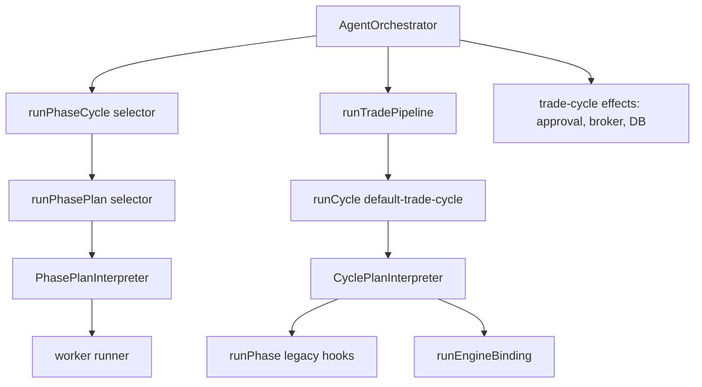
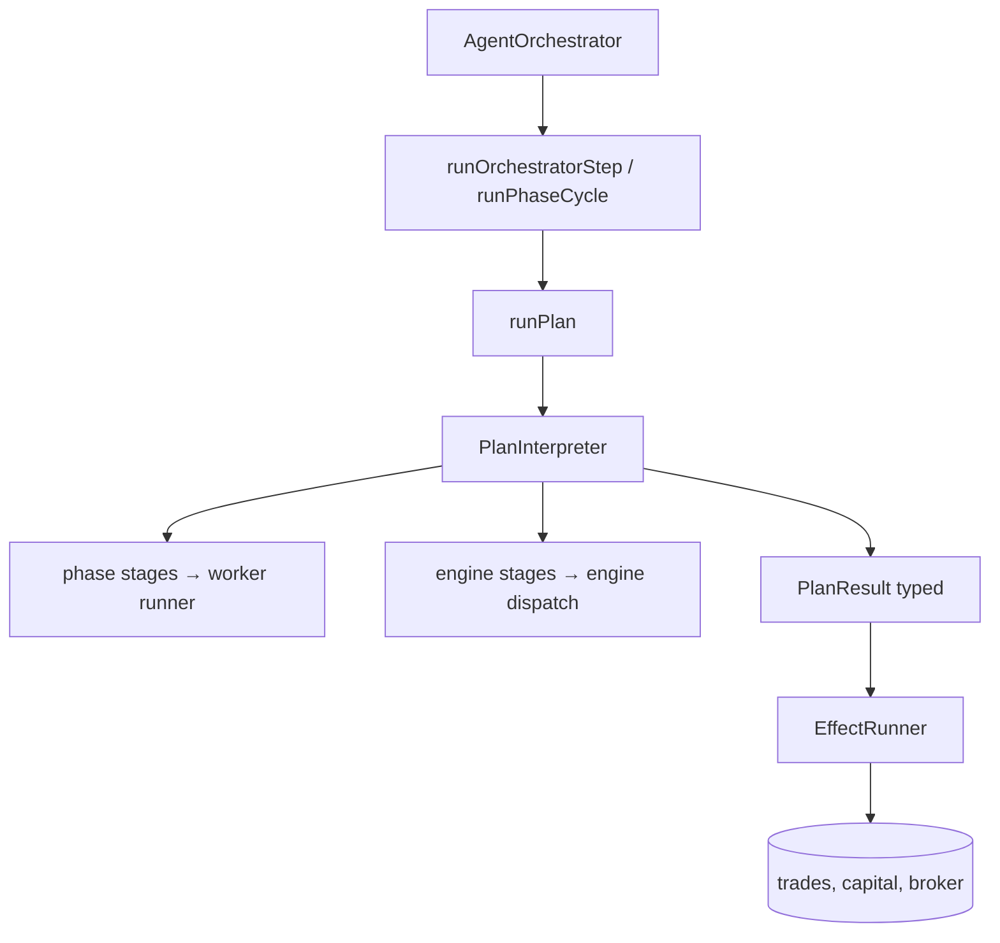

# Unified Pipeline Plan — Flexibility Plan

> **Date:** 2026-05-19  
> **Status:** Draft  
> **Deciders:** Exva engineering  
> **Related:** [Orchestration + Pipeline Runtime Architecture Review](../reviews/orchestration-pipeline-architecture-review-2026-05-19.md), [Selector Custom Configuration Debt](../reviews/selector-custom-configuration-debt-2026-05-19.md)

---

## 1. Problem Statement

Exva's pipeline migration (Phases 1–3, completed 2026-05-19) moved selector onto `PhasePlanInterpreter` and trade onto `CyclePlanInterpreter`, but the system still runs **three execution paths** for one product workflow: `runPhasePlan` (selector), `runCycle` (trade policy + ordering), and `runPhase` → custom `PipelineDefinition.run()` hooks (technical, fundamental, review, decision).

Adding a new trade stage today still requires editing procedural TypeScript in multiple places. `default-trade-cycle.ts` is 246 lines of hand-written `execute()` functions; `trade-cycle.ts` is 226 lines of side effects plus stage-specific failure branches; state is duplicated between `TradeCyclePlanState` and `TradeCycleContext` with manual seed/apply shims in `run-trade-pipeline.ts`.

The forcing function is onboarding cost: every new worker, policy gate, instrument-class variant, or stage reorder currently touches 2–4 files across `plan/`, `definitions/`, and `orchestration/`. The architecture review's goal — **configure pipelines without editing orchestration** — is only true for selector. Trade is "configured" in name but imperative in practice.

If nothing changes, each future phase (options flow, prediction-market liquidity check, alternate trade cycles) will copy the selector/trade/cycle pattern and produce a fourth parallel interpreter or another 200-line plan file. The debt doc's "ballooning" pattern repeats at the session level instead of the selector level.

---

## 2. Goals & Non-Goals

### Goals

| #   | Goal                                      | Success Looks Like                                                                                                                |
| --- | ----------------------------------------- | --------------------------------------------------------------------------------------------------------------------------------- |
| G1  | **One plan model** for selector and trade | Single registry + interpreter; no separate mental models for "phase plan" vs "cycle plan"                                         |
| G2  | **Declarative stage definitions**         | Reordering or adding an engine stage is a config diff, not a new `execute()` function                                             |
| G3  | **PhasePlans for all AI stages**          | Technical→decision run through the same machinery as selector; legacy `run()` hooks removed                                       |
| G4  | **Clear plan vs effects boundary**        | Orchestration receives typed `PlanResult` and runs effects (trade insert, approval, broker placement) without knowing stage order |
| G5  | **Inspectable resolved config**           | DevPanel shows full session workflow: stages, engines, input builders, failure policies — not just five `PipelinePhase` buckets   |
| G6  | **Preserve step persistence**             | Per-stage retry/pause via `ExecutionStepRunner` continues to work; no regression in orchestrator tests                            |

### Non-Goals

| #   | Non-Goal                                           | Reason                                                                                         |
| --- | -------------------------------------------------- | ---------------------------------------------------------------------------------------------- |
| NG1 | JSON/YAML config files in v1                       | Typed TS constants are fine; goal is data-shaped plans interpreted by runtime, not file format |
| NG2 | Full session DAG in one plan (selector → N trades) | Valuable later; scope explosion for v1; keep selector fan-out in orchestration queue           |
| NG3 | Moving broker placement into pipeline runtime      | Real-world side effect; stays in orchestration effect runner                                   |
| NG4 | Replacing `ExecutionStepRunner`                    | Works well; plans integrate via existing `runStep` hook                                        |
| NG5 | External workflow engine (Temporal, etc.)          | In-process Electron app; unnecessary operational complexity                                    |

---

## 3. Background & Context

### Current state (post Phase 3)

| Component              | Path                                                                    | Role today                                               |
| ---------------------- | ----------------------------------------------------------------------- | -------------------------------------------------------- |
| Phase plan interpreter | `plan/phase-plan-interpreter.ts` (163 lines)                            | Selector: cache, entry modes, worker frontiers, finalize |
| Cycle plan interpreter | `plan/cycle-plan-interpreter.ts` (87 lines)                             | Trade: sequential stages, optional `runStep` wrapper     |
| Selector plan          | `plan/plans/selector-plan.ts` (277 lines)                               | Procedural but uses worker stages + registries           |
| Trade cycle plan       | `plan/plans/default-trade-cycle.ts` (246 lines)                         | Procedural `execute()` per stage                         |
| Orchestrator lifecycle | `orchestration/cycle/orchestrator-step.ts`                              | Shared retry/pause/step runner                           |
| Trade orchestration    | `trade/run-trade-pipeline.ts` (87 lines) + `trade-cycle.ts` (226 lines) | Bridges cycle → context; runs effects                    |
| Legacy phase hooks     | `definitions/{technical,fundamental,review,decision}.phase.ts`          | Custom `run()` still authoritative for AI phases         |
| Effective config       | `effective-pipeline-config.ts`                                          | Phase-level metadata; no cycle stage graph               |

### Constraints

- Live trade cycles must not break during migration; incremental shippable phases required.
- `ExecutionStage` union is wired to UI (`SessionExecutionProgress`) and DB (`session_execution_steps`); stage IDs cannot change without migration.
- Engine registry already has policy/validator engines; binding `mode` type only allows `read | write | finalize` — policy engines currently use `mode: "read"` as a workaround.
- `PhasePlanServices` / `CyclePlanServices` duplicate wiring in `app-services.ts`.

### Prior work

| Phase                        | Outcome                                                                                   |
| ---------------------------- | ----------------------------------------------------------------------------------------- |
| Phase 1                      | `EffectivePipelineConfig`, DevPanel visibility, engine validation                         |
| Phase 2                      | Selector → `PhasePlanInterpreter`; removed selector-specific orchestration                |
| Phase 3                      | Trade → `CyclePlanInterpreter`; removed `runAiPipeline()`; engines for CV/risk/allocation |
| Orchestration generalization | `runOrchestratorStep`, `runPhaseCycle`; collapsed selector call chain                     |

**Lesson from selector debt doc:** moving lines without collapsing concepts produces parallel descriptions of the same behavior. The next migration must unify concepts, not add a third interpreter.

---

## 4. Research Summary

### Declarative vs imperative orchestration

Data-engineering orchestration went through the same tension Exva faces: Airflow's imperative DAGs (Python defines every step) vs Dagster's asset/graph model where dependencies and stages are declared and the runtime dispatches. Industry consensus in 2024: **pure imperative scales poorly** (reorder = rewrite functions; hidden dependencies); **pure declarative scales poorly for one-off escape hatches** (complex conditional logic fights YAML). The dominant pattern is **declarative structure + code escape hatches** — Dagster's hybrid (Python assets with declarative metadata), Prefect's `@flow` with explicit task graph.

**Key insight for Exva:** Selector already follows the hybrid well (declarative worker stages + procedural finalize). Trade cycle regressed to imperative `execute()` functions. The fix is not "YAML everything" — it is **data-shaped stage tables with a generic dispatcher**, keeping `execute()` only as an escape hatch.

Sources:

- [Declarative Data Pipelines: Moving from Code to Configuration](https://dev.to/jonathanbhaskar/declarative-data-pipelines-moving-from-code-to-configuration-1i13)
- [The Orchestration Dilemma: Declarative vs Imperative](https://www.dsstream.com/post/the-orchestration-dilemma-declarative-vs-imperative-patterns-in-modern-data-engineering)
- [Airflow vs Dagster key differences (2024)](https://getorchestra.io/guides/airflow-vs-dagster-key-differences-2024)

### Workflow engine stage identity separation

Mature workflow systems separate **logical stage ID** (plan config) from **persistence/observability key** (what gets recorded). AWS Step Functions state names, Temporal activity types, and Dagster op names can differ from UI labels. Exva currently conflates these: `CyclePlanStage.executionStage` must be an `ExecutionStage` union member, forcing hidden work (execution profile + broker allocation) inside the `risk_gate` step.

**Key insight:** Introduce `PipelineStageId` for plan config; map optionally to `ExecutionStage` for step persistence. Enables granular DevPanel stages without DB migration every time.

Source: [Workflow engines research (Val Town wrkflw)](https://www.val.town/x/nbbaier/wrkflw/branch/fix-api/code/workflow-engines-research-report.md) — compares state-machine vs DAG vs event-driven models; all separate logical graph from execution record.

### Plan/effect split (commands pattern)

Side-effect boundaries in pipeline systems (dbt run → warehouse write, ML pipeline → model deploy) consistently use **plan produces artifact, runner applies effects**. Mixing policy evaluation with broker order placement creates duplicate paths (main trade cycle vs `approval-recheck.ts` both call risk/order engines).

**Key insight:** `PlanResult` should be a typed terminal artifact; orchestration's `EffectRunner` is the only place that touches trades repo, capital, broker adapters.

---

## 5. Options Considered

### Option A: Status quo — incremental patches only

Keep `PhasePlanInterpreter` + `CyclePlanInterpreter` + legacy `runPhase()`. Add new stages by editing `default-trade-cycle.ts` execute functions.

| Dimension      | Assessment                |
| -------------- | ------------------------- |
| Complexity     | Low near-term             |
| Performance    | No change                 |
| Reliability    | Known behavior            |
| Cost           | Low now, high compounding |
| Reversibility  | N/A                       |
| Stack fit      | Matches current code      |
| Team readiness | Immediate                 |

**Risks:** Continued ballooning; approval-recheck and future variants diverge; DevPanel never shows true graph. **Likelihood:** High if no plan is adopted.

---

### Option B: Minimal — declarative engine stages only

Replace `execute()` functions in `default-trade-cycle.ts` with a stage table `{ kind: "engine", engineId, inputBuilderId }` + generic dispatcher. Keep dual interpreters and legacy `runPhase()` for AI stages.

| Dimension      | Assessment                                   |
| -------------- | -------------------------------------------- |
| Complexity     | Medium                                       |
| Performance    | No change                                    |
| Reliability    | Improves testability of engine wiring        |
| Cost           | ~1 week                                      |
| Reversibility  | Easy — swap table back to functions          |
| Stack fit      | Extends existing registries (input builders) |
| Team readiness | High — mirrors selector input builders       |

**Risks:** Still three execution paths; AI phases remain special. **Open question:** Is engine input builder registry enough without PhasePlans for technical?

---

### Option C: Recommended — unified plan runtime with declarative stages

1. **Merge interpreters** into `PlanInterpreter` with stage kinds: `phase | engine | engine-chain | custom`.
2. **Declarative stage config** in TS constants; generic dispatch for phase/engine stages.
3. **Migrate technical→decision to PhasePlans** (same pattern as selector).
4. **Unify state** — single `PipelineRunState` per trade cycle; remove seed/apply shims.
5. **Effect runner** — orchestration module that consumes `TradePlanResult` and runs approval/capital/broker.
6. **Extend EffectivePipelineConfig** to include cycle stage graph.

| Dimension      | Assessment                                               |
| -------------- | -------------------------------------------------------- |
| Complexity     | High upfront, low ongoing                                |
| Performance    | Neutral (same call depth)                                |
| Reliability    | Fewer duplicate paths; single validation pass            |
| Cost           | ~3–4 weeks phased                                        |
| Reversibility  | Phase-by-phase; legacy hooks kept until Phase C complete |
| Stack fit      | Direct extension of Phase 2/3 work                       |
| Team readiness | Requires disciplined phase sequencing                    |

**Risks:** Big-bang temptation; interpreter merge could break selector. Mitigate with adapter layer and test parity.

---

### Option D: External workflow engine (Temporal / custom DAG service)

Extract all stage execution to an external durable workflow engine with persisted state machine.

| Dimension      | Assessment                                |
| -------------- | ----------------------------------------- |
| Complexity     | Very high                                 |
| Performance    | Network/process overhead in Electron      |
| Reliability    | Strong durability, wrong deployment model |
| Cost           | Large                                     |
| Reversibility  | Hard                                      |
| Stack fit      | Poor — desktop app, in-process today      |
| Team readiness | Low                                       |

**Rejected** for NG5; revisit only if Exva moves to server-side orchestration.

---

## 6. Recommendation

**We recommend Option C: Unified plan runtime with declarative stages**, delivered in five shippable phases (below).

**Why not status quo (A):** Compounding cost already visible — 246-line procedural trade plan, duplicate approval-recheck path, three runtime entrypoints. Next feature will cost 2–4× what it should.

**Why not minimal only (B):** Fixes engine wiring but leaves AI phases on legacy `run()` hooks — the largest remaining flexibility gap. You would migrate engine stages twice (once for declarative, again when unifying interpreters).

**Why not external engine (D):** Wrong deployment model for Electron; massive ops burden.

**Key assumptions:**

- Trade cycle correctness is covered by existing orchestrator + pipeline tests; we can require parity before deleting legacy paths.
- `ExecutionStage` union can gain optional mapping from richer `PipelineStageId` without breaking UI.
- Technical/fundamental/review/decision worker graphs can be expressed as PhasePlans without changing worker output contracts.

**Would change recommendation if:**

- Team needs a new trade stage shipped in <1 week → do Option B as a bridge, then C.
- PhasePlan migration for technical proves incompatible with current worker graphs → keep `runPhase` as permanent escape hatch for AI stages only, still unify cycle shell.

---

## 7. Implementation Plan

### Phase A: Declarative engine stages (bridge)

**Goal:** Replace procedural engine wiring in `default-trade-cycle.ts` with data + dispatch.

**Done when:** `default-trade-cycle.ts` stage table is declarative for all engine stages; no `runEngineBinding` calls in plan file; engine input builders registered.

**Deliverables:**

- `plan/engine-input-builder-registry.ts` (mirror `input-builder-registry.ts`)
- Builders: `candidate-validation`, `post-decision-risk`, `broker-allocation`
- `plan/stage-dispatch.ts` — `runEngineStage(config, ctx, state)`
- Refactor `DEFAULT_TRADE_CYCLE` to stage config array; keep AI stages as thin `execute` wrappers temporarily
- Unit tests per input builder; snapshot of stage table

**Dependencies:** None (builds on Phase 3).

**Rollback:** Revert to execute functions in `default-trade-cycle.ts`.

**Risks:** Input builder contracts drift from engine expectations → validate against existing engine tests at registration time.

---

### Phase B: Unified plan types (adapter layer)

**Goal:** One plan shape and registry; keep both interpreters internally.

**Done when:** `PlanDefinition` type exists; selector and trade cycle register as plans; `AiRuntime.runPlan(id)` delegates to correct interpreter.

**Deliverables:**

- `plan/plan-types.ts` — unified `PlanStage` discriminated union
- `plan/plan-registry.ts` — keyed by string id (`"selector"`, `"default-trade-cycle"`)
- `AiRuntime.runPlan()` facade; deprecate direct `runPhasePlan` / `runCycle` in orchestration
- `EffectivePipelineConfig` extended with `planStages[]` for DevPanel

**Dependencies:** Phase A (engine stage shape stable).

**Rollback:** Facade delegates to old APIs; no caller changes required if facade is thin.

---

### Phase C: PhasePlans for trade AI stages

**Goal:** Technical, fundamental, review, decision use `PhasePlanInterpreter`; cycle stages reference them declaratively.

**Done when:** Legacy `run()` removed from four phase definitions; cycle AI stages are `{ kind: "phase", phase: "technical" }` etc.

**Deliverables:**

- `plan/plans/technical-plan.ts` (or shared analysis plan with variants — decide in OQ1)
- `plan/plans/fundamental-plan.ts`, `review-plan.ts`, `decision-plan.ts`
- Register in `register-default-plans.ts`
- Cycle plan AI stages become declarative phase references
- Delete custom `run()` from `definitions/*.phase.ts` (metadata only, like selector)
- Parity tests: same worker IDs, output schemas, finalizer engines as today

**Dependencies:** Phase B.

**Rollback:** Cycle plan stages call `runPhase()` legacy path via feature flag per phase.

---

### Phase D: Merge interpreters + unified state

**Goal:** Single `PlanInterpreter`; remove duplicate state mapping.

**Done when:** `PhasePlanInterpreter` and `CyclePlanInterpreter` deleted or internal; `TradeCycleContext` uses `PipelineRunState` directly; no `seedState` / `applyTradePipelineToContext`.

**Deliverables:**

- `plan/plan-interpreter.ts` — handles phase stages (worker graphs), engine stages, sequential composition
- `PipelineRunState` replaces `TradeCyclePlanState` + overlapping context fields
- `run-trade-pipeline.ts` simplified to `runPlan + map errors`
- Move `ToolStepTrace` to `electron/shared` (fix layer leak)

**Dependencies:** Phase C.

**Rollback:** Keep adapter that wraps old interpreters if merge proves risky.

---

### Phase E: Effect runner + orchestration shrink

**Goal:** Orchestration owns lifecycle + effects only; no stage-order knowledge.

**Done when:** `trade-cycle.ts` <100 lines; `approval-recheck.ts` uses `runPlan(..., { lastStageId })` + shared effect runner; failure policies declared on stages.

**Deliverables:**

- `orchestration/cycle/trade/effect-runner.ts` — persist trade, approval, capital, broker order
- Stage metadata: `failurePolicy: "warn" | "fail" | "reject_trade"`
- Generic `runStep` reads failure policy from plan (remove candidate_validation special case in orchestration)
- `order-policy` engine stage at broker placement via effect runner preflight hook
- Architecture review Phase 5 checklist closed

**Dependencies:** Phase D.

**Rollback:** Effect runner calls existing trade-cycle functions internally.

---

### Target architecture (end state)

---

## 8. Risk Register

| #   | Risk                                                  | Likelihood | Impact | Mitigation                                                           |
| --- | ----------------------------------------------------- | ---------- | ------ | -------------------------------------------------------------------- |
| R1  | Selector regression during interpreter merge          | Medium     | High   | Phase B adapter; selector tests gate every PR                        |
| R2  | PhasePlan for technical changes worker behavior       | Medium     | High   | Parity snapshots of worker schedules + output schemas before/after   |
| R3  | ExecutionStage / UI mismatch when splitting risk_gate | Low        | Medium | Map multiple `PipelineStageId` → one `ExecutionStage` initially      |
| R4  | Engine input builders duplicate orchestration logic   | Medium     | Medium | Builders call same engine task shapes as today; shared test fixtures |
| R5  | Scope creep into session-level DAG                    | Medium     | Medium | Non-goal NG2; explicit phase gate before fan-out plan                |
| R6  | DevPanel config surface incomplete                    | Low        | Low    | Phase B deliverable; don't wait for full merge                       |

---

## 9. Success Criteria

| Goal                  | Metric                                | Baseline                                   | Target                     | How Measured                             |
| --------------------- | ------------------------------------- | ------------------------------------------ | -------------------------- | ---------------------------------------- |
| G1 One plan model     | Runtime entrypoints for orchestration | 3 (`runPhasePlan`, `runCycle`, `runPhase`) | 1 (`runPlan`)              | Grep + architecture review               |
| G2 Declarative stages | Lines of `execute()` in trade plan    | 246                                        | <80 (escape hatches only)  | `wc -l`                                  |
| G3 PhasePlans for AI  | Phases with custom `run()` hook       | 4                                          | 0                          | `definitions/*.phase.ts`                 |
| G4 Plan/effect split  | Direct engine calls in orchestration  | approval-recheck + broker step             | effect runner only         | Grep `runEngineBinding` in orchestration |
| G5 Inspectability     | DevPanel shows stage graph            | Phase buckets only                         | Full plan stages + engines | Manual + snapshot test                   |
| G6 Step persistence   | Orchestrator tests passing            | 15/15                                      | 15/15 + new plan tests     | CI                                       |

**Leading indicators:** Engine input builder registry populated; `EffectivePipelineConfig` includes stage list; first phase plan (technical) registered.

**Lagging indicators:** Time to add a new engine stage (target: 1 builder + 1 config line + prompt if needed); zero new orchestration branches for stage ordering.

---

## 10. Open Questions

| #   | Question                                                                        | Owner       | Needed By     | Status |
| --- | ------------------------------------------------------------------------------- | ----------- | ------------- | ------ |
| OQ1 | One PhasePlan per AI phase vs single `ANALYSIS_PLAN` with variants?             | Engineering | Phase C start | Open   |
| OQ2 | Should `PipelineStageId` be persisted to DB or stay UI-only mapping?            | Engineering | Phase D       | Open   |
| OQ3 | Does approval-recheck share full effect runner or a subset (`placeOrder` only)? | Engineering | Phase E       | Open   |
| OQ4 | Extend `EngineBinding.mode` to include `policy | validator | execution`?        | Engineering | Phase A       | Open   |
| OQ5 | Feature-flag per session for new plan runtime during rollout?                   | Product/Eng | Phase C       | Open   |

---

## 11. Alternatives Rejected

| Option                       | Why Rejected                                                                  |
| ---------------------------- | ----------------------------------------------------------------------------- |
| A — Status quo patches       | Compounding onboarding cost; repeats selector debt at session level           |
| B — Declarative engines only | Leaves largest gap (legacy AI `run()` hooks) unaddressed                      |
| D — External workflow engine | Wrong deployment model; disproportionate complexity                           |
| Big-bang rewrite             | Violates incremental migration constraint; live trade cycles at risk          |
| YAML/config files now        | Non-goal NG1; TS constants achieve same runtime shape with better type safety |

---

## Appendix: File touch map (by phase)

| Phase | Primary files                                                                                                          |
| ----- | ---------------------------------------------------------------------------------------------------------------------- |
| A     | `plan/plans/default-trade-cycle.ts`, `plan/engine-input-builder-registry.ts`, `plan/stage-dispatch.ts`                 |
| B     | `plan/plan-types.ts`, `plan/plan-registry.ts`, `ai-runtime/runtime.ts`, `effective-pipeline-config.ts`, `DevPanel.tsx` |
| C     | `plan/plans/*-plan.ts`, `definitions/{technical,fundamental,review,decision}.phase.ts`                                 |
| D     | `plan/plan-interpreter.ts`, `cycle-types.ts`, `orchestration/cycle/types.ts`, `run-trade-pipeline.ts`                  |
| E     | `trade-cycle.ts`, `approval-recheck.ts`, `orchestration/cycle/trade/effect-runner.ts`                                  |

