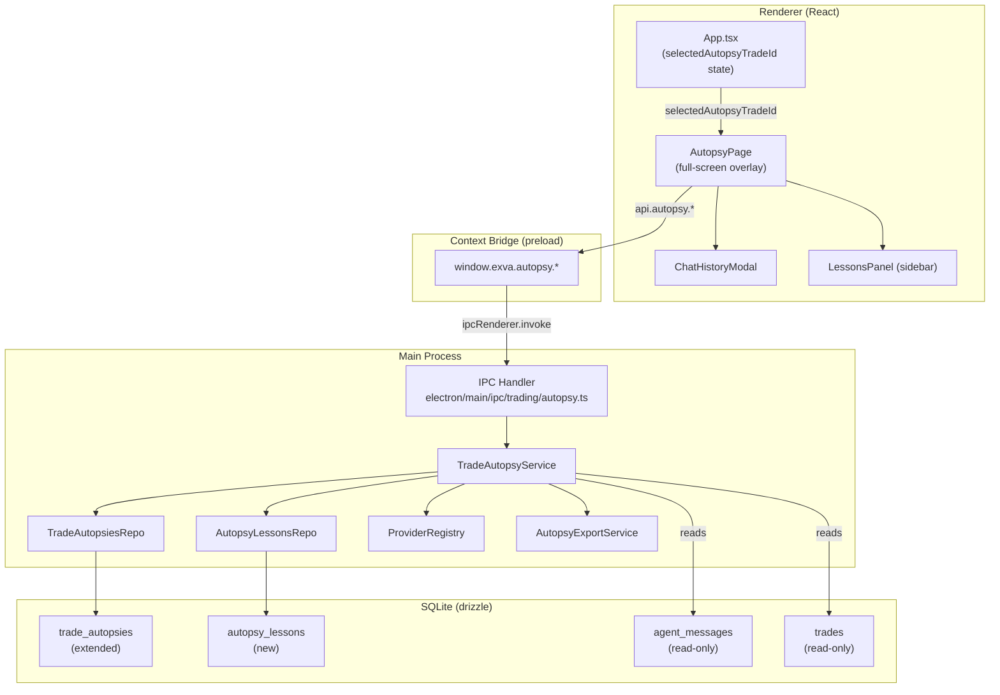
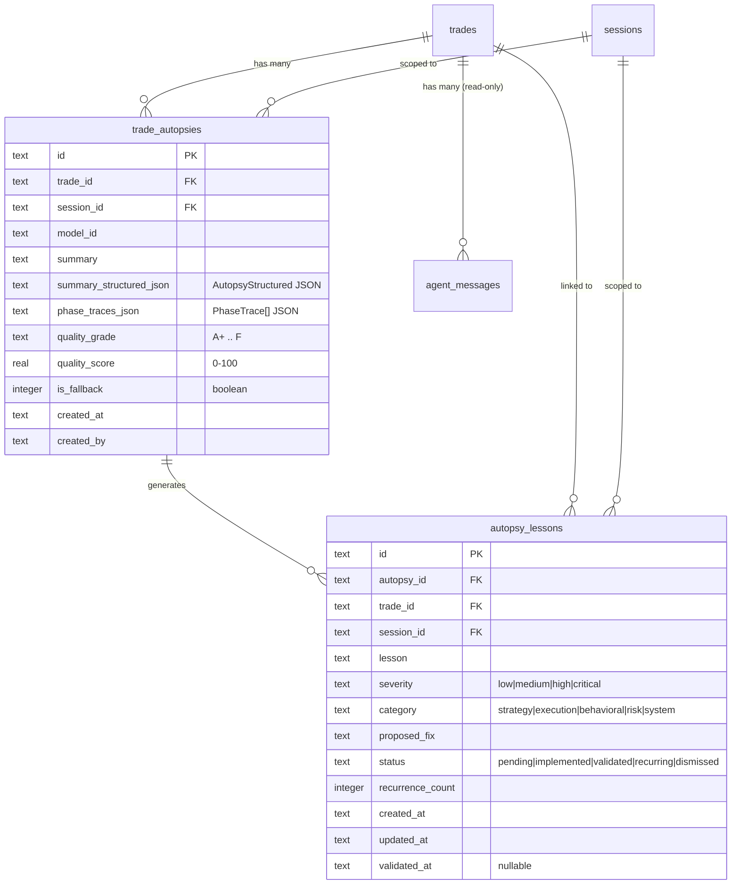
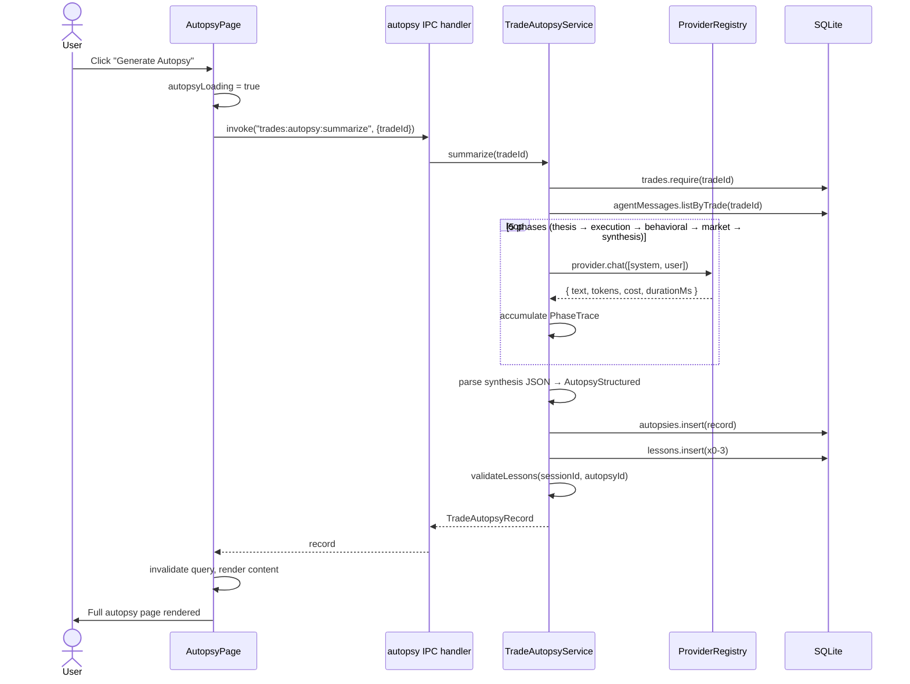
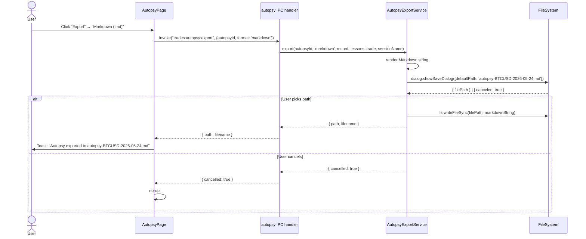
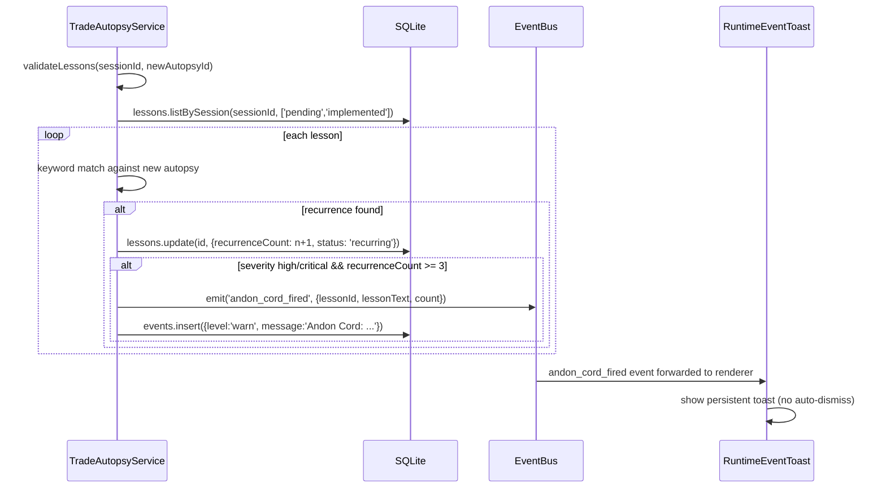

# Trade Autopsy — Low-Level Implementation Plan

> **Date:** 2026-05-24  
> **Status:** Implemented (2026-05-25; contract fixes applied 2026-05-25)  
> **Spec:** `docs/design/autopsy-product-spec.md`  
> **Author:** System Designer

---

## 1. Hard Problems

**1. No React Router.** App.tsx uses a `page: PageKey` switch — there is no file-based or URL router. The spec writes `/trades/[tradeId]/autopsy` as if it's a route, but it must be implemented as an overlay view state, same pattern as `TradeDetail` (which is a conditional render driven by `selectedId`).

**2. LLM pipeline is a one-off, not a trading cycle.** `LLMRuntime` is designed around `SessionConfig`, `PipelineRuntime`, and phase catalogs. The autopsy phases are ad-hoc, one-trade, sequential calls. We cannot reuse `LLMRuntime.run()` — instead `TradeAutopsyService` calls `ProviderRegistry.get(providerKey).chat(...)` directly, exactly like a raw API call, and records its own phase traces.

**3. Schema migration without data loss.** Existing `trade_autopsies` rows have only `{id, trade_id, session_id, model_id, summary, created_at, created_by}`. New columns (`summary_structured_json`, `phase_traces_json`, `quality_grade`, `quality_score`, `is_fallback`) must be added with safe defaults so existing rows survive the migration.

**4. Lesson validator correctness vs cost.** The spec allows LLM-based semantic similarity but that doubles per-autopsy cost. For v1: keyword match only. The LLM path is a function stub with a `// TODO: semantic similarity` comment, wired in only if a config flag is set.

**5. App routing shim.** The app has no router. Adding one now is out of scope. The autopsy view is rendered as a full-screen overlay (`position: fixed; inset: 0`) on top of the normal page, driven by `selectedAutopsyTradeId` state in App.tsx.

---

## 2. Capacity Estimate

This is a desktop Electron app, single user. No distributed scale concerns. The hard limits are:

- LLM calls: 5 sequential per autopsy. Each is an independent HTTP request to OpenRouter. P99 latency ~3–8s per call → total pipeline ~15–40s.
- DB writes per autopsy: 1 `trade_autopsies` upsert + 0–3 `autopsy_lessons` inserts. SQLite, synchronous, < 1ms each.
- Phase traces JSON: ~50–200KB per autopsy (text). SQLite `text` column, no concern.
- Export: Markdown/JSON is trivial. PDF requires an off-screen BrowserWindow render.

---

## 3. Architecture



---

## 4. Data Model

### 4.1 Migration: `0001_autopsy_enhancement.sql`

```sql
--> statement-breakpoint
ALTER TABLE `trade_autopsies` ADD COLUMN `summary_structured_json` text NOT NULL DEFAULT '{}';
--> statement-breakpoint
ALTER TABLE `trade_autopsies` ADD COLUMN `phase_traces_json` text NOT NULL DEFAULT '[]';
--> statement-breakpoint
ALTER TABLE `trade_autopsies` ADD COLUMN `quality_grade` text;
--> statement-breakpoint
ALTER TABLE `trade_autopsies` ADD COLUMN `quality_score` real;
--> statement-breakpoint
ALTER TABLE `trade_autopsies` ADD COLUMN `is_fallback` integer NOT NULL DEFAULT 0;
--> statement-breakpoint
CREATE TABLE `autopsy_lessons` (
    `id` text PRIMARY KEY NOT NULL,
    `autopsy_id` text NOT NULL,
    `trade_id` text NOT NULL,
    `session_id` text NOT NULL,
    `lesson` text NOT NULL,
    `severity` text NOT NULL DEFAULT 'medium',
    `category` text NOT NULL DEFAULT 'strategy',
    `proposed_fix` text NOT NULL DEFAULT '',
    `status` text NOT NULL DEFAULT 'pending',
    `recurrence_count` integer NOT NULL DEFAULT 0,
    `created_at` text NOT NULL,
    `updated_at` text NOT NULL,
    `validated_at` text,
    FOREIGN KEY (`autopsy_id`) REFERENCES `trade_autopsies`(`id`) ON DELETE cascade,
    FOREIGN KEY (`trade_id`) REFERENCES `trades`(`id`) ON DELETE cascade,
    FOREIGN KEY (`session_id`) REFERENCES `sessions`(`id`) ON DELETE cascade
);
--> statement-breakpoint
CREATE INDEX `idx_autopsy_lessons_autopsy` ON `autopsy_lessons` (`autopsy_id`);
--> statement-breakpoint
CREATE INDEX `idx_autopsy_lessons_session` ON `autopsy_lessons` (`session_id`);
--> statement-breakpoint
CREATE INDEX `idx_autopsy_lessons_status` ON `autopsy_lessons` (`status`);
```

**Why ALTER TABLE instead of recreate:** SQLite doesn't support `ADD COLUMN` in a transaction that also drops and recreates — but ADD COLUMN with a DEFAULT is safe and non-destructive. Existing rows get the default values.

**Migration file location:** `electron/main/db/drizzle/0001_autopsy_enhancement.sql`  
**Journal update:** `electron/main/db/drizzle/meta/_journal.json` — add entry for `0001`.

---

### 4.2 Schema Update (`electron/main/db/schema.ts`)

```typescript
// Extend existing tradeAutopsies table
export const tradeAutopsies = sqliteTable(
  "trade_autopsies",
  {
    id: text("id").primaryKey(),
    tradeId: text("trade_id").notNull().references(() => trades.id, { onDelete: "cascade" }),
    sessionId: text("session_id").notNull().references(() => sessions.id, { onDelete: "cascade" }),
    modelId: text("model_id").notNull(),
    summary: text("summary").notNull(),
    summaryStructuredJson: text("summary_structured_json").notNull().default("{}"),
    phaseTracesJson: text("phase_traces_json").notNull().default("[]"),
    qualityGrade: text("quality_grade"),
    qualityScore: real("quality_score"),
    isFallback: integer("is_fallback", { mode: "boolean" }).notNull().default(false),
    createdAt: text("created_at").notNull(),
    createdBy: text("created_by").notNull().default("user"),
  },
  (table) => ({
    tradeIdIdx: index("idx_trade_autopsies_trade").on(table.tradeId),
  }),
);

// New table
export const autopsyLessons = sqliteTable(
  "autopsy_lessons",
  {
    id: text("id").primaryKey(),
    autopsyId: text("autopsy_id").notNull().references(() => tradeAutopsies.id, { onDelete: "cascade" }),
    tradeId: text("trade_id").notNull().references(() => trades.id, { onDelete: "cascade" }),
    sessionId: text("session_id").notNull().references(() => sessions.id, { onDelete: "cascade" }),
    lesson: text("lesson").notNull(),
    severity: text("severity").notNull().default("medium"),
    category: text("category").notNull().default("strategy"),
    proposedFix: text("proposed_fix").notNull().default(""),
    status: text("status").notNull().default("pending"),
    recurrenceCount: integer("recurrence_count").notNull().default(0),
    createdAt: text("created_at").notNull(),
    updatedAt: text("updated_at").notNull(),
    validatedAt: text("validated_at"),
  },
  (table) => ({
    autopsyIdx: index("idx_autopsy_lessons_autopsy").on(table.autopsyId),
    sessionIdx: index("idx_autopsy_lessons_session").on(table.sessionId),
    statusIdx: index("idx_autopsy_lessons_status").on(table.status),
  }),
);
```

---

### 4.3 ER Diagram



---

## 5. Service Layer

### 5.1 `TradeAutopsiesRepo`

**File:** `electron/main/db/repositories/trades/trade-autopsies-repo.ts`

```typescript
export class TradeAutopsiesRepo {
  constructor(private readonly client: DbClient) {}

  listByTrade(tradeId: string): TradeAutopsyRecord[]
  findLatest(tradeId: string): TradeAutopsyRecord | null
  insert(record: TradeAutopsyRecord): void
  // No update — autopsies are immutable; regenerate = new insert
}
```

### 5.2 `AutopsyLessonsRepo`

**File:** `electron/main/db/repositories/trades/autopsy-lessons-repo.ts`

```typescript
export class AutopsyLessonsRepo {
  constructor(private readonly client: DbClient) {}

  listByAutopsy(autopsyId: string): AutopsyLesson[]
  listBySession(sessionId: string, statuses?: LessonStatus[]): AutopsyLesson[]
  insert(lesson: AutopsyLesson): void
  update(id: string, patch: Partial<Pick<AutopsyLesson, 'status' | 'lesson' | 'proposedFix' | 'recurrenceCount' | 'validatedAt' | 'updatedAt'>>): void
  find(id: string): AutopsyLesson | null
  require(id: string): AutopsyLesson  // throws AppError NOT_FOUND
}
```

### 5.3 `TradeAutopsyService`

**File:** `electron/main/services/analytics/trade-autopsy-service.ts`

This is the core service. It does NOT use `LLMRuntime` — it calls `ProviderRegistry.get(key).chat(messages)` directly. The autopsy pipeline is not a trading cycle; it's a one-shot analytical pipeline.

```typescript
export interface TradeAutopsyServiceDeps {
  trades: TradesRepo;
  agentMessages: AgentMessagesRepo;
  autopsies: TradeAutopsiesRepo;
  lessons: AutopsyLessonsRepo;
  providerRegistry: ProviderRegistry;
  workspacePrefs: WorkspacePreferencesRepo;
  eventBus: EventBus;
}

export class TradeAutopsyService {
  constructor(private readonly deps: TradeAutopsyServiceDeps) {}

  /**
   * Run the 5-phase autopsy pipeline for a closed trade.
   * Inserts autopsy + lessons. Returns the created record.
   */
  async summarize(tradeId: string): Promise<TradeAutopsyRecord>

  /**
   * List all autopsies for a trade, newest first.
   */
  listByTrade(tradeId: string): TradeAutopsyRecord[]

  /**
   * List lessons for an autopsy.
   */
  listLessons(autopsyId: string): AutopsyLesson[]

  /**
   * Update a lesson's status, text, or proposed fix.
   */
  updateLesson(lessonId: string, patch: LessonPatch): void

  /**
   * Manually add a lesson to an existing autopsy.
   */
  addLesson(input: AddLessonInput): AutopsyLesson

  /**
   * Run the lesson validation pass for a session after a new autopsy.
   * Checks prior pending/implemented lessons for recurrence.
   * Fires andon_cord_fired event if threshold met.
   */
  validateLessons(sessionId: string, newAutopsyId: string): void
}
```

#### `summarize()` internals

```
1. trades.require(tradeId) — assert exists
2. if trade.status !== 'closed' → throw AppError("Trade must be closed", "VALIDATION")
3. agentMessages.listByTrade(tradeId) → messages[]
4. resolve provider: workspacePrefs.get().defaultModelId ?? 'openrouter/google/gemma-4-31b-it'
5. Run phases sequentially:
   a. runPhase('thesis', buildThesisPrompt(trade, messages))
   b. runPhase('execution', buildExecutionPrompt(trade))
   c. runPhase('behavioral', buildBehavioralPrompt(messages))
   d. runPhase('market_context', buildMarketContextPrompt(trade, messages))
   e. runPhase('synthesis', buildSynthesisPrompt(trade, phaseOutputs))
6. Parse synthesis JSON → AutopsyStructured
7. if parse fails → isFallback = true, use fallbackSummary()
8. Build TradeAutopsyRecord, insert
9. Extract lessons from synthesis output, insert each
10. validateLessons(trade.sessionId, autopsyId)
11. return record
```

#### `runPhase()` private method

```typescript
private async runPhase(
  name: PhaseKind,
  systemPrompt: string,
  userPrompt: string,
  providerKey: string,
  modelId: string,
): Promise<PhaseTrace>
```

- Calls `providerRegistry.getProvider(providerKey).chat([system, user])`
- On error: returns `PhaseTrace` with `error` set, `responseText: ''`
- Records `durationMs`, `inputTokens`, `outputTokens`, `costUsd`
- Never throws — errors are captured in the trace

#### `validateLessons()` internals

```
1. Load lessons for session where status IN ('pending', 'implemented')
2. Load new autopsy's parsed structured JSON
3. For each lesson:
   a. Extract keywords from lesson.lesson text (split, lowercase, filter stopwords)
   b. Check if any keyword appears in:
      - new autopsy behavioralFlags[].description
      - new autopsy whatFailed[]
   c. If match found:
      - recurrenceCount++
      - if recurrenceCount >= 2 && status !== 'validated' → status = 'recurring'
   d. If no match && status = 'implemented' && last5TradesInSession all passed → status = 'validated'
4. For each lesson where severity IN ('high','critical') && status='recurring' && recurrenceCount >= 3:
   - eventBus.emit('andon_cord_fired', { lessonId, lessonText, recurrenceCount })
   - eventsRepo.insert({ level: 'warn', message: 'Andon Cord: ...' })
```

### 5.4 `AutopsyExportService`

**File:** `electron/main/services/analytics/autopsy-export-service.ts`

```typescript
export class AutopsyExportService {
  async export(
    autopsyId: string,
    format: 'markdown' | 'json' | 'pdf',
    autopsyRecord: TradeAutopsyRecord,
    lessons: AutopsyLesson[],
    trade: Trade,
    sessionName: string,
    webContents: WebContents,  // for PDF only
  ): Promise<{ path: string; filename: string } | { cancelled: true } | { error: string }>
}
```

- **Markdown**: build string from template, `dialog.showSaveDialog`, `fs.writeFileSync`
- **JSON**: `JSON.stringify` full record + lessons, same flow
- **PDF**: render autopsy to HTML string, create hidden `BrowserWindow` (offscreen), load HTML, call `webContents.printToPDF({ ... })`, write buffer to file, close window

---

## 6. IPC Layer

### 6.1 New channels (`electron/shared/ipc/channels.ts`)

Add to `trades` key:

```typescript
trades: {
  // ... existing ...
  autopsy: {
    summarize: "trades:autopsy:summarize",
    list:      "trades:autopsy:list",
    export:    "trades:autopsy:export",
    listLessons: "trades:autopsy:list-lessons",
    addLesson:   "trades:autopsy:add-lesson",
    updateLesson: "trades:autopsy:update-lesson",
  }
}
```

Add to `mainToRendererEvents`:

```typescript
"andon_cord_fired",
```

### 6.2 Handler file

**File:** `electron/main/ipc/trading/autopsy.ts`

```typescript
export function registerAutopsyHandlers(services: AppServices): void {
  // trades:autopsy:summarize
  handle(ipcMain, channels.trades.autopsy.summarize, async (payload) => {
    const { tradeId } = z.object({ tradeId: z.string() }).parse(payload);
    return services.tradeAutopsy.summarize(tradeId);
    // AppError with code NOT_FOUND → IPC 404
    // AppError with code VALIDATION → IPC 400
  });

  // trades:autopsy:list
  handle(ipcMain, channels.trades.autopsy.list, async (payload) => {
    const { tradeId } = z.object({ tradeId: z.string() }).parse(payload);
    return services.tradeAutopsy.listByTrade(tradeId);
  });

  // trades:autopsy:list-lessons
  handle(ipcMain, channels.trades.autopsy.listLessons, async (payload) => {
    const { autopsyId } = z.object({ autopsyId: z.string() }).parse(payload);
    return services.tradeAutopsy.listLessons(autopsyId);
  });

  // trades:autopsy:add-lesson
  handle(ipcMain, channels.trades.autopsy.addLesson, async (payload) => {
    const input = addLessonSchema.parse(payload);
    return services.tradeAutopsy.addLesson(input);
  });

  // trades:autopsy:update-lesson
  handle(ipcMain, channels.trades.autopsy.updateLesson, async (payload) => {
    const input = updateLessonSchema.parse(payload);
    services.tradeAutopsy.updateLesson(input.lessonId, input);
    return { ok: true };
  });

  // trades:autopsy:export
  handle(ipcMain, channels.trades.autopsy.export, async (payload, event) => {
    const { autopsyId, format } = exportSchema.parse(payload);
    // fetch record + lessons + trade + session
    // call services.autopsyExport.export(...)
    // event.sender for webContents (PDF)
  });
}
```

**Register in `register.ts`:** add `registerAutopsyHandlers(services)`.

### 6.3 Context bridge (`electron/preload/index.ts`)

Add `autopsy` namespace to `window.exva`:

```typescript
autopsy: {
  summarize: (tradeId: string) => ipcRenderer.invoke(channels.trades.autopsy.summarize, { tradeId }),
  list: (tradeId: string) => ipcRenderer.invoke(channels.trades.autopsy.list, { tradeId }),
  listLessons: (autopsyId: string) => ipcRenderer.invoke(channels.trades.autopsy.listLessons, { autopsyId }),
  addLesson: (input: AddLessonInput) => ipcRenderer.invoke(channels.trades.autopsy.addLesson, input),
  updateLesson: (input: UpdateLessonInput) => ipcRenderer.invoke(channels.trades.autopsy.updateLesson, input),
  export: (autopsyId: string, format: ExportFormat) => ipcRenderer.invoke(channels.trades.autopsy.export, { autopsyId, format }),
}
```

### 6.4 Frontend API (`src/lib/exva.ts`)

```typescript
autopsy: {
  summarize: (tradeId: string): Promise<TradeAutopsyRecord> =>
    bridge().autopsy.summarize(tradeId),
  list: (tradeId: string): Promise<TradeAutopsyRecord[]> =>
    bridge().autopsy.list(tradeId),
  listLessons: (autopsyId: string): Promise<AutopsyLesson[]> =>
    bridge().autopsy.listLessons(autopsyId),
  addLesson: (input: AddLessonInput): Promise<AutopsyLesson> =>
    bridge().autopsy.addLesson(input),
  updateLesson: (input: UpdateLessonInput): Promise<{ ok: true }> =>
    bridge().autopsy.updateLesson(input),
  export: (autopsyId: string, format: ExportFormat): Promise<ExportResult> =>
    bridge().autopsy.export(autopsyId, format),
}
```

---

## 7. Frontend Component Tree

```
App.tsx
├── [existing pages]
├── selectedAutopsyTradeId: string | null   ← new state
└── {selectedAutopsyTradeId && (
      <AutopsyPage
        tradeId={selectedAutopsyTradeId}
        onClose={() => setSelectedAutopsyTradeId(null)}
      />
    )}

AutopsyPage  [src/pages/AutopsyPage.tsx]
├── useQuery: api.autopsy.list(tradeId)       → autopsies[]
├── useQuery: api.trades.getDetail(tradeId)   → { trade }
├── selectedAutopsyId: string | null          ← local state (latest by default)
├── chatHistoryOpen: boolean                  ← local state
├── openSections: Set<string>                 ← local state (all expanded default)
│
├── AutopsyHeader (sticky)
│   ├── BackButton → onClose()
│   ├── TradeTitle: "[SYMBOL] [SIDE] · [status chip] · P&L"
│   └── ActionBar
│       ├── ViewChatHistoryButton (hidden if no autopsies)
│       ├── ExportDropdown (hidden if no autopsies)
│       └── GenerateButton | RegenerateButton | GeneratingButton
│
├── [trade.status === 'open'] → OpenTradeGuard (no generate)
│
├── VersionSelector (shown if autopsies.length > 1)
│   └── chip per autopsy: "v{n} · {date}"
│
├── WarningBanners
│   ├── [is_fallback] FallbackBanner
│   └── [no agent messages] NoTracesBanner
│
├── TwoColumnLayout
│   ├── MainColumn
│   │   ├── [no autopsies] EmptyAutopsyState
│   │   └── [has autopsy]
│   │       ├── GradeBannerCard
│   │       │   ├── GradeChip (A+/A/B/C/D/F, color-coded)
│   │       │   ├── Score: "{n}/100"
│   │       │   ├── Meta: "{model} · {date} · {n} phases"
│   │       │   └── ExecutiveSummary paragraph
│   │       │
│   │       ├── ThesisReviewCard (collapsible)
│   │       ├── ExecutionQualityCard (collapsible)
│   │       ├── BehavioralFlagsCard (collapsible)
│   │       ├── MarketContextCard (collapsible)
│   │       ├── WhatWorkedFailedCard (two-column inside)
│   │       ├── [rootCause] RootCauseCard (collapsible)
│   │       └── ProcessImprovementsCard (numbered list)
│   │
│   └── RightSidebar (sticky, w-[300px])
│       ├── TradeMetaCard
│       │   └── symbol, side, status, strategy, entry/SL/TP, size, hold, session
│       └── LessonsPanel
│           ├── useQuery: api.autopsy.listLessons(selectedAutopsyId)
│           ├── AddLessonButton → AddLessonForm (inline)
│           └── LessonList
│               └── LessonRow[]
│                   ├── SeverityChip
│                   ├── CategoryChip
│                   ├── LessonText (2-line truncated, click to expand)
│                   ├── ProposedFix (collapsed, expand on click)
│                   └── StatusChip (click → StatusPickerPopover)
│
└── ChatHistoryModal (Dialog, triggered by ViewChatHistoryButton)
    ├── useQuery: phase_traces parsed from selected autopsy
    ├── VersionSelector (if multiple autopsies)
    ├── PhaseList
    │   └── PhaseRow[] (collapsible)
    │       ├── PhaseHeader: name chip, model, stats (tokens/cost/ms)
    │       └── [expanded] PhaseBody
    │           ├── SystemPrompt pre block
    │           ├── UserPrompt pre block
    │           ├── [tool_calls] ToolCalls pre block
    │           └── Response pre block (colored left border by phase)
    └── ModalFooter
        ├── CopyAllJsonButton
        └── ExportChatHistoryButton
```

**Navigation entry points** (how user gets to AutopsyPage):
1. `TradesPage` row action → `setSelectedAutopsyTradeId(tradeId)` prop callback
2. `TradeDetail` (existing drawer) → "View Autopsy" button → same callback

Both are prop callbacks threaded from `App.tsx`. No router needed.

---

## 8. Key Flows

### 8.1 Generate Autopsy



**Failure path:** If any phase throws (network/timeout), `runPhase()` catches and returns `PhaseTrace { error: "...", responseText: "" }`. Pipeline continues. Synthesis receives partial inputs. If synthesis itself fails, `isFallback = true`, `summary = fallbackSummary(trade)`.

### 8.2 Export (Markdown/JSON)



### 8.3 Andon Cord



---

## 9. AppServices Wiring

**`electron/main/services/app-services.ts`:**

```typescript
// New imports
import { TradeAutopsiesRepo } from "../db/repositories/trades/trade-autopsies-repo";
import { AutopsyLessonsRepo } from "../db/repositories/trades/autopsy-lessons-repo";
import { TradeAutopsyService } from "./analytics/trade-autopsy-service";
import { AutopsyExportService } from "./analytics/autopsy-export-service";

// In AppServices interface:
repos: {
  // ... existing ...
  tradeAutopsies: TradeAutopsiesRepo;
  autopsyLessons: AutopsyLessonsRepo;
};
tradeAutopsy: TradeAutopsyService;
autopsyExport: AutopsyExportService;

// In createAppServices():
repos.tradeAutopsies = new TradeAutopsiesRepo(db);
repos.autopsyLessons = new AutopsyLessonsRepo(db);
// after eventBus is created:
const tradeAutopsy = new TradeAutopsyService({
  trades: repos.trades,
  agentMessages: repos.agentMessages,
  autopsies: repos.tradeAutopsies,
  lessons: repos.autopsyLessons,
  providerRegistry,
  workspacePrefs: repos.workspacePreferences,
  eventBus,
});
const autopsyExport = new AutopsyExportService();
```

---

## 10. Shared Types (`electron/shared/ipc/dto.ts` + `src/lib/types.ts`)

```typescript
// electron/shared/domain/autopsy.ts (new file — shared between main and renderer)

export type PhaseKind = "thesis" | "execution" | "behavioral" | "market_context" | "synthesis";
export type LessonStatus = "pending" | "implemented" | "validated" | "recurring" | "dismissed";
export type LessonSeverity = "low" | "medium" | "high" | "critical";
export type LessonCategory = "strategy" | "execution" | "behavioral" | "risk" | "system";
export type ExportFormat = "markdown" | "json" | "pdf";
export type QualityGrade = "A+" | "A" | "B" | "C" | "D" | "F";

export interface PhaseTrace {
  phase: PhaseKind;
  modelId: string;
  providerKey: string;
  systemPrompt: string;
  userPrompt: string;
  toolCallsJson: string | null;
  responseText: string;
  inputTokens: number;
  outputTokens: number;
  costUsd: number;
  durationMs: number;
  error: string | null;
}

export interface AutopsyStructured {
  executiveSummary: string;
  thesisReview: {
    valid: boolean | null;
    analysis: string;
    confirmatoryBias: boolean;
    prematureConviction: boolean;
    ignoredCounterSignals: string[];
  };
  executionQuality: {
    entryTiming: "early" | "good" | "late" | "unknown";
    sizingAdequacy: "oversized" | "appropriate" | "undersized" | "unknown";
    exitManagement: string;
    slippage: string | null;
  };
  behavioralFlags: Array<{
    flag: string;
    description: string;
    severity: LessonSeverity;
  }>;
  marketContext: {
    regime: "trending" | "ranging" | "volatile" | "low_liquidity" | "unknown";
    macro: string;
    volatility: string;
    suitability: "good_conditions" | "neutral" | "poor_conditions";
  };
  whatWorked: string[];
  whatFailed: string[];
  rootCause: string | null;
  processImprovements: string[];
}

export interface TradeAutopsyRecord {
  id: string;
  tradeId: string;
  sessionId: string;
  modelId: string;
  summary: string;
  summaryStructuredJson: string;  // serialized AutopsyStructured
  phaseTracesJson: string;        // serialized PhaseTrace[]
  qualityGrade: string | null;
  qualityScore: number | null;
  isFallback: boolean;
  createdAt: string;
  createdBy: string;
}

export interface AutopsyLesson {
  id: string;
  autopsyId: string;
  tradeId: string;
  sessionId: string;
  lesson: string;
  severity: LessonSeverity;
  category: LessonCategory;
  proposedFix: string;
  status: LessonStatus;
  recurrenceCount: number;
  createdAt: string;
  updatedAt: string;
  validatedAt: string | null;
}

export type ExportResult =
  | { path: string; filename: string }
  | { cancelled: true }
  | { error: string };
```

---

## 11. Trade-offs

| Decision | Chosen | Traded Away | Revisit When |
|----------|--------|-------------|--------------|
| No React Router | Page-overlay pattern (same as TradeDetail) | Clean URL navigation, browser back/forward | If app grows to need real URL routing |
| LLM calls direct via ProviderRegistry | Simple, decoupled from pipeline system | Reuse of retry/rate-limit logic in LLMRuntime | If autopsy needs streaming or phase-level retry |
| Keyword match for lesson validator | Fast, zero cost, deterministic | Semantic accuracy (FOMO described differently won't match) | When false-negative rate is confirmed to be a problem |
| No autopsy model config in v1 | Uses workspace default model | Per-phase model selection | When cost/quality of default model is evaluated |
| PDF via hidden BrowserWindow | Leverages Electron built-in | Heavier than pdfkit, requires BrowserWindow lifecycle | If PDF export is buggy or slow on large autopsies |
| Autopsies are immutable | Regenerate = new insert, old retained | Simpler logic, history preserved | Never — this is intentional per spec |

---

## 12. Failure Mode Analysis

| Component | Failure | User Impact | Detection | Recovery |
|-----------|---------|-------------|-----------|----------|
| Phase LLM call (non-synthesis) | Network error, timeout | Phase trace shows error. Synthesis runs with partial data. | PhaseTrace.error !== null | Continue pipeline — already handled in runPhase() |
| Synthesis phase fails | LLM error or JSON parse fail | Yellow fallback banner. Plain text summary. | is_fallback = true | fallbackSummary() generates basic text from trade metadata |
| Export save dialog cancel | User clicks Cancel | No-op | cancelled: true | Return { cancelled: true }, renderer no-ops |
| Export file write error | Disk full, no permission | Toast: "Export failed: [msg]" | Caught in fs.writeFileSync | Retry prompt to user |
| PDF hidden window crash | BrowserWindow fails to load | Toast: "Export failed" | Electron window-all-closed | Catch + close window + return error |
| Lesson update IPC error | Network/IPC fail | Toast: "Failed to update lesson status." | Renderer catches IPC error | Optimistic update reverted in UI |
| Andon cord fires | recurrenceCount >= 3, high/critical | Persistent toast, no auto-dismiss | EventBus event | User must manually dismiss |
| Migration: existing autopsies | Old rows have '{}' structured JSON | Chat history shows "not available", grade shows N/A | is_fallback default = 0, structured = '{}' | Pre-existing rows are display-degraded but don't break |

---

## 13. Build Sequence

Execute in this order. Each phase is independently deployable.

### Phase 1 — DB Layer (no UI risk)
1. [x] Write `electron/main/db/drizzle/0001_autopsy_enhancement.sql`
2. [x] Update `meta/_journal.json` to add the `0001` entry
3. [x] Update `electron/main/db/schema.ts` — extend `tradeAutopsies`, add `autopsyLessons`
4. [x] Write `TradeAutopsiesRepo` with `listByTrade`, `findLatest`, `insert`
5. [x] Write `AutopsyLessonsRepo` with full CRUD
6. [ ] Run `bun run drizzle-kit generate` to verify schema matches SQL

### Phase 2 — Shared Types
7. [x] Write `electron/shared/domain/autopsy.ts` with all interfaces
8. [x] Export from appropriate barrel files (`src/lib/autopsy-types.ts` re-exports)

### Phase 3 — Service Layer
9. [x] Write `TradeAutopsyService` with `summarize()` (5-phase pipeline)
10. [x] Write `AutopsyExportService` — Markdown, JSON, and PDF
11. [x] Wire both into `AppServices` (`app-services.ts`)
12. [x] Write unit tests for `validateLessons()` with mock lesson/autopsy data

### Phase 4 — IPC Layer
13. [x] Add channels to `channels.ts`
14. [x] Write `electron/main/ipc/trading/autopsy.ts`
15. [x] Add `registerAutopsyHandlers(services)` to `register.ts`
16. [x] Update preload bridge (`electron/preload/index.ts`)
17. [x] Add `api.autopsy.*` methods to `src/lib/exva.ts`
18. [x] Add `"andon_cord_fired"` to `mainToRendererEvents`

### Phase 5 — Real LLM Phase Implementation
19. [x] Implement the 5 prompt-builder functions in the service
20. [x] Implement `runPhase()` using `ProviderRegistry.generateText()` (plan said `.chat()`; actual adapter API is `generateText`)
21. [x] Implement synthesis JSON parsing + fallback
22. [x] Implement lesson extraction from synthesis output
23. [ ] Manual test: generate autopsy on a real closed trade

### Phase 6 — Frontend
24. [x] Add `selectedAutopsyTradeId` state to `App.tsx` (as `autopsyTradeId`)
25. [x] Wire navigation from `TradesPage` and `TradeDetail`
26. [x] Write `AutopsyPage` component (empty state + grade banner + sections)
27. [x] Write `LessonsPanel` sidebar with status updates
28. [x] Write `ChatHistoryModal`
29. [x] Wire `ExportDropdown` → `api.autopsy.export`

### Phase 7 — Andon Cord
30. [x] Add `andon_cord_fired` handler to `RuntimeEventToast.tsx` — persistent toast
31. [ ] Test end-to-end: inject a recurring lesson manually, trigger validator

### Phase 8 — PDF Export
32. [x] Implement `AutopsyExportService.exportPdf()` with hidden BrowserWindow
33. [x] Add PDF item to `ExportDropdown`

### Post-Implementation Contract Fixes — 2026-05-25
34. [x] Exclude lessons created by the current autopsy from the recurrence validator
35. [x] Safely degrade pre-migration autopsies with invalid/empty structured JSON in renderer + export paths
36. [x] Fix PDF export timeout code to use main-process timers instead of `window.*`
37. [x] Load trade detail inside `AutopsyPage` so header/meta/open-trade guard work from page state
38. [x] Wire inline manual lesson creation from `LessonsPanel`
39. [x] Wire Chat History JSON export from `ChatHistoryModal`

---

## 14. Open Questions Resolved

| Q# | Resolution |
|----|-----------|
| Q1 — Which model per phase? | Use `workspacePreferences.defaultModelId`. If null, fall back to `openrouter` with `google/gemma-4-31b-it`. All phases use same model in v1. |
| Q2 — New columns or repurpose? | New columns with defaults. `summary` column stays for backwards compat and fallback. |
| Q3 — Andon cord action? | Notification only in v1. No session lock. Spec confirmed. |
| Q4 — Lesson validation: LLM or keyword? | Keyword-only for v1. Stub function for LLM path with `// TODO` comment. |
| Q5 — PDF approach? | Hidden offscreen `BrowserWindow`. Simpler than pdfkit; already available in Electron. |
| Q6 — Regenerate for open trades? | No. Guard in IPC handler: `trade.status !== 'closed'` → 400 error. |
| Q7 — Where does validator run? | Inside `summarize()` at the end. Not a scheduled job. Every new autopsy triggers it. |

---

## 15. Risk Assessment

**Top 2 risks:**

1. **LLM JSON parse reliability.** The synthesis phase must return valid JSON matching `AutopsyStructured`. If the provider returns malformed JSON or prose, the fallback kicks in and the user gets a degraded experience. Mitigation: use explicit JSON mode if OpenRouter supports it for the chosen model; add zod parsing with a permissive fallback that extracts as many fields as possible before declaring `is_fallback = true`.

2. **PDF hidden window lifecycle.** Creating and destroying a hidden `BrowserWindow` in the main process for each PDF export is fragile if the main window closes mid-export or if the hidden window fails to load. Mitigation: wrap in try/finally that always closes the hidden window; add a 10s timeout that forcibly closes it.

**First thing to prototype:** Call `ProviderRegistry` directly from a test script (outside the trading cycle) to confirm the provider call pattern works with a simple chat message. This validates the core assumption that the autopsy service can use the registry without going through `LLMRuntime`.

**Assumption most dangerous if wrong:** That `ProviderRegistry.get(key).chat(messages)` is a simple, synchronous-interface async function that doesn't require session context. If the provider adapter requires a `SessionConfig` or `sessionId` to function (e.g., for API key lookup), the autopsy service needs to carry a session context — which changes the `summarize()` signature and the IPC payload.
