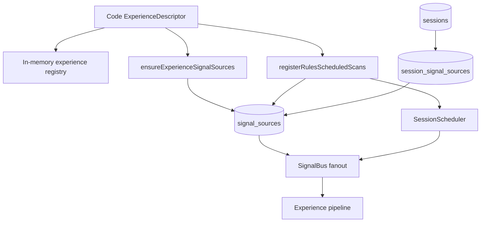
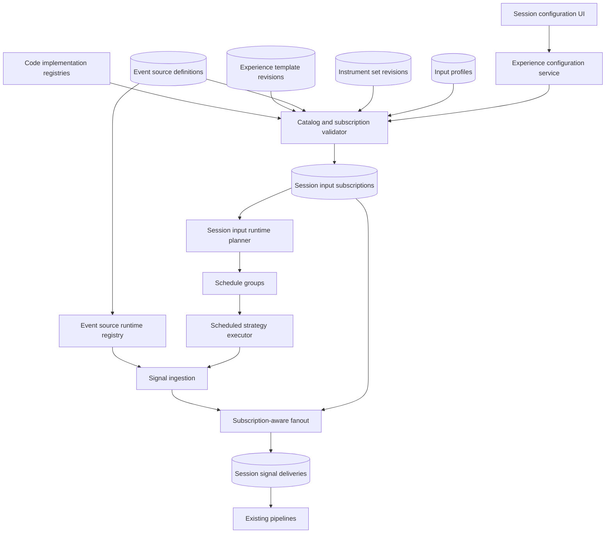

# Configurable Experience Input Architecture - Deep Plan

> **Date:** 2026-07-12
> **Status:** Implemented
> **Owner:** Kenneth
> **Audience:** Engineers, reviewers, and future maintainers
> **Scope:** Replace code-defined per-combination experience signals and schedules with configurable, versioned experience templates, event sources, instrument sets, input profiles, and session input subscriptions. This covers persistence, validation, scheduling, fanout, IPC, UI, migration, testing, and removal of legacy timer identities.

## 1. Executive Summary

Exva currently turns each concrete combination of strategy, instrument, cadence, and analysis timeframe into TypeScript. For example, Mean Reversion contains separate `spy-15m-meanrev` and `qqq-15m-meanrev` schedule objects, while Trend Following contains separate GC and CL objects. Adding ETH, changing a timeframe, or offering another cadence requires editing a descriptor, rebuilding the application, provisioning another synthetic source row, registering another timer, and updating tests. The number of definitions grows approximately with the product of the configurable dimensions rather than with the number of actual execution implementations.

The redesign must not merely move these descriptors into JSON. The existing descriptor combines five different concepts: executable strategy, reusable external feed, instrument universe, timing configuration, and session routing. The target architecture separates them. Executable behavior remains registered code; product and operator configuration becomes validated, versioned data. A session receives one or more explicit input subscriptions. Scheduled subscriptions can point at reusable instrument sets, and identical effective subscriptions share one scheduler execution group.

The final system scales with the number of distinct executable implementations plus the number of configurations users actually create. Adding `ETH-USD` to a crypto instrument set or changing a session from `4h` to `1h` analysis becomes a database/API operation, not a source-code change. Adding a genuinely new source protocol, strategy algorithm, pipeline implementation, or parameter schema still requires code and a release. This boundary is deliberate: configuration selects trusted capabilities; it does not execute arbitrary database-provided code.

This plan also corrects the adjacent ownership bug in the existing model. A source definition will no longer carry `experienceId`, `pipelineId`, or strategy analysis timeframe. Experiences define allowed behavior, source definitions produce external events, and session subscriptions bind the two. Schedules cease pretending to be deprecated `timer` signal sources.

## 2. Problem Statement

### 2.1 The current model has combinatorial growth

`ExperienceDescriptor` owns the pipeline and embeds concrete `signals` and `schedules` (`electron/main/experiences/types.ts:15-35`). A schedule contains a concrete symbol, instrument class, cadence, analysis timeframe, market-hours policy, and fixture (`electron/shared/domain/signal-descriptor.ts:32-45`). Consequently, this configuration:

```text
strategy = mean-reversion
instruments = SPY, QQQ
cadence = 15m
analysis timeframe = 1h
```

is represented by two code objects in `electron/main/experiences/rules-mean-reversion/descriptor.ts:37-64`. Adding five instruments, three cadences, and three analysis timeframes could require as many as `5 × 3 × 3 = 45` concrete descriptors if all combinations are offered. Adding strategy variants, market-hours modes, data providers, and parameter variants multiplies the problem further.

The shipped code already contains nine concrete input combinations across six experiences:

| Experience            | Mode      | Instruments   | Cadence                | Analysis timeframe |
| --------------------- | --------- | ------------- | ---------------------- | ------------------ |
| EDGAR Catalyst        | Event     | Event-defined | Provider polling       | `1d`               |
| Prediction Event Edge | Event     | Event-defined | `15m` provider polling | `1h`               |
| Mean Reversion        | Scheduled | SPY, QQQ      | `15m`                  | `1h`               |
| Trend Following       | Scheduled | GC, CL        | `4h`                   | `4h`               |
| Momentum Breakout     | Scheduled | BTC-USD       | `1h`                   | `4h`               |
| Options Flow          | Scheduled | AAPL, NVDA    | `15m`                  | `1d`               |

This is a small catalog, but it already duplicates structure and hardcodes product choices in six descriptor files under `electron/main/experiences/`.

### 2.2 Configuration changes require releases

Adding or changing a scheduled instrument currently touches this chain:


`registerRulesScheduledScans()` contains a second hard-coded experience-to-strategy mapping and loops every descriptor schedule (`electron/main/services/app-services.ts:891-973`). The same combination is then copied into a deprecated `timer` row for fanout compatibility. Descriptor data, scheduler data, and source-row data can disagree.

### 2.3 The scheduler scales by concrete combination

`SessionScheduler` stores one timer and one scan object per ID (`electron/main/services/signals/scheduler/session-scheduler.ts:87-118`). All descriptor schedules are registered globally, whether a session needs them or not. Each combination can independently fetch the same bars and evaluate the same strategy. At larger scale this causes unnecessary timers, duplicate provider requests, rate-limit pressure, and no natural way to coalesce identical work.

### 2.4 `signal_sources` is an overloaded abstraction

`signal_sources` currently stores provider type, experience ownership, instrument class, polling cadence, analysis timeframe, pipeline ID, and untyped configuration (`electron/main/db/schema.ts:80-94`). It acts as all of the following:

1. External event-feed configuration.
2. Experience input declaration.
3. Scheduled-job identity.
4. Session routing topic.
5. UI configuration object.

This is why a schedule explicitly documented as “not a SignalSourceType” still needs a deprecated `timer` source row (`electron/shared/domain/signal-descriptor.ts:32-35`). It is also why generated, experience-owned sources appear editable and removable as global integrations.

### 2.5 Validation is broad rather than configuration-specific

Session writes verify source existence and broad source-type compatibility (`electron/main/services/session/write-service.ts:258-283`). They do not establish that a strategy supports the selected timeframe, that an instrument set matches the strategy's class, that a cadence is operationally valid, or that an event source belongs to the selected configuration. Malformed cadence silently falls back to 15 minutes (`electron/main/services/signals/scheduler/session-scheduler.ts:47-55`), and malformed timeframe silently falls back to `1h` (`electron/main/services/signals/scheduler/rules-scheduled-scan.ts:130-142`). Configuration mistakes therefore become altered trading behavior instead of rejected writes.

### 2.6 Research claims are fixed while instruments are expected to vary

An experience's `researchContract.tradableUniverse` is code-defined (`electron/shared/domain/research-contract.ts:55-63`). Mean Reversion names SPY and QQQ in that contract (`electron/main/experiences/rules-mean-reversion/descriptor.ts:20-35`). If operators can add arbitrary instruments, the application must distinguish the validated research universe from an operator-configured extension. It must not imply that a strategy validated on SPY and QQQ has equivalent evidence for every stock.

## 3. Goals, Non-Goals, and Invariants

### Goals

| #   | Goal                                                     | Success Looks Like                                                                                                                                              |
| --- | -------------------------------------------------------- | --------------------------------------------------------------------------------------------------------------------------------------------------------------- |
| G1  | Remove descriptor-per-combination growth                 | Adding an instrument to an existing set, changing cadence, or choosing another supported timeframe requires no code change or application rebuild.              |
| G2  | Separate executable capability from configuration        | Strategies, pipelines, and source adapters remain code registries; templates, sets, profiles, and subscriptions are persisted data referencing registered keys. |
| G3  | Make sessions own concrete input choices                 | The complete effective input is queryable from a `session_input_subscriptions` record and its pinned references.                                                |
| G4  | Stop representing schedules as signal sources            | No `timer` source type, timer source row, or timer-specific source UI remains after migration.                                                                  |
| G5  | Scale scheduled work by distinct effective configuration | Equivalent subscriptions share one evaluation group; unused configurations create no timer or market-data request.                                              |
| G6  | Permit safe editing                                      | Drafts are validated before activation; running sessions pin immutable template and catalog revisions or explicit snapshots.                                    |
| G7  | Centralize compatibility                                 | Backend APIs return valid choices and validate writes; the renderer does not reconstruct compatibility from independent lists.                                  |
| G8  | Preserve auditability                                    | Every signal delivery identifies the source definition or schedule group and the session subscription responsible for delivery.                                 |
| G9  | Preserve research honesty                                | The UI and persisted state distinguish validated instruments from user-added or unvalidated instruments.                                                        |

### Non-Goals

| #   | Non-Goal                                                  | Why It Is Out Of Scope                                                                                                                                      |
| --- | --------------------------------------------------------- | ----------------------------------------------------------------------------------------------------------------------------------------------------------- |
| N1  | Arbitrary user-authored strategy code                     | Loading executable code from SQLite is unsafe and incompatible with packaged Electron deployment.                                                           |
| N2  | Fully visual pipeline authoring                           | Pipeline plans and worker implementations remain deployed code. Templates select a registered pipeline.                                                     |
| N3  | A distributed scheduler                                   | Exva currently executes in one Electron main process. The initial coordinator remains in-process but is driven by persisted subscriptions.                  |
| N4  | Automatic parameter optimization                          | The architecture permits parameters but does not choose or optimize them.                                                                                   |
| N5  | Automatic proof that a strategy works on a new instrument | Configurability does not imply research validation or profitability.                                                                                        |
| N6  | Immediate arbitrary query-based universes                 | V1 supports static and event-derived instrument sets. Query-based sets can follow after canonical instrument identity and provider constraints are settled. |

### Invariants

| #   | Invariant                                                                       | Why It Must Hold                                                                          |
| --- | ------------------------------------------------------------------------------- | ----------------------------------------------------------------------------------------- |
| I1  | Persisted configuration references only registered implementation keys.         | Data may configure trusted code but cannot invent executable behavior.                    |
| I2  | Active template revisions are immutable.                                        | Editing a shared template must not silently change a running or historical session.       |
| I3  | A session pins a template version and effective input revision/snapshot.        | Runtime behavior and backtests must be reproducible.                                      |
| I4  | Cadence and analysis timeframe remain separate fields.                          | “Run every 15m using 1h bars” is valid and must not collapse into one value.              |
| I5  | Scheduled work is created only from enabled persisted subscriptions.            | Unused catalog entries must not poll market data.                                         |
| I6  | A schedule group key contains every field that can change emitted signals.      | Omitting a field could route one evaluation's results to differently configured sessions. |
| I7  | A source definition has no `experienceId`, `pipelineId`, or strategy timeframe. | External producer configuration is independent from the consumer strategy.                |
| I8  | Invalid cadence, timeframe, class, parameter, or reference fails the write.     | The runtime must never silently substitute trading behavior.                              |
| I9  | Historical deliveries retain subscription identity after configuration changes. | Operators must be able to explain why a session received a signal.                        |
| I10 | Legacy and new fanout never both enqueue the same delivery.                     | Dual execution during migration could produce duplicate trades.                           |

### Global Constraints

- Use existing SQLite, Drizzle, Zod, IPC, and Electron main-process patterns. Do not add a network service or distributed queue.
- Keep pipeline plans, deterministic strategy algorithms, source adapters, broker adapters, credentials, prompts, and market-signal payload schemas in code.
- Store routing dimensions in typed columns. Use JSON only for implementation-specific parameter objects that are parsed by a versioned Zod schema.
- Do not mutate catalog state as a side effect of list/read APIs.
- Existing ID mappings must be deterministic during migration. Unknown legacy rows are quarantined with an explicit reason; they are never guessed.

## 4. Current State

### 4.1 Components and ownership



The code descriptor is authoritative for identity, pipeline, source/schedule combinations, preset defaults, prompt variant, and research contract. The database contains materialized source rows, but no experience table, schedule table, or versioned input-binding table. Sessions persist only a free-text `experienceId` and many-to-many source IDs.

### 4.2 Static registries

`electron/main/experiences/index.ts:1-24,137-142` statically imports and registers six experiences. `validateExperienceRegistry()` verifies pipeline/source-type relationships but assumes every concrete input is already available as code. The source runtime has another hard-coded dispatch in `SignalSourceRegistry.instantiate()` (`electron/main/services/signals/signal-source-registry.ts:205-229`). Rules strategies have a third dispatch switch in `rulesDeterministicStrategy()` (`electron/main/services/signals/scheduler/rules-scheduled-scan.ts:43-55`).

These switches are appropriate for executable implementations. The defect is that symbols, sets, cadence, and timeframe are placed beside them in code rather than supplied as validated data.

### 4.3 Runtime flows

#### Event feed

1. An experience signal descriptor is converted into a `signal_sources` row.
2. `SignalSourceRegistry` instantiates a source-specific class based on `record.type`.
3. The source emits an event with `sourceId`.
4. `SignalBus` queries `session_signal_sources` by that source ID.
5. The delivery gate resolves the session experience and broker compatibility.
6. A session delivery enters the existing pipeline.

#### Scheduled scan

1. Startup loops every hard-coded scheduled descriptor.
2. Startup creates a deprecated `timer` source row if absent.
3. Startup registers one `ScheduledScan` per descriptor with `SessionScheduler`.
4. Its timer fetches bars for one symbol and evaluates one strategy.
5. A hit is emitted with the timer row's ID as `sourceId`.
6. SignalBus fanout uses `session_signal_sources` as though the timer were an external feed.

### 4.4 Root causes

| Symptom                                          | Root Cause                                                                               |
| ------------------------------------------------ | ---------------------------------------------------------------------------------------- |
| Code change to add ETH, MSFT, or a new timeframe | Concrete product configuration lives inside `ExperienceDescriptor`.                      |
| One timer per concrete row                       | Scheduler is populated from descriptors rather than active session demand.               |
| Duplicate market-data work                       | No effective-configuration grouping exists.                                              |
| Schedule/source terminology exceptions           | Routing is source-ID based, so schedules imitate sources.                                |
| Generated source edits are overwritten           | Source rows are materialized views of code descriptors but presented as user-owned data. |
| Experience/source ownership confusion            | One row contains both producer configuration and consumer strategy metadata.             |
| Risky “editable descriptors in JSON” temptation  | Executable implementation keys and ordinary configuration have no explicit boundary.     |

## 5. Desired End State

### 5.1 Target vocabulary

| Concept                    | Plain-English Meaning                                                                                                         | Owner                                     |
| -------------------------- | ----------------------------------------------------------------------------------------------------------------------------- | ----------------------------------------- |
| Implementation registry    | Trusted code that knows how to execute a strategy, pipeline, source adapter, calendar, or signal contract.                    | Application code                          |
| Experience template        | Versioned strategy product definition: pipeline, strategy, allowed modes/classes/timeframes, defaults, and research contract. | Seeded/catalog data referencing code keys |
| Event source definition    | Reusable configured external event producer, such as SEC EDGAR 8-K or Polymarket events.                                      | Global data plus code adapter             |
| Instrument set             | Reusable named universe, such as Liquid US ETFs or Major Crypto.                                                              | User/system data                          |
| Input profile              | Recommended reusable binding of a template to a source or scheduled configuration.                                            | User/system data                          |
| Session input subscription | A session's concrete, pinned runtime input configuration.                                                                     | Session data                              |
| Schedule group             | Ephemeral runtime group of equivalent scheduled subscriptions evaluated once.                                                 | Scheduler runtime                         |
| Delivery                   | One persisted signal-to-session attempt, tied to a subscription.                                                              | Runtime history                           |

### 5.2 Architecture



The template defines what is allowed. The subscription defines what this session actually runs. The runtime planner derives work from enabled subscriptions, rather than startup blindly registering every catalog possibility.

### 5.3 What remains code-defined

The following are executable capabilities and remain TypeScript:

- Pipeline plans and worker resolution.
- Deterministic algorithms such as mean reversion, breakout, and trend following.
- Strategy parameter Zod schemas and factories.
- Event source adapters such as EDGAR and prediction events.
- Signal contracts and payload schemas.
- Market-data and broker adapters.
- Credential storage and provider rate limiting.
- Market-calendar implementations.
- Prompt implementations and mock worker output schemas.

A genuinely new strategy algorithm or source protocol still requires code. A new instrument, set membership, allowed timeframe from an existing supported list, cadence, source instance, or session binding does not.

### 5.4 What becomes persisted configuration

- Experience metadata and immutable versions.
- Registered pipeline and strategy keys selected by a template.
- Allowed input modes, source kinds, instrument classes, and timeframes.
- Template defaults and research contract.
- Event source instances and adapter configuration.
- Instrument sets and members.
- Input profiles.
- Schedule cadence, calendar, analysis timeframe, and strategy parameter values.
- Session input subscriptions and their enabled state.
- Subscription and schedule-group runtime telemetry.

### 5.5 End-user behavior

To add ETH to Momentum Breakout:

1. Open Instrument Sets.
2. Edit `Major Crypto` and add canonical `ETH-USD`.
3. Save a new instrument-set revision.
4. Existing pinned sessions remain unchanged.
5. New sessions using the latest profile receive BTC and ETH.
6. An operator may explicitly upgrade an existing session to the new set revision.

To run Mean Reversion using 30-minute bars every 5 minutes:

1. Choose Mean Reversion.
2. Choose a compatible stock instrument set.
3. Choose `5 minutes` cadence and `30m` analysis timeframe.
4. Backend validation confirms that the strategy and market-data integration support the class/timeframe and that the cadence is above the operational minimum.
5. Saving creates one scheduled subscription. No descriptor, generated source row, or source-code release is needed.

## 6. Gap Analysis

| Area              | Current State                                    | Target State                                            | Required Change                                                   |
| ----------------- | ------------------------------------------------ | ------------------------------------------------------- | ----------------------------------------------------------------- |
| Experience        | In-memory descriptor with concrete inputs        | Versioned template describing allowed configuration     | Add catalog tables/repo/service; retain implementation references |
| Instruments       | One symbol per schedule descriptor               | Reusable versioned instrument sets                      | Add set and member tables plus canonical identity                 |
| Timing            | Free-form strings in descriptors and source rows | Strict typed cadence plus separate analysis timeframe   | Shared Zod schemas; reject invalid writes                         |
| Event source      | Carries experience and pipeline metadata         | Reusable producer independent of consumers              | Rename/remodel source records and adapter registry                |
| Session routing   | `(sessionId, sourceId)` join                     | First-class versioned subscription                      | Add subscription table and delivery reference                     |
| Scheduling        | All code descriptors registered globally         | Enabled subscriptions reconciled into groups            | Add planner/coordinator/executor                                  |
| Fanout            | Source-ID lookup                                 | Source-definition or schedule-group subscription lookup | Add resolver and shadow comparison                                |
| UI                | Client filters global source list                | Server returns resolved options and validation          | Add configuration API and progressive editor                      |
| Versioning        | Shared mutable generated rows                    | Immutable active revisions and pinned sessions          | Add revisions/status and explicit upgrade flow                    |
| Research contract | Fixed universe mixed with configurable intent    | Validated universe plus extension policy                | Add universe policy and UI warning/status                         |

## 7. Options Considered

### Option A: Keep code descriptors and add generators

Generate descriptors programmatically from arrays of symbols and timeframes.

| Dimension        | Assessment            |
| ---------------- | --------------------- |
| Build complexity | Low                   |
| Migration risk   | Low                   |
| Runtime risk     | Unchanged             |
| Reversibility    | High                  |
| Team fit         | Short-term only       |
| Testability      | High                  |
| Maintainability  | Poor at product scale |

This reduces repeated syntax but not release coupling, global timers, source overloading, or UI editability. It is rejected.

### Option B: Move current descriptors directly into editable JSON/SQLite

Store the existing descriptor shape and load it dynamically.

| Dimension        | Assessment                                               |
| ---------------- | -------------------------------------------------------- |
| Build complexity | Medium                                                   |
| Migration risk   | Medium                                                   |
| Runtime risk     | High because invalid combinations reach executable paths |
| Reversibility    | Medium                                                   |
| Team fit         | Appears fast but preserves wrong boundaries              |
| Testability      | Medium                                                   |
| Maintainability  | Poor                                                     |

This preserves the overloaded object and one-row-per-combination model. It also risks treating database strings as executable implementations. It is rejected.

### Option C: Normalized catalog plus session input subscriptions

Separate code capabilities, template policy, event sources, instrument sets, profiles, and session subscriptions. Group equivalent scheduled work.

| Dimension        | Assessment                                   |
| ---------------- | -------------------------------------------- |
| Build complexity | High but phaseable                           |
| Migration risk   | Medium, controlled by shadow reads/plans     |
| Runtime risk     | Medium during scheduler/fanout cutover       |
| Reversibility    | High before legacy cleanup                   |
| Team fit         | Strong for local-first Electron architecture |
| Testability      | High through pure validators and planners    |
| Maintainability  | High                                         |

This is recommended because it solves the release-coupling, scalability, and ownership problems rather than relocating them.

### Option D: One scheduled job per session

Persist configuration per session but create an independent timer for every subscription.

| Dimension        | Assessment                    |
| ---------------- | ----------------------------- |
| Build complexity | Medium                        |
| Migration risk   | Medium                        |
| Runtime risk     | High at larger session counts |
| Reversibility    | High                          |
| Team fit         | Simple initial implementation |
| Testability      | High                          |
| Maintainability  | Medium                        |

This removes code changes but duplicates market-data and strategy evaluation across equivalent sessions. It is acceptable only as a temporary tracer implementation, not as the final scheduler model.

## 8. Recommendation

Implement Option C. Keep executable registries in code and move configuration into normalized, versioned data. Use session input subscriptions as the sole runtime binding and exact-match schedule grouping as the scaling mechanism.

Do not begin with a generic experience-builder UI. First establish repositories, schemas, registries, validation, migration, and a session configuration flow using seeded read-only templates. Make event source definitions, instrument sets, profiles, and session subscriptions editable. Template authoring can become editable later after activation/versioning rules have proven reliable.

The recommendation depends on three assumptions:

1. Exva remains a single-process Electron application for this migration.
2. Existing strategies can publish explicit supported classes, timeframes, and parameter schemas.
3. Sessions should not silently follow mutable shared definitions.

If the product explicitly chooses “all sessions always follow latest configuration,” revision pinning could be relaxed, but that is not recommended for trading behavior.

## 9. Detailed Design

### 9.1 Module boundaries

```text
electron/shared/domain/experience-inputs/
  cadence.ts                         # CadenceSpec + Zod schema + canonical serializer
  catalog.ts                         # DTOs and discriminated input types
  instrument-set.ts                  # set/member contracts
  subscription.ts                    # draft/resolved subscription contracts
  validation-result.ts               # field errors and warnings

electron/main/services/experience-catalog/
  experience-template-repo.ts
  experience-template-service.ts
  experience-template-seeds.ts
  input-profile-repo.ts
  catalog-validator.ts

electron/main/services/instruments/
  instrument-set-repo.ts
  instrument-set-service.ts
  instrument-identity.ts

electron/main/services/signals/
  adapters/source-adapter-registry.ts
  source-definition-repo.ts
  source-definition-service.ts
  subscription-fanout-resolver.ts

electron/main/services/strategies/
  strategy-definition-registry.ts
  definitions/mean-reversion.ts
  definitions/breakout.ts
  definitions/trend-following.ts
  definitions/options-flow.ts

electron/main/services/scheduling/
  session-input-runtime-planner.ts
  schedule-coordinator.ts
  scheduled-strategy-executor.ts
  schedule-group-key.ts
  market-calendar-registry.ts

electron/main/services/session-inputs/
  session-input-subscription-repo.ts
  session-input-configuration-service.ts
  subscription-validator.ts
```

`AppServices` composes these services but contains no per-experience schedule table or strategy switch.

### 9.2 Implementation registries

```ts
export interface StrategyDefinition<TParameters> {
  id: string;
  parameterSchemaVersion: number;
  parameterSchema: z.ZodType<TParameters>;
  acceptedInstrumentClasses: readonly InstrumentClass[];
  supportedTimeframes: readonly TradingTimeframe[];
  minimumCadenceMs: number;
  requiredBarCount: number;
  implementationStatus: "available" | "disabled";
  create(parameters: TParameters): DeterministicStrategy;
}

export interface SourceAdapterDefinition<TConfig> {
  kind: LiveSignalSourceType;
  configSchemaVersion: number;
  configSchema: z.ZodType<TConfig>;
  outputContractId: string;
  create(input: {
    definition: SourceDefinition;
    emit: (signals: MarketSignal[]) => Promise<void>;
  }): ISignalSource;
}
```

The existing strategy switch in `rules-scheduled-scan.ts` becomes registrations. The existing source switch in `signal-source-registry.ts` becomes adapter registrations. An unknown key, unavailable implementation, unsupported timeframe, or invalid parameter object fails validation before activation.

Options Flow must register `implementationStatus: "disabled"` until it can emit real results. A permanently quiet placeholder must not be activatable.

### 9.3 Core persisted entities

#### Experience template revision

```ts
interface ExperienceTemplateRevision {
  templateId: string;
  version: number;
  status: "draft" | "active" | "retired";
  displayName: string;
  description: string;
  pipelineId: string;
  strategyId: string | null;
  promptVariantKey: ProcessingMode;
  brokerRequirement: BrokerRequirement;
  inputContract: {
    modes: Array<"event_source" | "scheduled_scan" | "manual">;
    sourceKinds: LiveSignalSourceType[];
    signalKinds: MarketSignalKind[];
    instrumentClasses: InstrumentClass[];
    analysisTimeframes: TradingTimeframe[];
  };
  defaultPresetIds: ExperiencePresetIds;
  researchContract: ExperienceResearchContract;
  universePolicy: "validated_only" | "allow_unvalidated_with_warning";
}
```

Templates describe semantics and constraints, not concrete symbols or timers. Activation runs full catalog validation and makes the revision immutable.

#### Event source definition

```ts
interface SourceDefinition {
  id: string;
  kind: LiveSignalSourceType;
  name: string;
  description: string | null;
  enabled: boolean;
  integrationId: string | null;
  outputContractId: string;
  configSchemaVersion: number;
  config: Record<string, unknown>;
  revision: number;
}
```

It contains no experience, pipeline, schedule cadence, or analysis timeframe. Provider polling cadence may exist inside adapter config when it controls how often the external feed is checked; that is distinct from strategy evaluation cadence.

#### Instrument set revision

```ts
interface InstrumentSetRevision {
  setId: string;
  revision: number;
  status: "draft" | "active" | "retired";
  name: string;
  instrumentClass: InstrumentClass;
  mode: "static" | "source_driven";
  members: Array<{
    canonicalId: string;
    displaySymbol: string;
    venue: string | null;
  }>;
}
```

V1 static sets must contain one instrument class because broker compatibility, strategy support, and market calendars are class-sensitive. Event-driven sources use `source_driven` and do not require predeclared symbols.

#### Input profile

An input profile is a reusable recommendation, not runtime authority. Selecting one copies/pins its effective values into a subscription.

```ts
type ExperienceInputProfile =
  | {
      id: string;
      templateId: string;
      templateVersion: number;
      mode: "event_source";
      name: string;
      sourceDefinitionId: string;
      sourceRevision: number;
      filters: Record<string, unknown>;
      analysisTimeframe: TradingTimeframe;
      revision: number;
    }
  | {
      id: string;
      templateId: string;
      templateVersion: number;
      mode: "scheduled_scan";
      name: string;
      instrumentSetId: string;
      instrumentSetRevision: number;
      cadence: CadenceSpec;
      analysisTimeframe: TradingTimeframe;
      marketCalendarId: string;
      strategyParameters: Record<string, unknown>;
      revision: number;
    };
```

#### Session input subscription

```ts
type SessionInputSubscription =
  | {
      id: string;
      sessionId: string;
      templateId: string;
      templateVersion: number;
      mode: "event_source";
      sourceDefinitionId: string;
      sourceRevision: number;
      filtersJson: string;
      analysisTimeframe: TradingTimeframe;
      enabled: boolean;
      createdFromProfileId: string | null;
      revision: number;
    }
  | {
      id: string;
      sessionId: string;
      templateId: string;
      templateVersion: number;
      mode: "scheduled_scan";
      instrumentSetId: string;
      instrumentSetRevision: number;
      cadenceJson: string;
      analysisTimeframe: TradingTimeframe;
      marketCalendarId: string;
      strategyParametersJson: string;
      enabled: boolean;
      createdFromProfileId: string | null;
      revision: number;
    };
```

A session may have multiple subscriptions only when the selected template declares that mode and product rules permit composition. The initial UI should default to one subscription, not automatically select every globally compatible source.

### 9.4 Cadence model

```ts
const cadenceSchema = z.discriminatedUnion("kind", [
  z.object({
    kind: z.literal("interval"),
    every: z.number().int().positive(),
    unit: z.enum(["minute", "hour", "day"]),
    jitterPct: z.number().min(0).max(0.25).default(0.05),
  }),
  z.object({
    kind: z.literal("cron"),
    expression: z.string().min(1),
    timezone: z.string().min(1),
  }),
]);
```

No fallback is allowed. Canonical serialization sorts keys and normalizes interval units before hashing. The strategy definition supplies a minimum cadence. Provider rate limits may impose a larger effective minimum, which the configuration API returns to the UI.

### 9.5 Database schema direction

Add these tables:

- `experience_templates`
- `experience_template_revisions`
- `source_definitions`
- `source_definition_revisions`
- `instrument_sets`
- `instrument_set_revisions`
- `instrument_set_members`
- `experience_input_profiles`
- `session_input_subscriptions`
- `schedule_runtime_states`

Required relational rules:

- `(template_id, version)` is the template-revision primary key.
- `(set_id, revision)` is the instrument-set-revision primary key.
- Active revisions cannot be updated; create a new revision.
- Subscription rows reference a concrete template revision and the concrete source/set revision relevant to their mode.
- Check constraints or service validation enforce mode-specific nullability.
- `session_signal_deliveries` gains nullable `subscription_id` during migration, then becomes required for new deliveries.
- `signal_events` gains `origin_kind`, `origin_id`, and optional `schedule_group_key` while temporarily retaining legacy `source_id`.

Do not create one row per `(template × instrument × timeframe × cadence)` in the catalog. A scheduled subscription references one instrument set and one configuration.

### 9.6 Schedule runtime planning

`SessionInputRuntimePlanner` loads enabled scheduled subscriptions and resolves their pinned template, strategy, set, calendar, and parameters into plans.

```ts
interface ScheduledRuntimePlan {
  groupKey: string;
  templateId: string;
  templateVersion: number;
  pipelineId: string;
  strategyId: string;
  instrumentSetId: string;
  instrumentSetRevision: number;
  cadence: CadenceSpec;
  analysisTimeframe: TradingTimeframe;
  marketCalendarId: string;
  strategyParameters: Record<string, unknown>;
  subscriptionIds: string[];
}
```

The group key is a hash of a canonical object containing every behavior-affecting field:

```ts
hash({
  templateId,
  templateVersion,
  pipelineId,
  strategyId,
  strategyImplementationVersion,
  instrumentSetId,
  instrumentSetRevision,
  cadence,
  analysisTimeframe,
  marketCalendarId,
  strategyParameters,
});
```

Two subscriptions with identical keys share market-data fetches and strategy evaluation. Different parameters, revisions, timeframes, calendars, or cadence produce different groups. Start with exact-match grouping only.

### 9.7 Coordinator and executor behavior

`ScheduleCoordinator` owns due-time calculation, timers, overlap prevention, backoff, reconciliation, and telemetry. `ScheduledStrategyExecutor` owns resolving instruments, fetching bars, evaluating the registered strategy, and producing signals.

Required behavior:

1. Startup reads subscriptions and reconstructs groups idempotently.
2. Subscription create/update/delete/enable changes trigger planner reconciliation.
3. Groups with no enabled subscriptions are removed immediately.
4. One group cannot overlap itself; a late run is recorded and skipped or queued once.
5. Failures use bounded exponential backoff and do not stop unrelated groups.
6. Instruments within a set run with bounded concurrency.
7. Bar fetches are cached by `(canonical instrument, timeframe, completed bar timestamp)` where safe.
8. Provider rate limiting lives outside strategy code.
9. A quiet evaluation emits no market signal.
10. Runtime state exposes next run, last start/finish/success, duration, failures, last error, and instrument counts.

### 9.8 Event-source fanout

For an external event:

1. A source adapter emits one signal with `originKind = "source_definition"` and `originId = sourceDefinitionId`.
2. Signal ingestion persists it once.
3. `SubscriptionFanoutResolver` loads enabled event subscriptions for that source definition and pinned revision policy.
4. It applies subscription filters.
5. It resolves the template capability context and broker routing.
6. It creates one delivery per matching subscription and stores `subscriptionId`.

For a scheduled hit:

1. A schedule group evaluates once.
2. It persists a shared event with `originKind = "scheduled_scan"` and `originId = groupKey`.
3. Fanout is limited to the group's current subscription IDs.
4. Every delivery stores the subscription responsible for inclusion.

### 9.9 Validation

#### Catalog activation validation

- Pipeline ID exists.
- Strategy ID exists and is available for scheduled templates.
- Source adapter exists for every allowed source kind.
- Pipeline accepts the signal kinds/modes the template can generate.
- Template classes and timeframes intersect implementation support.
- Defaults satisfy the strategy parameter schema.
- Preset IDs exist.
- Research contract is structurally valid.
- Input profiles reference compatible active revisions.
- Instrument members match set class and have canonical identities.
- Event-source config satisfies the adapter's versioned schema.

#### Session write validation

- Template revision is active.
- Subscription mode is allowed.
- Source kind or strategy is allowed.
- Instrument set class is accepted by both template and strategy.
- Analysis timeframe is supported by strategy and market-data integration.
- Cadence is valid and above strategy/provider minimum.
- Strategy parameters pass the registered schema.
- Required integration exists and is enabled.
- Assigned brokers cover all statically known instrument classes.
- Equivalent duplicate subscriptions are rejected.
- Unvalidated-universe usage follows template policy and records acknowledgement when required.

Validation returns field-addressable errors and warnings. The backend is authoritative.

#### Runtime validation

- Source/integration remains healthy and enabled.
- Subscription remains enabled.
- Pinned implementation version remains supported.
- Event payload satisfies its signal contract.
- Instruments normalize successfully.
- Market data is available.
- Broker routing remains compatible.

### 9.10 Research-universe policy

Each template revision stores a validated `researchContract.tradableUniverse` and a `universePolicy`.

- `validated_only`: instrument sets must be a subset of the contract universe.
- `allow_unvalidated_with_warning`: additional instruments are allowed, but the subscription stores `usesUnvalidatedUniverse = true`, the UI warns the operator, and promotion/live-readiness reporting separates validated and extension results.

Do not automatically rewrite the research contract when an instrument set changes. That would alter the hypothesis after observing results.

### 9.11 API contracts

```ts
interface ExperienceConfigurationApi {
  listTemplates(): Promise<ExperienceTemplateSummary[]>;
  getConfigurationOptions(input: {
    templateId: string;
    templateVersion?: number;
  }): Promise<TemplateConfigurationOptions>;
  validateSessionDraft(
    input: SessionConfigurationDraft,
  ): Promise<SessionDraftValidation>;
  createSession(input: SessionCreateInputV2): Promise<SessionView>;
  replaceSessionInputs(input: {
    sessionId: string;
    expectedSessionInputRevision: number;
    subscriptions: SessionInputSubscriptionDraft[];
  }): Promise<SessionInputConfiguration>;
}
```

`TemplateConfigurationOptions` contains server-resolved source options, instrument sets, supported timeframes, cadence constraints, parameter-form metadata, recommended profiles, broker constraints, and research-universe status. The renderer must not infer compatibility by filtering a global source list.

Use optimistic revision checks for edits. A stale editor receives `CONFLICT` with the current input revision and does not overwrite another change.

### 9.12 UI final state

Split the current Signal Sources concept into:

- **Integrations:** credentials, connectivity, provider health.
- **Event Sources:** reusable feed definitions and global state.
- **Instrument Sets:** reusable universes and revisions.
- **Experience Templates:** initially read-only strategy capabilities and versions.
- **Session Inputs:** concrete source/schedule configuration and runtime health.

Session creation becomes:

1. Select experience template.
2. Select input mode when more than one is allowed.
3. Choose a recommended profile or Custom.
4. For event mode, choose a source and filters.
5. For schedule mode, choose an instrument set, cadence, analysis timeframe, market calendar, and exposed strategy parameters.
6. Assign compatible brokers.
7. Review an execution summary.
8. Save only after backend validation.

Example summary:

```text
Mean Reversion v2
Universe: Liquid US ETFs revision 4 (SPY, QQQ, IWM)
Evaluate: every 15 minutes during NYSE regular hours
Analyze: 1-hour bars
Strategy: 20-bar mean, entry at 2.0 standard deviations
Research status: IWM is outside the validated SPY/QQQ universe
Execution: Paper Alpaca
```

Never show `timer source`, `schedule identity`, or generated source IDs to the user.

### 9.13 Observability

Add structured logs and counters for:

- Active subscriptions by mode/template.
- Planned schedule groups and subscriptions per group.
- Group reconciliation additions/removals/changes.
- Next run, schedule lag, duration, overlap skips, and failures.
- Instruments evaluated and signals emitted per group.
- Market-data requests, cache hits, and rate-limit waits.
- Event/scheduled fanout target count.
- Legacy/new fanout shadow differences during migration.
- Quarantined migration records.

Session detail views read subscription health directly. They no longer ask `SignalSourceRegistry` for a timer snapshot.

## 10. Migration and Implementation Plan

### Phase 0: Baseline and guardrails

**Objective:** Make the current state measurable before changing behavior.

**Changes:**

- Add a diagnostic report of all descriptors, generated source rows, timer rows, and session subscriptions.
- Classify every source row as event source, timer identity, mock, manual, user-created, or unknown.
- Log invalid cadence/timeframe values without changing runtime behavior.
- Add golden fixtures for every shipped experience and schedule.
- Record current fanout target sets and scheduler registrations in tests.

**Validation:** Every existing session/source row maps to a known category. Unknown records block migration planning rather than being ignored.

**Rollback:** Remove diagnostics; no data behavior changes.

**Done:** A deterministic migration report exists for a representative database.

### Phase 1: Introduce code capability registries

**Objective:** Separate executable implementations from configuration while retaining current descriptors.

**Changes:**

- Add `StrategyDefinitionRegistry` and register current rules strategies.
- Add `SourceAdapterRegistry` and wrap current source classes.
- Add strict `CadenceSpec`, parameter schemas, and implementation status.
- Adapt existing descriptors into temporary in-memory template/profile objects.
- Replace silent cadence/timeframe fallbacks with validation at construction boundaries; migration readers may report legacy invalid values explicitly.

**Validation:** Existing descriptor behavior resolves through registries and all current experience tests pass.

**Rollback:** Restore direct switches; no persistence changes.

**Done:** No runtime factory accepts an arbitrary implementation string without registry lookup and schema validation.

### Phase 2: Add catalog and subscription tables

**Objective:** Persist the target model without changing reads or runtime.

**Changes:**

- Add schema tables and repositories from Section 9.5.
- Seed one template revision per current experience.
- Seed instrument sets: `liquid-us-etfs` (SPY/QQQ), `major-crypto` (BTC-USD), `commodities-front-month` (GC/CL), and `options-flow-stocks` (AAPL/NVDA).
- Seed profiles reproducing current cadence/timeframe/calendar behavior.
- Seed source definitions for current external event sources.
- Add catalog activation validation.

**Validation:** Persisted catalog can reproduce every current experience summary and combination without reading descriptor `signals` or `schedules`.

**Rollback:** New tables are additive and unused.

**Done:** Catalog parity tests pass and read APIs can return the persisted model behind a disabled feature flag.

### Phase 3: Backfill subscriptions and dual-read

**Objective:** Create V2 session inputs while preserving V1 runtime.

**Mapping:**

- Non-timer source joins become event-source subscriptions.
- Timer joins map by deterministic legacy source ID to a seeded scheduled profile.
- Mock joins reference a shared mock source definition.
- Manual scope remains manual mode and does not create a fake source definition.
- Unknown timer/config combinations are written to `migration_quarantine` with reason and source/session IDs.

**Dual-read rule:** If a session has any V2 subscriptions, read only V2 for configuration views. Otherwise read V1. Never merge both.

**Dual-write rule:** Continue writing V1 only while the V1 runtime remains active. V2 is authoritative for migrated sessions after verification. Mark migration state per session.

**Validation:** Compare session, mode, source/set, instruments, cadence, timeframe, enabled state, experience/template, and legacy source ID. Migration is idempotent and resumable.

**Rollback:** Mark the session V1-active and continue using the untouched join table.

**Done:** Every session is verified V2 or quarantined with an actionable reason.

### Phase 4: Subscription-driven scheduler in shadow mode

**Objective:** Prove planner parity without emitting signals.

**Changes:**

- Implement runtime planner, group key, coordinator, and executor.
- Build V2 plans from subscriptions but do not fetch data or emit.
- Compare expected legacy scans to V2 groups and log differences.
- Add coordinator telemetry to diagnostics.

**Validation:** Current descriptor combinations produce equivalent strategy, symbols, cadence, timeframe, and calendar. Equivalent subscriptions coalesce.

**Rollback:** Disable shadow planner.

**Done:** Zero unexplained parity differences across golden fixtures and migrated databases.

### Phase 5: Scheduled execution cutover

**Objective:** Make V2 subscriptions authoritative for scheduled signals.

**Changes:**

- Enable V2 execution per template behind `configurableSessionInputs`.
- Disable legacy registration for that same template before enabling V2 emission.
- Preserve compatible event dedupe semantics.
- Store schedule origin and subscription-aware delivery records.
- Compare market-data volume, run counts, hit counts, and timing.

**Abort conditions:** Any duplicate delivery, simultaneous legacy/V2 emitter for one configuration, unexplained group membership, or material market-data request increase.

**Rollback:** Disable V2 template execution and restore legacy registration. V2 data remains intact.

**Done:** All scheduled templates run through V2 for a stable test period with no duplicate or missing golden-path delivery.

### Phase 6: Event fanout cutover

**Objective:** Route external events through subscriptions rather than source/experience coupling.

**Changes:**

- Emit explicit source-definition origin.
- Shadow-compute V2 fanout target sets without enqueuing.
- Resolve filters and template capability context.
- Cut over one source kind at a time.
- Store `subscriptionId` on every new delivery.

**Validation:** V1 and shadow V2 target sets match for existing sessions. New filter behavior has dedicated tests.

**Rollback:** Route source events through legacy join lookup.

**Done:** All event kinds use subscription-aware fanout and source definitions carry no experience/pipeline metadata.

### Phase 7: UI and write-API cutover

**Objective:** Make configurable inputs usable without code changes.

**Changes:**

- Add template configuration/options and draft-validation APIs.
- Replace source switches in `CreateEditSessionModal` with the progressive input editor.
- Add Instrument Sets and Event Sources management surfaces.
- Show research-universe validation state.
- Add explicit session upgrade flow for template/set/source revisions.
- Update session templates/export/import to include V2 subscription snapshots.

**Validation:** Add ETH to a set, create a session using it, change cadence/timeframe, and run without editing code or restarting solely to provision descriptors.

**Rollback:** Keep V1 UI available only while V1 write/runtime support remains present.

**Done:** All newly created sessions use V2 inputs.

### Phase 8: Legacy removal

**Objective:** Leave one model and one live path.

**Delete or replace:**

- `ExperienceDescriptor.signals` and `.schedules`.
- `SignalDescriptor` and `ScheduledScanDescriptor` as runtime/catalog authorities.
- `ensure-experience-signal-sources.ts`.
- `registerRulesScheduledScans()` and its hard-coded mapping.
- Deprecated `timer` source type and `DeprecatedTimerStub`.
- Timer-specific source parsing/display/compatibility code.
- `signal_sources.experienceId`, `pipelineId`, strategy `analysisTimeframe`, and schedule cadence fields.
- `session_signal_sources` after all sessions and imports are migrated.
- Read-side provisioning in experience/source list APIs.
- Hard-coded schedule label mappings.
- V1 IPC contracts and feature flag.

Run static searches proving there is no reachable timer-source or descriptor-schedule path. Drop legacy tables/columns only after one stable release or immediately if the project confirms no persisted data needs preservation.

**Done:** One source of truth exists for every concept, and all tests execute only the V2 path.

## 11. Testing and Verification Strategy

### Unit tests

- Cadence parsing rejects malformed, zero, negative, and unsupported specifications.
- Canonical cadence and schedule-group serialization is stable.
- Strategy registry rejects unknown, disabled, or duplicate implementations.
- Source adapter registry validates config by schema version.
- Catalog validator catches incompatible pipelines, strategies, classes, timeframes, defaults, profiles, and sets.
- Subscription validator catches stale revisions, invalid modes, incompatible brokers, and research-universe violations.
- Group key changes for every behavior-affecting field and remains equal for equivalent normalized inputs.

### Repository and migration tests

- Active revisions are immutable.
- New revisions preserve history.
- Backfill handles EDGAR, prediction events, every timer combination, mock, manual, disabled rows, and unknown rows.
- Backfill is idempotent and resumes after partial completion.
- V2 reads never merge V1 inputs.
- Historical delivery subscription IDs remain resolvable after subscription edits.

### Scheduler integration tests

- Two equivalent sessions create one group and receive separate deliveries.
- Different timeframe, cadence, set revision, template version, calendar, or parameters create separate groups.
- Adding/removing/disabling subscriptions reconciles groups.
- Restart reconstructs exactly the same groups.
- A group cannot overlap itself.
- Failures back off without affecting other groups.
- Bounded concurrency is enforced for a large set.
- Quiet evaluations emit nothing.
- Market-closed runs skip according to the selected calendar.
- A retry does not duplicate a persisted event or delivery.

### Fanout tests

- Event sources fan out to matching enabled subscriptions only.
- Filters exclude nonmatching events.
- Scheduled results fan out only to current group members.
- Disabled source and disabled subscription are distinct states.
- Delivery retains subscription identity.
- Broker incompatibility remains blocked/dead-lettered with a precise reason.
- Shadow target comparison reports missing and extra targets without enqueuing.

### UI tests

- Selecting a template does not subscribe every globally compatible source.
- Profiles populate explicit fields and can be customized.
- Instrument sets summarize large membership rather than rendering thousands of switches.
- Cadence and analysis timeframe are separately labeled.
- Backend field errors map to the correct control.
- Event sources and schedules use distinct language.
- Stale revision conflicts do not overwrite changes.
- Unvalidated instruments require the configured warning/acknowledgement.

### End-to-end acceptance paths

1. Add ETH-USD to a new Major Crypto revision without code changes.
2. Create Momentum Breakout using BTC and ETH, `1h` cadence, and `4h` bars.
3. Start two equivalent sessions and prove one group evaluation fans out to both.
4. Change one session to `1h` bars and prove it moves to a separate group.
5. Create EDGAR sessions sharing one feed and prove one event fans out by subscription.
6. Restart Electron and prove groups restore without duplicate deliveries.
7. Migrate a legacy database and compare every visible input before and after.
8. Remove the last subscription from a group and prove its timer and future market-data calls stop.

### Local verification commands

Use the repository's existing package scripts as the source of truth. At minimum run type checking, lint/check, targeted Vitest suites for catalog/migration/scheduler/fanout, and the Electron end-to-end session path. Do not add invented command names to CI; wire new suites into the current scripts after inspecting `package.json` during implementation.

## 12. Risks and Failure Modes

| #   | Risk                                                 | Likelihood | Impact   | Detection                                               | Mitigation                                                  | Rollback                                                 |
| --- | ---------------------------------------------------- | ---------- | -------- | ------------------------------------------------------- | ----------------------------------------------------------- | -------------------------------------------------------- |
| R1  | Legacy and V2 schedulers emit simultaneously         | Medium     | Critical | Duplicate origin/group logs and delivery counts         | Per-template exclusive flag; switch legacy off before V2 on | Disable V2 and restore legacy                            |
| R2  | Group key omits a behavior field                     | Low        | Critical | Cross-config test mismatch or unexpected recipients     | Typed canonical key input and exhaustive field-change tests | Disable grouping; one group per subscription temporarily |
| R3  | Legacy row maps to wrong profile                     | Medium     | High     | Before/after migration report                           | Deterministic mapping and quarantine unknowns               | Revert session to V1 state                               |
| R4  | Shared definition edit changes running sessions      | Medium     | Critical | Revision mismatch audit                                 | Immutable active revisions and pinned subscriptions         | Repoint session to previous revision                     |
| R5  | Large instrument sets exceed provider limits         | High       | High     | Rate-limit waits, lag, duration, failure telemetry      | Batching, bounded concurrency, caching, set-size limits     | Disable group or reduce set revision                     |
| R6  | UI and backend compatibility diverge                 | Medium     | Medium   | Draft validation errors after apparently valid UI state | Server-resolved options plus shared schemas                 | Backend remains authoritative                            |
| R7  | Configurable instruments overstate research validity | High       | High     | Live-readiness/research status audit                    | Explicit universe policy and warnings                       | Restrict template to validated universe                  |
| R8  | Old generated source edits are lost                  | Medium     | Medium   | Migration report compares effective values              | Define field mapping and preserve user-enabled state        | Restore legacy source rows from backup                   |
| R9  | Source adapter config schema evolves                 | Medium     | High     | Revision/schema-version validation                      | Versioned config schemas and explicit migration             | Keep prior adapter parser during supported window        |
| R10 | Options Flow appears configurable but never emits    | High       | Medium   | Activation validator sees disabled implementation       | Mark unavailable and block activation                       | Keep template retired                                    |

The two most dangerous failures are duplicate scheduled emissions and an incomplete group key. Both can cause trades to occur under the wrong assumptions. Scheduler cutover must therefore be exclusive, not dual-emitting, and grouping must have a safe fallback to one subscription per group.

## 13. Operational Rollout

1. Ship schema and catalogs dark.
2. Run migration reports and resolve quarantined rows.
3. Enable V2 reads for internal configuration views.
4. Run planner shadow mode and compare groups.
5. Cut over scheduled templates one at a time.
6. Cut over event source kinds one at a time.
7. Enable V2 session creation after runtime paths are proven.
8. Migrate remaining sessions and imports.
9. Remove the feature flag and legacy paths.

Monitor group count, subscription count, group membership, market-data requests, schedule lag, errors, hit counts, fanout target differences, delivery counts, and dead letters throughout rollout.

Abort immediately on duplicate deliveries, mixed V1/V2 emission for one binding, unexplained target-set differences, unknown active revisions, or a material increase in provider requests for equivalent work.

## 14. Open Questions

| #   | Question                                                                           | Why It Matters                                                                                             | Owner               | Resolution Needed By         |
| --- | ---------------------------------------------------------------------------------- | ---------------------------------------------------------------------------------------------------------- | ------------------- | ---------------------------- |
| Q1  | Are current databases disposable, or must all existing sessions be upgraded?       | Determines whether Phases 3 and dual-read are required or whether schema can be rebuilt cleanly.           | Kenneth             | Before schema implementation |
| Q2  | Can one session intentionally combine multiple input subscriptions or modes?       | Determines product validation and UI complexity; schema supports it either way.                            | Product/Engineering | Before V2 write API          |
| Q3  | What is the canonical instrument identity across market-data and broker providers? | Raw symbols are insufficient for venue-specific, futures, options, and prediction-market identities.       | Engineering         | Before Instrument Sets       |
| Q4  | Should input profiles copy values or optionally follow revisions?                  | This plan recommends copy/pin; following revisions changes running behavior.                               | Product             | Before profile API           |
| Q5  | Which market-calendar implementation is authoritative for equities and futures?    | Current weekday/time check ignores holidays and venue-specific sessions.                                   | Engineering         | Before scheduler cutover     |
| Q6  | Should templates be operator-editable in V1?                                       | Read-only seeded templates reduce activation and versioning risk while still allowing configurable inputs. | Product             | Before UI implementation     |
| Q7  | What maximum instrument-set size and minimum cadence should each provider allow?   | Required for rate-limit safety and validation.                                                             | Engineering         | Before scheduler activation  |

None of these questions changes the core separation of executable capabilities from configurable bindings. Q1 changes migration cost; Q2 and Q6 change the initial product surface.

## 15. Appendix

### 15.1 Current code references

| Concern                          | Current Source                                                     |
| -------------------------------- | ------------------------------------------------------------------ |
| Experience shape                 | `electron/main/experiences/types.ts`                               |
| Static experience registry       | `electron/main/experiences/index.ts`                               |
| Concrete combinations            | `electron/main/experiences/*/descriptor.ts`                        |
| Signal/schedule shapes           | `electron/shared/domain/signal-descriptor.ts`                      |
| Generated event sources          | `electron/main/experiences/ensure-experience-signal-sources.ts`    |
| Hard-coded schedule registration | `electron/main/services/app-services.ts:891-975`                   |
| In-memory scheduler              | `electron/main/services/signals/scheduler/session-scheduler.ts`    |
| Rules strategy factory           | `electron/main/services/signals/scheduler/rules-scheduled-scan.ts` |
| Source runtime factory           | `electron/main/services/signals/signal-source-registry.ts`         |
| Source/session schema            | `electron/main/db/schema.ts:47-94,192-205`                         |
| Session compatibility            | `electron/main/services/session/write-service.ts:222-283`          |
| Current session source UI        | `src/components/sessions/CreateEditSessionModal.tsx`               |
| Current source management        | `src/pages/SignalSourcesPage.tsx`                                  |
| Research contract                | `electron/shared/domain/research-contract.ts`                      |

### 15.2 Final ownership matrix

| Field/Concern                           | Final Owner                                                  |
| --------------------------------------- | ------------------------------------------------------------ |
| Pipeline implementation                 | Code registry                                                |
| Strategy algorithm and parameter schema | Code registry                                                |
| Source protocol/adapter                 | Code registry                                                |
| Experience display metadata and policy  | Template revision                                            |
| Pipeline/strategy selection             | Template revision referencing code keys                      |
| External feed config                    | Source definition revision                                   |
| Credentials                             | Existing secret/integration account system                   |
| Instrument membership                   | Instrument set revision                                      |
| Evaluation cadence                      | Scheduled session subscription                               |
| Analysis timeframe                      | Session subscription, constrained by template/strategy       |
| Strategy parameter values               | Scheduled session subscription                               |
| Session routing                         | Session input subscription                                   |
| Shared scheduled execution              | Derived runtime schedule group                               |
| Event provenance                        | Signal origin fields                                         |
| Why a session received a signal         | Delivery `subscriptionId`                                    |
| Research validity                       | Template research contract plus subscription universe status |

### 15.3 Definition of done

The rearchitecture is complete only when all of the following are true:

- Adding an instrument, source instance, supported timeframe, or cadence requires no source-code change.
- No active schedule originates from `ExperienceDescriptor.schedules`.
- No schedule is represented by a `timer` signal source.
- No event source stores experience or pipeline ownership.
- New sessions persist explicit input subscriptions.
- Equivalent scheduled subscriptions share one evaluation.
- Runtime and UI compatibility come from the backend catalog validator.
- Active revisions cannot mutate beneath running sessions.
- Every delivery identifies its subscription.
- Legacy source joins, timer stubs, read-side provisioning, and client-side compatibility special cases are removed.
- Golden event and scheduled paths pass after restart and legacy database migration.
