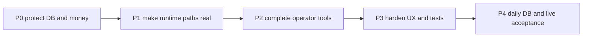

# Finish-Line Fix-Up Plan

> **Date:** 2026-07-13 (last updated 2026-07-15)
> **Status:** Active; P0 repairs landed and verified; automated gate (`bun run check`) now green; P1 runtime, P2 tools, and P4 operator gates still open
> **Owner:** Ken
> **Source audit:** [`docs/attic/finish-line/`](../attic/finish-line/00-INDEX.md)
> **Goal:** Repair the finish-line implementation until its original completion contract is true in code, tests, the daily database, and live operation.

## Audit Verdict

The finish-line work is **not implemented completely or correctly**. The five-hub shell, much of the config-document cutover, several broker/data primitives, mock proof, and many unit tests exist. However, the audit found critical defects in database upgrades and emergency liquidation, disconnected alpha-source implementations, incomplete broker/paper lifecycles, and operator tools that are prototypes rather than the end-to-end features described by the archived plans.

**2026-07-15 update — `bun run check` is now green end to end** (typecheck, lint, format, knip, 1506 tests, mock proof). The earlier `format:check` failure on the drizzle meta files is resolved. Fixes landed since the audit:

- Lint restored to green: type-only `base` → `BaseDoc` alias in `session-strategy-config-backfill.ts`; unused import dropped; archived `docs/attic/mockups` excluded from lint.
- The backup→restore journey test (`operator-journeys.ipc.test.ts`) was rewritten from opaque fake bytes into a real migrated-SQLite round-trip (insert → checkpoint → backup → restore → reopen → query), which also validates the new F0.2 `quick_check` gate (partial **F3.2**).
- Accounts panel now surfaces typed load errors with retry on both queries (partial **F3.1**).
- UI density and dashboard layout reworked (type scale, Roster/Ladder de-squash, scroll).

Several tests still prove isolated helpers or mocked persistence rather than the stated production journeys; the deep P1 runtime journeys remain unproven against live brokers.

### Status by archived plan

Two columns: the original 2026-07-13 audit verdict, and the verified state as of
2026-07-16 (confirmed by reading the code, `bun run check` green).

| Plan                | Audit (07-13)         | Now (07-16) — verified                                                                                                                                                                                               |
| ------------------- | --------------------- | -------------------------------------------------------------------------------------------------------------------------------------------------------------------------------------------------------------------- |
| 01 residual debt    | Partial / unsafe      | Migration chain restored + tested (P0 green). **Gap: legacy signal envelope `signal-event-from-market-signal.ts` still present (F1.7).**                                                                             |
| 02 config diet      | Partial / unsafe      | Backfill Zod validation + atomic drops + version CAS landed (P0 verified). Done pending live daily-DB migration.                                                                                                     |
| 03 brokers          | Partial               | Capabilities/feeds largely wired. **Gap: cert error-taxonomy is a hardcoded placebo (F1.3) — needs a live broker to prove.**                                                                                         |
| 04 proof and ops    | Partial / broken gate | Mock proof green; alpaca proof is a real read-only audit; backup is a hard gate. **Gap: launchd/PID-identity handoff (F3.4).**                                                                                       |
| 05 Polymarket paper | Partial               | **Persisted ghost positions + rehydration landed** (`paper-positions-repo.ts` + both adapters). Multi-restart settlement unproven vs live.                                                                           |
| 06 alpha sources    | Mostly disconnected   | Registered in `strategies/definitions/*` + scan callers for form4/funding. **Gap: cross-venue has no scheduled scan (F1.5).**                                                                                        |
| 07 UI consolidation | Mostly implemented    | UI density + dashboard layout reworked (2026-07-15). Visual/capability parity still operator-review only.                                                                                                            |
| 08 operator tools   | Partial / unsafe      | **Attribution (F2.1) + what-if replay (F2.2) reworked.** Gaps: briefing ladder/calibration sections still empty + no 08:00 scheduler (F2.3); no `backtest-lab-service` found (F2.6); palette/Data Doctor unverified. |
| 09 smoothness       | Not complete          | `bun run check` green; Accounts + cost-breakdown error states done. **Gaps: remaining journey tests (F3.2), perf evidence, daily-DB run, soak.**                                                                     |

### What's left — punch list (2026-07-16)

**Code-completable but require the running app / live-or-sandbox brokers to verify (not safely one-shottable static):**

- F1.3 — replace cert error-taxonomy placebo with induced BROKER_AUTH / INSUFFICIENT_FUNDS / UNKNOWN_SYMBOL and typed-code assertions.
- F1.6 — options-flow v2 (two-leg verticals through RiskEngine/allocation/policy).
- F1.7 — remove the legacy signal envelope; migrate reads/dedupe to `MarketSignal`.
- F1.5 — add a scheduled scan caller for cross-venue dislocation.
- F2.3 — populate briefing ladder/calibration sections; schedule at 08:00 local with persisted last-run.
- F2.6 — confirm/implement Backtest Lab rerun-from-spec (service file not found).
- F2.4/F2.5 — command-palette parity + Data Doctor calendar/degraded correctness (unverified).
- F3.2 — add the remaining journey tests (signal→decision→gates→order→fill→close; ghost-fill→restart→settlement; pause/flatten partial-failure reconciliation).
- F3.4 — verify process identity (not just PID) before SIGTERM; calendar-based nightly scheduling.

**Operator-only — physically require Ken (keys / hardware / time):** every item under "Operator-only gates" below — real broker certs, live stream close, cross-venue approval, Tradier sandbox vertical, light/dark hub screenshots, cold-start perf, three 08:00 briefings, 7-day soak.

**Already done since the audit (do not redo):** P0 (F0.1–F0.5), paper persistence (F1.1), stream feeds (F1.2), proof modes (F1.4), attribution (F2.1), what-if replay (F2.2), Accounts/cost-breakdown error states (F3.1), glossary cleanup (F3.3), `bun run check` green.

## Non-Negotiable Repair Order

Do not perform broker certification, daily-DB migration, or multi-day soak until P0 is green. Those exercises cannot validate away code defects and may damage or misreport real state.

## P0 - Database and Money Safety

### F0.1 Restore an immutable database upgrade chain

**Defect**

The staged migration squash deletes `0001` through `0014` and retimestamps a full-schema `0000_initial` in `electron/main/db/drizzle/meta/_journal.json:4-11`. Existing databases can either run full `CREATE TABLE` statements against existing tables or skip transformations/indexes based on their last migration timestamp. `electron/main/db/migrations.ts:41-49` runs Drizzle before the TypeScript backfill, so the backfill cannot recover from a Drizzle failure.

**Implement**

1. Restore the immutable `0001`-`0014` SQL files and original journal entries. Never rewrite a migration that any daily DB or backup may have recorded.
2. If a consolidated baseline is desired, make it fresh-DB-only under a distinct bootstrap mechanism; do not put it into the upgrade journal seen by existing DBs.
3. Add fixture databases representing migration states `0012`, `0013`, and `0014`. Upgrade each fixture to head and assert schema, row counts, indexes, and `PRAGMA foreign_key_check`.
4. Test the real `0006` deprecated-source purge and `0007` autopsy copy from old tables. Current tests at `electron/main/db/migrations.test.ts:218-307` manually reproduce purge SQL, while `:353-419` inserts directly into the already-merged schema.
5. Add the required `autopsies.scope CHECK(scope IN ('trade','period'))`; it is absent from `electron/main/db/schema.ts:570-576`.

**Acceptance**

- Fresh DB reaches head.
- Copies at `0012`, `0013`, and `0014` reach the identical head schema without data loss.
- Old autopsy rows and lesson relationships survive the upgrade.
- Deprecated source rows are removed only after the subscription safety guard passes.
- `PRAGMA integrity_check` returns `ok`; `PRAGMA foreign_key_check` returns no rows.

### F0.2 Make pre-migration backup a hard gate

**Defect**

`electron/main/services/infra/db-backup.ts:167-177` returns a failed result, but `electron/main/db/client.ts:23-33` proceeds to migration. `scripts/db-backup.sh:37-40` exits successfully when an explicitly expected DB is absent, and its pruning pipeline at `:63-81` is fragile under `pipefail`.

**Implement**

1. If a source DB exists, abort startup before migration when backup fails.
2. Distinguish a genuine first run from an explicitly configured missing `EXVA_DB_PATH`; the latter must fail.
3. Replace the `ls` pruning pipeline with null-safe file enumeration.
4. Validate every backup by opening it read-only and running `PRAGMA quick_check` before recording success.
5. Add a test where backup fails because the destination is unwritable and assert that `runMigrations()` is never called.

### F0.3 Make config backfill lossless and atomic

**Defect**

`session-strategy-config-backfill.ts:185-379` substitutes defaults when legacy section rows are missing. Existing documents and presets are skipped without Zod validation at `:767-773` and `:413-418`, then `migrations.ts:47-49` drops recovery-source tables. `drop-legacy-session-config-tables.ts:24-33` has no preservation assertions.

**Implement**

1. Require and read every expected legacy row for every session; abort with session/table identifiers when one is missing.
2. Zod-validate existing config documents and presets, not only newly assembled ones.
3. Run backfill, row-count assertions, foreign-key checks, and legacy-table drops in one transaction.
4. Before drop, assert one valid config per session and a verified mapping for every preset.
5. Add corruption, missing-row, duplicate-row, and rollback tests using a pre-cutover fixture DB.

### F0.4 Make optimistic concurrency a database compare-and-swap

**Defect**

`session-strategy-config-service.ts:771-816` checks the version before the transaction and updates by `session_id` only. Existing tests serialize writes instead of racing them. `ConfigHistoryDrawer.tsx:84-115` can keep resubmitting a stale parent version after refresh.

**Implement**

1. Update with `WHERE session_id = ? AND version = ?` inside the transaction.
2. Require exactly one changed row; otherwise return `STALE_VERSION`.
3. Race two writes from separate connections and prove only one commits.
4. On stale rollback, refresh the parent config/store version before allowing another attempt.

### F0.5 Rebuild flatten-all as a reconciled emergency workflow

**Defect**

`kill-switch-service.ts:95-128` marks both open and pending trades closed even when broker identifiers are absent. It releases capital after a direct `closeOrder()` call without pausing intake, proving broker closure, or reconciling positions. The UI can report success while exposure remains live.

**Implement**

1. Fence all new entries, then pause every runnable session before liquidation.
2. Cancel pending orders; liquidate open positions. Do not treat these as the same operation.
3. Route liquidation through explicit emergency policy and risk checks, with a documented exception only if the normal entry gate is inapplicable to exits.
4. Keep a trade open and raise an attention item when broker identity, confirmation, or reconciliation is missing.
5. Re-query broker orders and positions after every close. Update the DB and release capital only after terminal confirmation.
6. Make the operation idempotent and resumable after partial failure or restart.

**Acceptance**

- A running mock session cannot open a new trade after flatten begins.
- Pending orders are canceled, open positions are closed, and already-terminal orders remain unchanged.
- Simulated broker failure leaves the DB trade open and visible as attention-required.
- Broker positions and DB trades reconcile to zero before the UI says complete.

## P1 - Complete Runtime Trading and Signal Paths

> **Verification pass — 2026-07-16.** Much of P1 has been implemented since the
> 2026-07-13 audit; the defect line-references below are stale. Current state,
> confirmed by reading the code:
>
> - **F1.1 (paper persistence): largely done.** Both adapters take a
>   `PaperPositionsRepo` and rehydrate persisted ghost positions on read
>   (`polymarket-adapter.ts:68-73,247-260`, `kraken-adapter.ts:247-260`).
>   Kraken debits on fill and credits proceeds with realized P&L
>   (`kraken-adapter.ts:424,628,661`). `paper-positions-repo.ts` exists with a
>   passing test. Remaining: confirm parity + multi-restart settlement against a
>   live/paper broker.
> - **F1.2 (streams): substantially done.** `trade-monitor.ts` carries order-event
>   feeds keyed by account with a stream→poll fallback hook (`:43-92`).
> - **F1.4 (proof): done.** `prove-trade-loop.ts` alpaca mode is a read-only audit
>   of a real recorded paper trade, not an unconditional failure.
> - **F1.5 (alpha sources): mostly wired.** cross-venue, form4, and funding-basis
>   are registered in `strategies/definitions/*` + `strategies/index.ts`; form4 and
>   funding-basis have `signals/strategy/*-scan.ts` callers. Gap: cross-venue has no
>   scheduled scan caller yet.
> - **Genuine remaining gaps (all require the running system / live brokers to fix
>   AND verify — not safely one-shottable from static code):**
>   - **F1.3** — `adapter-certification.ts:295-301` still pushes a hardcoded
>     `errorTaxonomyDocumented: true` placebo; inducing real BROKER_AUTH /
>     INSUFFICIENT_FUNDS / UNKNOWN_SYMBOL codes needs a live broker to prove.
>   - **F1.6** — options-flow is still v1 (single-leg underlying);
>     `options-flow-input-builders.ts:51-53` still says "next phase."
>   - **F1.7** — the legacy envelope bridge `signal-event-from-market-signal.ts`
>     still exists; removing it touches persistence/read paths and needs a live
>     round-trip to verify.

### F1.1 Persist paper orders and positions

**Defect**

Polymarket ghost orders/positions live only in memory (`polymarket-adapter.ts:102-104`). After restart an unknown order is treated as closed (`:644-651`), while `trade-monitor.ts:294-305` can close the DB trade at zero P&L. Kraken has the same memory-only state (`kraken-adapter.ts:117-123`); resting fills are not debited (`:371-408`), closes do not credit proceeds (`:442-448`), and paper positions read real balances (`:183-210`).

**Implement**

1. Add persisted paper orders, fills, and positions with account, instrument metadata, side, quantity, entry, state, and settlement fields.
2. Make placement/fill/cancel/settle and balance debit/credit transactional and idempotent.
3. Rehydrate adapter state on startup.
4. For Polymarket, settle persisted positions against real resolution after any number of restarts.
5. For Kraken, debit resting fills exactly once, credit closes, compute P&L, and return ghost positions in paper mode.
6. Run parity after each actual fill, including later-crossed resting orders. Compare fill price to a contemporaneous quote, not merely market existence.

### F1.2 Make streams drive state and make capabilities honest

**Defects**

- `trade-monitor.ts:155-178` only logs feed events; closure still comes from polling.
- Alpaca and Polymarket advertise combinations that throw `not yet wired` (`alpaca-adapter.ts:215-234`, `polymarket-adapter.ts:202-218`).
- Tradier advertises IOC/FOK and streaming while mapping IOC/FOK to day and using polling (`tradier-adapter.ts:522-545`, `:638-640`).
- Reconnect health resets on TCP open without auth/subscription acknowledgment, and heartbeat has no pong timeout (`streaming-order-event-feed.ts:110-122`).

**Implement**

1. Process terminal stream events immediately by broker order ID and record closure source as `stream` or `poll`.
2. Either implement every advertised order shape or remove it from capabilities. The policy gate must reject unsupported shapes before HTTP.
3. Preserve resting Alpaca limits instead of waiting 1.5 seconds and throwing.
4. Count a stream healthy only after protocol authentication and subscription acknowledgment; add pong deadlines.
5. Fall back to polling after bounded protocol-level failures and raise one deduplicated supervisor alarm.

### F1.3 Replace the broker certification placebo

**Defect**

`adapter-certification.ts:294-301` records error taxonomy as passing without inducing errors; `:247-280` can pass feed certification without starting a feed; `:178-207` permits a far limit to be closed instead of open then canceled.

**Implement**

1. Enumerate every advertised order type, quantity kind, time-in-force, and multileg combination.
2. Require unsupported combinations to fail before adapter HTTP.
3. Require a far limit to reach `open`, cancel it, and observe terminal `canceled`.
4. Start the feed independently of synchronous fill data and require a correlated terminal event.
5. Induce bad auth, insufficient funds, and unknown symbol and assert exact typed codes.
6. Add an application-level Tradier vertical certification through RiskEngine, allocation, order policy, placement, monitoring, and close.

### F1.4 Make proof modes prove the stated journeys

**Defect**

`scripts/prove-trade-loop.ts:39-70` always exits non-zero in Alpaca mode, even after keys and a qualifying fill exist. Polymarket proof tests direct adapter actions rather than signal-to-resolution behavior.

**Implement**

1. Alpaca mode opens the selected DB read-only, finds a qualifying paper trade, verifies open and close timestamps, broker/account mode, stream closure evidence, decision trace, and scorecard export, then reports exact IDs.
2. Polymarket mode exercises signal, decision, ghost order, persisted fill, restart/rehydration, real or deterministic fixture resolution, settlement, balance, and signal label.
3. Keep no-key/no-network failures loud and stage-specific.

### F1.5 Wire all seven alpha sources into production

**Defect**

Several scanners are exported but have no production caller. `cross-venue-dislocation.ts:31-39`, `form4-insider-cluster.ts:27-33`, and `funding-basis.ts:26-31` register unreachable mean-reversion strategies. The persistent catalog lacks templates/profiles/contracts, runtime source rows are not provisioned, and the source UI can create only EDGAR/mock. News enrichment exists only in a unit test.

**Implement for every source**

1. Seed an experience template/input profile and a real research contract.
2. Provision/configure a runtime source or scheduled scan through the catalog UI.
3. Add a non-test production caller and lifecycle ownership.
4. Persist ingestion data, emit strict typed payloads, and route to the intended consumer.
5. Add a source-specific Dev Panel injection and signal-to-trace smoke.
6. Make dedupe buckets no broader than TTL; funding and cross-venue currently use daily keys with one-hour TTLs.

**Source-specific work**

| Source        | Required repair                                                                                                          |
| ------------- | ------------------------------------------------------------------------------------------------------------------------ |
| Kalshi        | Provision poller, accept `kalshi_market` in prediction templates, and route fee-adjusted dislocations                    |
| Cross-venue   | Load approved links, validate resolution source/date, fetch both quotes, schedule scans, add approval UI/IPC             |
| Form 4        | Ingest real Form 4 feeds, persist transactions, schedule cluster scans, and extend historical backfill beyond 8-K        |
| RVOL          | Seed selectable template/profile/contract and schedule the existing OHLCV implementation                                 |
| Calendar      | Provision poller, add Settings editor, persist emitted events, and flatten/reduce existing holdings when policy requires |
| Funding/basis | Schedule public fetch, persist `funding_rates`, invoke detector, and route crypto context/strategy correctly             |
| News          | Invoke enrichment in evidence building, enforce `contextOnly`, and prevent standalone candidate creation                 |

### F1.6 Implement options-flow v2 rather than documenting v1

**Defect**

`options-flow-input-builders.ts:49-54` explicitly says v1 trades the underlying and vertical execution is the next phase. `order-placer.ts:73-109` always builds a single-leg notional order. `placeSpread()` and `selectVerticalSpread()` have no production caller, and RiskEngine does not size from spread max loss.

**Implement**

1. Select a valid two-leg vertical from live chain data and carry both legs plus net limit through the decision contract.
2. Size debit spreads by net debit and credit spreads by width minus credit, including multiplier and fees.
3. Pass RiskEngine, allocation, and order-policy gates before `placeSpread()`.
4. Monitor spread mid and close at profit target, stop, or DTE floor.
5. Replace the v1 experience contract and in-app docs; remove every `next phase` statement.
6. Add a mock application-level vertical journey before using Tradier credentials.

### F1.7 Remove the legacy signal envelope for real

**Defect**

`signal-event-from-market-signal.ts:7-40` recreates the old EDGAR-shaped fields, and `signal-events-repo.ts:9-29`, `:71-85`, and `:157-189` persists, deduplicates, and reads them. This is the bridge doc 01 claimed was removed.

**Implement**

1. Make `MarketSignal` the persisted/read domain shape.
2. Migrate any needed legacy values into typed payloads.
3. Drop unused top-level EDGAR columns through the restored upgrade chain.
4. Update downstream consumers rather than adding a renamed bridge.

## P2 - Complete Operator Tools

### F2.1 Make equity attribution truthful

`equity-snapshot-service.ts:55-76` records only current unrealized P&L by experience. `equity-curve-panel.tsx:70-77` ignores that map and draws total equity minus daily, non-cumulative AI spend.

1. Attribute realized and unrealized P&L to experiences.
2. Persist mark timestamps and surface stale marks.
3. Build stacked per-experience contribution and per-experience net-of-cumulative-AI-cost series.
4. Reconcile the sum of contributions to portfolio equity at every snapshot.

### F2.2 Make what-if replay reproducible

`what-if-replay-service.ts:94-109` and `:180-229` can use latest bars, hard-code stock/1h, ignore parameters, silently fall back to mean reversion, and save under a fake experience ID.

1. Resolve the exact stored `barWindowHash` and reject when unavailable.
2. Reuse recorded LLM outputs and re-run only deterministic stages.
3. Apply every exposed parameter or remove it from the UI.
4. Derive instrument, timeframe, strategy, and experience from the source decision.
5. Reject unsupported source states and future-leaking bars.
6. Hash inputs and prove repeated runs are identical.

### F2.3 Finish morning briefing and deterministic scheduling

`morning-briefing-service.ts:86-125` leaves ladder/calibration empty, and the supervisor runs on startup plus 24-hour elapsed intervals rather than 08:00 local.

1. Populate every promised section, restricting calendar warnings to held symbols.
2. Query bounded date ranges in SQL instead of loading all trades.
3. Schedule by local wall clock with persisted last-run/idempotency state.
4. Persist digest queue/flush state across restarts.
5. Surface assembly and delivery errors in the UI and supervisor.
6. Make Telegram secret set/clear update the live sink without restart.

### F2.4 Finish command palette parity and safety

1. Add executable approve, readiness toggle, open-backup-folder, backtest, and create-from-preset actions.
2. Route docs slug, settings section, instrument, trade, and session results to the selected entity, not just the parent hub.
3. Reject invalid tab IDs instead of rendering blank content.
4. Surface query/action errors; never convert transport failure into “No matches.”
5. Expire destructive confirmation state and keep the palette open on failure.

### F2.5 Make Data Doctor operationally correct

1. Use exchange calendars so overnight/weekend closures are not gaps.
2. Treat no calls, no success, and unknown freshness as unknown/degraded, never passing.
3. Persist provider enablement and make it govern normal ingestion/scheduling, not only manual backfill.
4. Move gap detection to bounded SQL/window queries.
5. Add a real provider-outage test proving the UI and supervisor report degradation.

### F2.6 Complete Backtest Lab

`backtest-lab-service.ts:207-227` compares two hashes already stored on the same run; it does not rerun a spec.

1. Rerun from the stored immutable specification and compare output hashes.
2. Add expectancy confidence intervals, Sharpe lower bound, max drawdown, cost drag, and trade count per fold.
3. Support instrument sets and editable cost models.
4. Render per-fold equity curves, overlaid comparisons, and a real sweep small-multiples grid.
5. Continue writing every sweep trial to `experience_experiments`.

## P3 - UX, Documentation, and Proof Quality

### F3.1 Finish error and empty states

Audit every TanStack Query and imperative IPC call. Known misses include `cost-breakdown-panel.tsx:28-36`, `accounts-panel.tsx:266-284`, `App.tsx:506-509`, and `DashboardHub.tsx:151-158`.

Every failure state must show the typed message, affected operation, and retry/recovery action. Every first-run empty state must point to the action that creates data.

### F3.2 Replace fake journey tests

`operator-journeys.ipc.test.ts:63-113` inserts an open trade directly instead of exercising signal-to-order flow. Its backup test at `:168-193` copies fake bytes instead of backing up and reopening SQLite.

Add journey tests for:

- create session -> configure -> start -> signal -> decision -> all gates -> broker order -> fill -> close;
- config edit -> restart/reopen DB -> persistence;
- valid open SQLite backup -> restore -> reopen -> query expected rows;
- ghost fill -> process restart -> settlement;
- pause/flatten with partial broker failure and reconciliation;
- each alpha source -> delivery -> intended consumer -> decision trace or context attachment.

### F3.3 Correct docs and vocabulary

1. Remove Timer/Web Search glossary entries and stale timer-driven language in `src/lib/help-glossary.ts:11-18`, `:43-62`, and `:104-115` where they refer to removed sources.
2. Replace stale config architecture in `docs/architecture/pipeline-runtime.md:442-449` and `docs/architecture/ai-runtime.md:159-169`, `:550-557`.
3. Remove all false completion claims, placeholders, `next phase`, and unsupported capability statements from in-app docs.
4. Keep archived finish-line docs unchanged as historical evidence; this plan is the active source of truth.

### F3.4 Fix headless scheduling and GUI handoff

1. Replace unconditional launchd `KeepAlive=true` or add a persisted GUI-owned suppression condition.
2. Verify process identity, not only PID, before sending SIGTERM from `instance-lock.ts`.
3. Use calendar-based nightly scheduling with persisted run state.
4. Prove GUI takeover does not create a headless restart storm and headless resumes after GUI exit.

## P4 - Acceptance Contract

### Automated gates

- [~] `bun run check` passes (green as of 2026-07-15; still needs three consecutive confirmed runs).
- [ ] Zero skipped/todo tests in production test suites. (Note: `check:proof` still reports 2 skipped Alpaca/Polymarket key-gated stages.)
- [ ] Migration matrix passes from fresh, `0012`, `0013`, `0014`, and a sanitized daily-DB copy.
- [x] `bun run prove -- --mode=mock` passes.
- [ ] Polymarket proof passes across a forced process restart.
- [ ] Broker certification assertions are non-placeholder and mock certification passes.
- [ ] All seven alpha sources have at least one non-test production caller and source-specific smoke.
- [ ] Emergency flatten integration test proves broker/DB reconciliation and partial-failure honesty.

### Operator-only gates

Run these only after all automated gates pass:

- [ ] Back up the daily DB, upgrade a copy, inspect row counts/integrity, then upgrade the daily DB.
- [ ] Run Kalshi demo, Tradier sandbox, Kraken validate/paper, and Alpaca paper certificates with real keys.
- [ ] Observe an Alpaca terminal stream event closing a trade and record the proof row.
- [ ] Approve a real cross-venue link and observe a fee-adjusted signal.
- [ ] Place and close a real Tradier sandbox vertical through the application gate chain.
- [ ] Review light/dark screenshots for all five hubs, all new surfaces, and failure/empty states.
- [ ] Measure cold start below 3 seconds and each hub interactive below 1 second on the daily DB, or record and approve a revised measured budget.
- [ ] Receive three consecutive 08:00 briefings after restarts.
- [ ] Complete a seven-day headless paper soak with no silent stalls, clean Data Doctor state, nightly backups, and reconciled trades/balances.
- [ ] Walk each hub journey and explicitly accept it.

## Completion Rule

This plan closes only when every checkbox above is backed by output, database evidence, screenshots, or operator notes. “Code exists,” “unit helper passes,” “requires keys,” and “pending Ken” are not substitutes for an executable production path. Any blocked gate remains open with its exact blocker; no section may be marked complete by narrowing the original behavior.
