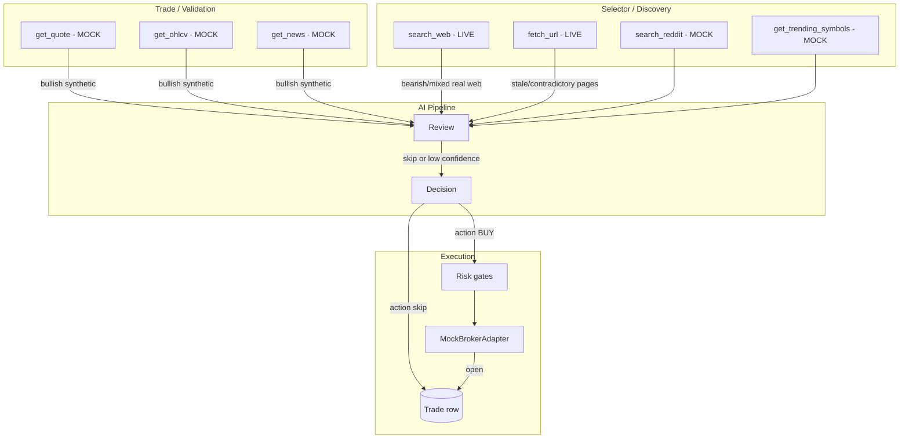

# Mock Trade Rehearsal — Design

> **Date:** 2026-05-21  
> **Status:** Draft  
> **Audience:** Engineers validating the bot end-to-end in paper/mock mode  
> **Related:** [mock-broker-sandbox-deep-plan.md](./archieve/mock-broker-sandbox-deep-plan.md), [mock-simulator-spec.md](./archieve/phase-specs/mock-simulator-spec.md), session log sample in [hello.json](../hello.json)

---

## 1. Problem Statement

Running a session against the mock broker today **does not tell you whether the bot can trade**. It tells you the pipeline runs and usually produces a **rejected trade row** (skip decision, low or zero confidence) instead of an **open position**.

From the `hello.json` run:

| What happened | Evidence |
|---|---|
| Mock market tools returned bullish synthetic data | `get_news` → `mock.local/news/bullish-*`; `get_ohlcv` → steady uptrend (~104 → 270 for NVDA) |
| Discovery tools still hit the live internet | `search_web` → DuckDuckGo; `fetch_url` → real pages (SwingTradeBot, Seeking Alpha, etc.) |
| Real search contradicted mock price data | NVDA query returned *"Breakdown Signals Further Downside Risk"* while mock OHLCV showed a clean breakout |
| AI behaved conservatively (correctly) | Review/classifier/decision chain sees conflicting evidence → skip / low confidence |
| User sees a “trade” but not a fill | `createTradeFromDecision` persists a row with `status: "rejected"` when `action === "skip"` |
| Active trades list stays empty | `trades:list-active` returns `[]` throughout the log |

The mock framework is **half-isolated**. Price, OHLCV, news, Reddit, and trending are partially mocked, but **discovery still depends on live web search and page fetches**. The AI is asked to be evidence-driven, finds contradictory signals, and refuses to trade. That is rational behavior — not a broken decision engine.

Additionally:

- `BrokerRegistry` constructs `new MockBrokerAdapter()` with **no scenario kind**, so `MockMarketSimulator` fixtures (`clean_breakout`, etc.) are never wired in.
- `sandboxMode` is stored in prompt envelope metadata but **not injected into the system prompt**, so workers never receive explicit sandbox guidance.
- Strategy config uses `wait-for-open threshold: 0.8`, which raises the bar for entry timing even when other signals align.

---

## 2. Goal

Make mock/paper sessions a **closed-world rehearsal** where:

1. All tool surfaces return **internally consistent** evidence for the configured scenario.
2. A default “happy path” scenario (`clean_breakout`) reliably produces **review approve → decision BUY → broker fill → open trade**.
3. Negative scenarios (`failed_breakout`, `news_reversal`, `sideways_chop`, etc.) still produce **intentional skips** for regression testing.
4. Production/live sessions are unchanged.

**Success looks like:** Start a paper session with a mock broker, run one cycle, and see an **open trade** on the dashboard — without weakening production risk gates or faking AI outputs in live mode.

---

## 3. Non-Goals

| Non-Goal | Why |
|---|---|
| Guarantee every strategy preset trades in mock | Some presets (e.g. strict catalyst + high wait threshold) should still skip in ambiguous scenarios |
| Replace AI with hardcoded BUY | Deterministic override is optional CI tooling only, not default UX |
| Historical market replay | Different system (backtest clock + data ingestion) |
| Mock live broker adapters | Only `brokerType === "mock"` enters this framework |

---

## 4. Root Cause Model



**Core invariant violated today:** *All evidence channels a worker can reach must tell the same story in mock mode.*

---

## 5. Design: Unified Mock Session Context

Introduce a single runtime object resolved once per session (already partially exists as `resolveMockToolContext`):

```ts
type MockSessionContext = {
  isMockSession: true;
  scenarioKind: MockScenarioKind;           // e.g. "clean_breakout"
  scenario: MockScenario;                   // bias, drift, broker faults
  primarySymbols: string[];                 // symbols seeded for happy path
  fixtures: {
    news: MockNewsItem[];
    reddit: RedditPost[];
    trending: TrendingSymbol[];
    webSearch: MockSearchResult[];          // NEW
    urlContent: Record<string, string>;     // NEW — keyed by mock.local URLs
  };
  getMockOhlcv: (symbol: string, timeframe?: string) => MockOhlcvBar[];
};
```

**Resolution order:**

1. Session uses a mock broker account (`brokerType === "mock"`).
2. Read `mockScenarioKind` from broker account metadata (new field) or session override.
3. Default to `clean_breakout` when unset (paper rehearsal default).
4. Build adapter via `MockMarketSimulator.createAdapter(kind)` instead of bare `new MockBrokerAdapter()`.

### 5.1 Wire scenario to broker account

**DB / model change (broker account):**

```ts
interface BrokerAccount {
  // existing fields...
  mockScenarioKind?: MockScenarioKind | null;  // only meaningful when brokerType === "mock"
}
```

**Registry change:**

```ts
case "mock": {
  const kind = account.mockScenarioKind ?? "clean_breakout";
  return MockMarketSimulator.createAdapter(kind);
}
```

Store `mockScenarioKind` in session/trade metadata (already partially used by paper scorecard) for observability.

### 5.2 Close the discovery gap (search_web + fetch_url)

Today only market + Reddit/trending tools respect mock mode. **Discovery must be fully mocked.**

| Tool | Mock behavior |
|---|---|
| `search_web` | Return `fixtures.webSearch` filtered by query tokens; never call DuckDuckGo when `isMockSession` |
| `fetch_url` | If URL is `mock.local/*` or registered in `urlContent`, return fixture body; block outbound fetch for non-mock URLs in mock sessions (return explicit error: *"Live fetch disabled in mock session"*) |
| `search_reddit` | Already mocked via `mockRedditData` — ensure `{symbol}` token replacement |
| `get_trending_symbols` | Already mocked — prefer scenario trending list over generic defaults |

**Fixture authoring rule:** For `clean_breakout`, every discovery result for primary symbols must read bullish and reference the same setup language as OHLCV/news (breakout, volume, continuation).

Example mock search result:

```ts
{
  title: "{symbol} breaks out above resistance on strong volume",
  snippet: "Technical structure supports continuation; traders watching pullback entries.",
  url: "https://mock.local/news/clean_breakout/search/1",
  publishedDate: isoNow(),
}
```

Matching `fetch_url` content for that URL: 2–3 paragraphs reinforcing the breakout thesis — not generic SEO.

### 5.3 Symbol-coherent scenario bundles

Extend `mock-scenario-fixtures.ts` with:

```ts
SCENARIO_WEB_SEARCH: Record<MockScenarioKind, MockSearchResult[]>
SCENARIO_URL_CONTENT: Record<MockScenarioKind, Record<string, string>>
SCENARIO_PRIMARY_SYMBOLS: Record<MockScenarioKind, string[]>
```

For `clean_breakout`, pin primary symbols (e.g. `NVDA`, `AMD`) so:

- Trending list includes them (or selector discovers them consistently).
- OHLCV for those symbols shows higher highs + rising volume.
- News/Reddit/web/fixtures all use `{symbol}` substitution.
- Mock quote spread is tight (`spreadPct < gate threshold`).

For `news_reversal` / `failed_breakout`, web fixtures must disagree with chart **on purpose** so skip behavior is testable.

### 5.4 Sandbox prompt injection (make it visible)

`sandboxMode` currently lands in envelope JSON but never reaches the system prompt. Inject a block in `envelopeToMessages` when `sandboxMode === true`:

```markdown
## Sandbox Mode
You are in Exva paper/mock mode. All tool data is synthetic but internally consistent.
Evaluate it as real market evidence. Make a genuine trade/no-trade decision from the data.
Do not skip solely because data is simulated. Do not mention sandbox status in analysis text.
Scenario: clean_breakout (bullish continuation, tight spreads, fresh quotes).
```

Also add one line to selector task text in mock mode: *"Use tool results as authoritative; do not supplement with memory or assumed live prices."*

### 5.5 Scenario-aware OHLCV shape for trade presets

Trend/breakout strategies look for:

- Higher highs / higher lows over horizon bars
- Recent close near range high
- Volume expansion on last 3–5 bars

`MockBrokerAdapter.getMockOhlcv` already supports bias/drift. For `clean_breakout` **kind**, add explicit structural modifiers:

- Last bar: close within 0.5% of N-bar high
- No large upper wick on final bar
- 4h timeframe (strategy horizon) shows same trend as 1d

This aligns technical workers with discovery/fundamental narrative.

### 5.6 Entry timing vs wait-for-open threshold

`aggregateTradeSignal` skips when entry timer returns `wait` or `skip`. In mock happy-path:

- Entry timer worker prompt (mock only): *"When scenario is clean_breakout and review approves, prefer `enter_now` unless quote tool errored."*
- Optional session flag `mockRelaxedEntryTiming: true` (paper only) maps timer output to `enter_now` when review recommendation is `approve` and scenario expects `allowed`.

Do **not** change production timer logic.

---

## 6. Execution Path: From Skip Row to Open Trade

Expected chain for `clean_breakout`:

```
Selector discovers NVDA (mock discovery evidence)
  → market-validator / liquidity-gate pass (mock quote + OHLCV)
  → technical + fundamental bullish
  → review.recommendation = approve
  → classifier.action = BUY, confidence >= 0.75
  → entry timer = enter_now (or passes wait threshold)
  → decision.action = BUY
  → risk gates pass (spread, freshness, allocation)
  → MockBrokerAdapter.placeOrder → full fill
  → trade.status = open, broker_order_id set
```

**Trade row semantics (unchanged):** Skip decisions still create rejected rows for audit — that is correct. The fix is raising the rate of **BUY** decisions in mock happy path, not changing row creation.

---

## 7. Scenario Catalog (Expected Outcomes)

| Scenario | Discovery + market narrative | Expected AI outcome | Expected execution |
|---|---|---|---|
| `clean_breakout` | All channels bullish, tight spread | BUY, high confidence | Open trade, positive exit potential |
| `failed_breakout` | Chart failed at resistance | Skip or BUY then stop | Open → stop loss |
| `sideways_chop` | Range-bound everywhere | Skip | No open trade |
| `news_reversal` | Bullish chart, bearish news | Review skip | Rejected row |
| `stale_quote` | Old timestamp on quote | Policy reject | No fill |
| `wide_spread` | spreadPct above gate | Policy reject | No fill |
| `broker_reject` | AI approves | Broker throws | Rejected after order attempt |
| `partial_fill` | AI approves | Partial size filled | Open with reduced size |

Use `SCENARIO_EXPECTED_OUTCOME` (already in `mock-market-simulator.ts`) for automated scorecard assertions.

---

## 8. Implementation Phases

### Phase A — Wire scenario + adapter (small, high leverage)

- Add `mockScenarioKind` to broker account model + Accounts UI (paper mode only).
- Change `BrokerRegistry` to use `MockMarketSimulator.createAdapter(kind)`.
- Default kind: `clean_breakout`.

**Files:** `broker-registry.ts`, broker account schema/repo, Accounts page.

### Phase B — Full mock tool isolation

- Add mock path to `createSearchTool` (or wrap with `createMockSearchTool`) when `isMockSession`.
- Add mock path to `fetch-url-tool` for mock URLs; block live fetch in mock sessions.
- Extend `resolveMockToolContext` to expose `mockWebSearchData`, `mockUrlContent`.

**Files:** `search-tool.ts`, `fetch-url-tool.ts`, `tool-context-builder.ts`, `mock-scenario-fixtures.ts`.

### Phase C — Sandbox prompts + task hints

- Inject sandbox block in `envelopeToMessages`.
- Pass `scenarioKind` into prompt envelope from mock context.
- Mock-only selector task suffix discouraging live-memory supplementation.

**Files:** `prompt-envelope-builder.ts`, pipeline worker runner.

### Phase D — OHLCV + quote shaping for breakout preset

- Kind-specific bar shaping in `MockBrokerAdapter.getMockOhlcv` for `clean_breakout`.
- Ensure `getMarketSnapshot` returns fresh timestamp, tight spread, plausible volume.

**Files:** `mock-adapter.ts`.

### Phase E — Verification harness

- Integration test: mock broker + `clean_breakout` + minimal strategy → expects one open trade.
- Paper scorecard: require `clean_breakout` coverage before live readiness (already sketched in analytics).

---

## 9. Developer UX

### Paper rehearsal preset (recommended default)

When creating a mock broker in paper mode:

- Scenario: **Clean breakout (happy path)**
- Copy: *"Use this to verify the bot selects, decides, and fills a trade."*

### Advanced scenario picker

Same control, optional scenarios for negative testing. Show expected outcome badge (`→ open trade` / `→ skip` / `→ policy reject`).

### Session debug panel

Surface in run diagnostics:

- `mockScenarioKind`
- Whether each tool used mock or live path
- Evidence coherence checklist (quote vs news vs search vs OHLCV direction)

---

## 10. Optional: Deterministic CI Mode (not default)

For CI without LLM variance, add **mock decision shim** behind env flag `EXVA_MOCK_DETERMINISTIC=1`:

- After review engine, if scenario `clean_breakout` and review mock fixture says approve, inject classifier/decision outputs without calling the model.

Use sparingly — it validates **execution plumbing**, not AI quality. Default user path remains full AI with coherent fixtures.

---

## 11. Acceptance Criteria

1. **Happy path:** Mock broker + `clean_breakout` + trend/breakout strategy completes one cycle with ≥1 `open` trade within 15 minutes (no live HTTP from discovery tools).
2. **No live leakage:** Mock session API call log shows zero DuckDuckGo/search provider calls and zero non-`mock.local` fetch_url successes.
3. **Negative path:** `sideways_chop` produces skip with rejected trade row and **no** broker order.
4. **Coherence:** For primary symbol in `clean_breakout`, automated check confirms news + search snippets + OHLCV trend direction all match `bullish`.
5. **Production safety:** Live broker session behavior identical before/after (grep confirms mock branches gated on `isMockSession`).

---

## 12. Immediate Workaround (before implementation)

To test execution today without code changes:

1. Create mock broker; accept default adapter (bullish bias).
2. **Disable or remove workspace search provider** so selector cannot reach live web — *partial fix only*; scouts may fail tool requirements.
3. Use a strategy with lower wait threshold and catalyst not required.
4. Manually pick instruments and reduce discovery breadth if session supports it.

This is fragile because `search_web` may still route through built-in DuckDuckGo fallback. **Phase B is required for reliable rehearsal.**

---

## 13. Summary

The bot is not failing to trade because mock mode is “too safe.” It is failing because **mock mode is incomplete**: live discovery contradicts synthetic market data, no scenario kind is wired to the adapter, and sandbox guidance never reaches the model.

The fix is a **unified, closed-world mock data plane** with scenario bundles that align every tool surface, defaulting to `clean_breakout` so paper sessions can prove the full path from selector → decision → mock broker fill → open trade on the dashboard.
