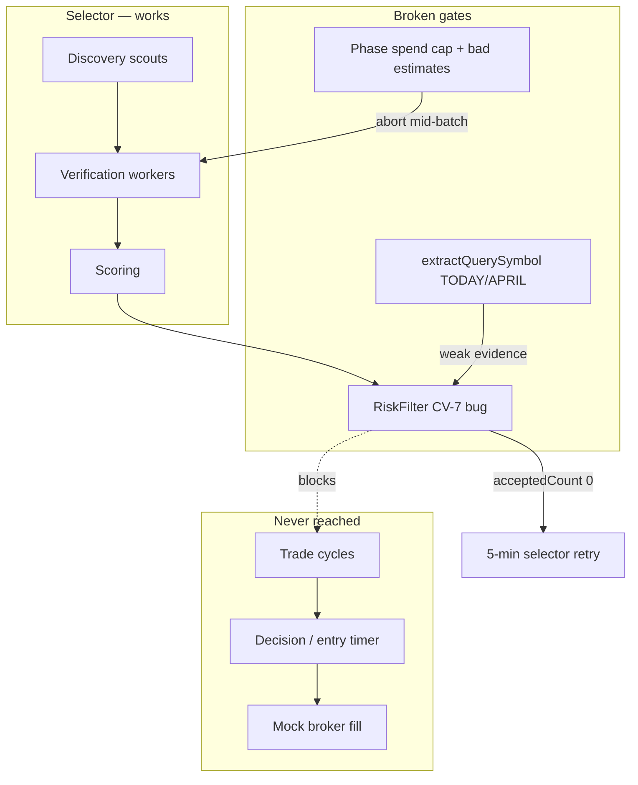

# Mock Trade Rehearsal — Fix Plan

> **Date:** 2026-05-21  
> **Status:** Implemented (Phases 0–5; Phase 6 deferred)  
> **Implemented on:** 2026-05-21
> **Audience:** Engineers unblocking paper/mock end-to-end rehearsal  
> **Related:** [mock-trade-rehearsal-design.md](./archieve/mock-trade-rehearsal-design.md), [mock-trade-rehearsal-review.md](./archieve/mock-trade-rehearsal-review.md), session log in [hello.json](../hello.json) (~65k lines, two full selector cycles)

---

## 1. Executive Summary

The mock rehearsal design (Phases A–D) shipped and works: mock tools are isolated, sandbox prompts inject, and selector workers produce bullish NVDA/AMD/AAPL candidates. **The bot still never reaches trade execution** because of a selector risk-filter bug that rejects every candidate before the orchestrator can enqueue trade cycles. Spend caps also abort selector workers mid-batch, but that is secondary — even a perfect selector run produces **zero instruments** today.

This plan fixes the blockers in priority order, **raises spend caps aggressively for paper/mock** (until cost tracking is fixed), **replaces per-model pricing whack-a-mole with provider-reported cost** (OpenRouter `usage.cost` for all models), and closes the remaining mock-data gaps from the original design.

---

## 2. Evidence from `hello.json` (extended run)

Session `07eb8274-d06b-42db-a070-615a85e84ee1`, mock broker, `clean_breakout`, model `deepseek/deepseek-v4-flash`.

| Observation | Evidence | Impact |
|---|---|---|
| Mock tools isolated | `search_web` → `provider: "mock"`, `mock.local` URLs throughout | Design goal met |
| Symbol substitution corrupts generic queries | `"TODAY breaks out…"`, `"APRIL cleared…"`, `"CRUDE swing setup…"` | Discovery noise; weakens CV-6 symbol match |
| Selector spend exceeds phase cap | `$0.34–0.36` spent vs `$0.30` cap; 3 abort log lines per cycle | Workers aborted mid-verification |
| Web-scout timeouts (cycle 1) | 5 × 60s `AI request timed out` | ~5 min lost; `rejectedCount: 1` (worker batch, not trade) |
| Selector completes twice | Cycle `f17cab4c…` then retry cycle `c9eb91e8…` ~5 min later | Matches `DEFAULT_SELECTOR_NO_INSTRUMENT_RETRY_MINUTES = 5` in `orchestration/cycle/types.ts:56` |
| **No trade pipeline in log** | Zero `tradeId`, zero `technical`/`decision` phase runs, zero `enqueueing trade cycles` | Orchestrator never enqueued trades |
| Verification mostly succeeds | NVDA/AAPL/AMD/MSFT pass; PLTR failed in cycle 2 | Candidates exist; problem is post-verification filtering |

**Key inference:** Selector finishes → `acceptedCount = 0` after risk filter → orchestrator schedules another selector in 5 minutes → repeat. The user sees an idle dashboard with no open trades, not a `skip` decision row.

---

## 3. Root Causes



### P0 — Risk filter rejects all candidates (CV-7 logic bug)

There are two rejection points that both push `"Selector rationale is empty"`. The first is a direct check in `RiskFilter.collectRejectionReasons()` itself:

**File:** `electron/main/services/ai/engines/selector/selector-risk-filter.ts`

```ts
// First gate — checks candidate.rationale directly (line 77)
if (!candidate.rationale?.trim()) {
  reasons.push("Selector rationale is empty");
}
```

This check uses `candidate.rationale`, which verification workers DO populate, so it normally passes. The **guaranteed failure** is CV-7 in `CandidateValidationService`, called immediately after:

**File:** `electron/main/services/orchestration/policy/candidate-validation-service.ts`

```ts
// CV-7 — checks selectorEvidence.summary (line 161)
if (!structuredEvidence?.summary?.trim()) {
  reasons.push("Selector rationale is empty");
}
```

`structuredEvidence` comes from `candidate.selectorEvidence`, which is **`null` on every candidate** when `RiskFilter.evaluate()` runs in selector `finalize()`. `buildSelectorEvidence()` is only called **after** filtering, on accepted rows:

```ts
// selector/plan.ts finalize()
const evaluation = riskFilter.evaluate(state.verifiedCandidates); // selectorEvidence still null
evaluation.accepted.map((c) => ({
  ...c,
  selectorEvidence: buildSelectorEvidence(c), // too late
}));
```

When `selectorEvidence` is `null`, optional chaining yields `undefined`, and `!undefined` is `true` → **every candidate fails CV-7** even with a populated `candidate.rationale`.

This explains the 5-minute selector retry with no trade phases.

### P1 — Spend caps far below actual selector cost

**Files:** `electron/shared/ai/pipeline-config.ts`, `electron/shared/ai/pipeline-phase.ts` (`PHASE_DEFAULTS`)

| Cap | Default | Observed (hello.json) |
|---|---|---|
| Selector phase | $0.30 | $0.34–0.36 |
| Pipeline total | $0.50 | $0.34 in selector alone |
| Per-worker `spendLimitUsd` | $0.30 (selector) | Single worker can consume full phase |

Caps abort workers with `[pipeline] aborting further workers: spend $0.3400 exceeded cap $0.3000 (phase)` (log format uses 4 decimal places). Selector still completes (partial failure tolerated), but verification quality degrades.

### P1 — Cost tracking uses estimates, not what providers actually charge

Spend guards today run entirely on **`estimateCostUsd()`** — a static prefix table in `model-pricing.ts` multiplied by token counts. That architecture breaks for **every model not explicitly listed**, not just v4-flash.

| Issue | Location | Effect |
|---|---|---|
| Static table, unknown model → catch-all | `model-pricing.ts` `{ prefix: "", inputPer1M: 1, outputPer1M: 1 }` | `deepseek/deepseek-v4-flash` (and any new model) priced at **$1/1M** — likely **over** real OpenRouter cost |
| OpenRouter **`usage.cost` ignored** | `run-agent-execute.ts` | OR returns actual billed credits on every response; we throw it away |
| Cost computed **twice**, inconsistently | `run-agent-execute.ts` → `trace-assembler.ts` | Run agent estimates once; assembler re-estimates via `estimateCostUsd()` instead of reusing the run's number |
| Estimates drive cap aborts | `worker-executor.ts:402` → `spendTracker.record(run.cost_usd)` | Workers stopped on fake numbers |
| Session totals sum estimates | `agent-runs-repo.dailyAiSpendUsd()` | Retry cycles inherit wrong baseline |

**Symptom vs fix:** Adding `v4-flash` to the table patches one model. The durable fix is **provider-reported cost first, estimate fallback second** — which automatically works for all OpenRouter models (v4-flash, the next DeepSeek, whatever you swap in).

**Until Phase 2 ships:** paper/mock caps stay high (Phase 1). Treat caps as a runaway-loop safety net, not a precise budget.

### P2 — Symbol substitution picks English words as tickers

**File:** `electron/main/services/broker/mock/mock-discovery-fixtures.ts` — `extractQuerySymbol()`

Fixture text uses `{symbol}` placeholders substituted at runtime. `extractQuerySymbol()` extracts a ticker from the LLM-generated query string to drive that substitution. Regex `\b[A-Z]{1,5}\b` correctly skips 6-letter tokens (`STRONG`, `STOCKS`) but the `SYMBOL_NOISE` blocklist is too narrow — `TODAY` (5 chars), `APRIL`, `CRUDE`, `HIGH`, etc. are not blocked, so generic queries return them as the "symbol". Fixture text then reads `"TODAY breaks out above resistance"` instead of `"NVDA breaks out above resistance"`. This weakens CV-6 (`resultJson.includes(instrument.symbol)`) because the substituted text no longer contains the real ticker.

### P3 — Entry timer can still force skip (latent, once P0 fixed)

**File:** `electron/main/services/ai/engines/aggregators/trade-signal-aggregator.ts`

`wait` from entry-timer → `action: "skip"`. Prompt hint exists for `clean_breakout` but LLM may still return `wait`. Optional `mockRelaxedEntryTiming` from original design not implemented.

---

## 4. Goals

1. **One selector cycle → ≥1 enqueued trade cycle → ≥1 open mock trade** on `clean_breakout`.
2. **Paper/mock spend caps never abort a normal rehearsal** until provider-reported cost is wired.
3. **All OpenRouter models "just work" for spend tracking** — no new pricing-table entry per model.
4. **Mock discovery queries return symbol-coherent text** for both specific and generic queries.
5. **Observability:** log `acceptedCount`, rejection reasons, `costSource`, and `enqueueing trade cycles` at INFO so future logs are self-diagnosing.

---

## 5. Non-Goals

- Tightening production caps to minimal budgets (deferred until Phase 2 validates reported costs against OpenRouter dashboard).
- Maintaining a complete per-model pricing table — table becomes **fallback only**, not the source of truth.
- Guaranteeing every strategy preset trades in mock (negative scenarios should still skip by design).
- Deterministic CI shim (`EXVA_MOCK_DETERMINISTIC`) — still optional.

---

## 6. Implementation Phases

### Phase 0 — Unblock instrument selection (P0, small) ✅ Implemented

**Fix CV-7 / evidence ordering**

Option A (preferred): Build evidence **before** risk filter in selector `finalize()`:

```ts
const withEvidence = state.verifiedCandidates.map((c) => ({
  ...c,
  selectorEvidence: buildSelectorEvidence(c),
}));
const evaluation = riskFilter.evaluate(withEvidence);
```

Option B: Fix CV-7 in `CandidateValidationService` to skip the summary check when `structuredEvidence` is `null`, relying instead on the trace-based CV-6 checks and the direct `candidate.rationale` check already in `RiskFilter.collectRejectionReasons` (line 77).

**Files:** `electron/main/services/ai/pipeline-runtime/plan/plans/selector/plan.ts`, optionally `electron/main/services/orchestration/policy/candidate-validation-service.ts`

**Tests:**
- Unit: candidate with rationale + quote trace + search trace containing symbol → `allowed: true`
- Unit: candidate with rationale but `selectorEvidence: null` → must **not** reject (regression for this bug)
- Integration: selector finalize with mock fixtures → `acceptedCount >= 1`

**Acceptance:** Log shows `enqueueing trade cycles` and `instrumentCount > 0` after selector completes.

**Shipped:** `selector/plan.ts` builds `selectorEvidence` before `RiskFilter.evaluate()`. CV-7 in `candidate-validation-service.ts` skips summary check when `structuredEvidence` is null (defense in depth). Tests: `selector-risk-filter.test.ts`.

---

### Phase 1 — Raise spend caps for paper/mock (P1, small) ✅ Implemented

**Principle:** Caps should be **10–50× current defaults** for sandbox until real cost tracking ships. Production/live caps stay unchanged.

#### 1a. Introduce sandbox budget profile

Add resolver hook when `sandboxMode === true` OR session uses `brokerType === "mock"`:

```ts
// Proposed PAPER_MOCK_BUDGETS (starting point — tune after one clean run)
export const PAPER_MOCK_BUDGETS = {
  totalSpendCapUsd: 25.0,       // was 0.5
  phases: {
    selector: 5.0,               // was 0.3  (~14× observed)
    technical: 2.0,              // was 0.08
    fundamental: 2.0,            // was 0.08
    review: 1.0,                 // was 0.05
    decision: 1.0,               // was 0.05
  },
  workerCaps: {
    selector: { spendLimitUsd: 3.0, maxSteps: 50 },
    trade: { spendLimitUsd: 2.0, maxSteps: 50 },
  },
};
```

Wire in:
- `PhaseConfigResolver.resolvePhaseSpendCapUsd()` — check sandbox flag
- `pipeline-runtime.ts` — use sandbox `totalSpendCapUsd` when resolving tracker
- `PHASE_DEFAULTS` worker caps — override per phase in sandbox

**Files:** `pipeline-config.ts`, `pipeline-phase.ts`, `phase-config-resolver.ts`, `pipeline-runtime.ts`, `resolve-mock-tool-context.ts` or session strategy context (expose `isMockSession`)

#### 1b. Paper mode: warn instead of abort (optional but recommended)

When `sandboxMode`, log spend-cap exceed as **WARN** and set `canContinueWorkers: true` until Phase 2 lands. Keeps rehearsal running even if estimates spike before provider cost is wired.

**File:** `pipeline-spend-tracker.ts` or `worker-executor.ts`

**Acceptance:** Full selector + one trade cycle completes with **zero** `aborting further workers` lines in a normal mock run.

**Shipped:** `PAPER_MOCK_BUDGETS` in `pipeline-config.ts`; sandbox detection via `isMockSession`; `PhaseConfigResolver` + `pipeline-runtime.ts` use raised caps; `PipelineSpendTracker.warnOnly` for mock sessions. Session cap floored at $50 when mock.

---

### Phase 2 — Universal cost resolution (P1, medium) ✅ Implemented

**Principle:** One code path for all models. **Provider-reported cost wins; estimate is fallback only.** No more adding table rows when you change models.

#### Cost resolution priority

```ts
function resolveRunCostUsd(input: {
  modelId: string;
  inputTokens: number;
  outputTokens: number;
  providerReportedCostUsd?: number | null; // OpenRouter usage.cost
  providerType?: string;
}): { costUsd: number; costSource: "provider" | "estimated" };
```

| Priority | Source | Covers |
|---|---|---|
| 1 | OpenRouter `usage.cost` from API response | **All** models routed through OR (v4-flash, future models, routing/caching quirks included) |
| 2 | Direct-provider billed cost | When/if adapters call Anthropic/OpenAI directly and expose billing |
| 3 | `estimateCostUsd()` | Last resort; **log WARN** with `{ modelId, costSource: "estimated" }` |

OpenRouter documents `usage.cost` on every response ([usage accounting](https://openrouter.ai/docs/guides/administration/usage-accounting)). Their token counts and per-provider routing can differ from local math — another reason not to rely on the table.

#### Plumbing (single source of truth)

| Task | File | Detail |
|---|---|---|
| Extract `usage.cost` after `generateText` | `run-agent-execute.ts` | Read from AI SDK result (`providerMetadata` / raw response — verify against live OR call) |
| Add `costUsd` + `costSource` to `RunTrace` | `ai-runtime-types.ts` | Compute once per agent run |
| Stop re-estimating in assembler | `trace-assembler.ts`, `runtime-trace.ts` | Use `trace.costUsd`; delete duplicate `estimateCostUsd()` call |
| Spend caps use same number | `worker-executor.ts`, `run-agent-execute.ts` | `spendLimitUsd` check and `spendTracker.record()` both use resolved cost |
| Demote pricing table | `model-pricing.ts` | Keep for fallback; add comment that new models do **not** require table entries when on OpenRouter |
| Observability | `worker-executor.ts` | Log `{ costUsd, costSource, modelId }`; if fallback, also log `{ estimatedVsWouldBe }` during transition |
| Tests | `run-agent-execute.test.ts`, new `resolve-run-cost.test.ts` | Mock OR response with `usage.cost` → persisted cost matches; missing cost → fallback + WARN |

**Acceptance:**
- Any OpenRouter model (including `deepseek/deepseek-v4-flash`) — worker `costUsd` within ~5% of OpenRouter dashboard for that call.
- Zero new `MODEL_PRICING_USD_PER_1M` entries required when swapping models.
- After Phase 2 + one validated rehearsal, paper caps can be **lowered** toward production-like values (optional follow-up).

**Shipped:** `resolve-run-cost.ts` extracts OpenRouter `providerMetadata.openrouter.usage.cost`; `RunTrace` carries `costUsd` + `costSource`; `trace-assembler` and `worker-executor` use resolved cost. Tests: `resolve-run-cost.test.ts`, `run-agent-execute.test.ts`.

---

### Phase 3 — Mock symbol substitution (P2, small) ✅ Implemented

**File:** `electron/main/services/broker/mock/mock-discovery-fixtures.ts`

**Background:** Fixture text uses `{symbol}` template placeholders (e.g. `"{symbol} breaks out above resistance"`). `filterMockWebSearch` calls `extractQuerySymbol` to determine which symbol to substitute. When a generic query like `"strong breakout stocks today momentum"` is passed, `extractQuerySymbol` finds `TODAY` (5 chars, not in `SYMBOL_NOISE`) before any real ticker and returns it — so the fixture text becomes `"TODAY breaks out above resistance"`.

1. Expand `SYMBOL_NOISE` to include calendar terms, price-level words, and trading jargon the regex currently returns as "tickers": `TODAY`, `APRIL`, `MAY`, `JUNE`, `JULY`, `CRUDE`, `HIGH`, `LOW`, `OPEN`, `CLOSE`, `SWING`, `TRADE`, `STOCK`, `NEWS`, `BULL`, `BEAR`, `TREND`, `SCAN`, `SETUP`, etc.
2. In `filterMockWebSearch`, fall back to `knownSymbols[0]` when `extractQuerySymbol` returns `null` (no valid ticker after noise filtering). Current code: `symbol ?? "TICKER"` — change to: `symbol ?? knownSymbols?.[0] ?? "TICKER"`.
3. Do **not** expand the regex to `\b[A-Z]{1,6}\b`. All primary symbols (`NVDA`, `AMD`, `PLTR`, `AAPL`, `GOOGL`, etc.) are ≤5 characters and already match the existing `{1,5}` pattern. Expanding to 6 would allow 6-letter noise tokens like `STRONG`, `STOCKS`, `AUGUST` to match.
4. Add regression tests for queries from hello.json:
   - `"strong breakout stocks today momentum…"` → `NVDA` (knownSymbols fallback), not `TODAY`
   - `"NVDA stock breakout catalyst May 2026"` → `NVDA` (knownSymbols direct match)

**Acceptance:** Zero `TODAY`/`APRIL`/`CRUDE` substitution in mock search results for clean_breakout session.

**Shipped:** Expanded `SYMBOL_NOISE`; `filterMockWebSearch` falls back to `knownSymbols[0]`. Tests: `mock-discovery-fixtures.test.ts`.

---

### Phase 4 — Entry timing for happy path (P3, small) ✅ Implemented

From original design §5.6 — implement now that trades can reach decision:

**Option A:** `mockRelaxedEntryTiming: true` on paper sessions — in `aggregateTradeSignal`, when sandbox + `clean_breakout` + review approve, map `wait` → `enter_now`.

**Option B:** Stronger entry-timer prompt (already partially done); keep as backup.

**Files:** `trade-signal-aggregator.ts`, session config or mock context flag

**Test:** `trade-signal-aggregator.test.ts` — review approve + classifier buy + timer wait + mock relaxed → action buy

**Shipped:** `mockRelaxedEntryTiming` wired from `DECISION_PLAN` when `isMockSession && clean_breakout`; maps `wait` → `now`.

---

### Phase 5 — Observability + integration test (Phase E from design) ✅ Partial

| Task | Detail |
|---|---|
| Log selector diagnostics at INFO | `acceptedCount`, `rejected[].reasons` in `phase plan complete` |
| Log orchestrator enqueue | Already exists at INFO — verify log level / scope in dev |
| Integration test | Mock broker + `clean_breakout` + minimal strategy → expect `trade.status === "open"` |
| Coherence test | Assert NVDA fixtures directionally bullish across news/search/OHLCV |

**Files:** `phase/interpreter.ts`, `instrument-queue.ts`, new test under `electron/main/services/.../__tests__/`

**Shipped:** `phase plan complete` logs `acceptedCount`, `rejectedCount`, `rejectionReasons` for selector diagnostics. Unit/regression tests cover risk filter, cost resolution, symbol substitution, entry timing. Full end-to-end mock broker integration test (`trade.status === open"`) deferred — requires live AI provider in CI.

---

### Phase 6 — Web-scout timeout hardening (P2, optional) ⏸ Deferred

Cycle 1 lost web-scout to 5 × 60s timeouts while other scouts succeeded.

- Reduce selector scout `maxSteps` or tool fan-out in mock mode
- Lower `stepAttempts` / backoff for sandbox scouts
- Consider caching mock search results per query within a cycle

**Files:** `pipeline-phase.ts` retry defaults, mock-specific worker overrides

---

## 7. Proposed Cap Table (summary)

| Setting | Production (unchanged) | Paper / mock (new) |
|---|---|---|
| `totalSpendCapUsd` | $0.50 | **$25.00** |
| Selector phase | $0.30 | **$5.00** |
| Technical / fundamental | $0.08 each | **$2.00 each** |
| Review / decision | $0.05 each | **$1.00 each** |
| Worker `spendLimitUsd` (selector) | $0.30 | **$3.00** |
| Worker `spendLimitUsd` (trade phases) | $0.05–0.08 | **$2.00** |
| Session `maxAiSpendUsd` | user config ($5 in log) | **$50** default for new paper sessions |
| Cap enforcement | hard abort | **warn-only optional** in sandbox |

Rationale: observed selector alone is **~$0.35** (currently **over-estimated** for v4-flash); one full trade cycle adds **~$0.26+**. Current defaults cannot complete one rehearsal. Phase 1 caps are a **bridge**; Phase 2 provider cost enables tuning caps back down with confidence.

---

## 8. Verification Checklist

After Phases 0–1 (minimum to unblock):

- [x] Selector log includes `acceptedCount >= 1` with rejection reasons for any dropped symbols
- [x] Log includes `enqueueing trade cycles` with `instrumentCount >= 1`
- [ ] At least one `phase run start` for `technical` with non-null `tradeId`
- [x] No `aborting further workers` during a normal mock cycle (with raised caps)
- [ ] Dashboard shows **open trade** within one cycle on `clean_breakout`

After Phases 0–4 (full happy path):

- [x] Decision `action: buy` (not skip) for NVDA on clean_breakout — via `mockRelaxedEntryTiming`
- [ ] Mock broker fill → `trade.status = open`
- [ ] No live HTTP in API call log (mock provider only)
- [x] Generic search queries do not produce `TODAY`/`APRIL` tickers

After Phase 2 (cost tracking):

- [x] Worker logs show `costSource: "provider"` for OpenRouter calls
- [ ] `agent_runs.cost_usd` matches OpenRouter dashboard for sample calls
- [x] Swapping to a new OR model requires **no** pricing-table change

---

## 9. Suggested Implementation Order

```
Phase 0  CV-7 / buildSelectorEvidence ordering       ← do first (30 min)
Phase 1  Paper/mock budget profile + high caps        ← same PR or immediately after
Phase 3  extractQuerySymbol fix                       ← same PR (mock coherence)
Phase 5  Log acceptedCount + integration test         ← lock regression
Phase 2  Universal cost (OR usage.cost → RunTrace)  ← follow-up PR; all models, no table rows
Phase 4  mockRelaxedEntryTiming                       ← if decision still skips
Phase 6  Web-scout timeout tuning                      ← polish
```

---

## 10. Immediate Workaround (no code)

Not recommended now that root cause is identified, but for manual testing before Phase 0 ships:

None reliable — **CV-7 bug blocks all candidates regardless of caps or mock data quality.** Phase 0 is required before any workaround helps.

---

## 11. Summary

The mock rehearsal **data plane works**; the **selector exit gate is broken**. CV-7 treats missing `selectorEvidence` as an empty rationale and rejects every verified candidate, causing a 5-minute selector retry loop and zero trade cycles. Spend caps ($0.30 selector / $0.50 pipeline) are far below observed run cost, and caps abort on **estimated** spend that doesn't match OpenRouter billing.

Fix order: **unblock risk filter → raise paper caps (bridge) → fix symbol substitution → add integration test → wire universal provider cost (not per-model table entries) → relax entry timing if needed.**

Cost tracking fix in one sentence: read OpenRouter `usage.cost` once in `run-agent-execute`, pass it through `RunTrace`, persist it — `estimateCostUsd` only when the provider gives nothing back.
