# Why Exva Is Not Trading - Verified Root-Cause Analysis

> **Date:** 2026-07-27
> **Status:** Authoritative diagnosis for the July 27 paper run
> **Code baseline:** `main` at `78d59dffaa4625548d600b1e0d7cc05b23e5251f`
> **Runtime evidence:** `~/Library/Application Support/exva/exva.db`, `~/.exva/logs/exva-2026-07-27.log`
> **Scope:** Why no order appeared in Exva or Alpaca, why EDGAR and Polymarket did not trade, what account setup is actually missing, and why the Lab is not yet a trustworthy backtester
> **Confidence:** High for code paths and persisted counts; medium for historical causality where no order-attempt row exists

## 1. Bottom Line

No trade reached Alpaca because the run failed much earlier than broker placement. This was not one
threshold being slightly too strict, and it was not primarily a quiet market.

The July 27 runtime had six paper sessions, 189 signal events, 124 deliveries, 260 execution steps,
and four persisted `no_trade` rows. It had **zero decision-trace rows, zero approvals, zero capital
reservations, zero positions, and zero open or closed trades**. There is no production evidence that
the normal order placer was reached. [R1][R2]

The zero-trade outcome came from several independent failures stacked together:

1. **Rules sessions reused stale OHLCV indefinitely.** Once the database held the requested number
   of rows, `MarketDataService.getBars()` returned them without checking the newest bar timestamp.
   SPY, QQQ, and BTC scans could repeatedly evaluate the same window. [C1]
2. **The scheduler and trade pipeline do not evaluate the same rule contract.** The scheduler uses
   the configured timeframe and parameters, but the emitted signal omits both. Downstream builders
   can re-fetch fallback `1h` bars and hard-coded defaults. A 4h breakout can be approved by one
   calculation and judged by another. [C2]
3. **The default Options Flow session is structurally unable to emit.** Its scheduled evaluator
   always returns `null`; the option-chain detector lives downstream of the signal that never exists.
   [C3]
4. **Polymarket source events arrived before the session subscribed and were then permanently
   deduplicated.** All 28 initial events were recorded as no-subscriber drops. Later selector cycles
   then failed 62 times because the model omitted required `pHat`, eight times after provider timeout
   exhaustion, six times on a null-unsafe review destructure, and twice on an empty decision object.
   [R3][C4][C5]
5. **EDGAR was not rare.** The broad live configuration accepted thousands of feed rows and produced
   161 unique events; 124 reached the EDGAR session. Most arrived after the equity close, and the four
   candidates that completed enough pipeline work were weak, stale, OTC, or untradeable. The actual
   filing URL and accession are then dropped before the document-first analyst, making the remaining
   analysis less reliable and more expensive. [R4][C6]
6. **The broker path has unproved and broken seams.** The instrumentation wrapper strips optional
   Alpaca methods such as `placeOrderV2`, order streaming, and option-chain access. The raw adapter
   also lacks the client-order-ID lookup needed for timeout-safe reconciliation.
   Approval rejection does not resolve the waiting trade cycle. The existing force-trade helper can
   send a paper order, but deliberately creates no Exva trade row, so it cannot prove the user journey
   “visible in Exva and visible at Alpaca.” [C7][C8][C9]
7. **The Lab is not a portfolio backtester.** It has no starting cash, quantity, cash ledger,
   exposure, dollar P&L, marked equity, chronological multi-symbol event stream, or durable trade and
   fill storage. It enters on the same close that generated the signal and labels five trades plus
   positive point Sharpe a `pass`. The current 15-trade “pass” is not evidence that the live strategy
   should trade at a particular daily frequency or that it is promotable. [C10][C11][R5]

The correct response is not “loosen every threshold.” First prove one minimal paper order end to end,
then repair freshness and contract parity, then rerun a measured funnel. Threshold tuning comes after
the machinery evaluates current data consistently.

## 2. Evidence Rules

This document uses three evidence classes:

| Label           | Meaning                                                     | What it can prove                               |
| --------------- | ----------------------------------------------------------- | ----------------------------------------------- |
| **Observed**    | Persisted production DB row or time-bounded runtime log     | What happened in the July 27 run                |
| **Code-proven** | Unconditional or conditional behavior in the current source | What can or must happen when that path executes |
| **Hypothesis**  | Plausible explanation requiring a controlled run            | What to test next, not what to state as fact    |

Source code can prove that a gate exists. It cannot prove a historical session hit that gate unless
the run persisted a corresponding event, status, trace, or error. Conversely, a zero count proves the
absence of a persisted artifact, not necessarily that no uninstrumented transient action occurred.

## 3. The July 27 Funnel

### 3.1 Persisted totals

| Artifact             | Count | Meaning                                                     |
| -------------------- | ----: | ----------------------------------------------------------- |
| Sessions             |     6 | All `paper_only`; four stopped and two `attention_required` |
| Signal events        |   189 | Source intake existed                                       |
| Signal deliveries    |   124 | Some events reached a session queue                         |
| Execution steps      |   260 | 182 succeeded, 78 failed                                    |
| Trades               |     4 | Every row is `no_trade`                                     |
| Decision traces      |     0 | No durable decision-gate evidence                           |
| Approvals            |     0 | Human approval was never reached                            |
| Capital reservations |     0 | No order-sized capital was reserved                         |
| Broker positions     |     0 | No Exva-observed position lifecycle                         |
| Backtest runs        |     1 | 15-trade result labeled `pass` by a weak verdict rule       |

### 3.2 Session outcomes

| Session                           | Actual first useful divergence                                                                                    | Outcome                                 |
| --------------------------------- | ----------------------------------------------------------------------------------------------------------------- | --------------------------------------- |
| `ETF-REVERSION-PRIMARY`           | Scheduled evaluations reused a cache whose newest SPY/QQQ bars stopped at `16:00Z`; no scheduled signal persisted | 0 trades                                |
| `ETF-REVERSION-CONTENDER`         | Same coalesced schedule group and same stale-data behavior; not an independent scheduler lane                     | 0 trades                                |
| `CRYPTO-BREAKOUT-24X7`            | BTC database ended at `16:00Z` while later scans continued; cache count prevented refresh                         | 0 trades                                |
| `OPTIONS-FLOW-MULTILEG-LIFECYCLE` | Scheduled `options-flow.evaluate()` always returns `null`                                                         | 0 trades by construction                |
| `POLYMARKET-DISCOVERY-RESOLUTION` | Initial event batch had no subscriber; later AI phases failed schema/timeout boundaries                           | `attention_required`, 0 trades          |
| `EDGAR-FANOUT-PRIMARY`            | Broad intake reached the pipeline, but market-hours and candidate quality removed all orders                      | `attention_required`, 4 `no_trade` rows |

### 3.3 The 78 failed execution steps

| Stage       | Persisted error                                    | Count |
| ----------- | -------------------------------------------------- | ----: |
| Fundamental | Required `pHat` missing                            |    62 |
| Fundamental | OpenRouter failed after five timeout attempts      |     8 |
| Review      | `rawSummary` destructured from an undefined signal |     6 |
| Fundamental | Required decision fields all missing               |     2 |

This is the opposite of “the LLM pipeline completes.” Thirty percent of persisted steps failed, and
the failure distribution is fully reconciled. [R3]

## 4. The Actual Trade Path

```mermaid
flowchart LR
    A[Session starts] --> B[Preflight]
    B --> C[Fresh source event or scheduled bars]
    C --> D[Signal emitted]
    D --> E[Subscription fanout]
    E --> F[Selector and market-hours gate]
    F --> G[Fundamental/review/decision]
    G --> H[Risk and sizing]
    H --> I[Optional approval]
    I --> J[Final order policy]
    J --> K[Broker submit]
    K --> L[Order event/fill reconciliation]
    L --> M[Trade visible in Exva and broker]
```



The July 27 run proves activity through parts of `G`. It does not prove `H` through `M`. A green
broker connection and a `$100,000` balance prove only credentials and account reads. They do not
prove a current-data strategy signal, route selection, order acceptance, fill, persistence, or close.

## 5. Deterministic Rules: Why They Produced Nothing

### 5.1 The cache has no live freshness invariant

`MarketDataService.getBars()` reads the requested row count and returns immediately:

```ts
const cached = this.readRecent(input.symbol, input.timeframe, barCount);
if (cached.length >= barCount) return cached;
```

`freshnessLagMs()` exists, but `getBars()` does not use it. A cache containing 21 old rows satisfies a
21-row request forever. The provider is never called, no new bar is written, and a strategy can emit
`no_setup` against the same `barWindowHash` for hours. [C1]

Observed last rows:

| Symbol  | Timeframe | Rows | Newest row             |
| ------- | --------- | ---: | ---------------------- |
| SPY     | 1h        |  858 | `2026-07-27T16:00:00Z` |
| QQQ     | 1h        |   21 | `2026-07-27T16:00:00Z` |
| BTC-USD | 4h        |   22 | `2026-07-27T16:00:00Z` |
| AAPL    | 1d        |    1 | `2026-07-27T04:00:00Z` |
| NVDA    | 1d        |    1 | `2026-07-27T04:00:00Z` |

The important defect is not merely “too few historical bars.” SPY has 858 rows and still freezes,
because count and recency are conflated.

### 5.2 `requiredBarCount` is not the production request contract

Strategy definitions declare `requiredBarCount`, but the scheduled executor requests
`strategy.warmupBars + 1` and reports `barsRequired = strategy.warmupBars`. [C2]

This creates three different concepts with no enforced relationship:

1. Definition-level minimum history.
2. Runtime evaluator warmup.
3. Requested provider/cache count.

The fix is not blindly “always fetch 50.” The contract needs two explicit values: minimum evaluable
bars and preferred context bars. Freshness must be evaluated separately from both.

### 5.3 One rule is evaluated twice with different inputs

The scheduler creates a `scan_hit` containing strategy ID, evidence, bar-window hash, and proposed
action. It omits analysis timeframe, parsed strategy parameters, strategy implementation version, and
the exact bar-window identity needed downstream. [C2]

Downstream rule input builders can then use default `1h` timing and hard-coded strategy values. For
the BTC session, the scheduler's 4h breakout claim can be reinterpreted on 1h bars. That violates a
basic invariant: **one signal must represent one immutable decision fact**.

### 5.4 The mean-reversion math is biased, but it is not the first blocker

The current z-score includes the candidate bar in the mean and population standard deviation used to
score that same bar. This compresses extreme values. For a window of 20 under the implementation's
population variance, the single-outlier bound is `sqrt(19)`, about `4.359`, not `4.249`. [C12]

That should be fixed and backtested, but lowering `zScoreEntry` first would be a bad experiment. A
looser threshold evaluated on stale bars and then re-evaluated under a different timeframe does not
prove signal quality or trading readiness.

### 5.5 Market hours were mostly correct, but the noise was misleading

The log's large wall of `exchange_closed` and market-closed delivery messages begins after the
regular equity close. That explains 115 EDGAR drops after hours, not the rules sessions' failure to
produce an open-market scheduled signal. The problem is observability: post-close expected skips
dominate logs without a per-session funnel showing the earlier first divergence.

## 6. Options and Futures: Account Setup Is Not the Main Blocker

### 6.1 Options Flow cannot reach an option chain

The registered `options-flow` deterministic strategy explicitly returns `null` because bar-only input
cannot see an option chain. The default profile nevertheless schedules that evaluator. [C3]

The codebase contains an option-chain detector, a vertical-spread selector, and Tradier multi-leg
placement code, but the production path does not compose them. The seeded input remains stock-class
AAPL/NVDA underlyings, and no OCC contract or leg set reaches order placement.

Alpaca's current official documentation says paper options are enabled by default; separate approval
is required for live options, not paper options. Options quantities must be whole contracts, and live
capability depends on `options_approved_level`, `options_trading_level`, and
`options_buying_power`. [A3]

**User action now:** none is required to make Alpaca paper options nominally available. Account setup
cannot repair Exva's missing chain-to-contract-to-order handoff.

### 6.2 Futures are a simulated adapter, not an unconfigured real integration

`TradovateAdapter` checks only whether credential strings are present, reports a hard-coded `$250,000`
balance, creates fake order IDs and fills, returns no positions, implements no OHLCV fetch, and no-ops
close. It correctly declares `launchCapable = false`. [C13]

Tradovate's official Partner API does expose demo, live, and market-data environments, but access
requires an actual partner integration with organization credentials, API key, CID, authentication,
market-data WebSockets, order/fill synchronization, and conformance work. [T1]

**User action now:** add a paper Mock broker only if a local futures lifecycle sentinel is desired.
Do not create or fund a Tradovate account expecting the current adapter to start trading GC/CL.

## 7. Polymarket: The Broker Was Not the First Failure

### 7.1 The source emits immediately, before session creation can catch up

`PredictionEventSignalSource.start()` calls `pollOnce()` before arming its interval. The source marks a
condition ID seen before emitting. The bus persists every source/dedupe key before resolving fanout;
if no session subscribes, it marks the event `dropped_pre_fanout/no_subscribers`. A later subscriber
does not replay it because durable dedupe now suppresses the same event. [C4][C5]

This exact ordering occurred: 28 initial prediction events arrived around boot, the session was
created later, and it received zero event deliveries. [R4]

### 7.2 `pHat` turned model variance into a hard pipeline failure

Both forecast and red-team schemas require `pHat`; other fields have defaults. Missing `pHat` throws
instead of producing an explicit degraded skip, repair request, or retry with a smaller schema. That
was the largest persisted failure class: 62 steps. [C4][R3]

The correct behavior is not to invent `pHat = 0.5`. A missing probability means the worker failed its
contract. The runtime should attempt bounded structured-output repair and then persist a typed
`model_output_invalid` skip with the raw validation issue. It must not kill an entire session without
an actionable operator surface.

### 7.3 Paper Polymarket needs no credentials

Official Polymarket live trading requires a signer, account wallet, wallet type, CLOB credentials,
allowances, signed orders, and order/fill reconciliation. Gamma discovery is public and
credential-free. [P1][P2][P3]

Exva's Polymarket paper mode is a local ghost simulator using public Gamma/CLOB prices. It does not
post an order to Polymarket. Therefore the current paper failure is not “missing Polymarket account
credentials.” Live setup should remain out of scope until wallet types, allowances, aggregate
positions, and close/redeem semantics are implemented.

## 8. EDGAR: High Raw Volume, Low Trade Quality

### 8.1 “EDGAR is rare” is the wrong model

The active source had no CIK whitelist, no item-code whitelist, and no minimum filing age. It detected
5,560 feed rows across 139 successful polls, passed 4,986 raw rows, and produced 161 unique events
after durable accession dedupe. EDGAR was the busiest source, not the rarest. [R4]

What is rare is a filing that simultaneously is:

1. New enough to retain information edge.
2. Mapped to the correct issuer and symbol.
3. Tradable on the assigned broker and data feed.
4. Liquid enough for the strategy's size and spread.
5. Material under a clearly defined 8-K item/catalyst taxonomy.
6. Not already priced by the time the pipeline finishes.

That rarity must be measured from a defined historical denominator. SEC documentation does not
provide an “actionable 8-K rate,” and raw filing frequency is not a strategy signal rate. [S3]

### 8.2 The expensive gates are in the wrong order

The current live path lacks an early deterministic tradability screen equivalent to the existing
backtest defaults for price, dollar volume, spread, and venue. The run spent AI calls on names such as
OYCG and GRUSF before discovering missing Alpaca data or extreme illiquidity.

The proper order is:

1. Parse and preserve issuer CIK, accession, filing URL, accepted timestamp, and item codes.
2. Resolve issuer identity without inferring issuer CIK from the accession prefix.
3. Check broker asset existence, exchange, active/tradable status, price, spread, and dollar volume.
4. Reject stale filings before AI work.
5. Pass the exact filing URL/accession into the document-first analyst.
6. Run AI only on candidates that survive deterministic screening.

SEC states that an accession uniquely identifies a submission but its prefix may identify a filing
agent rather than the issuer. Exva must preserve issuer CIK separately. SEC also requires an
identifying User-Agent and limits automated access to 10 requests per second across a user. [S1][S2]

### 8.3 One EDGAR session is enough

The current setup prompt correctly retired the former three-lane EDGAR duplication. Keep one EDGAR
primary session. It should prove source health and candidate quality, not serve as the main
“something must trade today” lane.

## 9. Broker and Order-Lifecycle Defects

### 9.1 Optional Alpaca capabilities disappear behind instrumentation

The raw Alpaca adapter implements richer optional methods, but `createInstrumentedBrokerAdapter()`
returns a newly constructed object containing only the methods it explicitly copies. It currently
omits `capabilities`, `placeOrderV2`, option-chain access, and order-event streaming. [C7]

The raw adapter does not currently implement open-order listing or lookup by client order ID. Those
are new requirements for timeout-safe submission and restart reconciliation, not methods that merely
need to be forwarded.

Consequences include fallback to legacy placement, weaker reconciliation, and invisible loss of
capability at the decorator boundary. A decorator must preserve the complete adapter contract or fail
at construction when it cannot.

### 9.2 Broker acceptance is not a fill

Alpaca documents `accepted`, `new`, `partially_filled`, `filled`, `canceled`, `expired`, `rejected`, and
other lifecycle states. HTTP success or an order ID does not prove a fill. Alpaca recommends streaming
order updates; a timed-out submission must be reconciled by client order ID before any retry. [A2]

Exva's proof must therefore persist:

1. Client order ID before submission.
2. Broker order ID after acknowledgement.
3. Every order event and partial fill.
4. Terminal status or a timed reconciliation failure.
5. The corresponding Exva trade/certification row.

### 9.3 The existing force-trade helper proves the wrong journey

`SignalBus.debugForceTrade()` is paper-only and directly exercises broker routing and placement, but
its own documentation says it does not create a `Trade` row. An order can appear at Alpaca while Exva
still appears to have no trades. [C9]

This helper should become a first-class paper certification flow with a durable run, order events,
trade visibility, and close/reconcile step. It must remain explicitly non-alpha and excluded from
strategy performance statistics.

### 9.4 Approval has a hanging rejection path

`waitForApproval()` installs an in-memory callback with no timeout. The approval IPC resolves that
callback on approval, but the rejection branch updates repositories and returns without calling
`resolveApproval(tradeId, false)`. The queued task remains unresolved. [C8]

### 9.5 Resume bypasses preflight

Starting a `paused` or `attention_required` session calls `resumeImpl()` before normal live-readiness
and preflight checks. Credentials, account state, routing, source health, or balance may have changed
while paused. [C14]

## 10. Account and Data Responsibilities

| Area                 | User must do                                                           | Code must do                                                              | Current truth                                                    |
| -------------------- | ---------------------------------------------------------------------- | ------------------------------------------------------------------------- | ---------------------------------------------------------------- |
| Alpaca paper         | Supply paper keys or add the account in Settings                       | Use paper base URL, verify account and asset, reconcile orders            | Account exists and reads `$100,000`; order path unproved         |
| Alpaca stock data    | Decide whether IEX is enough or buy SIP entitlement                    | Select feed explicitly and surface entitlement/coverage                   | Paper-only defaults to IEX; one exchange is not full SIP [A1]    |
| Alpaca paper options | No separate options approval required                                  | Verify contract active/tradable, whole quantity, option buying power      | Pipeline never reaches an OCC contract [A3]                      |
| Tradier sandbox      | Create account/token only after options path is composed               | Preview and place actual multi-leg orders, track positions/close          | Adapter code exists; production handoff does not                 |
| Futures              | Do not buy an account yet; optional Mock paper account for local proof | Build real Tradovate auth, data, orders, fills, positions, close          | Current adapter is a simulator stub                              |
| Polymarket paper     | Nothing; seeded ghost-paper account is credential-free                 | Replay missed source events and repair model-output handling              | Broker credentials were not the first blocker                    |
| Polymarket live      | Defer                                                                  | Support signer/account wallet types, allowances, orders, fills, positions | Not ready for safe live use [P2][P3]                             |
| EDGAR                | Provide a monitored SEC contact email in settings/env                  | Identify User-Agent, global rate limit, checkpoint/reconcile feeds        | Broad source works; candidate quality and context handoff do not |

Alpaca paper is a simulator, not a realistic execution benchmark. It does not model market impact,
queue position, latency slippage, price improvement, regulatory fees, or dividends, and it can fill
more quantity than displayed liquidity. A paper fill proves integration, not profitability or live
fill quality. [A1]

## 11. Why the Current Lab Cannot Answer “How Much Money Did I Make?”

### 11.1 The input contract has no money

`BacktestSpec` contains symbols, bars, folds, costs in basis points, and an exit policy. It has no
starting capital, quantity, sizing policy, contract multiplier, buying power, cash balance, leverage,
or exposure limit. `BacktestTrade` contains prices and return basis points only. [C10]

Dollar P&L cannot be correctly displayed because it is not calculated.

### 11.2 The simulated fill is optimistic

The strategy sees bar `i`, emits from bar `i`, and enters at `bar[i].close`. A live strategy cannot
normally calculate a completed bar and fill retroactively at that same close. Backtrader's documented
default is next available price, commonly the next bar's open. [B1][B2]

The default must be next-bar open, with same-close execution available only as an explicit,
prominently labeled model.

### 11.3 “Equity” is an additive return counter

The drawdown function starts at zero and adds each trade's normalized return. It does not compound,
mark open positions, track cash, or merge symbols chronologically. Because trades are appended one
symbol at a time, multi-symbol drawdown depends on symbol grouping rather than event time. [C10]

Portfolio equity should be derived from cash plus marked holdings, with fees deducted through the
fill ledger. QuantConnect documents the same accounting boundary: cashbook transactions and security
holdings aggregate into portfolio value. [Q1][Q2]

### 11.4 Results vanish after the immediate response

The service persists aggregate metrics but not trades, fills, equity points, drawdown points, signal
evidence, data digests, or source snapshots. The UI then renders a JSON subset and never loads a saved
run detail. [C11]

### 11.5 The verdict and hash are invalid for promotion

The Lab calls a result `pass` when it has at least five trades and positive point expectancy and
Sharpe. That ignores the experience research contract. It stores the replay result hash in a column
named `contractHash`, while promotion expects the research-contract hash. The replay hash itself omits
timeframe, parsed parameters, implementation version, and dataset contents. [C11]

The one 15-trade run therefore cannot support claims such as “2.2% independent hourly firing rate,”
“0.33 expected trades today,” or a Poisson probability of seeing zero. Those estimates assume a valid
simulation, stationarity, independence, and transfer from one SPY period to multiple strategies. None
of those assumptions was established.

## 12. Why Previous Iterations Kept Missing the Problem

The defects changed over time. Earlier reviews correctly found and repaired detached methods, missing
source rows, an empty calendar registry, crypto symbol routing, obsolete Gamma fields, and lost
prediction outcome identity. Those fixes exposed later failures rather than proving the system as a
whole.

The recurring process error was component success being mistaken for journey success:

1. A broker connection test was treated as order proof.
2. A provider response was treated as fresh, sufficient strategy data.
3. A resolved scheduler promise was treated as an evaluated market.
4. A persisted signal was treated as a delivered signal.
5. A successful pipeline step was treated as a complete cycle.
6. A `no_trade` row was counted as “the trading pipeline worked.”
7. A positive aggregate backtest was treated as a valid portfolio simulation.

The replacement rule is simple: every session reports its **first divergence from the expected
journey**, and every release must include one composition proof that crosses the exact production
boundaries.

## 13. Prioritized Problem Inventory

| ID   | Problem                                                                | Evidence                         | Severity | Owner         |
| ---- | ---------------------------------------------------------------------- | -------------------------------- | -------- | ------------- |
| P0-1 | No durable Exva-plus-Alpaca order certification journey                | Code-proven                      | Critical | Code          |
| P0-2 | Live OHLCV cache count bypasses freshness                              | Code-proven + runtime timestamps | Critical | Code          |
| P0-3 | Scheduled signal loses timeframe/parameters/version                    | Code-proven                      | Critical | Code          |
| P0-4 | Options Flow scheduled producer always returns `null`                  | Code-proven                      | Critical | Code/design   |
| P0-5 | Prediction startup events permanently lost before subscription         | Code-proven + runtime            | Critical | Code          |
| P0-6 | Backtest has no capital/ledger/equity/durable detail                   | Code-proven                      | Critical | Code/product  |
| P1-1 | `pHat` and malformed model output hard-fail phases                     | Runtime + code-proven            | High     | Code/provider |
| P1-2 | EDGAR lacks early tradability/materiality/staleness gates              | Runtime + code-proven            | High     | Code/strategy |
| P1-3 | EDGAR filing identity is not preserved into analysis                   | Code-proven                      | High     | Code          |
| P1-4 | Instrumented broker strips optional capabilities                       | Code-proven                      | High     | Code          |
| P1-5 | Resume bypasses preflight/readiness                                    | Code-proven                      | High     | Code          |
| P1-6 | Backtest same-close fill and non-chronological drawdown                | Code-proven                      | High     | Quant/design  |
| P1-7 | Backtest verdict/hash do not match research contract                   | Code-proven                      | High     | Code/research |
| P1-8 | Tradovate and options claims exceed production capability              | Code-proven                      | High     | Product/code  |
| P2-1 | Mean-reversion baseline includes the tested bar                        | Code-proven                      | Medium   | Quant         |
| P2-2 | Approval rejection leaves waiter unresolved                            | Code-proven                      | Medium   | Code          |
| P2-3 | Post-close expected skips bury first-divergence logs                   | Runtime                          | Medium   | Observability |
| P2-4 | Session input editor contracts are inconsistent and swallow failures   | Code-proven                      | Medium   | Code/UI       |
| U1   | Decide IEX versus paid SIP for current US-stock coverage               | Official constraint              | Medium   | User          |
| U2   | Add Mock paper broker only if futures local lifecycle proof is desired | Current workaround               | Low      | User          |
| U3   | Prefer a reliable structured-output model/provider for AI sessions     | Runtime mitigation               | Medium   | User          |

The split is overwhelmingly system/design work. User setup cannot repair the principal blockers.

## 14. Proofs Required Before Threshold Tuning

1. **Mock closed loop:** one certification order is submitted, filled, persisted, displayed, closed,
   and reconciled in Exva.
2. **Alpaca paper closed loop:** one minimum-size order appears in Alpaca and Exva under the same
   client/broker order IDs, then reaches a terminal state.
3. **Freshness proof:** every scan records newest bar timestamp, expected closed-bar timestamp, lag,
   provider fetch decision, and bar-window hash.
4. **Parity proof:** scheduler and trade pipeline use the exact same immutable signal fact, timeframe,
   parameters, implementation version, and bar-window digest.
5. **Prediction replay proof:** an event emitted before subscription is delivered after the subscriber
   becomes ready, without duplicate orders.
6. **EDGAR funnel proof:** poll -> unique accession -> tradability -> materiality -> freshness -> AI ->
   decision -> order is counted by reason.
7. **Backtest accounting proof:** a hand-calculated fixture matches cash, quantity, fees, realized and
   unrealized P&L, equity, and drawdown at every timestamp.

Only after proofs 1-4 should rule thresholds or universe size be changed. Only after proof 7 should a
backtest result drive a new production experience.

## 15. Recommendation

Implement the recovery program in `docs/solutions/00-trading-recovery-deep-plan.md` in this order:

1. Build the paper-order certification lane and obtain an Exva-plus-Alpaca fill.
2. Fix live bar freshness and make scheduled signals immutable decision facts.
3. Repair prediction replay/model-output handling and EDGAR candidate ordering.
4. Preserve the complete broker contract and reconcile order events.
5. Replace the Lab's return-statistics engine with a durable portfolio simulator.
6. Launch a smaller session matrix: execution canary, liquid deterministic primary, one EDGAR lane,
   one Polymarket lane, and explicit blocked sentinels for unfinished options/futures paths.

Do not add more nominal sessions until each row has a reachable producer, compatible instrument
handoff, broker route, and measurable first-divergence funnel.

## 16. Addendum: Defects Verified During Solution Design

These were confirmed against the same code baseline after §13 was written, while building
`docs/solutions/`. They are numbered into the existing scheme so the solution coverage matrix has
stable anchors. Each is **Code-proven** unless noted.

| ID    | Defect                                                                                                                        | Evidence                                                                                                          | Severity | Solved in |
| ----- | ----------------------------------------------------------------------------------------------------------------------------- | ----------------------------------------------------------------------------------------------------------------- | -------- | --------- |
| P2-5  | `requiredBarCount` has no production reader, and nothing provisions bar depth for a live session                              | `grep -rIn "requiredBarCount"` outside definitions returns only the type declaration and two tests [C15]           | High     | 06        |
| P2-6  | Universe breadth and per-strategy setup rate are unmeasured, so "not enough opportunity" cannot be distinguished from a bug    | No persisted eligible-evaluation or unique-digest counters                                                        | High     | 06        |
| P2-7  | The LLM runtime retries one route five times and has no cross-provider fallback or circuit breaker                            | `runtime-retry.ts` `RETRY_CONFIG`; `grep -rIn "fallback" services/llm/` matches only a pricing-table comment [C16] | High     | 07        |
| P2-8  | AI spend precedes deterministic rejection and no budget cap is enforced before the call                                       | Cost is resolved post-hoc; July 27 spent research cost on OYCG/GRUSF/PEBO before correct vetoes [R6]               | High     | 07        |
| P2-9  | `AlphaSourceScanService.start()` arms a 30-minute timer without an immediate tick, so a late boot loses a further full interval | `alpha-source-scan-service.ts:68-94`, `DEFAULT_INTERVAL_MS = 30 * 60_000` [C17]                                   | Medium   | 08        |
| P2-10 | `no_signal_stale` measures age since session creation and lifetime step/delivery counts, so a session that goes quiet after one step never flags | `session-activity-tracker.ts:724-756` [C18]                                                                       | Medium   | 08        |
| U4    | The app was not running for roughly a third of the eligible trading window, and the shipped autostart agent was never installed | Boot at `15:42Z` versus a `13:30Z` open; `scripts/headless/install-launchd.sh` exists and is referenced by no runbook [C19] | Medium   | 08        |

### Correction to the superseded draft

The superseded `2026-07-28` draft claimed sessions "auto-stop on `no_signal_stale` after 12h."
`no_signal_stale` is a warning condition and stops nothing. The July 27 sessions ending at `04:05Z`
are unexplained by that condition and are most consistent with process shutdown, which is currently
unmeasured — see P2-10 and U4.

### Additional code references

[C15] `electron/main/services/strategies/strategy-definition-registry.ts:16` and
`electron/main/services/scheduling/scheduled-strategy-executor.ts:205-227`.

[C16] `electron/main/services/llm/runtime-retry.ts:11-18`.

[C17] `electron/main/services/signals/alpha-source-scan-service.ts:25,68-94`.

[C18] `electron/main/services/sessions/session-activity-tracker.ts:724-756`.

[C19] `scripts/headless/install-launchd.sh`, `scripts/headless/run.sh`, `package.json` script `headless`.

[C20] `src/components/sessions/SessionInputEditor.tsx:377-390` — the template-catalog `.catch` that
discards the error and renders a failure as an empty catalog (the concrete instance of P2-4).

[R6] Production `trades` rows with `ai_cost_usd` between `0.0058` and `0.0064`, all `no_trade`.

## Sources

### Runtime and repository

[R1] Read-only production SQLite counts, queried 2026-07-27.

[R2] `docs/reviews/2026-07-19-overnight-stress-session-review.md` and
`docs/reviews/2026-07-20-current-system-and-stress-run-review.md`, rechecked against current code.

[R3] `session_execution_steps` grouped by stage/status/error in the production DB: 62/8/6/2 failures.

[R4] Production source-poll, signal-event, delivery, and OHLCV rows, read-only investigation.

[R5] Production `backtest_runs` row `d130b2c2-1758-4299-8cfa-ef91304acf2e`.

[C1] `electron/main/services/marketdata/market-data-service.ts:58-97`.

[C2] `electron/main/services/scheduling/scheduled-strategy-executor.ts:218-319` and downstream rules
input builders.

[C3] `electron/main/services/strategies/definitions/options-flow.ts:39-51`.

[C4] `electron/shared/ai/prediction-research.ts:30-53`.

[C5] `electron/main/services/signals/sources/prediction-event-signal-source.ts:59-70,116-149` and
`electron/main/services/signals/signal-bus.ts:120-171`.

[C6] EDGAR source, signal-seeded orchestration, and EDGAR analysis input builders under
`electron/main/services/signals/` and `electron/main/services/pipeline/implementations/filing/`.

[C7] `electron/main/services/broker/instrumented-broker-adapter.ts:23-135`.

[C8] `electron/main/services/orchestration/cycle/trade/approval-flow.ts:71-105` and
`electron/main/ipc/trading/approvals.ts:35-85`.

[C9] `electron/main/services/signals/signal-bus.ts:248-343`.

[C10] `electron/main/services/backtest/replay-engine.ts:56-109,116-223,381-391`.

[C11] `electron/main/services/operator/backtest-lab-service.ts:79-207,354-358` and
`src/hubs/panels/backtest-lab-panel.tsx:320-427`.

[C12] `electron/main/services/signals/strategy/mean-reversion-signal.ts`.

[C13] `electron/main/services/broker/adapters/tradovate-adapter.ts:26-139`.

[C14] `electron/main/services/session/session-service.ts:52-85,122-134`.

### Primary external documentation

[A1] Alpaca, “Paper Trading” and “Market Data FAQ”:
https://docs.alpaca.markets/us/docs/paper-trading and
https://docs.alpaca.markets/us/docs/market-data-faq

[A2] Alpaca, “Orders at Alpaca” and “Working with Orders”:
https://docs.alpaca.markets/us/docs/orders-at-alpaca and
https://docs.alpaca.markets/us/docs/working-with-orders

[A3] Alpaca, “Options Trading” and “Options Trading Overview”:
https://docs.alpaca.markets/us/docs/options-trading and
https://docs.alpaca.markets/us/docs/options-trading-overview

[P1] Polymarket, “Discover Markets” and “Market Details”:
https://docs.polymarket.com/market-data/discover-markets and
https://docs.polymarket.com/market-data/market-details

[P2] Polymarket, “Authentication” and “Wallets & Authentication”:
https://docs.polymarket.com/getting-started/api#authentication and
https://docs.polymarket.com/trading/wallets-auth

[P3] Polymarket, “Create Orders” and “Orders Overview”:
https://docs.polymarket.com/trading/orders/create and
https://docs.polymarket.com/trading/orders/overview

[S1] SEC, “Accessing EDGAR Data”:
https://www.sec.gov/search-filings/edgar-search-assistance/accessing-edgar-data

[S2] SEC, “Developer Resources” and “EDGAR Application Programming Interfaces”:
https://www.sec.gov/about/developer-resources and
https://www.sec.gov/search-filings/edgar-application-programming-interfaces

[S3] SEC, “RSS Feeds” and Latest Filings:
https://www.sec.gov/about/secrss.shtml and
https://www.sec.gov/cgi-bin/browse-edgar?action=getcurrent&output=atom

[T1] Tradovate Partner API, introduction and environments:
https://partner.tradovate.com/overview/welcome/introduction-to-tradovate-partner-api.md

[B1] Backtrader, “Strategy”:
https://www.backtrader.com/docu/strategy/

[B2] Backtrader, “Quickstart”:
https://www.backtrader.com/docu/quickstart/quickstart/

[Q1] QuantConnect, “Multi-Asset Modeling”:
https://www.quantconnect.com/docs/v2/writing-algorithms/key-concepts/multi-asset-modeling

[Q2] QuantConnect, “Backtesting Results”:
https://www.quantconnect.com/docs/v2/cloud-platform/backtesting/results

[Q3] QuantConnect, “Walk Forward Optimization” and “Live Reconciliation”:
https://www.quantconnect.com/docs/v2/writing-algorithms/optimization/walk-forward-optimization and
https://www.quantconnect.com/docs/v2/research-environment/meta-analysis/live-reconciliation
