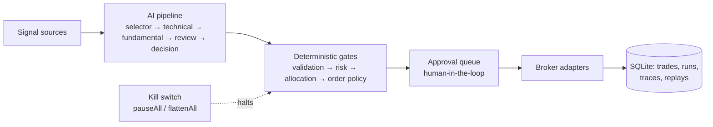

# System Overview — What Exva Is

Audit date: 2026-07-17. Read this first; the other docs assume it.

## One paragraph

Exva is a local-first autonomous trading workstation: an Electron desktop app where a sandboxed React renderer talks over a typed preload bridge (`electron/preload/exva-api.ts`, ~130 IPC methods) to a privileged main process that owns everything — SQLite (drizzle + better-sqlite3), broker integrations (ccxt/Coinbase/Tradier/Polymarket), LLM providers (Anthropic/OpenAI via the AI SDK), search, and the trading runtime. Secrets live in the OS keychain (keytar). A single operator (Ken) runs multiple trading sessions, each with its own strategy, risk config, broker assignment, and AI settings.

## The trading loop

Sessions are owned in the main process by `SessionRuntimeManager`; the pipeline layer (`electron/main/services/pipeline/`) is separate from the LLM layer (`electron/main/services/llm/`). Runs, traces, approvals, and replay data persist locally for observability.

## The surfaces

- **Renderer** (`src/`): shell (rail + context bar + event tape), 5 hubs (Dashboard, Sessions, Signals, Research, Settings), 18 operator panels (trades, brokers, kill switch, backtest lab, morning briefing, autopsies, equity curve, data doctor, …), a docs area, and a command palette.
- **AI assistant** ("control agent"): a chat slide-over wired to a main-process agent loop with 17 confirmation-gated tools over the same services the UI uses. Covered in depth by docs 03 (capability) and 05 (interface).
- **Ops scripts**: `bun run check` (typecheck+lint+format+tests+trade-loop proof), `test:smoke`, `prove`, headless mode, db backup/reset.

## Where the audit found the system today

| Area                 | State                                                                                                                                | Doc |
| -------------------- | ------------------------------------------------------------------------------------------------------------------------------------ | --- |
| Backend architecture | Sound boundaries (sandboxed renderer, single IPC choke point, keychain secrets); gaps in boundary validation and money-data coercion | 02  |
| AI capability        | Excellent extensible framework, but only ~15% action coverage and four safety defects to fix before expanding                        | 03  |
| UI system            | 90% coherent token/component system; convergence work needed (duplicate primitives, native dialogs, no shared formatters)            | 04  |
| AI interface         | Functional but rough: dead wiring bugs, hand-rolled markdown, no motion/history/full view                                            | 05  |

Nothing found suggests a rewrite anywhere. Every doc is convergence and completion work on an architecture that holds up.
