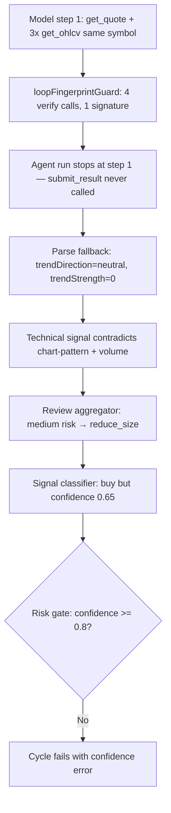

# Mock `clean_breakout` Confidence Gate Failure

> **Log:** `~/.exva/logs/exva-2026-05-24.log`  
> **Date:** 2026-05-24  
> **Session:** `ed893644-31bd-405a-b97f-9b334e167607`  
> **Cycle:** `701befb2-1a0a-4d43-b5fc-8f18969bcafb`  
> **Instrument:** ETH (crypto)  
> **Scenario:** `clean_breakout` (mock happy path)

---

## Executive summary

A mock `clean_breakout` trade cycle reached `risk_gate` and failed with:

```
Decision confidence is below wait-for-open threshold
(confidence=0.65, threshold=0.8)
```

This is **not** what we want for mock happy path. The mock OHLCV, news, and discovery fixtures were bullish and internally consistent. The cycle still failed because the **momentum-indicator worker never produced a valid `submit_result`**, so the pipeline substituted **neutral/empty momentum defaults**. That created a contradictory technical picture, which pushed review to `reduce_size`, which led the signal classifier to output **buy @ 0.65** — below the session's **0.8 wait-for-open threshold**.

**Root cause (discovered on follow-up):** the model did not fail to analyze the data or submit bad momentum scores. It fetched quote + three OHLCV timeframes in step 1 (reasonable behavior), then **`loopFingerprintGuard` stopped the agent run before step 2**, so `submit_result` was never reached. The parse fallback is a downstream symptom of that premature stop.

The mock data was fine. The failure is a **tool-loop guard bug + parse fallback + confidence policy** interaction, not bad fixtures or model confusion about the breakout.

---

## Timeline (log line refs)

| Step      | Stage                         | Outcome                                                      |
| --------- | ----------------------------- | ------------------------------------------------------------ |
| Selector  | `baf1d29f…`                   | ETH selected with bullish selector evidence                  |
| Technical | momentum-indicator            | **Loop guard stopped run after step 1 → no `submit_result` → parse fallback → neutral trend** |
| Technical | chart-pattern, volume-profile | Strong bullish (pattern 0.9, accumulation 0.9)               |
| Review    | risk-assessor                 | `overallRisk: medium` → recommendation **`reduce_size`**     |
| Decision  | signal-classifier             | **`buy`, confidence `0.65`**                                 |
| Decision  | entry-timer                   | `now` (correct for mock)                                     |
| Risk gate | `701befb2…`                   | **Denied:** 0.65 < 0.8 → cycle ERROR                         |

Key log entries:

- Lines 530–533: momentum step 1 — `get_quote` + `get_ohlcv` (1h, 4h, 1d); **no `submit_result`**
- Line 536: `worker terminal output validation failed; retrying once` (momentum-indicator, `stepCount: 1`, `finishReason: stop`)
- Line 545: `worker terminal output substituted empty dimension after validation failure` (`terminalToolSubmitted: false`)
- Lines 526–527 vs 530–533: chart-pattern also multi-timeframe but only **2** verify calls → reached step 2 `submit_result`
- Line 823 (later cycle `6aed1a15…`): momentum **did** submit bullish scores when step 1 stayed under guard threshold
- Line 702: signal-classifier `confidence: 0.65`, action `buy`
- Line 724: `risk decision denied due to confidence` (0.65 vs 0.8)
- Lines 725–729: `risk_gate failed` → `step:failed` → cycle stage ERROR

---

## Root cause chain



### 1. `loopFingerprintGuard` stopped the agent before `submit_result` (primary trigger)

The momentum-indicator's **first step** was correct, diligent behavior:

| Tool call | Args |
|-----------|------|
| `get_quote` | ETH, crypto |
| `get_ohlcv` | ETH, 1h |
| `get_ohlcv` | ETH, 4h |
| `get_ohlcv` | ETH, 1d |

Four "verify" tool calls in one step. The run then ended with **`stepCount: 1`** and **`terminalToolSubmitted: false`**. There is no log line showing `submit_result` for cycle `701befb2` on momentum-indicator — the model never got a second turn.

The agent harness attaches `loopFingerprintGuard` to every tool-using run (`run-agent-execute.ts`). The guard runs **two independent checks**:

**Check A — step-level:** stops if the last 4 full steps have identical signatures (detects agents re-running the same multi-tool step). Does not fire here because momentum only executes 1 step.

**Check B — verify-call-level:** flattens all tool calls from all steps, takes the last 6, then checks if 4+ verify-tool calls share the same canonical signature:

```typescript
// run-agent-execute.ts — loopFingerprintGuard (verify branch, simplified)
const recentCalls = steps.flatMap((step) =>
  step.toolCalls.map((call) => ({
    toolName: String(call.toolName),
    signature: canonicalizeToolInput(String(call.toolName), call.input),
  })),
).slice(-6);

const verifyCalls = recentCalls.filter(
  (call) =>
    call.toolName === "get_quote" ||
    call.toolName === "get_news" ||
    call.toolName === "get_ohlcv",
);
if (
  verifyCalls.length >= 4 &&
  new Set(verifyCalls.map((call) => call.signature)).size === 1
) {
  return true; // stop the agent run
}
```

Check B fires here — momentum's single step generates 4 verify-tool entries in `recentCalls`, all with canonical signature `"ETH"`.

Verify tools include `get_quote`, `get_news`, and `get_ohlcv`.

The bug is in **how signatures are canonicalized** — for all three, only the **symbol** is kept; **`timeframe` is dropped**:

```typescript
// tool-loop-guard.ts — canonicalizeToolInput for get_ohlcv
if (toolName === "get_quote" || toolName === "get_news" || toolName === "get_ohlcv") {
  return normalizeSymbol(readStringField(input, "symbol")) ?? JSON.stringify(input);
}
```

So momentum's four calls all canonicalize to `"ETH"`. The guard treats multi-timeframe analysis as a **stuck loop** and kills the run **before** the model can call `submit_result` on step 2.

**Same cycle, chart-pattern succeeded** because it only made **2** `get_ohlcv` calls in step 1 (1d + 4h) — under the ≥4 threshold — then reached step 2 and submitted pattern 0.9.

| Worker | Step 1 verify calls | Signatures (canonical) | Loop guard fires? | Step 2 `submit_result`? |
|--------|---------------------|------------------------|-------------------|---------------------------|
| chart-pattern | 2× `get_ohlcv` | both `ETH` | No (< 4) | Yes |
| momentum-indicator | `get_quote` + 3× `get_ohlcv` | all `ETH` | **Yes** | **Never** |
| volume-profile | 1× `get_ohlcv` (then step 2 submit) | `ETH` | No | Yes |

**Intermittent, not deterministic:** on a later cycle in the same log (`6aed1a15…`, line ~823), momentum-indicator reached step 2 and submitted `trendDirection: bullish`, `trendStrength: 0.95`, `momentumScore: 0.82`. That run likely stayed under four same-signature verify calls in step 1.

### 2. Momentum worker parse fallback (symptom, not root cause)

Because the agent run ended without `submit_result`, `extractWorkerSubmission` returned `undefined`. The worker contract uses `onValidationFailure: "retry_once"`:

1. First run → no submission → retry
2. Retry → same step-1 tool pattern → guard fires again → still no submission
3. After retry exhaustion → `substitute_empty` via empty schema parse

```typescript
// worker-structured-output.ts — retry_once exhausted → schema.parse({}) → defaults
// (same code path as substitute_empty, triggered when retried=true and parse still fails)
trendDirection: "neutral"; // Zod .default("neutral")
trendStrength: 0;           // Zod .default(0)
momentumScore: null;        // Zod .default(null)
```

> **Note on terminology:** `onValidationFailure: "retry_once"` and `"substitute_empty"` are two distinct policies. `retry_once` retries once, then falls through to `schema.parse({})` on exhaustion — same end result as `substitute_empty` but via a different path. The log's `parseFallback: true` is set by `worker-executor.ts` (from `parseWorkerOutput`), not by `run-agent-execute.ts`.

Log evidence:

```
parseFallback: true
terminalToolSubmitted: false
msg: "worker terminal output substituted empty dimension after validation failure"
```

**Important:** this is resilience code doing its job on missing output. The model did not choose neutral momentum — the pipeline invented it after the loop guard prevented submission.

### 3. Contradictory aggregated technical signal

After technical aggregation, downstream workers saw:

| Field                | Value                                | Source                              |
| -------------------- | ------------------------------------ | ----------------------------------- |
| `trendDirection`     | `neutral`                            | Momentum fallback defaults          |
| `trendStrength`      | `0`                                  | Momentum fallback defaults          |
| `patternName`        | `trend continuation / runaway trend` | chart-pattern                       |
| `patternStrength`    | `0.9`                                | chart-pattern                       |
| `volumeScore`        | `0.9`, accumulation                  | volume-profile                      |
| `timeframeAlignment` | `0.5`                                | Derived from neutral + accumulation |

Chart-pattern and volume-profile correctly read the mock bars. Momentum did not. Review workers explicitly flagged the tension:

> "neutral trend direction (strength 0) conflicts with 'runaway trend' pattern"

### 4. Review → `reduce_size` (deterministic, not model whim)

`review-aggregator.ts` maps:

- `overallRisk === "medium"` → **`reduce_size`**
- Not `skip`, not `proceed`

Risk assessor returned `overallRisk: "medium"` because of the neutral-trend vs runaway-pattern inconsistency. With coherent bullish momentum, this would likely have been `low` → `proceed`.

### 5. Signal classifier hedged confidence

The classifier correctly treated `reduce_size` as "enter smaller, not skip" and returned:

```json
{
  "action": "buy",
  "confidence": 0.65,
  "reasoning": "...Review recommends reduce_size (not skip)... moderate confidence given neutral trend direction..."
}
```

The prompt includes `Wait-for-open threshold: 0.8` but does **not** instruct the model that **`confidence` must be ≥ that threshold for a buy to survive risk gate**. The model rationally hedged after seeing mixed signals.

### 6. Risk gate blocked the trade

Session config (moderate risk preset):

```
waitForOpenThreshold: 0.8
```

`RiskEngine.validateDecision`:

```typescript
if (input.confidence < confidenceThreshold) {
  return {
    allowed: false,
    reason: WAIT_FOR_OPEN_REJECTION_REASON,
    gateType: "confidence",
  };
}
```

0.65 < 0.8 → denied.

---

## Why this violates mock happy-path expectations

For `clean_breakout`, the design intent ([`mock-trade-rehearsal-design.md`](../plans/archieve/mock-trade-rehearsal-design.md)) is:

```
review.recommendation = proceed (or equivalent green light)
classifier.action = BUY, confidence >= threshold
entry timer = now
→ risk gates pass → mock broker fills
```

What actually happened:

| Expected                         | Actual                                    |
| -------------------------------- | ----------------------------------------- |
| Coherent bullish technical stack | Neutral momentum + bullish pattern/volume |
| Review `proceed`                 | Review `reduce_size`                      |
| Confidence ≥ 0.8                 | Confidence 0.65                           |
| Graceful no-trade or open trade  | **Cycle ERROR at risk_gate**              |

Mock sandbox prompts tell workers to treat synthetic data as real and not skip because it's simulated — but **nothing guarantees structured output validity or confidence above the production threshold**.

---

## Secondary issue: ERROR vs graceful no-trade

Current codebase (post runtime-resilience work) has two softening layers that **should** prevent this from surfacing as a cycle ERROR:

1. **`aggregateTradeSignal`** — if `classifier.confidence < waitForOpenThreshold`, force `action: "skip"` before risk gate runs (`trade-signal-aggregator.ts` lines 83–91). With `skipIf: decision.action === "skip"`, the entire `risk_gate` engine chain should be skipped.

2. **`riskGateInputBuilder.applyOutput`** — if rejection reason is wait-for-open, convert decision to skip instead of throwing (`trade-engine-input-builders.ts`).

The log shows `risk_gate` **ran** and **failed hard**. That implies the running Electron main process at log time either:

- Predated these fixes, or
- Had not been restarted after they landed.

Even with those fixes, mock happy path would still end as **no trade** (skip), not an **open mock fill** — which also misses the goal.

---

## Contributing factors

### A. `loopFingerprintGuard` false positive on multi-timeframe fetch (root cause)

The guard was designed to stop agents stuck re-fetching the same quote/OHLCV/news in a loop. Canonicalizing `get_ohlcv` by symbol-only makes legitimate multi-timeframe analysis (1h + 4h + 1d + quote) indistinguishable from a loop. Momentum-indicator is especially exposed because its tool set is `["get_ohlcv", "get_quote"]` — the natural first step is several verify calls before synthesis.

### B. Model choice + worker configuration (secondary)

Worker: `deepseek/deepseek-v4-flash`. On this cycle the model behaved well (multi-timeframe fetch) but was cut off by infrastructure. Other workers on the same cycle (chart-pattern, volume-profile, catalyst-context) completed normally when they made fewer verify calls in step 1.

### C. High production threshold on mock session

`waitForOpenThreshold: 0.8` is injected into every worker prompt but only **enforced deterministically** at risk gate (and optionally in the aggregator). The signal classifier is not required to comply.

### D. `mockRelaxedEntryTiming` does not cover confidence or review

Implemented relaxation only maps entry timer `wait` → `now` when:

- `isMockSession === true`
- `mockScenarioKind === "clean_breakout"`
- `review.recommendation === "proceed"`

In this cycle, review was `reduce_size`, so no timing relaxation applied anyway. **There is no mock relaxation for confidence or review severity.**

### E. Earlier selector noise (same session, different cycle)

Cycle `baf1d29f…` logged `Mock URL not registered in sandbox fixtures` for some `fetch_url` calls during selector verification. That did not block ETH selection but shows mock fixture registration gaps for URL-based tools.

### F. Mock integration test uses `waitForOpenThreshold: 0` (testing gap)

`mock-trade-rehearsal.integration.test.ts` configures `waitForOpenThreshold: 0`, meaning any confidence > 0 passes the gate. The test also mocks `runTradePipeline` entirely via `vi.spyOn`, bypassing the AI pipeline and the `loopFingerprintGuard` entirely. As a result, this test cannot catch:

- Confidence gate failures caused by pipeline artifacts
- `loopFingerprintGuard` false positives on multi-timeframe workers

Both issues would silently pass in CI.

---

## Recommended fixes (ordered by impact)

### P0 — Fix `canonicalizeToolInput` for multi-timeframe `get_ohlcv`

Include distinguishing fields in the verify-call signature so multi-timeframe fetches are not treated as a loop:

```typescript
// tool-loop-guard.ts — proposed
if (toolName === "get_ohlcv") {
  const symbol = normalizeSymbol(readStringField(input, "symbol"));
  const timeframe = readStringField(input, "timeframe") ?? "";
  const instrumentClass = readStringField(input, "instrumentClass") ?? "";
  return `${symbol ?? "?"}:${instrumentClass}:${timeframe}`;
}
```

Optionally: do **not** count `get_quote` and `get_ohlcv` toward the same verify-call bucket, or require repeated **identical** raw args (including timeframe) before stopping.

Add unit tests: 3× `get_ohlcv` different timeframes + 1× `get_quote` same symbol → guard must **not** stop.

**Why:** Fixes the actual root cause. Momentum (and any multi-timeframe worker) can complete step 2 and call `submit_result` with real analysis.

### P0b — Mock momentum fallback should be bullish for `clean_breakout` (defense in depth)

When `parseFallback === true` for momentum-indicator **and** scenario is `clean_breakout`, substitute scenario-aligned defaults instead of schema empties:

```typescript
trendDirection: "bullish";
trendStrength: 0.85;
momentumScore: 0.8;
```

Alternatively: fail the technical phase loudly in mock rehearsal scorecard when momentum parse-fallbacks, so happy-path runs cannot silently degrade.

**Why:** Belt-and-suspenders if loop guard or model submission still fails; prevents silent neutral momentum from poisoning review.

### P1 — Signal classifier prompt: bind confidence to threshold

Add to decision worker guidance (already receives `waitForOpenThreshold` in facts):

> If action is `buy` or `sell`, confidence must be ≥ wait-for-open threshold. Otherwise use `skip`.

**Why:** Aligns model output with deterministic gate without changing production policy.

### P2 — Mock-only confidence relaxation for happy path

For `clean_breakout` + mock session, either:

- Lower effective threshold (e.g. 0.6) in aggregator + risk gate, or
- Add `mockRelaxedConfidence: true` parallel to `mockRelaxedEntryTiming`

**Why:** Mocks should exercise the **trade execution path**, not production conservatism.

### P3 — Review aggregator mock override

For `clean_breakout` when technical pattern/volume are strong and only momentum was parse-fallback, cap review at `proceed` or ignore medium-risk from known fallback artifacts.

**Why:** `reduce_size` is correct given the contradictory input, but the input itself is a pipeline artifact in mock mode.

### P4 — Ensure running app picks up resilience handlers

Restart Electron main after deploying:

- Aggregator wait-for-open → skip
- Risk gate wait-for-open → skip (no throw)

**Why:** Confidence rejection should be `no_trade` + WARN, not cycle ERROR — but mock happy path should ideally never reach that state.

---

## Reproduction checklist

1. Mock broker account with scenario `clean_breakout`
2. Session with moderate risk preset (`waitForOpenThreshold: 0.8`)
3. Run trade cycle on a crypto symbol (ETH reproduced the issue)
4. Watch for momentum-indicator step 1 with **4+ verify tools** (`get_quote` + multiple `get_ohlcv`) and **`stepCount: 1`** at completion
5. Watch for `worker terminal output validation failed; retrying once` then `substituted empty dimension after validation failure`
6. Confirm review → `reduce_size`, classifier confidence < 0.8, risk_gate denial

**Quick repro pattern:** any worker with `get_quote` + `get_ohlcv` where the model batch-fetches ≥3 timeframes in step 1 is at risk until `tool-loop-guard.ts` is fixed.

---

## Expected happy-path signal bundle (reference)

For `clean_breakout` mock cycles to trade reliably, the aggregated inputs to review/decision should look roughly like:

| Signal                  | Target    |
| ----------------------- | --------- |
| `trendDirection`        | `bullish` |
| `trendStrength`         | ≥ 0.7     |
| `patternStrength`       | ≥ 0.8     |
| `volumeScore`           | ≥ 0.8     |
| `review.recommendation` | `proceed` |
| `classifier.confidence` | ≥ 0.8     |
| `entryTiming`           | `now`     |

The 2026-05-24 ETH cycle had everything except coherent momentum — and that one gap was enough to kill the trade. Coherent momentum was available in the OHLCV; the pipeline never let the worker submit it.

---

## Investigation notes (follow-up)

**Question:** why did the worker use parse fallback?

**Answer:** Not because the model returned invalid momentum scores. The agent run was terminated after step 1 by `loopFingerprintGuard`. No `submit_result` → validation failure → retry → same guard → empty substitution.

**Key code paths:**

| Step | File | What happens |
|------|------|--------------|
| Agent multi-step loop | `electron/main/services/llm/adapters/run-agent-execute.ts` | `loopFingerprintGuard()` in `stopWhen` |
| Signature canonicalization | `electron/main/services/llm/tool-loop-guard.ts` | `get_ohlcv` → symbol only |
| Missing terminal tool | `electron/main/services/pipeline/execution/worker-executor.ts` | `extractWorkerSubmission` → undefined |
| Retry then substitute | `electron/main/services/pipeline/execution/worker-structured-output.ts` | `retry_once` then `schema.parse({})` |

**Log contrast (same session):**

- `701befb2` momentum: 4 verify calls step 1 → guard → fallback → confidence failure downstream
- `6aed1a15` momentum: step 2 `submit_result` with bullish scores → happy path possible for that cycle

---

## Related code

| Area                                  | File                                                                                    |
| ------------------------------------- | --------------------------------------------------------------------------------------- |
| **Loop guard (root cause)**           | `electron/main/services/llm/adapters/run-agent-execute.ts` (`loopFingerprintGuard`)     |
| **Verify call signature bug**         | `electron/main/services/llm/tool-loop-guard.ts` (`canonicalizeToolInput`)             |
| Agent stop conditions                 | `electron/main/services/llm/adapters/run-agent-execute.ts` (`stopWhen`, `terminalToolNames`) |
| Terminal submission extraction        | `electron/main/services/pipeline/execution/worker-executor.ts` (`extractWorkerSubmission`) |
| Momentum schema defaults              | `electron/main/services/signal/aggregators/technical-aggregator.ts`                     |
| Parse fallback substitution           | `electron/main/services/pipeline/execution/worker-structured-output.ts`                 |
| Review recommendation rules           | `electron/main/services/signal/aggregators/review-aggregator.ts`                        |
| Decision aggregation + threshold skip | `electron/main/services/signal/aggregators/trade-signal-aggregator.ts`                  |
| Mock OHLCV shaping                    | `electron/main/services/broker/adapters/mock-adapter.ts` (`shapeCleanBreakoutBars`)     |
| Risk confidence gate                  | `electron/main/services/risk/risk-engine.ts`                                            |
| Risk gate soft no-trade               | `electron/main/services/pipeline/implementations/inputs/trade-engine-input-builders.ts` |
| Mock design spec                      | `docs/plans/archieve/mock-trade-rehearsal-design.md`                                    |
