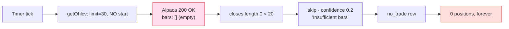
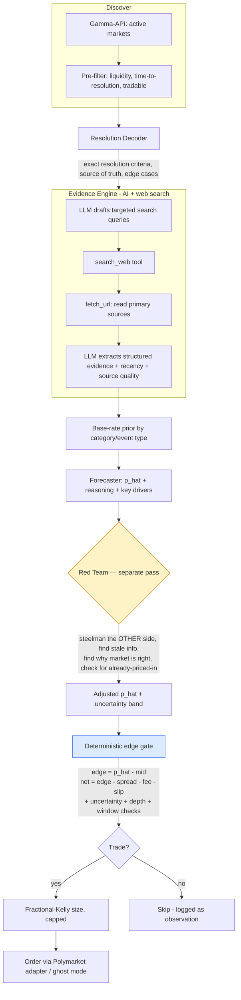
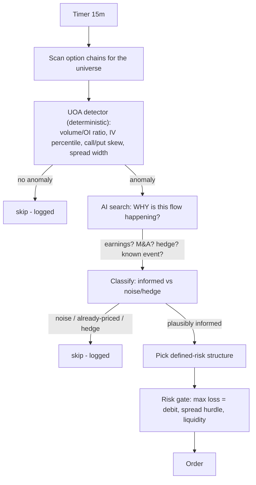

# Exva — Why It Never Trades, Experience Audit, Polymarket AI Pipeline, and Options Feature

> **Date:** 2026-06-26
> **Status:** Findings + design (actionable)
> **Owner:** Kenneth Atchon
> **Audience:** Engineers
> **Method:** Live runtime DB (`~/Library/Application Support/exva/exva.db`), pino logs (`~/.exva/logs/exva-2026-06-24.log`), `api_call_log` table, and a **live reproduction against the Alpaca data API**, cross-referenced against `electron/` code.
> **Supersedes the open question in:** `docs/attic/archive/system-review-2026-06-22.md` (which concluded "the strategy is correctly being picky"). That conclusion was **wrong for the current build** — see Part A.

---

## TL;DR

The system will **never** open a position — not because the entry rules are too strict, but because **the rules never run**. Every deterministic experience fetches OHLCV bars from Alpaca with **no time window**, Alpaca returns **zero bars**, and every signal function bails at its `bars.length < N` guard with a hardcoded `confidence: 0.2` "skip". The z‑score, the breakout band, the SMA crossover — none of them are ever computed. Confidence is pinned at `0.2` for 100% of cycles, which can never clear any entry threshold.

It is not "too confident-shy." **It is data-starved.** One missing query parameter (`start`) sterilizes the entire trade engine.



This document has five parts:

- **Part A** — The root cause, reproduced and proven. _(the "what the fuck is going on")_
- **Part B** — Audit of the existing experiences.
- **Part C** — A new AI + web‑search‑driven Polymarket research pipeline.
- **Part D** — A new options‑trading signal source and experience.
- **Part E** — In-app documentation that must ship alongside the changes.

---

## Part A — Why ZERO trades will _ever_ execute

### A.1 The evidence trail

The DB was reset and re-run on **2026-06-24** (commit `ecf8480`). Three paper sessions were created (mean‑reversion SPY/QQQ, trend GC/CL, breakout BTC), all on the `seed-alpaca-paper` broker. Here is the entire outcome:

| Table                                      | Value                                                     | Reading                                          |
| ------------------------------------------ | --------------------------------------------------------- | ------------------------------------------------ |
| `trades`                                   | 64 rows, **100% `status='no_trade'`**                     | No order was ever even attempted                 |
| positions opened (`opened_at IS NOT NULL`) | **0**                                                     | Nothing ever filled                              |
| `trades.confidence_score`                  | **min = max = avg = 0.2**                                 | Confidence is a _constant_, not a computed value |
| `trades.position_size_usd`                 | **0** for every row                                       | No sizing ever happened                          |
| `decision_traces`                          | 34 rows, **finalAction = `skip` for all 34**              | Every decision was a skip                        |
| `decision_traces.skipReason`               | **`"Insufficient bars for z-score mean reversion."` ×34** | Same reason, every time                          |
| `session_signal_deliveries`                | 156 `market_hours_filtered`, 64 `decision_skip`           | Half filtered (closed market), half skipped      |

The 64 `no_trade` rows span **all three** experiences, not just equities:

| Symbol  | Experience                    | n   | Market hours?                          |
| ------- | ----------------------------- | --- | -------------------------------------- |
| BTC-USD | rules-breakout (crypto, 24/7) | 30  | **No filter — trades round the clock** |
| SPY     | rules-mean-reversion          | 17  | filtered when closed                   |
| QQQ     | rules-mean-reversion          | 17  | filtered when closed                   |

BTC is the tell. Crypto has **no** market-hours filter, so BTC reached the decision engine 30 times during fully open trading — and skipped **every** time at `confidence 0.2`. So this is not a "weekend / market closed" artifact (the 06-22 review's escape hatch). It happens with the market wide open.

### A.2 The decision trace, verbatim

```json
{
  "aggregation": {
    "classifierConfidence": 0.2,
    "classifierAction": "skip",
    "finalAction": "skip",
    "skipReason": "Insufficient bars for z-score mean reversion."
  }
}
```

That `skipReason` string is emitted in exactly one place — the early-return guard in `computeMeanReversionSignal`:

```ts
// electron/main/services/signal/rules/mean-reversion-signal.ts:21
const closes = input.ohlcv.map((bar) => bar.close);
if (closes.length < 20) {
  return tradeSignalSchema.parse({
    symbol: input.symbol,
    action: "skip",
    executionStrategy: "mean_reversion",
    confidence: 0.2, // <-- the pinned 0.2
    reasoning: "Insufficient bars for z-score mean reversion.",
  });
}
// the z-score below this line NEVER runs in production
```

So the z-score (`zScore <= -2`) check at line 40 is **dead code in practice**. The engine never reaches it.

### A.3 The bars are empty — and it's not an error

The natural assumption is "the data request is failing (403/auth)." It is not. The broker interaction logger records **every** Alpaca HTTP call into `api_call_log` with a status:

```
call_type          status   n
-----------------  ------   ---
getOhlcv           ok       111      <-- 111 OHLCV calls, ALL ok, ZERO errors
getAccountBalance  ok       263
broker_http        ok       379
```

There are **zero** `level:50` error logs in the entire day's log file. The requests succeed with **HTTP 200** and return an **empty `bars` array**. The logged URLs show why:

```
GET /v2/stocks/SPY/bars?timeframe=1Hour&limit=30&feed=iex
GET /v1beta3/crypto/us/bars?symbols=BTC%2FUSD&timeframe=4Hour&limit=30
```

Notice what is **missing**: there is no `start` and no `end` parameter.

### A.4 Reproduced live (the smoking gun)

I ran the **exact** call the app makes, against the live Alpaca data API with the seeded paper credentials:

```bash
# Exact app request — no `start`:
curl "https://data.alpaca.markets/v2/stocks/SPY/bars?timeframe=1Hour&limit=30&feed=iex"
→ bars returned: 0          # EMPTY

# Same request WITH a 60-day start window:
curl ".../bars?timeframe=1Hour&limit=30&feed=iex&start=<60d ago>"
→ bars returned: 30         # FULL
```

**This is the bug, proven.** Alpaca's `/v2/stocks/.../bars` and `/v1beta3/crypto/us/bars` endpoints return an **empty array when `start` is omitted** — the default window resolves to nothing usable on this account/feed. `getOhlcv` faithfully returns `[]`, every signal function sees `closes.length === 0`, every cycle skips at `0.2`.

### A.5 The defect, in one place

```ts
// electron/main/services/broker/adapters/alpaca-adapter.ts:328
const params = new URLSearchParams({
  timeframe: alpacaTimeframe,
  limit: String(barCount),
  feed: "iex",
  // ❌ no `start`
});
```

The crypto and options bar paths (lines ~351, ~377) have the **same** omission. This single gap is replicated across all three deterministic experiences, because they all call `adapter.getOhlcv(...)` through the same input builder (`rules-engine-input-builders.ts:69`).

### A.6 The fix

Compute a `start` that comfortably covers `barCount` bars at the requested timeframe (with slack for non-trading hours/weekends), and pass it on every bars request:

```ts
function lookbackStartIso(
  timeframe: "15m" | "1h" | "4h" | "1d",
  barCount: number,
): string {
  const minutesPer = { "15m": 15, "1h": 60, "4h": 240, "1d": 1440 }[timeframe];
  // ~3x slack so weekends/closed sessions still yield >= barCount bars
  const spanMs = minutesPer * 60_000 * barCount * 3;
  return new Date(Date.now() - spanMs).toISOString();
}

const params = new URLSearchParams({
  timeframe: alpacaTimeframe,
  limit: String(barCount),
  feed: "iex",
  start: lookbackStartIso(timeframe, barCount), // ✅
});
```

Apply identically to `getCryptoOhlcv` and `getOptionOhlcv`.

### A.7 Two guardrails so this can never silently recur

The deeper failure is that **a structural data outage was indistinguishable from a healthy "no setup today."** Both produce `confidence 0.2 / skip`. Fix the data, then make the failure loud:

1. **Distinguish "no data" from "no signal."** `confidence: 0.2 + "Insufficient bars"` should be an `error`/`degraded` outcome surfaced as a **session health warning**, not a routine `no_trade`. A session that returns "insufficient bars" N cycles in a row should raise an alert — silent starvation is how this hid for an entire multi-day run.
2. **Preflight a data probe.** At session start, fetch bars once per subscribed instrument and assert `bars.length >= requiredLookback`. Refuse to start (or warn loudly) if the feed returns empty. This belongs next to the existing `electron/main/services/session/preflight/*` checks.

> **Note on the 06-22 review.** It concluded the strategy was "correctly waiting" for a rare `z ≤ -2`. That was a _plausible_ read of the old data (weekend + a crypto‑short config bug), but the current build proves it false: the z‑score is never computed at all. **The strategy's pickiness has never once been exercised.** We genuinely do not yet know if the rules are any good — they have never seen a single bar of real data.

---

## Part B — Audit of the existing experiences

Five experiences ship today. Here is the honest state of each.

| Experience                           | Engine                          | Reaches a trade? | Real blocker                                                                                                    |
| ------------------------------------ | ------------------------------- | ---------------- | --------------------------------------------------------------------------------------------------------------- |
| `rules-mean-reversion` (SPY/QQQ)     | deterministic z-score           | ❌ never         | **A.5 empty bars**                                                                                              |
| `rules-breakout` (BTC-USD)           | deterministic Donchian + volume | ❌ never         | **A.5 empty bars** (`need 21, got 0`)                                                                           |
| `rules-trend-following` (GC/CL)      | deterministic SMA crossover     | ❌ never         | **A.5 empty bars** + futures **dead-letter** (Alpaca can't trade futures → 22 `unsupported_by_assigned_broker`) |
| `prediction-event-edge` (Polymarket) | candidate rank → LLM            | ❌ never         | Candidate gate passes **0/40** every poll (see B.2); ranking has no edge model                                  |
| `edgar-catalyst` (8-K)               | poll → filter → LLM             | ❌ never         | Filter passes **0/40** every poll; never emits a signal                                                         |

**Every experience produces zero trades.** Three are killed by Part A. The other two never emit a candidate at all.

### B.1 The deterministic three share one fatal shape

`mean-reversion`, `breakout`, and `trend-following` are structurally identical: fetch bars → `if (bars.length < N) return { confidence: 0.2, action: "skip" }` → otherwise compute. With empty bars they are all permanently stuck in the guard. Fixing A.5 unblocks all three at once.

Secondary issues that will surface _after_ A.5 is fixed:

- **Trend-following on futures is misconfigured.** GC/CL futures are subscribed to an Alpaca-only session; Alpaca cannot trade futures, so 22 signals dead-lettered. Preflight should refuse the GC/CL sources unless a futures-capable broker (Tradovate) is assigned. This was F4 in the 06-22 review and is still live.
- **Confidence is a heuristic, not a probability** (06-22 P2). `Math.min(0.95, abs(zScore)/4)` is a shape, not a calibrated `P(win)`. Acceptable for v1, but it must not be allowed to drive Kelly sizing later.

### B.2 The prediction-event candidate gate never passes

`prediction-event-edge` polls Polymarket and logs `Poll 0/40 passed (odds_volume_dislocation)` on **every** cycle. The candidate engine ranks markets by **liquidity + time-to-resolution + "has a category"** — there is **no probability-edge computation at all**:

```ts
// prediction-market-candidate-engine.ts:74
const score = Math.min(liquidity / 1000, 100) + timeScore + categoryScore;
```

This is exactly the gap the 06-22 profitability review flagged as **P4**: there is no comparison of a model probability `p_hat` to the market-implied mid. The "dislocation" gate is heuristic noise. Part C replaces this wholesale.

### B.3 What's actually solid (don't rebuild these)

The plumbing below the signal layer is genuinely good and should be reused, not replaced:

- **`ExperienceResearchContract`** is already wired onto every descriptor (hypothesis, label horizon, validation thresholds, cost model). The 06-22 P0 recommendation **was implemented.** Good.
- **Observation/label spine exists** — `signal_observations` (64 rows), `signal_labels` (29), `model_versions`, `backtest_runs`, `promotion_decisions` tables are all present. The research loop from the profitability review is scaffolded.
- **5-phase pipeline** (`selector → technical → fundamental → review → decision`) with per-phase LLM workers, spend caps, and tool injection.
- **Tooling**: a real web-search tool (`createSearchTool` over Brave / Tavily / DuckDuckGo / MCP adapters), an SSRF-guarded `fetch_url` tool, and a `data-spend-guard`. **The AI-search capability Part C needs already exists** — it's just not used by the prediction pipeline.
- **Decision trace persistence** now works (34 rows written) — the 06-22 F1 silent-swallow is fixed.

---

## Part C — A new AI + web-search Polymarket research pipeline

> **Goal (your words):** these markets are **predictions** — and you can't predict well without information. "Lets say it's predicting a player will score 3 points: you look up their background, how consistently they score, the matchup, injuries, all of that." That research — going out, finding the relevant facts, and synthesizing them into a probability — is exactly what an LLM is good at and a liquidity-ranking heuristic can never do. The LLM is the **forecaster**; web search is how it does the homework.

### C.1 Why prediction markets need an LLM (not a formula)

A Polymarket price **is** an implied probability. Edge is not "predict up/down" — it's **"is the true probability meaningfully different from the quoted mid, and does that gap survive spread + fees?"** Estimating that true probability is a **research task**, and the inputs are different for every market:

| Market                               | What you actually have to go look up                                                                                              |
| ------------------------------------ | --------------------------------------------------------------------------------------------------------------------------------- |
| "Player X scores 30+ points tonight" | season scoring average, last-10-game consistency/variance, the matchup defense, minutes/role, injury report, back-to-back fatigue |
| "Candidate Y wins the primary"       | recent polls, polling trend, endorsements, fundraising, base rates for similar races                                              |
| "Company Z ships product by date"    | official announcements, prior shipping track record, supply-chain news, exec statements                                           |
| "Hurricane makes landfall in region" | latest forecast track, historical landfall base rates, model spread                                                               |

None of that is in the order book. A human forecaster opens a browser and reads. The pipeline does the same: the LLM **drafts the research questions, searches, reads the sources, and turns the evidence into a calibrated `P(outcome)`.** That is the whole reason to use an LLM here — the _prediction_ is information-bound, and gathering + synthesizing information is the job.

### C.2 Pipeline shape — "Forecaster + Red Team"

The LLM **forecaster** does the research and produces the probability estimate `p_hat` from the evidence it gathered. A **separate adversarial pass (red team)** then tries to break that estimate before any money is committed — it hunts for disconfirming evidence and stale/already-priced information, and its disagreement widens the uncertainty band. A **deterministic gate** (no LLM) does the final edge math and sizing. So the model forms the _view_; it never directly chooses the _size_.



### C.3 The phases, mapped to the existing 5-phase runtime

This reuses `selector → technical → fundamental → review → decision` — no new pipeline framework needed:

| Existing phase  | Polymarket role                                                                        | Worker / engine                          | Tools                           |
| --------------- | -------------------------------------------------------------------------------------- | ---------------------------------------- | ------------------------------- |
| **selector**    | Discover + pre-filter markets; decode resolution criteria                              | `pm-resolution-decoder` (LLM)            | gamma-api fetch                 |
| **technical**   | Market microstructure: mid, spread, order-book depth, volume trend, time-to-resolution | deterministic `pm-microstructure` engine | CLOB / gamma-api                |
| **fundamental** | **Evidence Engine** — agentic search + fetch + structured extraction                   | `pm-evidence` (LLM, tool loop)           | `search_web`, `fetch_url`       |
| **review**      | **Red Team** — adversarial challenge of the forecast                                   | `pm-red-team` (LLM, _fresh context_)     | `search_web` (counter-evidence) |
| **decision**    | Deterministic edge gate + fractional-Kelly sizing                                      | `pm-edge-gate` engine                    | none (pure math)                |

The key discipline: **the forecaster and the red team are separate worker runs with separate prompts.** The red team is told the proposed `p_hat` and instructed to _attack_ it — find the strongest case for the opposite outcome, flag stale/low-quality evidence, and ask "if I'm wrong, why?" Its output adjusts `p_hat` and **widens the uncertainty band**, which directly shrinks Kelly size.

### C.4 The evidence-gathering loop (fundamental phase)

```
GIVEN: market question, exact resolution criteria, current mid, time-to-resolution
LOOP (bounded by tool-loop-guard + data-spend-guard):
  1. LLM decomposes the question into the facts it needs, then drafts 2-4 queries.
     e.g. "Player X scores 30+" -> [X season PPG, X last 10 games, opponent points allowed,
           X injury status tonight] ; political/event markets -> polls, base rates, announcements
  2. search_web(query) -> ranked results
  3. LLM picks the highest-signal links
  4. fetch_url(link) -> primary content (8k char cap, SSRF-guarded)
  5. LLM extracts: claim, direction, recency, source credibility, does-it-bear-on-resolution
UNTIL: enough independent corroboration OR spend cap OR max steps
OUTPUT (structured, no free-form sizing):
  {
    evidence: [{claim, sourceUrl, publishedAt, credibility, bearing}],
    keyDrivers: string[],
    informationFreshness: "fresh" | "partially_priced" | "stale",
    p_hat_evidence: number,        // forecaster's pre-redteam estimate
    confidenceRationale: string
  }
```

`informationFreshness` is first-class: if the catalyzing news is hours old and the price already moved, the edge is likely **already priced in** → skip (06-22 P0/staleness gate). This is the single most important guard against the classic prediction-market trap of trading yesterday's headline.

### C.5 The red-team pass (review phase)

A **separate** LLM call, given the forecaster's `p_hat` and evidence, with this mandate:

```
You are an adversarial reviewer. The forecaster estimates P(YES) = {p_hat}.
Your job is to be RIGHT, which means trying to prove the forecaster WRONG.
1. Steelman the opposite outcome with the strongest available evidence.
2. Re-run targeted searches for DISCONFIRMING information.
3. Flag any evidence that is stale, low-quality, or already priced into {mid}.
4. Identify resolution-criteria edge cases that could surprise us.
5. State your own P(YES) and how far you'd move the forecaster's number.
```

Output → `p_hat_final` and an **uncertainty band**. Disagreement between forecaster and red team is not averaged away — it _widens uncertainty_, which the sizing step treats as a haircut.

### C.6 The deterministic edge gate (decision phase)

No LLM. Pure, auditable math — the model's job is done:

```ts
const edge      = p_hat_final - marketMid;          // probability gap
const netEdge   = edge - spreadBps/1e4 - feeBps/1e4 - slipBps/1e4;

const trade =
  Math.abs(netEdge) >= MIN_NET_EDGE &&              // survives costs
  uncertaintyBand   <= MAX_UNCERTAINTY &&           // forecaster/red-team agree enough
  orderBookDepthUsd >= requiredSizeUsd &&           // can actually fill
  timeToResolution  inside validatedWindow;         // not too soon / too far

// size only if trade; fractional Kelly, then hard caps and haircuts
const kelly  = edge / (1 - marketMid);              // binary Kelly
const size   = bankroll
             * Math.min(kelly * KELLY_FRACTION, MAX_FRACTION)
             * uncertaintyHaircut                   // shrink when bands are wide
             * Math.min(1, sampleSize / requiredSampleSize);
```

This is the same fractional-Kelly + haircut discipline the 06-22 profitability review prescribed (P4/P6) — now fed by an _evidence-grounded_ `p_hat` instead of a liquidity score.

### C.7 What gets logged (closing the research loop)

Every market evaluated — **traded or skipped** — writes a `signal_observation` with: the full evidence set, `p_hat_evidence`, `p_hat_final`, the red-team delta, `marketMid`, `netEdge`, and the gate decision. When markets resolve, `signal_labels` records the actual outcome. That makes the forecaster **measurable** (Brier score, calibration buckets) and lets you prove or kill the edge before scaling. **Skipped markets must be labeled too** — you only learn selectivity by comparing taken vs. passed.

### C.8 Cost & safety

- Bounded by the existing `data-spend-guard` (per-session spend cap) and `tool-loop-guard` (max tool steps). A full evidence+red-team cycle is a few LLM calls + a handful of searches/fetches — gate it under a per-cycle USD cap in `PHASE_DEFAULTS`.
- gamma-api reads are free and unauthenticated — discovery and microstructure cost nothing.
- Pair with the **ghost/paper mode** from `docs/plans/polymarket-paper-mode.md` so the whole pipeline can run end-to-end with zero on-chain risk while calibration data accumulates.

---

## Part D — New signal source & experience: options trading

> Tracks options as a new signal source + experience. The good news: **`options` is already a first-class instrument class**, and the Alpaca adapter already has option order placement, `getOptionMarketSnapshot` (`/v1beta1/options/...`), and `getOptionOhlcv`. This is mostly an _experience + signal_ on top of existing plumbing — not a new broker integration.

### D.1 What already exists

- `instrument class "options"` in `enums.ts`.
- OCC symbol detection (`isOptionWireSymbol`) routing to option-specific Alpaca endpoints.
- `getOptionMarketSnapshot` using the free `feed=indicative` options plan.
- Order placement guarded to `stocks | crypto | options`.

What's missing: an **experience descriptor**, a **signal source**, a **signal-generation strategy**, and a **chain selector** (which contract to trade).

### D.2 Proposed experience — `options-flow-edge`

The most defensible options edge for a local-first app is **unusual options activity (UOA) as an information signal**, not naked direction-betting. The thesis: abnormal volume/open-interest + skew shifts on liquid underlyings can precede directional moves, and (like Polymarket) it benefits from AI search to separate "informed flow" from "noise/hedging."

```ts
// electron/main/experiences/options-flow-edge/descriptor.ts
export const OPTIONS_FLOW_EDGE_EXPERIENCE: ExperienceDescriptor = {
  id: "options-flow-edge",
  displayName: "Options Flow Edge",
  description:
    "Detects unusual options activity on liquid underlyings, contextualizes it with AI search, and trades a defined-risk options structure.",
  capabilities: {
    signalSourceTypes: ["timer"], // poll the chain; later: a flow stream
    brokerRequirement: "any_supported_class", // gated to options-capable brokers at preflight
  },
  pipelineId: "options-flow-cycle",
  defaultPresets: {
    posturePresetId: "manual_watchlist",
    rulesPresetId: "catalyst_entry",
    riskPresetId: "moderate",
    timeframePresetId: "swing",
  },
  promptVariantKey: "catalyst",
  researchContract: {
    hypothesis:
      "On liquid large-caps, contracts showing volume >> open interest with a directional skew precede an abnormal move in the underlying within the holding window, net of the wide options spread.",
    tradableUniverse: ["AAPL", "NVDA", "TSLA", "SPY", "QQQ"], // liquid chains only
    instrumentClass: "options",
    signalTimestamp: "intraday",
    label: { horizon: "5d", outcome: "net_return", benchmark: "cash" },
    validation: {
      minOutOfSampleTrades: 100,
      minNetExpectancyUsd: 0,
      minLowerBoundSharpe: 0,
      maxDrawdownPct: 0.25,
      requiredFolds: 3,
    },
    // options spreads are WIDE — this hurdle must be honest or the edge is fake
    costs: { spreadBps: 80, slippageBps: 30, commissionBps: 5 },
  },
  signals: [
    {
      id: "uoa-liquid-megacap",
      sourceType: "timer",
      instrumentClass: "options",
      symbol: null, // resolved per-cycle from the universe
      pollCadence: "15m",
      defaultAnalysisTimeframe: "1d",
      enabledByDefault: false, // off until paper-validated
      mockFixtures: {
        defaultScenario: "clean_breakout",
        scriptedWorkerOutputs: {},
      },
    },
  ],
};
```

### D.3 The cycle



- **Deterministic UOA detector** does the cheap screening (volume/OI, IV rank, skew) — no LLM spend until something is actually anomalous.
- **AI-search step** (reusing Part C's evidence engine) answers _why_ the flow exists — earnings, M&A chatter, or just delta-hedging noise. This is the same "challenge your bias" discipline: most UOA is not informed.
- **Defined-risk only** for v1: long calls/puts or vertical spreads where **max loss = debit paid**. No naked short options. This keeps the risk gate simple and bounded.

### D.4 New pieces required

| Piece                                     | Location                                                            | Notes                                                                                   |
| ----------------------------------------- | ------------------------------------------------------------------- | --------------------------------------------------------------------------------------- |
| `OPTIONS_FLOW_EDGE_EXPERIENCE` descriptor | `electron/main/experiences/options-flow-edge/descriptor.ts`         | register in `experiences/index.ts`                                                      |
| `getOptionChain(underlying)` on adapter   | `alpaca-adapter.ts`                                                 | `/v1beta1/options/snapshots/{underlying}` for chain + greeks/IV                         |
| UOA detector                              | `electron/main/services/signal/rules/options-flow-signal.ts`        | deterministic, same shape as the other rules engines                                    |
| Chain selector                            | `electron/main/services/signal/scoring/option-contract-selector.ts` | picks the specific OCC contract / spread                                                |
| `options-flow-cycle` pipeline             | `electron/main/services/pipeline/...`                               | reuse the 5-phase runtime                                                               |
| Preflight: options-capable broker         | `electron/main/services/session/preflight/`                         | refuse the source unless broker supports `options` (mirror the futures→Tradovate guard) |

### D.5 Hard constraints (so this doesn't become a money incinerator)

- **Options spreads are brutally wide.** The `costs` hurdle (80bps spread assumed above) must be applied _before_ entry as a real gate, not subtracted after the fact. Most UOA "edges" die here — that's correct.
- **Liquidity filter is mandatory** — only contracts with tight bid/ask and real open interest. An illiquid option you can't exit is worse than no trade.
- **Defined-risk only** until paper-proven. Max loss bounded to debit.
- **Paper-only and `enabledByDefault: false`** until the research contract's 100-trade out-of-sample bar is met.

---

## Part E — In-app documentation (must ship with the code)

Exva ships **in-app docs** (`src/components/docs/pages/*`, registered in `src/components/docs/registry.ts`) and an **inline help glossary** (`src/lib/help-glossary.ts`, covered by `src/__tests__/help-glossary.test.ts`). Markdown docs in `/docs` are for engineers; the in-app pages are what the operator actually reads. **Every change below is incomplete until the in-app docs match.** Treat this as part of the Definition of Done, not a follow-up.

### E.1 What to update

| Change                                                          | In-app doc page (`src/components/docs/pages/`)                                                                                                                                                            | Glossary (`help-glossary.ts`)                                                                                                                           |
| --------------------------------------------------------------- | --------------------------------------------------------------------------------------------------------------------------------------------------------------------------------------------------------- | ------------------------------------------------------------------------------------------------------------------------------------------------------- |
| Bars `start` fix + "insufficient bars = degraded, not no-trade" | `SignalArchitecturePage`, `TimerSignalPage` — document the data-window requirement and that an instrument with no bars now shows a **session health warning** instead of a silent skip                    | add **"Insufficient bars / data-starved"** entry explaining the degraded state                                                                          |
| Preflight data probe + broker-capability checks                 | `SessionsDocPage`, `AccountsBrokersPage` — document that sessions now refuse to start (or warn) when the feed is empty or the broker can't trade a subscribed class (futures→Alpaca, options→non-options) | extend **"Dead letter"** entry to mention the preflight guard                                                                                           |
| Polymarket Forecaster+RedTeam pipeline                          | `PredictionEventsPage` (rewrite) + `PipelinePage` (the new phase mapping)                                                                                                                                 | update **"Prediction event"**; add **"Forecaster"**, **"Red team / adversarial review"**, **"Implied probability / edge"**, **"Information freshness"** |
| Options Flow Edge experience                                    | **new page** `OptionsFlowEdgePage` (register in `registry.ts`, `category: "Signal sources"`, add to a nav group + `related`)                                                                              | add **"Options Flow Edge"**, **"Unusual options activity (UOA)"**, **"Defined-risk structure"**                                                         |

### E.2 Registration checklist for the new options page

Adding a page is not just a component — wire all of it or it won't render:

1. Create `src/components/docs/pages/OptionsFlowEdgePage.tsx` (follow an existing page, e.g. `PredictionEventsPage.tsx`).
2. `import` it in `registry.ts` and add a `DocPageDefinition` (`slug`, `title`, `description`, `category`, `order`, `related`, `headings`, `component`).
3. Add the slug to the correct `DocNavGroup` so it appears in `DocsSidebar`.
4. Cross-link: add it to `related` on `ExperiencesPage` and `SignalSourceTypesPage`.
5. Add glossary entries and confirm `help-glossary.test.ts` still passes (it asserts coverage/shape).

### E.3 Rule

When an experience, signal source, instrument class, or pipeline phase changes, the matching in-app doc page **and** glossary entry change in the **same** PR. A new signal source with no in-app doc page is treated as unfinished.

---

## Consolidated remediation plan

| #   | Change                                                                                            | Part    | Severity | Effort | Payoff                                                           |
| --- | ------------------------------------------------------------------------------------------------- | ------- | -------- | ------ | ---------------------------------------------------------------- |
| 1   | Add `start` to every Alpaca bars request (`getOhlcv` / crypto / options)                          | A.6     | 🔴 fatal | **S**  | **Unblocks all 3 deterministic experiences instantly**           |
| 2   | Make "insufficient bars" an error/degraded outcome + session health alert (not silent `no_trade`) | A.7     | 🔴       | S      | Makes this class of failure impossible to hide again             |
| 3   | Preflight data probe: assert `bars.length >= lookback` per instrument at session start            | A.7     | 🟠       | S      | Catches feed outages before a wasted run                         |
| 4   | Preflight broker-capability: refuse futures→Alpaca, options→non-options broker                    | B.1/D.4 | 🟠       | S      | Kills dead-letter noise                                          |
| 5   | Replace prediction candidate ranking with the Forecaster+RedTeam pipeline                         | C       | 🟠       | L      | Turns a no-edge heuristic into a measurable probability edge     |
| 6   | Wire Polymarket ghost/paper mode (existing plan) so C runs risk-free                              | C.8     | 🟡       | M      | End-to-end validation with zero capital                          |
| 7   | Ship `options-flow-edge` experience (paper, disabled by default)                                  | D       | 🟡       | L      | New signal source per request; defined-risk                      |
| 8   | Update in-app doc pages + glossary alongside each change above (same PR)                          | E       | 🟠       | S–M    | Operator-facing docs stay truthful; new sources are discoverable |

**Do #1 first.** It is a few lines and it is the difference between a system that has never traded and a system that can finally generate the data needed to judge whether any of this works. Everything else is downstream of having real bars.

---

## Implementation status (2026-06-27)

| #   | Item                           | Status          | What landed (tests)                                                                                                                                                                                                                                                                                                                                                                                                                                                                                                                                                                                                |
| --- | ------------------------------ | --------------- | ------------------------------------------------------------------------------------------------------------------------------------------------------------------------------------------------------------------------------------------------------------------------------------------------------------------------------------------------------------------------------------------------------------------------------------------------------------------------------------------------------------------------------------------------------------------------------------------------------------------ |
| 1   | Alpaca bars `start` window     | ✅ Done         | `barLookbackStartIso` added; `start` now passed on stock/crypto/option bar requests in `alpaca-adapter.ts`. Reproduced empty→full. (`alpaca-adapter.test.ts`)                                                                                                                                                                                                                                                                                                                                                                                                                                                      |
| 2   | "Insufficient bars" made loud  | ✅ Done         | Rules input builder logs a `warn` on 0 bars instead of a silent skip; `insufficient-bars` glossary entry. Plus the preflight probe below.                                                                                                                                                                                                                                                                                                                                                                                                                                                                          |
| 3   | Preflight OHLCV data probe     | ✅ Done         | New `ohlcv-data-probe-check.ts` warns at session start when a bar-driven source returns < 20 bars. (`ohlcv-data-probe-check.test.ts`)                                                                                                                                                                                                                                                                                                                                                                                                                                                                              |
| 4   | Preflight broker-capability    | ✅ Already done | `signalSourceCapabilityCheck` + `brokerReachabilityCheck` already cover futures→Alpaca / class mismatch. No change needed.                                                                                                                                                                                                                                                                                                                                                                                                                                                                                         |
| 5   | Polymarket Forecaster+RedTeam  | ✅ Done         | Full pipeline shipped. LLM `pm-forecaster` (fundamental, researches via search/fetch → `pHat`) and `pm-red-team` (review, adversarial re-estimate) workers; outputs carried via `rawSummary` and recovered by a deterministic `prediction-edge` decision engine that runs `combineForecasterAndRedTeam` → extended `evaluatePredictionEdge` (cost, uncertainty-band, depth, freshness gates). New `prediction-edge-cycle` plan repoints `prediction-event-cycle`; candidate engine now emits `marketMid`. (`prediction-edge-input-builders.test.ts`, `prediction-forecast.test.ts`, `prediction-research.test.ts`) |
| 6   | Polymarket ghost/paper mode    | ✅ Done         | Adapter now takes `mode`; in paper mode `placeOrder`/`closeOrder`/`getOrderStatus`/`getAccountBalance`/`testConnection` fill locally against real CLOB prices, track a paper balance, verify the market exists, and ride to real resolution — never posting on-chain. Registry passes `account.mode`. (`polymarket-adapter.test.ts` ghost suite)                                                                                                                                                                                                                                                                   |
| 7   | `options-flow-edge` experience | ✅ Done (v1)    | Full vertical registered and loading: deterministic UOA detector, contract selector, `getOptionChain` on the Alpaca adapter, input builder, `options-flow-cycle` pipeline, experience descriptor. v1 trades the underlying; contract-level execution is the documented next phase. (`options-flow-signal.test.ts`, `option-contract-selector.test.ts`, `alpaca-adapter.test.ts`)                                                                                                                                                                                                                                   |
| 8   | In-app docs + glossary         | ✅ Done         | New `OptionsFlowEdgePage` wired into the docs registry/nav; glossary entries for options flow, UOA, defined-risk, forecaster, red team, implied-probability edge, information freshness, and insufficient-bars.                                                                                                                                                                                                                                                                                                                                                                                                    |

Full suite green after these changes: **1222 unit tests passing**, lint clean, typecheck introduces no new errors (and cleared 3 pre-existing `getOhlcv` type errors by widening the adapter interface to `TradingTimeframe`).

**All eight items are implemented.** The prediction pipeline's LLM workers research and estimate; everything else (sizing, gating) is deterministic and unit-tested. The forecaster/red-team prompts are wired and validated by the pipeline registry; their live LLM behavior is exercised when a prediction session runs (paired with the ghost/paper mode from #6 for zero-risk validation).

---

## How to reproduce these findings

```bash
export EXVA_DB="$HOME/Library/Application Support/exva/exva.db"

# Confidence is a constant 0.2 across every trade:
sqlite3 -header -column "$EXVA_DB" \
  "SELECT MIN(confidence_score), MAX(confidence_score), COUNT(*) FROM trades;"

# Every decision skips for the same reason:
sqlite3 "$EXVA_DB" \
  "SELECT json_extract(trace_json,'\$.aggregation.skipReason') r, COUNT(*)
   FROM decision_traces GROUP BY r;"

# All OHLCV calls returned OK (it's not an auth/error problem):
sqlite3 -header -column "$EXVA_DB" \
  "SELECT call_type, status, COUNT(*) FROM api_call_log
   WHERE call_type='getOhlcv' GROUP BY call_type, status;"

# THE PROOF — exact app call returns 0 bars; adding start returns 30:
KEY=...; SEC=...   # seed-alpaca-paper creds from .env
curl -s "https://data.alpaca.markets/v2/stocks/SPY/bars?timeframe=1Hour&limit=30&feed=iex" \
  -H "APCA-API-KEY-ID: $KEY" -H "APCA-API-SECRET-KEY: $SEC"   # -> bars: []
```

Key code references:

- Empty-bars bug: `electron/main/services/broker/adapters/alpaca-adapter.ts:328` (and crypto ~351, options ~377)
- Pinned-0.2 skip guard: `electron/main/services/signal/rules/mean-reversion-signal.ts:21` (mirror in `breakout-signal.ts:27`, `trend-following-signal.ts:22`)
- OHLCV fetch (no window): `electron/main/services/pipeline/implementations/inputs/rules-engine-input-builders.ts:69`
- No-edge prediction ranking: `electron/main/services/signal/scoring/prediction-market-candidate-engine.ts:74`
- AI-search tooling to reuse: `electron/main/services/tools/search-tool.ts:62`, `electron/main/services/tools/fetch-url-tool.ts`
  </content>
  </invoke>
