# Exva Trading System Audit — Big Picture, Edge, and Mock Reliability

> **Implementation status:** Pipeline refactor completed 2026-06-11 — deferred audit items implemented (see [§10](#10-implementation-log-2026-06-11)). Session table collapse and experience-picker UI remain follow-ups.

> **Date:** 2026-06-09
> **Scope:** Whole-project audit — signal architecture, AI pipeline, decision/risk layer, mock sandbox, and the strategic question: _is there an edge?_
> **Method:** Full read of the orchestration path (signal source → bus → orchestrator → pipeline → gates → broker), the mock subsystem, the decision aggregation logic, worker prompts, and the prior `mock-no-trade-investigation.md` (recovered from git history at `070bc5e`).

---

## Summary

Exva is an impressively engineered execution machine wrapped around an unvalidated trading hypothesis. The plumbing — session lifecycle, FIFO signal deliveries, deterministic risk gates, capital reservations, approval flow, autopsies, replay — is genuinely good and unusually disciplined for a solo project. The two structural problems are upstream of all of it:

1. **The edge has never been measured.** The system bets on EDGAR 8-K catalyst trading, but there is no backtest, no per-item-type return analysis, and no calibration of the LLM's materiality judgments. The only feedback loop is forward paper trading, which takes weeks per iteration and (in mock mode) is rigged to be profitable.
2. **End-to-end mock testing is probabilistic because a real LLM sits in the loop.** Every "mock doesn't trade" incident so far (catalyst-posture mismatch, confidence below threshold, entry-timer `wait`) has been patched by adding another special case to production code — fixture catalysts, threshold relaxation, parse fallbacks. That's whack-a-mole. Mocks will reliably produce a trade only when the non-deterministic component can be replaced, not coaxed.

The recommendations below are ordered by leverage: measure the edge first, make the pipeline deterministic to test second, then simplify the machinery that has outgrown its current needs.

---

## 1. What the system is (as built today)

```mermaid
flowchart LR
    EDGAR[EDGAR 8-K Atom feed<br/>poll 3–5 min] --> BUS[SignalBus<br/>persist + fan-out]
    WS[WebSearchSignalSource] --> BUS
    MANUAL[Manual tickers<br/>injected at start] --> BUS
    BUS --> DELIV[(session_signal_deliveries<br/>FIFO per session)]
    DELIV --> ORCH[AgentOrchestrator<br/>signal listener]
    ORCH --> SEL[Selector phase<br/>catalyst-feed-scout + validators]
    SEL --> TECH[Technical<br/>volume-profile, price-reaction]
    TECH --> FUND[Fundamental<br/>document-extractor, market-reaction]
    FUND --> REV[Review<br/>conflict-detector, risk-assessor]
    REV --> DEC[Decision<br/>signal-classifier, entry-timer]
    DEC --> AGG[trade-signal-aggregator<br/>deterministic merge + threshold]
    AGG --> GATES[Risk engine + order policy<br/>deterministic]
    GATES --> APPROVE[Optional human approval]
    APPROVE --> BROKER[Broker adapter<br/>mock / alpaca / coinbase / ...]
    BROKER --> MON[Trade monitor → autopsy]
```



Roughly **8–10 real LLM calls per signal evaluation** (selector validation workers + 2 technical + 2 fundamental + 2 review + 2 decision), each a structured-output tool call. Deterministic logic (aggregation, thresholds, sizing, spread/staleness gates) is correctly kept out of the LLM. That separation is the best architectural decision in the codebase.

---

## 2. The edge question — an honest assessment

### 2.1 The latency story doesn't hold

The spec's stated thesis (`docs/specs/signal-driven-architecture.md` §2) is _"trade on information before the market prices it in."_ The latency budget says otherwise:

| Stage                                                  | Latency                                      |
| ------------------------------------------------------ | -------------------------------------------- |
| EDGAR Atom feed poll (`edgar-signal-source.ts:89–100`) | 0–3 min (market hours), 0–15 min off-hours   |
| CIK→ticker resolution + fan-out + FIFO queue           | seconds to minutes (behind any active cycle) |
| 5-phase LLM pipeline, 8–10 sequential-ish calls        | ~2–6 min                                     |
| **Total: filing → order**                              | **~5–10+ minutes**                           |

HFT and news-desk algos machine-read 8-Ks in **sub-second** time. Any catalyst whose value decays in minutes is gone before Exva's selector even starts. The system's own `price-reaction-checker` (worker-prompts.ts:261) admits this — it exists to detect that the move already happened (>3% = stale).

### 2.2 But the system is accidentally pointed at a real edge

The actual configuration — 1d bars, 1–5 day holds (`catalyst` timeframe preset), document-first analysis — is not a speed strategy. It's a **post-filing drift strategy**: the well-documented tendency of prices to underreact to certain filing types over days (post-event drift / limited-attention literature). That edge does not require beating anyone to the filing; it requires _selecting the right filings_ and holding through the drift.

**Recommendation: stop describing the edge as speed and start describing it as selection.** This is not cosmetic — it changes what you build next:

- Speed edge → you'd need websockets, sub-second pipelines, and to delete the LLM from the hot path. Not viable here.
- Selection edge → you need to know _which 8-K item types, market caps, and contexts_ drift, and whether the LLM's materiality call adds anything over a simple item-code filter. That is measurable offline, this month, for near-zero cost.

### 2.3 The missing piece: an edge-measurement harness (highest-leverage build)

There is currently **no way to know if any of this makes money** without running it forward for weeks. That is the single biggest gap in the project — bigger than any code issue below.

Radical but cheap proposal — a backtest harness that needs none of the live machinery:

1. Pull 6–12 months of historical 8-K filings (EDGAR full-text search API / bulk index files — free).
2. Parse **item codes deterministically** — they're structured data in the filing, no LLM needed (Item 1.01 material agreement ≠ Item 5.02 executive departure ≠ Item 2.02 earnings).
3. Join with daily OHLCV (free sources suffice for daily bars).
4. Measure forward 1/3/5-day returns by item type × market cap × time-of-day, with entry at the _next realistic fill time_ given your actual latency (~10 min after filing).
5. Only then ask: does an LLM materiality score on the filing text improve on the item-code base rate? Run the same LLM prompt over the historical filings and check correlation with forward returns.

This is days of work and answers the existential question. Everything else in this document is secondary to it. Without it, the autopsy/lessons system is introspecting noise.

### 2.4 Cost reality check

At 8–10 LLM calls per signal and the EDGAR feed surfacing dozens of filings during market hours, a naively-subscribed session burns meaningful API spend evaluating filings that a free item-code filter would have dropped. **Add a deterministic pre-filter at the signal-source level** (item-code whitelist in `EdgarSignalSource` config, alongside the existing CIK whitelist) before any AI runs. Expect ~80% cost reduction and better signal density.

---

## 3. Mock E2E: why trades don't reliably come through, and how to make them deterministic

### 3.1 Root cause analysis

A mock cycle must survive **eight independent dice rolls** before an order is placed:

| #   | Gate                                                  | Failure mode observed/possible                        | Where                                                                         |
| --- | ----------------------------------------------------- | ----------------------------------------------------- | ----------------------------------------------------------------------------- |
| 1   | Posture↔signal compatibility                          | Catalyst posture + non-EDGAR signal = guaranteed skip | Fixed by validation (`session-strategy-context-service.ts`, commit `070bc5e`) |
| 2   | Selector workers accept candidate                     | LLM rejects on liquidity/materiality                  | `run-selector.ts:114–138`                                                     |
| 3   | Market-hours filter                                   | **Stocks excluded all weekend (UTC)** — mock included | `market-hours-service.ts:58–62`                                               |
| 4   | Review recommends proceed                             | LLM judgment                                          | `review.phase.ts`                                                             |
| 5   | Classifier votes buy/sell with confidence ≥ threshold | LLM judgment; threshold leaked into prompt            | `worker-prompts.ts:25`, `trade-signal-aggregator.ts:83–91`                    |
| 6   | Entry-timer says `now` (`wait` ⇒ skip)                | LLM judgment                                          | `trade-signal-aggregator.ts:79–80`                                            |
| 7   | Risk gates (size, caps, budget, confidence again)     | Deterministic, config-dependent                       | `risk-engine.ts:107–198`                                                      |
| 8   | Human approval (if enabled)                           | Blocks unattended E2E                                 | `effect-runner.ts:61`                                                         |
| 9   | Order policy gate (spread/staleness)                  | Deterministic; scenario-driven                        | `order-policy-gate.ts`                                                        |

Gates 2, 4, 5, 6 are **real LLM calls on every run**. The product of four ~0.7–0.95 probabilities is structurally flaky — no amount of fixture tuning makes it 1.0. The project's history proves this: three rounds of patches (synthetic EDGAR 8-K fixture, `mockRelaxedEntryTiming`, threshold floor of 0.6, momentum parse fallback marker) and the answer to "will clean_breakout trade this time?" is still "probably."

### 3.2 The fix: a scripted pipeline tier (the actual answer to "mocks trade every time")

Stop trying to convince a real LLM. Every worker already has a strict zod output schema (`signalClassifierOutputSchema`, `entryTimerOutputSchema`, etc.) — which means **canned outputs are trivially valid inputs to the rest of the system**.

Add a third execution tier:

| Tier                       | LLM                                   | Market data                  | Purpose                                                                         | Determinism              |
| -------------------------- | ------------------------------------- | ---------------------------- | ------------------------------------------------------------------------------- | ------------------------ |
| **Scripted** (new)         | Canned outputs per (worker, scenario) | Mock adapter                 | E2E system testing: orchestration, persistence, gates, broker, monitor, autopsy | **100%**                 |
| Rehearsal (today's "mock") | Real                                  | Mock fixtures                | Prompt/judgment QA — does the model behave sensibly on fixtures?                | Probabilistic, by design |
| Paper                      | Real                                  | Real quotes via paper broker | Edge validation                                                                 | Probabilistic, honestly  |

Implementation sketch (modest effort, clean seam exists):

- Extend `MockToolContext` (`resolve-mock-tool-context.ts:17–25`) with `scriptedWorkerOutputs?: Record<workerId, unknown>` derived from the scenario fixtures.
- In `worker-executor.ts`, if a scripted output exists for the worker, validate it against the worker's `outputSchema` and return it without calling the LLM runtime. One branch, at the same level where mock tool data is already injected.
- Scenario fixtures gain a `workerOutputs` section: `clean_breakout` scripts classifier `{action: "buy", confidence: 0.9}`, timer `{entryTiming: "now"}`, review `{recommendation: "proceed"}`; `news_reversal` scripts review skip; etc. Each `MOCK_SCENARIO_LABELS` outcome ("→ open trade", "→ policy reject") becomes a _guarantee_ instead of a hope.
- Add a CI test: start scripted session → assert a trade row reaches `open` → auto-close (`autoCloseAfterMs`) → assert autopsy ran. This is the golden-path regression test the project currently cannot have.

Then **delete the mock hacks from production code**: `mockRelaxedEntryTiming` and the threshold floor in `engines/finalizer/trade-signal-aggregator.ts:19–25`, and `MOCK_CLEAN_BREAKOUT_MOMENTUM_FALLBACK_MARKER` (`mock-scenario.ts:20` — which references a momentum-indicator worker the signal-driven spec already removed). Production decision code that branches on `isMockSession` is test logic living in the blast radius of real money.

### 3.3 Supporting fixes for reliable mock trades

- **Mock signal source.** Source types are `edgar_8k | web_search | manual` only — there is no way to fire a synthetic signal through the _full_ path (bus → delivery → orchestrator listener → pinned cycle). Manual tickers bootstrap differently, so the production signal path is never exercised in tests. Add a `mock` source type (or a Dev Panel "Fire test signal" button calling `SignalBus.handleSignal` with a synthetic 8-K event whose ticker matches the scenario's primary symbols). Without this, the EDGAR-driven path is untestable end to end.
- **Weekend bypass for mock sessions.** `MarketHoursService.exclusionReason` (`market-hours-service.ts:48–64`) blocks stock instruments on UTC weekends — which includes Friday evening US time, and applies to mock brokers. Weekend dev sessions silently produce zero tradable instruments after a successful selector run. Pass broker type (or a session-level flag) and skip the filter for mock. (Conversely, for live this filter is _too weak_ — it would happily trade 3 AM Tuesday; it needs real exchange-hours logic before live use.)
- **Auto-approve in mock.** If `human_approval_required` is on, unattended E2E stalls at the approval queue. Scripted tier should force auto-approval or auto-resolve approvals.
- **Default `autoCloseAfterMs` for mock sessions** so the close → PnL → autopsy half of the lifecycle is exercised without manual intervention.

---

## 4. Critical issues (will bite regardless of strategy)

### 4.1 Signal delivery lifecycle is a stub — every delivery ends "triggered"

**File:** `agent-orchestrator.ts:269–305`

The signal listener marks a delivery `processing`, schedules the selector cycle, and then unconditionally marks it `triggered / completed` when the _selector_ resolves — regardless of whether the pipeline skipped, the review rejected, a trade opened, or anything downstream happened. Consequences:

- `traded`, `rejected`, `dropped (stale)` statuses (`signal-bus.ts:124–131`) are **never written by anyone**. The Session Drawer chips "Trade opened" / "Rejected in review" specified in §4.6 of the spec can never appear. `delivery.trade_id` is never set.
- If the enqueued task throws, the error callback emits an event but the delivery stays `processing` forever — a permanently stuck "pending" row in the UI.
- The spec's per-session FIFO ("exactly one signal-driven cycle active; new deliveries append behind") is not what runs: deliveries are enqueued into the shared task queue whose concurrency is `max_concurrent_trades` (`agent-orchestrator.ts:46`), so multiple signal cycles can run concurrently.

**Fix:** thread the delivery ID through `SelectorCycleContext` into the trade cycle outcome (it's already in `signalTrigger`), and update the delivery at the _actual_ terminal point: `traded` + `tradeId` in `finalizeOpenedTrade`, `rejected` on review/decision skip, `dropped(stale)` on staleness, `expired`/`dropped` on error. Wrap the listener task in try/finally so no delivery can be left `processing`. This matters beyond UI honesty: **per-signal outcomes are the dataset your edge analysis (§2.3) needs.** Right now the system throws away the one label that would let you measure signal→outcome conversion.

### 4.2 Confidence is gamed by construction

**Files:** `worker-prompts.ts:25`, `trade-signal-aggregator.ts:83–91`, `risk-engine.ts:177–187`

The classifier prompt tells the model the pass mark: _"If action is buy or sell, confidence must be ≥ the wait-for-open threshold."_ So the model never emits `buy, confidence 0.55` — it emits either `skip` or a confidence inflated past the threshold. The number stops being a calibrated belief and becomes a formality; then **two separate deterministic layers re-check it anyway** (aggregator and risk engine, with different fallback defaults).

**Fix:** remove the threshold from the prompt. Ask for an honest probability ("how likely is this trade to hit its target before its stop?"), gate purely in the aggregator (delete the duplicate check in `risk-engine.ts` or vice versa — one owner), and **log confidence vs realized outcome** in the period autopsy (Brier score / bucketed hit-rate). That converts confidence from theater into a measurable, tunable input — and gives you data to set thresholds instead of guessing 0.6/0.8.

### 4.3 `wait` is a dead state

**File:** `trade-signal-aggregator.ts:79–80`

`entryTiming: "wait"` is mapped to skip, and nothing ever revisits the instrument sooner than the generic retry cycle. So `wait` ≡ `skip` with extra steps, and in mock mode it had to be patched out (`mockRelaxedEntryTiming`). Either implement it (schedule a re-evaluation of _the same signal_ after a short delay, with the prior analysis seeded — the seed-state machinery in `run-trade-pipeline.ts:104–116` already supports this) or delete the option from the schema. A three-way output where two values are identical actively misleads the model.

### 4.4 Mock fills guarantee profit — keep that away from any scorecard

**File:** `mock-adapter.ts:382–395`

`clean_breakout` closes at entry × 1.05, every time. Fine for lifecycle testing; fatal if mock-session results ever feed the paper scorecard or "live readiness" confidence. Verify `paper-scorecard-service` excludes mock-broker trades, and make the exclusion structural (filter on `brokerType === "mock"`), not conventional. The honest tiers are: scripted (tests the machine), rehearsal (tests the prompts), paper-on-real-quotes (tests the edge). Only the third one is evidence.

---

## 5. Architecture: the machinery has outrun the mission

The pipeline framework is five registries deep (phase registry, engine registry, analysis registry, signal-engine registry, pipeline router) with worker-graph scheduling, input-builder registries, and finalizer engines — serving **one production pipeline with a fixed worker set**. The prior investigation doc is the tell: answering "why didn't a trade happen?" took a 200-line forensic document tracing posture → processing mode → worker selection → prompt → threshold. When the explanation of a no-op needs that much archaeology, the indirection is costing more than it returns. (This echoes the project's own `pipeline-simplification-plan-2026-05-19` and `project-wide-simplification-opportunities-2026-05-20` — the instinct was right; it lost to feature work.)

Two radical simplifications worth real consideration:

1. **Collapse the catalyst pipeline to two LLM calls.** The 8-worker decomposition (catalyst-feed-scout, document-extractor, market-reaction-checker, volume-profile, price-reaction-checker, conflict-detector, risk-assessor, classifier, entry-timer) mimics an org chart, not an information flow — every worker reasons over the same filing + the same bars, and each pairwise handoff loses context and adds a failure mode (the parse-fallback hacks exist _because_ there are so many structured handoffs). A single **analyst call** (filing text + OHLCV + quote → full structured assessment: materiality, reaction, risks, direction, calibrated probability) plus one **adversarial reviewer call** (try to kill the trade) preserves the genuinely valuable two-model check while cutting cost and latency ~4× and shrinking the no-trade debugging surface to two prompts. Keep every deterministic gate exactly as is.
2. **Delete dead strategy surface.** `worker-prompts.ts` still ships chart-pattern, momentum-indicator, and trend-scout prompts (lines 197, 224, 252) that the signal-driven spec explicitly removed from all phases. Dead prompts invite re-wiring "because they're there" — the exact TA-flavored path the pivot deliberately killed. Same for any lingering enum values the spec's §6.3 replacement didn't fully purge.

---

## 6. What's done well (keep these)

- **Deterministic gates around AI judgment.** Risk engine, order policy gate, capital reservations, allocation checks — all code, all auditable, all outside the model. This is the correct shape for an AI trading system and many funded teams get it wrong.
- **The skip in the original incident was _correct_.** The model refused to trade an ETF on a catalyst-required strategy. The system's honesty under contradictory inputs is a feature; the configuration that allowed the contradiction was the bug, and it was properly fixed at the validation layer (one-signal-per-session + posture compatibility checks) rather than by loosening the model.
- **Persist-before-fanout signal design** (`signal-bus.ts:44–80`) with crash-recovery semantics, per-session delivery rows, and UI that reads session-truth (`deliveries`) instead of global events. Textbook.
- **Mock scenario taxonomy** (`mock-scenario.ts`) — ten failure-mode scenarios with declared expected outcomes is a great test vocabulary. It just needs the scripted tier (§3.2) to make the declared outcomes enforceable.
- **Process isolation and renderer discipline** — sandboxed renderer, main-process ownership of secrets/brokers/LLM, typed IPC. Solid Electron hygiene.
- **The autopsy/lessons loop** — right instinct (close the learning loop); it will become genuinely valuable the moment per-signal outcomes (§4.1) and confidence calibration (§4.2) start feeding it real labels.

---

## 7. Priority plan

| #   | Action                                                                                                                                              | Why first                                                                             | Size        |
| --- | --------------------------------------------------------------------------------------------------------------------------------------------------- | ------------------------------------------------------------------------------------- | ----------- |
| 1   | **Backtest harness over historical 8-Ks** (item-code × forward-return analysis; then test LLM materiality against it)                               | Decides whether the edge exists — everything else is detail                           | days        |
| 2   | **Scripted pipeline tier + mock signal source + golden-path CI test**; delete `mockRelaxedEntryTiming` and mock branches from production aggregator | Makes "mock → trade, every time" true by construction; protects every future refactor | days        |
| 3   | **Fix delivery lifecycle terminal states** (`traded`/`rejected`/`dropped` + `tradeId`, try/finally on listener)                                     | Unlocks signal→outcome dataset; fixes lying UI; prevents stuck `processing` rows      | ~1 day      |
| 4   | **Confidence calibration**: remove threshold from prompt, single gate owner, Brier scoring in period autopsy                                        | Turns the core decision number into something measurable                              | 1–2 days    |
| 5   | **EDGAR item-code prefilter** in source config                                                                                                      | ~80% AI-cost cut, better signal density                                               | <1 day      |
| 6   | Mock weekend bypass, auto-approve in scripted mode, default auto-close                                                                              | Removes remaining E2E flake sources                                                   | <1 day      |
| 7   | Evaluate the 2-call pipeline collapse; purge dead prompts/enums                                                                                     | Cost, latency, and debuggability — after 1–2 prove what's worth keeping               | spike first |

The honest sequencing argument: if #1 shows no drift edge after the item-code filter, items 4–7 don't matter and the right move is to point this (genuinely good) execution machine at a different signal class — the signal-source abstraction was built for exactly that pivot. If #1 shows an edge, you'll know _which filings_ carry it, and the whole pipeline gets sharper for free.

---

## 8. Addendum (2026-06-09): the "no-AI pipeline" — rules execute, Claude is the quant

Prompted by the viral "Claude built her a trading bot" post (mean reversion on S&P/NQ 15-min candles, momentum breakouts on BTC 1-hour, trend-following on gold/oil 4-hour, ATR-based sizing, hard 1% stop, correlation filter; Claude Code writes and updates the logic, the bot just executes; two summary messages a day).

### 8.1 Take the architecture, not the PnL claim

The journal screenshot proves nothing — survivorship bias plus engagement bait; nobody posts the bots that blew up. The strategies themselves (index mean reversion, crypto momentum, commodity trend) are the most public edges in existence: real in some regimes, crowded, and they decay. **Do not adopt this because "it earns a salary in days." Adopt the division of labor, because it independently fixes the two structural problems this audit identified:**

| This audit's problem                                                      | How the "no-AI" model solves it                                                                                                                                                                                                                       |
| ------------------------------------------------------------------------- | ----------------------------------------------------------------------------------------------------------------------------------------------------------------------------------------------------------------------------------------------------- |
| LLM in the hot path → nondeterministic, slow, costly, untestable E2E (§3) | LLM moves to design-time. Runtime is pure code: deterministic, ~0ms, $0 per cycle, every mock run produces the same trades. The "mock → trade every time" goal becomes trivial — no scripted-output layer even needed for this pipeline.              |
| Edge never measured (§2.3)                                                | Rule-based logic is backtestable in hours. A z-score mean-reversion rule can be validated against years of 15-min bars before it ever touches the orchestrator. LLM judgment can't be backtested cheaply; `if zscore < -2 and trend_filter: buy` can. |

"LLM as quant, code as trader" is also just the institutionally correct shape: quants research and ship strategies; the execution system runs them dumb and fast. Exva currently has the LLM doing both jobs at runtime.

### 8.2 It drops into Exva's architecture almost natively

The signal-driven design was built for pluggable inputs and pipelines — this is the pivot it was built for:

1. **`TimerSignalSource`** — new source type emitting a tick per (instrument, cadence) — `SPY@15m`, `BTC-USD@1h`, `GC@4h`. Clock-driven where EDGAR is event-driven; same bus, same deliveries, same drawer UI, same crash-recovery semantics. (The mock signal source from §3.3 is this with a fake clock — build one, get both.)
2. **`rules` pipeline** — registered in the pipeline router alongside the LLM pipelines, routed by source type exactly like `edgar_8k → catalyst`. Its "workers" are computed indicators (z-score vs 20-bar mean, ATR, breakout level, MA slope), not LLM calls. Output is the same `TradeSignal` schema the aggregator already emits — so **every downstream gate (risk engine, order policy, capital reservation, approval, broker, monitor, autopsy) is reused unchanged.** That's the payoff for having kept the deterministic layer separate (§6).
3. **Claude's runtime role shrinks to the two daily messages** for this pipeline: a morning market brief and an evening recap — which Exva's event/autopsy data can already feed. Cheap, useful, out of the money path.

What's genuinely missing and must be built:

- **Intraday OHLCV.** The mock adapter serves 1h/4h/1d bars, but live brokers need real 15-min/1-hour candle plumbing and the bot needs a reliable clock cadence. This is the main new infrastructure.
- **Real exchange-hours logic.** `MarketHoursService` only knows "UTC weekend" — fine for a daily-bar catalyst system, disqualifying for a 15-min intraday one (§3.3 caveat becomes blocking here).
- **Exit-side execution.** Hard 1% stops on 15-min strategies need prompt, automatic exits; today's trade monitor cadence and exit-policy evaluator were tuned for multi-day holds. Verify stop latency before live.

### 8.3 Two ideas from the post worth stealing for every pipeline, AI or not

- **ATR-based position sizing (volatility targeting).** Exva sizes by flat USD caps (`max_position_usd`). Vol-targeted sizing — risk a fixed % of equity per trade, size = risk ÷ (ATR × multiplier) — keeps realized risk constant across quiet gold days and violent BTC days. This belongs in the risk engine as a sizing mode for the catalyst pipeline too: a biotech 8-K and a mega-cap 8-K should not get the same dollar size.
- **Correlation/exposure grouping.** Nothing in Exva stops three concurrent risk-on longs that are economically one position. A simple asset-group exposure cap in the risk engine (equities-beta / crypto / commodities / rates buckets; cap concurrent same-bucket exposure) is cheap and protects the LLM pipeline from its own enthusiasm on correlated catalysts.

### 8.4 Revised strategic picture

Run two pipelines with honest, opposite identities:

- **Rules pipeline (new):** boring, known, backtested edges; deterministic; zero marginal cost; generates steady trade flow that exercises the whole execution machine daily and gives the autopsy system real labeled data at volume.
- **Catalyst pipeline (existing):** the speculative, differentiated bet — LLM judgment on 8-K drift — which §2.3's backtest must justify.

The rules pipeline also de-risks the project emotionally: the execution machine proves itself end-to-end on strategy logic that can't hallucinate, while the AI edge is validated offline at its own pace. Priority-wise this slots in as **#2b**, sharing work with the scripted tier (timer/mock signal source, deterministic pipeline registration) — and it is the strongest version of the §7 closing argument: the machine was always more valuable than the first signal it ran.

> Note: the post references an article with implementation details; no link was captured here — drop it in `docs/plans/` if retrieved.

---

## 9. Addendum (2026-06-09): rearchitecture map — make "experience = preset + pipeline" the actual unit of the system

This section names the structural things that don't make sense as built, then proposes the reorganization that makes adding new, imaginative strategies cheap. The user's framing is exactly right and should be promoted from convention to architecture: **a new experience = a pipeline + its presets, shipped together as one unit.** Today that unit does not exist anywhere in the code — it's an emergent property of six independent configuration dimensions, and that's the root of most of the pain below.

### 9.1 What doesn't make sense today

**A. A "strategy" is six orthogonal dials that can contradict each other.**
A session's behavior is assembled from: research posture (`session_research_posture`), trade rules (`session_trade_rules`), risk (`session_risk_config`), timeframe (`session_timeframe_config`), signal-source subscription (`session_signal_sources`), and AI-phase overrides (`session_ai_phases` / `_workers`) — six tables, five preset dimensions, plus a "global preset" that is just a tuple of four preset IDs (`shared/presets/index.ts:21–31`). Nothing guarantees the dials form a coherent whole; coherence is patched in afterwards by pairwise validators (`assertPostureSignalCompatible` — added only after the mock-no-trade incident proved a silently-impossible combination could exist). Pairwise validation of N independent dimensions is a losing game: every new dimension multiplies the contradiction surface. **The architecture allows the operator to configure a session that can never trade, and relies on whack-a-mole validators to notice.**

**B. Two routing brains decide "what analysis runs."**
Pipeline selection is keyed on **signal source type** (`pipeline-router.ts` — `signalSources` on the descriptor), but worker selection _inside_ each phase is keyed on **`posture.processingMode`** (`fundamentalWorkersForMode` et al.). Two independent switches, two owners, no reconciliation — this exact decoupling produced the silent no-trade bug (EDGAR workers running on a web-search session). The validator made the bad combo unrepresentable for one pair; the dual-brain design that generates such pairs is still there. There should be **one owner**: the pipeline declares its workers, period. `processingMode` should be deleted as a routing input (it can survive as derived metadata for prompts).

**C. Presets are code, not data.**
`ResearchPosturePresetId`, `TradeRulesPresetId`, `TimeframePresetId`, `RiskPresetId`, `SetupType`, `StrategyEntryStyle`, `ProcessingMode` are all hardcoded TS union types (`shared/domain/enums.ts`), mirrored in JSON files, mirrored again in preset DB tables, seeded by code, and mirrored a fourth time in UI dropdowns. Adding one preset is a migration-grade, five-file change with type errors as the enforcement mechanism. The signal-driven pivot itself (spec §6.3) demonstrates the cost: it was largely an exercise in rewriting these unions. **For a system whose pitch is pluggable experiences, the experience vocabulary should be rows, not types.** Validation belongs in zod schemas + referential checks, not TS unions.

**D. `signal/` vs `signals/` — one name, two unrelated subsystems.**
`services/signal/` is pipeline output aggregation (aggregators, scoring, registry); `services/signals/` is signal-source infrastructure (bus, sources, repos). Adjacent in every file listing, constantly confusable. Worse, the phase-finalization concept is smeared across both: `pipeline/engines/finalizer/fundamental-aggregator.ts` is a thin wrapper importing its schemas from `signal/aggregators/fundamental-aggregator.ts`. One concept, two directories, an import seam in the middle. Merge the aggregation layer into `pipeline/` and rename `signals/` → `signal-sources/` (or keep `signals/` once the collision is gone).

**E. Registry depth built for N=20, serving N=2.**
Five registries (pipeline, phase, engine, analysis, signal-engine) + worker-graph scheduler + input-builder registry + engine bindings serve **two registered pipelines** (`pipelines.ts`) that share the same four phases and differ only by "skip candidate validation." The `PipelineDescriptor` itself is good — pipeline-as-data with boot-time validation is exactly right. The strata _underneath_ it are speculative generality. New contributors (including future Claude sessions) pay the comprehension tax on every change; the §5 finding ("no-op needed a 200-line forensic doc") is the recurring bill.

**F. The selector sits outside the pipeline but is configured like part of it.**
The router comment is candid: the selector is "a shared, source-adaptive front-door … NOT part of a pipeline." Yet selector behavior is shaped per-session by `session_selector_settings`, by `signalTrigger`, and by processing mode — meaning the real "experience" is _selector behavior + pipeline + presets_, with the selector configured through a fourth, separate mechanism. Whatever owns the experience must own selector behavior too, or the front door will keep drifting from the rooms behind it.

**G. The session aggregate is a 12-table distributed join.**
Creating a session writes a dozen `session_*` rows; every new config dimension historically meant a new table + repo + IPC channel + modal section. That per-dimension cost is exactly why config keeps being added as parallel dimensions (problem A) instead of cohesive bundles — the architecture makes the wrong thing the cheap thing.

### 9.2 The fix: a first-class `ExperienceDescriptor`

One unit, one folder, one registration — everything a strategy needs to exist, travel, and be tested:

```ts
// electron/main/experiences/<experience-id>/descriptor.ts
export interface ExperienceDescriptor {
  id: string; // "edgar-catalyst", "rules-mean-reversion"
  displayName: string;
  signalSource: {
    // what feeds it
    type: SignalSourceType; // edgar_8k | timer | web_search | manual | ...
    defaultConfig: Record<string, unknown>;
  };
  pipeline: PipelineDescriptor; // what runs — LLM phases OR deterministic rules
  presets: {
    // the bundled defaults (DATA, not enums)
    posture: PostureValues;
    rules: TradeRuleValues;
    risk: RiskValues;
    timeframe: TimeframeValues;
  };
  prompts?: Record<string, string>; // worker prompts, colocated
  mockFixtures: {
    // §3.2 scripted tier, per experience
    scenarios: Partial<Record<MockScenarioKind, ScenarioFixture>>;
    scriptedWorkerOutputs: Record<string, unknown>;
  };
  invariants?: (session: SessionDraft) => ValidationResult; // coherence INSIDE the bundle
}
```

Principles this encodes:

1. **Coherence by construction, not by validation.** A session picks one experience (plus explicit overrides), instead of assembling six dimensions and hoping. The catalyst-posture-on-web-search class of bug becomes _unrepresentable_ — the experience ships only combinations that make sense. Cross-dimension validators shrink to invariants local to one bundle.
2. **One routing brain.** Experience → signal source → pipeline → workers is a single ownership chain. `processingMode` as a worker selector dies.
3. **Presets become data.** String IDs, zod-validated values, seeded from the descriptor. Adding a preset variant = adding a row/JSON entry. UI dropdowns render from the DB. The seven enum unions in §9.1-C get deleted.
4. **Session schema collapses.** `sessions` gains `experience_id` + an `overrides` JSON column (risk can stay relational — it's genuinely cross-cutting and gate-enforced). The 12-table join, its repos, and most modal tabs shrink accordingly. Session creation becomes: pick experience → pick broker → adjust risk → go.
5. **Every experience ships its own golden path.** `mockFixtures` + scripted outputs are _part of the descriptor_, so "new experience must include a deterministic mock-to-trade test" is enforced by the type, not by review discipline. New experience without a passing E2E cannot boot.
6. **The shared chassis stays shared.** Risk engine, order-policy gate, capital reservation, approval flow, broker adapters, trade monitor, autopsy — none of this is per-experience. That's the platform; experiences are cartridges.

Resulting layout:

```
electron/main/experiences/
  edgar-catalyst/        descriptor.ts  pipeline.ts  prompts.ts  presets.json  fixtures.ts
  rules-mean-reversion/  descriptor.ts  rules.ts                 presets.json  fixtures.ts   ← §8, no LLM
  rules-btc-momentum/    ...
  prediction-edge/       ...
  index.ts               ← registerExperience(...) for each; boot-time cross-validation
```

Cost of a new imaginative experience after this: **one folder, zero migrations, zero enum edits, zero new tables, one registration line** — and it arrives with its presets, its prompts (or rules), its fixtures, and its deterministic E2E test. That is the "preset + new pipeline = new experience" set, made structural.

**What this is deliberately NOT:** a plugin system, a DSL, or dynamic loading. Experiences stay TypeScript in-repo. The win is _colocation and single ownership_, not runtime extensibility — building a plugin framework now would repeat mistake E one layer up.

### 9.3 Migration order (each step ships independently)

1. **Kill the second routing brain.** Move worker selection off `processingMode` into the two existing `PipelineDescriptor`s (each declares its phase workers explicitly). Mechanical; deletes the bug class from §9.1-B.
2. **Presets → data.** Replace preset-ID unions with strings + zod; UI reads preset tables. Unlocks everything downstream.
3. **Introduce `ExperienceDescriptor`** wrapping the two existing pipelines + their presets + fixtures. No behavior change — pure regrouping. Move files into `experiences/`.
4. **Session modal becomes an experience picker** (+ broker, + risk, + manual tickers). Collapse redundant `session_*` tables as the modal tabs disappear (DB-reset is acceptable per the project's own no-backward-compat principle).
5. **Add the first new cartridge to prove the seam:** `rules-mean-reversion` from §8 — deterministic pipeline + timer source + presets + fixtures in one folder. If step 5 takes more than a few days, the abstraction is wrong; revisit before adding more.
6. **Rename/merge the `signal[s]/` split** opportunistically during 3.

Sequencing vs the §7 plan: step 1 here pairs naturally with §7-#2 (scripted tier), and step 5 _is_ §8's rules pipeline — the experience seam should land before a third strategy is attempted, or it will be built as a seventh configuration dimension instead.

---

## 10. Implementation log (2026-06-11)

Code review against the repo on 2026-06-11. §7 priority items **shipped in varying completeness** — nothing was reverted, but several rows below are partial relative to the audit spec.

| #       | Audit item                                                     | Status           | Key files / notes                                                                                                                                                                                                          |
| ------- | -------------------------------------------------------------- | ---------------- | -------------------------------------------------------------------------------------------------------------------------------------------------------------------------------------------------------------------------- |
| 1       | Backtest harness (item-code × forward returns, Brier)          | **Done**         | `edgar-drift-backtest.ts`, `edgar-historical-ingest.ts`, `edgar-ohlcv-join.ts`, `edgar-historical-ingest.test.ts`. SEC bulk fetch is online-only; join + analytics are offline.                                            |
| 2       | Scripted pipeline tier + delete mock hacks + golden-path test  | **Done**         | Scripted tier + `mock-signal-source.ts`. Golden path: aggregation in `scripted-golden-path.integration.test.ts`; open → auto-close in `mock-trade-rehearsal.integration.test.ts` (TradeMonitor + mock `autoCloseAfterMs`). |
| 3       | Delivery lifecycle terminal states                             | **Done**         | `complete-signal-delivery.ts`; all terminal paths in `trade-cycle.ts` + `effect-runner.ts`; FIFO `signalDeliveryQueue` (concurrency 1) in `trading-cycle-context.ts` / `agent-orchestrator.ts`.                            |
| 4       | Confidence calibration                                         | **Done**         | Honest-probability prompt in `worker-prompts.ts`; single gate in `trade-signal-aggregator.ts`; risk engine no longer re-checks confidence; Brier buckets in `period-autopsy-service.ts`.                                   |
| 5       | EDGAR item-code prefilter                                      | **Done**         | `edgar-signal-source.ts` (`itemCodeWhitelist`); default whitelist on `experiences/edgar-catalyst/descriptor.ts`.                                                                                                           |
| 6       | Mock weekend bypass, scripted auto-approve, default auto-close | **Done**         | `run-selector.ts` (`skipWeekendFilter` for mock); `effect-runner.ts` auto-approves scripted mock; `mock-market-simulator.ts` sets `autoCloseAfterMs: 30_000` on all scenarios.                                             |
| 7       | 2-call pipeline collapse                                       | **Done (EDGAR)** | EDGAR pipeline: `catalyst-analyst` + `adversarial-reviewer` + `catalyst-trade-decision` engine (`catalyst-two-call-aggregator.ts`, `edgar-8k-analysis.ts`). Default pipeline still runs 8-worker graph.                    |
| 8       | Rules pipeline + timer/mock sources                            | **Done**         | `timer-signal-source.ts`, `rules-mean-reversion-analysis.ts`, `mean-reversion-signal.ts`, `15m` OHLCV on adapters, NYSE hours in `market-hours-service.ts`, intraday poll in `trade-monitor.ts`.                           |
| 8.3     | ATR sizing + correlation caps                                  | **Done**         | `risk-engine.ts` (`sizingMode: atr_vol_target`, `assetGroup` exposure cap); covered in `risk-engine.test.ts`.                                                                                                              |
| 9       | ExperienceDescriptor                                           | **Done (v1)**    | `electron/main/experiences/`; `experience_id` + `overrides_json` on sessions; `session-bootstrap.ts` seeds presets; IPC `experiences.list`; experience picker in `CreateEditSessionModal.tsx`.                             |
| 9.3-1   | Kill processingMode routing                                    | **Done**         | `PipelineDescriptor.phaseWorkers` + `pipeline-phase-worker-resolver.ts`; phases resolve workers from `pipelineId`. `processingMode` is prompt metadata only.                                                               |
| 9.3-2–4 | Presets → data, session collapse, experience picker UI         | **Partial**      | Experience picker + `experience_id` seeding done. Full `session_*` table collapse and presets-as-DB-rows not started (acceptable per no-backward-compat reset).                                                            |
| 4.3     | `wait` entry timing                                            | **Done**         | `entryTimerOutputSchema` is `now \| skip` only (`trade-signal-aggregator.ts`).                                                                                                                                             |
| 4.4     | Paper scorecard excludes mock                                  | **Done**         | `paper-scorecard-service.ts` filters trades where `brokerType === "mock"`.                                                                                                                                                 |

### Verification notes

- **Tests run (passing):** `pipeline-router.test.ts`, `scripted-golden-path.integration.test.ts`, `mock-trade-rehearsal.integration.test.ts`, `edgar-historical-ingest.test.ts`, `risk-engine.test.ts`.
- **Rehearsal tier:** `MockExecutionTier` includes `"rehearsal"` but mock sessions default to `"scripted"` with no session-level switch — prompt QA against real LLM in mock is not a first-class path yet.
- **Golden path autopsy step:** trade-close event is asserted; LLM autopsy generation is not in the integration harness.

**Still deferred:** full session schema collapse (drop redundant `session_*` tables), default pipeline 2-call collapse, presets-as-data migration, and live SEC ingest CLI wrapper.
