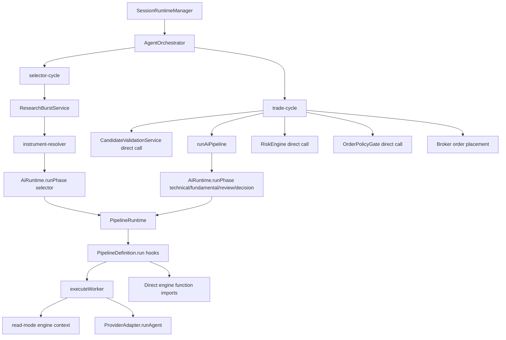
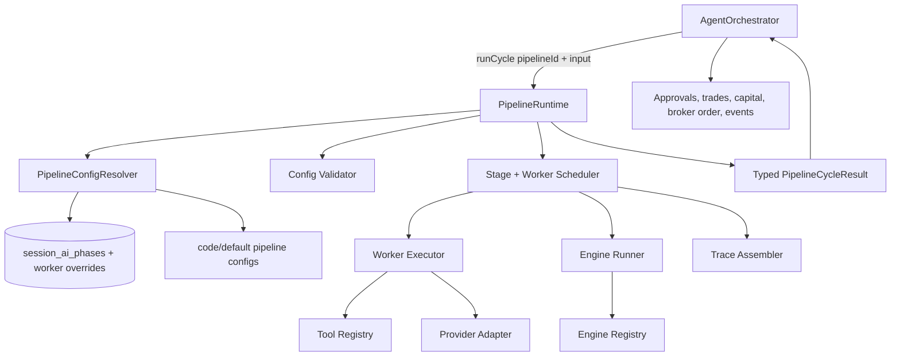

# Orchestration + Pipeline Runtime Architecture Review

> **Date:** 2026-05-19
> **Scope:** `electron/main/services/orchestration`, `electron/main/services/ai/pipeline-runtime`, and `electron/main/services/ai/engines`
> **Audience:** Exva engineering
> **Goal:** Identify ownership leaks and move the AI/trading mechanism toward a configuration-based architecture that makes new phases, workers, tools, engines, and execution policies easy to onboard.

> **Implementation status:** Phase 1 foundation, Phase 2 selector plan migration, and Phase 3 trade cycle plan implemented on 2026-05-19. Phase 5 remains separate follow-up work.

---

## Executive Summary

The current system is halfway through the intended phase-first runtime design. The good news is that the old role-specific AI runtime has been replaced by `AiRuntime.runPhase()` and a `PipelineRuntime` that can execute workers with prompt assets, tools, structured schemas, and spend tracking. The problem is that the actual trading workflow is still controlled by code spread across orchestration, phase definition files, shared defaults, and engine registration.

The main ownership issue: **orchestration still owns pipeline shape, selector input construction, deterministic selector steps, trade-stage sequencing, retry policy, and execution gates.** Pipeline-runtime owns worker execution, but not enough of the pipeline plan. Engines exist, but most deterministic business logic is either called directly from orchestration or imported directly inside phase definitions instead of being invoked through engine bindings.

The target should be: **orchestration owns lifecycle and durable side effects; pipeline-runtime owns phase graph execution; engines own deterministic business functions; configuration owns the mapping between phases, workers, tools, engines, caps, retries, output contracts, and finalizers.**

---

## Hard Problems

- **The workflow has two clocks:** `AgentOrchestrator` serializes session/trade lifecycle, while `PipelineRuntime` serializes phase workers. There is no single declarative plan for the complete cycle.
- **Configuration is split between typed constants, DB overrides, and procedural code:** adding a worker or changing behavior still requires editing multiple TypeScript files.
- **Engines are registered but not authoritative:** deterministic logic such as candidate validation, risk gates, aggregation, and execution profile computation is sometimes modeled as an engine but usually called directly.
- **Selector remains special:** discovery mode changes worker sets, builds instructions, fetches prediction-market candidates, caches outputs, and filters broker coverage through orchestration-side code.

---

## Current Architecture



The system has the right rough layers, but the arrows reveal the problem: orchestration and phase definitions both reach around the runtime boundary. Orchestration calls deterministic policy services directly; phase definitions import deterministic engines directly; `PipelineRuntime` is mostly an executor for workers rather than the owner of the pipeline mechanism.

---

## Ownership Model

### What Orchestration Should Own

- Session lifecycle: start, pause, resume, stop, rehydrate, attention-required state.
- Durable business side effects: creating trades, placing broker orders, writing approvals, reserving/releasing capital, emitting user-visible events.
- Queueing and runtime cancellation at the session level.
- Calling one high-level configured pipeline entrypoint and acting on its typed result.

### What Pipeline Runtime Should Own

- The configured phase graph: selector, candidate validation, technical, fundamental, review, decision, execution profile, risk gate, broker policy preflight as declared stages.
- Worker graph scheduling, concurrency, retry/caps per phase/worker, terminal-tool enforcement, structured output enforcement.
- Resolving phase/worker config from DB plus defaults.
- Calling engines through bindings instead of phase files importing engine functions directly.
- Producing a complete typed `PipelineCycleResult` that orchestration can persist and execute.

### What Engines Should Own

- Pure deterministic transforms and policy decisions.
- Candidate merge, scoring, risk filtering, submission building.
- Technical/fundamental/review/decision aggregation.
- Execution profile computation: sizing, stop/take-profit, order policy inputs.
- Candidate validation, risk gate, broker allocation checks, and order policy checks if they are represented as pipeline stages.

### What Configuration Should Own

- Phase list and ordering.
- Workers per phase, prompts, tools, tool config, output schemas, dependency graph, concurrency.
- Engine bindings and binding mode (`read`, `transform`, `policy`, `finalize`).
- Retry policy, spend caps, max steps, terminal-tool requirements.
- Discovery-mode variants and instrument-class variants without runtime `if` ladders.

---

## Findings

### 1. Orchestration Still Owns the AI Pipeline Order

**Files:** `electron/main/services/orchestration/cycle/trade/ai-pipeline.ts:22`, `electron/main/services/orchestration/cycle/trade/ai-pipeline.ts:45`, `electron/main/services/orchestration/cycle/trade/ai-pipeline.ts:68`, `electron/main/services/orchestration/cycle/trade/ai-pipeline.ts:100`

`runAiPipeline()` hardcodes the phase sequence and the exact data handoff from technical to fundamental to review to decision. This makes the trading AI pipeline code-driven instead of configuration-driven. Adding a new phase, changing phase order, or making a phase optional requires editing orchestration code.

**Why this matters:** The runtime already has `PipelineDefinition`, worker graphs, and phase config. But the larger trade pipeline is still a bespoke TypeScript workflow.

**Recommendation:** Introduce a configured `PipelineCycleDefinition` that declares stages and edges:

```ts
type PipelineCycleDefinition = {
  id: "default-trade-cycle";
  stages: Array<{
    id: string;
    kind: "phase" | "engine" | "policy" | "side_effect_gate";
    phase?: PipelinePhase;
    engine?: string;
    dependsOn?: string[];
    required: boolean;
  }>;
};
```

Then orchestration should call one entrypoint:

```ts
const result = await ctx.deps.ai.runCycle("default-trade-cycle", {
  sessionId: ctx.sessionId,
  cycleId: context.cycleId,
  instrument: context.instrument,
});
```

Orchestration should not know that `review` depends on `technical` and `fundamental`; the cycle definition should.

---

### 2. Selector Ownership Is Split Across Orchestration and Pipeline Runtime

**Files:** `electron/main/services/orchestration/cycle/selector/instrument-resolver.ts:17`, `electron/main/services/orchestration/cycle/selector/instrument-resolver.ts:35`, `electron/main/services/orchestration/cycle/selector/instrument-resolver.ts:47`, `electron/main/services/orchestration/cycle/selector/selection-instructions.ts:7`, `electron/main/services/ai/pipeline-runtime/definitions/selector.phase.ts:91`

Selector behavior is scattered:

- Orchestration computes selector fingerprints and cache behavior.
- Orchestration decides manual shortlist vs AI picker.
- Orchestration builds long natural-language selection instructions.
- Orchestration fetches prediction-market candidates.
- Pipeline definition chooses discovery workers based on `researchPosture.discoveryMode`.
- Pipeline definition runs discovery, verification, scoring, risk filtering, and submission.

**Why this matters:** A new selector mode requires editing orchestration plus pipeline definitions. That is the opposite of onboarding by configuration.

**Recommendation:** Move selector planning into pipeline-runtime as a `selector` phase plan with configured input builders and preflight engines:

```ts
const SELECTOR_PHASE_CONFIG = {
  phase: "selector",
  inputBuilders: ["selector-scope", "broker-coverage", "prediction-market-candidates"],
  cache: { keyBuilder: "selector-definition", ttlPolicy: "holding-style" },
  variants: {
    trend_scan: { workers: ["web-scout", "reddit-scout", "trend-scout"] },
    event_contract_scan: { workers: ["event-web-scout", "event-prediction-scout"] },
  },
  finalizers: ["selector-candidate-merger", "selector-scoring-engine", "selector-risk-filter", "selector-submission-builder"],
};
```

Orchestration should only ask for resolved candidates and react to the result.

---

### 3. Pipeline Definitions Are Procedural, Not Declarative

**Files:** `electron/main/services/ai/pipeline-runtime/definitions/selector.phase.ts:84`, `electron/main/services/ai/pipeline-runtime/definitions/technical.phase.ts:76`, `electron/main/services/ai/pipeline-runtime/definitions/fundamental.phase.ts:76`, `electron/main/services/ai/pipeline-runtime/definitions/review.phase.ts:42`, `electron/main/services/ai/pipeline-runtime/definitions/decision.phase.ts:52`

Every major phase uses a custom `run` hook. Those hooks embed worker selection, concurrency, failure tolerance, result collection, aggregation, and trace assembly in TypeScript. This bypasses the generic graph executor in `PipelineRuntime` and makes `PipelineDefinition` more like a plugin API than a data configuration model.

**Why this matters:** The system claims worker onboarding is config-driven, but the actual onboarding path for a new phase shape requires writing a new `run` function.

**Recommendation:** Make the common path data-only. Keep `run` as an escape hatch, not the normal path.

Target shape:

```ts
type PhaseDefinition = {
  phase: PipelinePhase;
  variants?: Record<string, { workers: string[] }>;
  workers: Record<string, WorkerDefinition>;
  scheduler: { mode: "flat_parallel" | "dependency_graph"; maxConcurrency: number };
  failurePolicy: { tolerateWorkerFailure: boolean; minSuccessfulWorkers?: number };
  finalizer: { engine: string; inputBuilder: string; outputSchema: string };
  trace: { mode: "aggregate_workers" };
};
```

If selector needs discovery and verification stages, model them as worker groups/frontiers in config rather than a custom function.

---

### 4. Engine Bindings Exist, But Finalizers Are Imported Directly

**Files:** `electron/shared/ai/pipeline-config.ts:73`, `electron/main/services/ai/pipeline-runtime/definitions/technical.phase.ts:8`, `electron/main/services/ai/pipeline-runtime/definitions/technical.phase.ts:92`, `electron/main/services/ai/pipeline-runtime/definitions/decision.phase.ts:8`, `electron/main/services/ai/pipeline-runtime/definitions/decision.phase.ts:93`, `electron/main/services/ai/pipeline-runtime/execution/engine-context-runner.ts:24`

`ENGINE_BINDINGS` declares aggregator finalizers, and `registerPipelineEngines()` registers those engines. But phase definitions import `aggregateTechnicalSignal()`, `aggregateFundamentalSignal()`, `aggregateReviewSignal()`, and `aggregateTradeSignal()` directly and call them manually. The only engine mode currently executed by worker runtime is `read` mode in `runReadEngineContext()`.

**Why this matters:** The engine layer is not authoritative. Developers will not know whether to add deterministic behavior as an engine binding or as a direct import inside a phase file.

**Recommendation:** Extend runtime engine execution to support all configured modes:

- `read`: adds structured context to a worker prompt envelope.
- `transform`: transforms typed intermediate data between stages.
- `policy`: returns allow/deny decisions with reasons.
- `finalize`: creates the phase output from worker outputs.

Then remove direct aggregator imports from phase definitions and route them through engine bindings.

---

### 5. The Engine Registry Silently Ignores Missing Engines

**Files:** `electron/main/services/ai/pipeline-runtime/execution/engine-context-runner.ts:27`, `electron/main/services/ai/pipeline-runtime/execution/engine-context-runner.ts:28`, `electron/main/services/ai/engines/registry/engine-registry.ts:14`

`runReadEngineContext()` calls `getEngine()` and silently continues if the engine is missing. That makes bad configuration fail open. `requireEngine()` exists but is not used in this path.

**Why this matters:** In a configuration-based architecture, invalid config must fail loudly at startup or phase-plan validation time. Silent skip means a worker can run without critical risk context and no one notices until behavior drifts.

**Recommendation:** Use `requireEngine()` during pipeline definition validation. Validate all engine bindings when the registry is initialized, not during worker execution. Runtime execution should fail closed if a required binding is unavailable.

---

### 6. Some Engine-Worthy Policy Logic Still Lives in Orchestration

**Files:** `electron/main/services/orchestration/cycle/trade/trade-cycle.ts:41`, `electron/main/services/orchestration/cycle/trade/trade-cycle.ts:54`, `electron/main/services/orchestration/cycle/trade/trade-cycle.ts:112`, `electron/main/services/orchestration/cycle/trade/trade-cycle.ts:124`, `electron/main/services/orchestration/cycle/trade/trade-cycle.ts:169`, `electron/main/services/orchestration/cycle/trade/trade-cycle.ts:180`, `electron/main/services/orchestration/cycle/trade/trade-cycle.ts:247`

The trade cycle directly instantiates or invokes candidate validation, risk engine, broker allocation gate, instrument conflict gate, and order policy gate. These are deterministic policy stages and several are already registered as engines in `register-default-engines.ts`.

**Why this matters:** Direct calls make the cycle hard to reconfigure. If a new instrument class needs a different candidate validator or a different order policy, the developer edits orchestration code.

**Recommendation:** Keep side effects in orchestration, but move policy decisions into configured engine stages:


The configured pipeline should return a `readyToPlaceOrder` payload. Orchestration then performs approval, capital reservation, broker placement, and persistence.

---

### 7. Retry Policy Is Hardcoded in Orchestration Instead of Runtime Config

**Files:** `electron/main/services/orchestration/cycle/execution-step-runner.ts:31`, `electron/main/services/orchestration/cycle/execution-step-runner.ts:32`, `electron/main/services/orchestration/cycle/execution-step-runner.ts:171`, `electron/shared/ai/pipeline-phase.ts:104`

`ExecutionStepRunner` imports global `RUNTIME_DEFAULTS` and hardcodes retry classification logic. The phase config resolver also resolves retry config, but worker execution does not consume it meaningfully for orchestration-stage retry behavior.

**Why this matters:** New stages cannot declare retry semantics. A selector provider timeout, deterministic validation failure, broker 429, and market-closed policy decision are different failure categories but are governed by one hardcoded classifier.

**Recommendation:** Move retry policy into stage config:

```ts
type StageRetryPolicy = {
  attempts: number;
  backoffMs: number[];
  retryOn: string[];
  failOpen?: boolean;
  attentionRequiredOnFailure?: boolean;
};
```

`ExecutionStepRunner` should be a persistence/timer utility that receives a resolved policy, not a policy owner.

---

### 8. Pipeline Phase Registry Requires TypeScript Edits for Every New Phase

**Files:** `electron/shared/ai/pipeline-phase.ts:5`, `electron/shared/ai/pipeline-phase.ts:7`, `electron/main/services/ai/pipeline-runtime/core/pipeline-registry.ts:3`, `electron/main/services/ai/pipeline-runtime/core/pipeline-registry.ts:10`

Adding a new phase requires editing the `PipelinePhase` union, `PIPELINE_PHASES`, imports in `pipeline-registry.ts`, the `REGISTRY` object, default config, possibly DB validation, and renderer config surfaces. That is acceptable for rare top-level product phases but not for every pipeline experiment.

**Why this matters:** The user goal is easy onboarding of new things. Today the system is easy to tune within existing phases, but not easy to add a stage or variant.

**Recommendation:** Separate stable product phases from configured stage IDs:

- `PipelinePhase`: stable UI/product buckets such as `selector`, `technical`, `fundamental`, `review`, `decision`.
- `PipelineStageId`: config-defined runtime stages such as `candidate_validation`, `execution_profile`, `risk_gate`, `options_flow_worker`, `prediction_market_liquidity_check`.

This lets new stages/workers onboard through config while preserving stable UI terminology.

---

### 9. Configuration Defaults Are Spread Across Multiple Files

**Files:** `electron/shared/ai/pipeline-phase.ts:104`, `electron/shared/ai/pipeline-config.ts:56`, `electron/main/services/ai/pipeline-runtime/phase-config-resolver.ts:23`, `electron/main/services/ai/pipeline-runtime/pipeline-discovery-config.ts:40`

Defaults live in `RUNTIME_DEFAULTS`, `PHASE_DEFAULTS`, `DEFAULT_PIPELINE_CONFIG`, `pipeline-discovery-config.ts`, and DB-backed `session_ai_phases`. These are all real config sources, but there is no single resolved `EffectivePipelineConfig` to inspect, diff, validate, or render in the Developer UI.

**Why this matters:** Configuration-based systems need a canonical resolved view. Without it, onboarding requires knowing which file wins for tools, retries, spend caps, prompts, worker variants, and provider/model settings.

**Recommendation:** Add a `PipelineConfigResolver.resolveEffectiveConfig(sessionId, pipelineId)` that returns the complete resolved plan:

```ts
type EffectivePipelineConfig = {
  pipelineId: string;
  stages: EffectiveStageConfig[];
  workers: EffectiveWorkerConfig[];
  engines: EffectiveEngineBinding[];
  budgets: EffectiveBudgetConfig;
  sourceMap: Array<{ path: string; value: unknown; source: "default" | "db" | "session" }>;
};
```

This should be shown in the Developer Workbench so a new worker can be audited without reading source.

---

### 10. Runtime Validation Does Not Cover Enough Configuration Semantics

**Files:** `electron/main/services/ai/pipeline-runtime/core/pipeline-registry.ts:20`, `electron/main/services/ai/pipeline-runtime/core/pipeline-registry.ts:53`, `electron/main/services/ai/pipeline-runtime/core/pipeline-registry.ts:63`

The registry validates phase mismatch, empty workers, duplicate worker IDs, output schemas, tool IDs, and dependency cycles. That is a good start. It does not validate engine existence, binding mode compatibility, required finalizers, input builders, variant coverage, or whether a worker's output schema matches the finalizer input contract.

**Why this matters:** The more behavior moves to config, the more important config validation becomes. Otherwise the system shifts from compile-time failures to runtime surprises.

**Recommendation:** Add a startup `validateEffectivePipelineConfig()` pass that validates:

- every tool ID exists and can be built for the phase context;
- every engine ID exists and supports the binding mode;
- every worker prompt asset path exists;
- every worker output schema has a registered schema name;
- every finalizer input contract can consume the worker output contracts;
- every variant has at least one worker and one finalizer path;
- every required stage has retry/failure policy.

---

## Recommended Target Architecture



In this model, `AgentOrchestrator` stops being the AI workflow author. It becomes the owner of lifecycle and real-world effects. `PipelineRuntime` becomes the owner of the mechanism. `EngineRegistry` becomes the deterministic function catalog. Config becomes the place where new things are onboarded.

---

## Proposed Configuration Shape

```ts
export interface PipelineCycleConfig {
  id: string;
  version: number;
  stages: PipelineStageConfig[];
  budgets: {
    totalSpendCapUsd: number;
  };
}

export interface PipelineStageConfig {
  id: string;
  kind: "phase" | "engine" | "policy" | "effect_boundary";
  phase?: PipelinePhase;
  engine?: string;
  dependsOn?: string[];
  inputBuilder: string;
  outputSchema: string;
  required: boolean;
  retry: StageRetryPolicy;
  workers?: WorkerConfig[];
  finalizer?: EngineBinding;
}

export interface WorkerConfig {
  id: string;
  promptAssetPath: string;
  tools: string[];
  engines: EngineBinding[];
  outputSchema: string;
  caps: {
    maxSteps: number;
    maxTokens: number;
    spendLimitUsd: number;
  };
  terminalToolNames?: string[];
}
```

This does not require configs to be JSON files immediately. They can start as typed TypeScript constants. The important shift is that runtime behavior is represented as data and interpreted by the runtime instead of being custom functions embedded across orchestration and phase definitions.

---

## Migration Plan

### Phase 1: Make the Current Config Resolvable and Inspectable

- [x] Add `resolveEffectivePipelineConfig(sessionId, pipelineId)`.
- [x] Keep current TypeScript definitions, but normalize them into one effective shape.
- [x] Add validation for engine IDs, prompt assets, finalizers, and variants.
- [x] Expose the resolved config in Developer Workbench.

Implemented files:

- `electron/shared/ai/effective-pipeline-config.ts`
- `electron/main/services/ai/pipeline-runtime/effective-pipeline-config.ts`
- `electron/main/services/ai/pipeline-runtime/core/pipeline-runtime.ts`
- `electron/main/services/ai/ai-runtime/runtime.ts`
- `electron/main/ipc/developer.ts`
- `src/pages/DevPanel.tsx`

### Phase 2: Move Selector Input/Cache/Variants Into Pipeline Runtime

- [x] Convert `buildSelectionInstructions()`, prediction-market candidate fetch, selector cache policy, and discovery-mode worker selection into configured input builders and stage config.
- [x] Leave manual shortlist as a selector input builder, not an orchestration branch.
- [x] Make selector return an `InstrumentSelection` plus trace/candidate metadata; orchestration only schedules trade cycles.

Implemented files:

- `electron/main/services/ai/pipeline-runtime/plan/` (interpreter, registries, selector plan)
- `electron/main/services/ai/ai-runtime/runtime.ts` (`runPhasePlan`)
- `electron/main/services/orchestration/cycle/selector/instrument-resolver.ts` (scheduling adapter)

### Phase 3: Replace `runAiPipeline()` With a Configured Trade Cycle

- [x] Add `AiRuntime.runCycle()` or `PipelineRuntime.runCycle()`.
- [x] Model technical/fundamental/review/decision as configured stages.
- [x] Add configured `candidate_validation`, `execution_profile`, `risk_gate`, and `order_policy` engine stages.
- [x] Return a typed `TradePipelineResult` that contains the decision and prevalidated execution profile.

Implemented files:

- `electron/main/services/ai/pipeline-runtime/plan/cycle-plan-interpreter.ts`
- `electron/main/services/ai/pipeline-runtime/plan/plans/default-trade-cycle.ts`
- `electron/main/services/ai/ai-runtime/runtime.ts` (`runCycle`)
- `electron/main/services/orchestration/cycle/trade/run-trade-pipeline.ts`

### Phase 4: Make Engines Authoritative

- [x] Route finalizers through engine bindings.
- [x] Remove direct aggregator function imports from phase definitions. Schema/type imports remain because worker output contracts live next to the aggregator implementations today.
- [x] Use `requireEngine()` during config validation and engine execution.
- [ ] Give engines typed schemas instead of `z.any()` where possible.

Implemented files:

- `electron/main/services/ai/pipeline-runtime/execution/engine-context-runner.ts`
- `electron/main/services/ai/pipeline-runtime/definitions/technical.phase.ts`
- `electron/main/services/ai/pipeline-runtime/definitions/fundamental.phase.ts`
- `electron/main/services/ai/pipeline-runtime/definitions/review.phase.ts`
- `electron/main/services/ai/pipeline-runtime/definitions/decision.phase.ts`

### Phase 5: Shrink Orchestration to Lifecycle + Effects

- [ ] Keep approval wait, capital reservation, trade insert/update, broker order placement, and event emission in orchestration.
- [ ] Remove AI phase ordering, policy decision branching, selector cache ownership, and direct deterministic policy calls from orchestration.

---

## Concrete File-Level Moves

| Move | From | To |
|------|------|----|
| Selector instructions | `orchestration/cycle/selector/selection-instructions.ts` | `plan/input-builders/selector-scope.ts` |
| Selector cache/fingerprint policy | `orchestration/cycle/selector/instrument-resolver.ts` | `plan/cache/selector-instrument-cache.ts` |
| Manual shortlist parsing | `orchestration/cycle/selector/manual-shortlist.ts` | `plan/input-builders/manual-shortlist.ts` |
| Prediction-market candidate prefeed | `orchestration/cycle/selector/prediction-market-candidates.ts` | `ai/engines/selector/prediction-market-candidate-engine.ts` |
| AI phase order | `orchestration/cycle/trade/ai-pipeline.ts` | configured `default-trade-cycle` |
| Candidate validation | `orchestration/policy/candidate-validation-service.ts` direct call | `candidate-validator` policy engine stage |
| Risk gate | `riskEngine.validateDecision()` direct call | `risk-gate` policy engine stage |
| Order policy | `new OrderPolicyGate().evaluate()` direct call | `order-policy` policy engine stage |
| Aggregators | phase definition direct imports | engine finalizers |
| Retry constants | `ExecutionStepRunner` | resolved stage retry config |

---

## What Is Done Well

- `AiRuntime.runPhase()` is now a single clean entrypoint (`electron/main/services/ai/ai-runtime/runtime.ts:53`). That is the right seam.
- `PipelineRuntime` centralizes worker execution, prompt loading, tool building, spend tracking, and trace assembly (`electron/main/services/ai/pipeline-runtime/core/pipeline-runtime.ts:64`). Keep this.
- Pipeline registry validation already catches duplicate worker IDs, unknown tool IDs, and dependency cycles (`electron/main/services/ai/pipeline-runtime/core/pipeline-registry.ts:36`, `electron/main/services/ai/pipeline-runtime/core/pipeline-registry.ts:53`, `electron/main/services/ai/pipeline-runtime/core/pipeline-registry.ts:83`). Extend it rather than replacing it.
- Worker output schemas are first-class (`electron/shared/ai/pipeline-phase.ts:30`). That is the correct contract boundary.
- The engine folder already contains the right deterministic concepts: selector scoring, candidate merging, aggregators, and execution profile computation. The missing piece is making runtime config call them consistently.

---

## Top Risks

1. **Fail-open config:** missing engines or malformed bindings can currently be skipped or discovered too late. This gets worse as more behavior becomes configuration-driven.
2. **Over-custom phase hooks:** if every phase keeps its own `run` function, the architecture will look configuration-based from the outside but still require code edits for normal onboarding.

---

## First Validation Step

Before refactoring everything, build a read-only `EffectivePipelineConfig` resolver for the current implementation and render it in a test snapshot. If that snapshot cannot clearly explain selector, technical, fundamental, review, decision, workers, tools, engines, caps, retries, and finalizers, the configuration model is not yet good enough.

---

## Recommendation

Do not start by moving files around. Start by making the runtime able to describe the current behavior as one resolved config object. Then migrate one ownership boundary at a time:

1. Validate engines and prompt assets at startup.
2. Move selector input/cache ownership into pipeline-runtime.
3. Replace `runAiPipeline()` with a configured trade-cycle plan.
4. Route finalizers and policy gates through engine bindings.
5. Leave orchestration as lifecycle plus durable side effects only.

That path preserves the working system while moving toward the goal: adding a new worker, engine, phase variant, or policy should be a config diff plus a prompt/schema/engine implementation, not a new orchestration branch.
