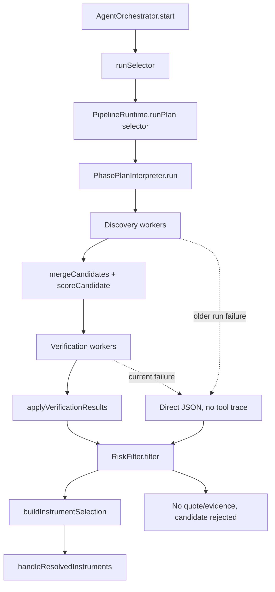

# Selector Runtime System Review - 2026-05-20

## Summary

`docs/hello.json` shows a clean app boot and a successful selector phase startup, not a process crash. The first captured run showed discovery and verification workers returning schema-shaped JSON without tool evidence. The newer captured run narrows the active failure: discovery workers now call tools (`get_trending_symbols`, `search_web`, `search_reddit`), but verification workers still return one-step structured JSON without calling `get_quote`, `get_ohlcv`, `get_news`, or `fetch_url`. The downstream risk filter correctly rejects or starves candidates because verification did not produce trustworthy quote/news/OHLCV traces.

Primary fix: make tool evidence a runtime contract for selector verification workers, not just a prompt instruction. A `market-validator:*`, `liquidity-gate:*`, or `catalyst-extractor:*` worker must be unable to complete successfully unless it executes the required tools and produces validated evidence. Secondary fixes should normalize broker symbols before market tools run, align tool context with effective instrument classes, make rejected selector evidence visible in the aggregate trace, and avoid blocking `session:start` on long-running AI discovery.

## Evidence From The Runtime Log

The relevant log file is `docs/hello.json`.

| Log lines           | Observation                                                                                                                                 | Meaning                                                                                            |
| ------------------- | ------------------------------------------------------------------------------------------------------------------------------------------- | -------------------------------------------------------------------------------------------------- |
| `95-112`            | Runtime starts and orchestrator begins for session `fd1cca3c-1fbd-4146-8d31-c883557b9369`.                                                  | Startup path is healthy.                                                                           |
| `114-191`           | `reddit-scout`, `web-scout`, and `trend-scout` start with tools available.                                                                  | Selector discovery workers are scheduled correctly.                                                |
| `210-273`           | Workers start with tool lists like `search_reddit`, `search_web`, `fetch_url`, and `get_trending_symbols`.                                  | Tool configuration exists at execution time.                                                       |
| Older run `275-353` | `web-scout` and `trend-scout` returned direct `{"candidates": []}` text on step 1.                                                          | The first captured run showed discovery could skip tools.                                          |
| Older run `371-401` | `reddit-scout` returned `NVDA`, `ARM`, and `BITCOIN` directly.                                                                              | The first captured run had mostly model-generated discovery.                                       |
| Newer run `238-246` | Discovery workers call `get_trending_symbols`, `search_web`, and `search_reddit`.                                                           | Discovery is now producing real tool traces.                                                       |
| Newer run `250-260` | Discovery workers return `ONON`, `PLTR`, `NVDA`, and `SOL` after tool calls.                                                                | Discovery is no longer the primary active failure.                                                 |
| `547-633`           | Verification workers start with `get_quote`, `get_ohlcv`, `get_news`, and `fetch_url` available.                                            | Validation tools are wired into workers.                                                           |
| Newer run `279-354` | Verification workers return direct JSON such as `volumeScore: 0.0`, `liquidityScore: 0.0`, or “No quote or OHLCV data available” on step 1. | They are still making validation claims without recorded tool calls.                               |
| `1337-1354`         | Orchestrator reports started and runtime active.                                                                                            | The selector failure is not treated as a runtime failure.                                          |
| Newer run `355-357` | `session:start` succeeds after `46638ms`.                                                                                                   | The start IPC waits for the initial selector cycle instead of returning when the runtime is ready. |

The key active signal is narrower now: discovery has `agent tool call` entries, but verification workers still have none between `execute run agent start` and `execute run agent complete`. The system had validation tools, but the model satisfied the structured-output request by writing JSON immediately.

## Execution Path



Source path:

1. `electron/main/services/orchestration/cycle/agent-orchestrator.ts:25-43` starts the orchestrator and immediately runs the initial selector cycle.
2. `electron/main/services/orchestration/cycle/selector/run-selector.ts:15-19` calls `ctx.deps.ai.runPlan("selector", ...)`.
3. `electron/main/services/llm/pipeline/core/pipeline-runtime.ts:219-250` builds strategy context, tool context, and the worker executor.
4. `electron/main/services/llm/pipeline/phases/interpreter.ts:80-121` runs discovery and verification stages.
5. `electron/main/services/llm/pipeline/implementations/selector/plan.ts:80-147` defines discovery and verification stage behavior.
6. `electron/main/services/llm/pipeline/execution/worker-executor.ts:104-149` builds tools and calls `adapter.runAgent(...)`.
7. `electron/main/services/llm/adapters/run-agent-execute.ts:237-242` calls `generateText(...)` with `experimental_output: Output.object(...)` when a schema is present.
8. `electron/main/services/signal/scoring/selector-risk-filter.ts:37-56` requires a quote snapshot and validates selector evidence before allowing a candidate.

## Findings

### 1. Critical: Verification Tool Use Is Prompted But Not Enforced

**Files:**

- `electron/main/services/llm/adapters/run-agent-execute.ts:160-178`
- `electron/main/services/llm/adapters/run-agent-execute.ts:237-242`
- `electron/main/services/llm/pipeline/execution/worker-executor.ts:124-139`
- `electron/main/services/llm/pipeline/phase-config-resolver.ts:83-85`

**What:** Object-output workers with tools can finish after one text step because `executeRunAgent` only sets stop conditions for max steps, terminal tools, spend, and loop guard. It never requires a first tool call or required tool coverage. The default `terminalToolNames` is also always empty for worker runtime config. The newer runtime log shows discovery workers can call tools successfully, but verification workers still skip their required quote/news/OHLCV tools.

**Why it matters:** The selector looks successful because structured JSON parses, but the JSON can be unsupported. That directly explains the newer `docs/hello.json`: verification workers have tools but return immediate text. Then `RiskFilter` rejects candidates because there is no quote snapshot or verification evidence trace.

**Fix:** Add worker-level tool requirements and enforce them after the run trace is built. Do not rely only on provider `toolChoice`; OpenRouter/model combinations may reject it or ignore it. A post-run invariant is provider-agnostic and easy to test.

Recommended type shape:

```ts
export type WorkerToolRequirement = {
  requiredAny?: string[];
  requiredAll?: string[];
  minToolCalls?: number;
};
```

Add this to `WorkerDefinition` or the resolved runtime config, then enforce it in `executeWorker` after `runAgent()`:

```ts
const toolNamesUsed = new Set(
  trace.steps.flatMap((step) => step.toolCalls.map((call) => call.tool)),
);

if (
  requirement.minToolCalls &&
  trace.steps.flatMap((s) => s.toolCalls).length < requirement.minToolCalls
) {
  throw new AppError(
    `Worker ${worker.id} did not call required tools.`,
    "VALIDATION_FAILED",
  );
}

if (requirement.requiredAll?.some((tool) => !toolNamesUsed.has(tool))) {
  throw new AppError(
    `Worker ${worker.id} missed required tool evidence.`,
    "VALIDATION_FAILED",
  );
}

if (
  requirement.requiredAny?.length &&
  !requirement.requiredAny.some((tool) => toolNamesUsed.has(tool))
) {
  throw new AppError(
    `Worker ${worker.id} did not call any required evidence tool.`,
    "VALIDATION_FAILED",
  );
}
```

Initial selector requirements:

| Worker                 | Required evidence                                                   |
| ---------------------- | ------------------------------------------------------------------- |
| `web-scout`            | `search_web`, and `fetch_url` when a result URL is used as evidence |
| `reddit-scout`         | `search_reddit`                                                     |
| `trend-scout`          | `get_trending_symbols` plus optional `search_web` for context       |
| `market-validator:*`   | `get_quote` and `get_ohlcv`                                         |
| `liquidity-gate:*`     | `get_quote`                                                         |
| `catalyst-extractor:*` | at least one of `get_news`, `search_web`, or `fetch_url`            |

Implementation priority should start with verification workers. Discovery requirements remain useful as a regression guard, but the current active failure is verification.

### 2. Critical: Verification Workers Can Produce Zero Scores Without Showing The Tool Failure

**Files:**

- `electron/main/services/llm/pipeline/implementations/selector/plan.ts:203-224`
- `electron/main/services/llm/pipeline/implementations/selector/plan.ts:227-239`
- `electron/main/services/signal/scoring/selector-risk-filter.ts:37-39`
- `electron/main/services/orchestration/policy/candidate-validation-service.ts:96-139`

**What:** Verification results are merged even when they contain no tool trace. `RiskFilter` then extracts a quote snapshot from `selectorTraces`; if there is no `get_quote` result, it silently filters the candidate out.

**Why it matters:** The system spends money and appears to run, but the user sees no actionable reason beyond weak model-written rationale. The aggregate result can be empty without surfacing the exact evidence gap: missing quote call, quote error, stale quote, no news evidence, etc.

**Fix:** Keep `RiskFilter` strict, but expose rejection reasons as first-class selector output metadata and event logs.

Concrete changes:

1. Add a `CandidateRejection` shape containing `symbol`, `instrumentClass`, `finalScore`, `sourceWorkers`, `toolNamesUsed`, and `reasons`.
2. Change `RiskFilter.filter(...)` into `RiskFilter.evaluate(...)` returning `{ accepted, rejected }`.
3. Persist rejected candidates in the selector aggregate `output_json` or `market_snapshot_json`.
4. Emit an orchestrator event when selector returns zero accepted instruments but had rejected candidates.

This preserves safety while making the cause visible in DevPanel and logs.

### 3. Critical: Broker Symbol Normalization Is Not Used By Market Tools

**Files:**

- `electron/main/services/tools/market-tools.ts:137-189`
- `electron/main/services/broker/instrument-normalizer.ts:9-38`
- `electron/main/services/broker/adapters/coinbase-advanced-trade-adapter.ts:122-125`

**What:** `createMarketTools` passes the model-provided symbol directly into `adapter.getMarketSnapshot(symbol)`. `InstrumentNormalizer` exists and knows Coinbase crypto symbols should become `BASE-USD`, but the market tools do not call it.

**Why it matters:** `docs/hello.json` includes `BITCOIN`, and validators correctly complain that the symbol is unverifiable. The current `submit_candidates` normalizer only uppercases non-prediction symbols, which does not convert aliases like `BITCOIN` to `BTC-USD`, `BTC`, or broker-specific products.

**Fix:** Normalize before broker market-data calls, not only at final submission.

Recommended approach:

1. Add a canonical alias resolver before `InstrumentNormalizer.toBrokerSymbol`:

```ts
const CRYPTO_ALIASES: Record<string, string> = {
  BITCOIN: "BTC",
  BTC: "BTC",
  ETHEREUM: "ETH",
  ETH: "ETH",
};
```

2. Resolve aliases by instrument class before `get_quote` and `get_ohlcv`.
3. Use `InstrumentNormalizer.toBrokerSymbol({ symbol, instrumentClass, brokerType: adapter.brokerType })` before calling adapter market-data methods.
4. Return both canonical and broker symbols in tool output so traces show what was tested.

Example tool output:

```json
{
  "symbol": "BITCOIN",
  "canonicalSymbol": "BTC",
  "brokerSymbol": "BTC-USD",
  "instrumentClass": "crypto",
  "price": 123456.78,
  "timestamp": "..."
}
```

### 4. High: Tool Context Uses Raw Session Classes Instead Of Effective Classes

**Files:**

- `electron/main/services/llm/pipeline/worker-tools/tool-context-builder.ts:35-59`
- `electron/main/services/llm/pipeline/phases/interpreter.ts:29-39`
- `electron/main/services/llm/pipeline/implementations/inputs/selector-scope.ts:9-18`

**What:** `PhasePlanInterpreter` resolves effective classes with `resolveSessionInstrumentClasses(...)`, but `buildToolContext` still sets `toolContext.instrumentClasses` from `session.instrumentClasses`. `SELECTOR_PLAN.buildTask` uses `ctx.toolContext.instrumentClasses` at `selector/plan.ts:87-91`, while input builders use `ctx.instrumentClasses`.

**Why it matters:** This can split the same selector run into two different class universes. The prompt may say “broker-backed classes: stock, crypto, futures,” while tools like Reddit subreddit selection use the stale raw session classes. That can recreate the earlier “stock-only discovery despite broader broker coverage” behavior.

**Fix:** Make effective instrument classes the only class list used during a phase run.

Concrete change:

1. Add `instrumentClasses?: InstrumentClass[]` to `buildToolContext(...)` input.
2. In `PipelineRuntime.runPhasePlan`, compute effective classes before building tool context or rebuild tool context after `PhasePlanInterpreter` resolves them.
3. Set `toolContext.instrumentClasses = effectiveInstrumentClasses`.
4. In `SELECTOR_PLAN.buildTask`, use `ctx.instrumentClasses`, not `ctx.toolContext.instrumentClasses`.

### 5. High: Prompts Are Too Thin For The New Pipeline Contract

**Files:**

- `electron/main/services/llm/pipeline/prompts/selector-workers/web-scout.md:1-21`
- `electron/main/services/llm/pipeline/prompts/selector-workers/reddit-scout.md:1-7`
- `electron/main/services/llm/pipeline/prompts/selector-workers/trend-scout.md:1-7`
- `electron/main/services/llm/pipeline/prompts/selector-workers/market-validator.md:1-17`
- `electron/main/services/llm/pipeline/prompts/selector-workers/liquidity-gate.md:1-16`
- `electron/main/services/llm/pipeline/prompts/selector-workers/catalyst-extractor.md:1-16`

**What:** The prompt assets say what JSON to return, but they do not make tool use an explicit step-by-step contract. They also do not define what to do with tool errors beyond “use low scores.”

**Why it matters:** With structured output enabled, the model is incentivized to satisfy the schema as quickly as possible. The current prompts do not strongly counter that incentive.

**Fix:** Update each selector worker prompt with a mandatory process section.

Example for `market-validator.md`:

```md
## Required Process

1. Call `get_quote` for the candidate symbol and instrument class.
2. Call `get_ohlcv` for the same candidate.
3. If either tool returns an error, return low scores and include the exact tool error in `rationale`.
4. Do not infer quote, volume, or liquidity from memory.
5. Do not return final JSON until both required tools have been called.
```

Prompt changes are necessary but not sufficient. The runtime enforcement from finding 1 is still required.

### 6. Medium: Discovery Tools Are Stock-Biased And Live Reddit Is Disabled

**Files:**

- `electron/main/services/tools/trending-symbols-tool.ts:5-6`
- `electron/main/services/tools/search-reddit-tool.ts:9-10`
- `electron/main/services/tools/search-reddit-tool.ts:139-141`

**What:** `get_trending_symbols` only uses StockTwits. Reddit search defaults to stock-heavy subreddits and explicitly returns an error in live mode unless mock data is supplied. Crypto subreddits are only added when `instrumentClasses` includes `crypto`.

**Why it matters:** Broad “Search everything” discovery is not actually broad. If web/trend scouts skip tools or return empty, Reddit/mock fixtures can dominate candidate generation with stock-heavy examples.

**Fix:** Treat social/trending discovery as a multi-provider layer:

1. Rename the current tool or output metadata to make the source explicit: `stocktwits_trending`.
2. Add provider-specific sections for stocks, crypto, futures, and prediction markets.
3. In live mode, either implement Reddit OAuth or remove `search_reddit` from live worker definitions and rely on `search_web` for Reddit pages.
4. Add a discovery coverage event listing which discovery tools were available, mocked, blocked, or errored.

### 7. Medium: Aggregate Trace Hides Per-Candidate Rejection Detail

**Files:**

- `electron/main/services/llm/pipeline/execution/trace-assembler.ts:101-177`
- `electron/main/services/llm/pipeline/execution/trace-assembler.ts:220-253`
- `electron/main/services/llm/pipeline/implementations/selector/plan.ts:149-181`

**What:** The aggregate trace summarizes workers and tool traces, but selector finalization only emits accepted output. Rejected candidates and their reason chain are not part of the user-facing phase output.

**Why it matters:** The system can perform useful work and reject everything safely, but the operator cannot tell whether the issue was no candidates, missing tool calls, broker symbol mismatch, stale quote, no broker route, or low score.

**Fix:** Include selector diagnostics in the aggregate output:

```ts
type SelectorDiagnostics = {
  discoveredCount: number;
  verifiedCount: number;
  acceptedCount: number;
  rejected: CandidateRejection[];
  workerToolCoverage: Array<{
    workerId: string;
    requiredTools: string[];
    usedTools: string[];
    satisfied: boolean;
  }>;
};
```

Persist this alongside the accepted `InstrumentSelection` so DevPanel can explain zero-result selector runs.

### 8. Low: Temperature Warning Is Mostly Handled In Pipeline Workers, But Other Paths Still Pass It

**Files:**

- `electron/main/services/llm/pipeline/execution/worker-executor.ts:21-27`
- `electron/main/services/llm/adapters/openrouter-adapter.ts:124-129`
- `electron/main/services/llm/adapters/openai-adapter.ts:96-101`
- `electron/main/services/llm/adapters/anthropic-adapter.ts:97-102`

**What:** Pipeline workers avoid temperature for model IDs containing `/`, which explains why selector logs show `temperature: null`. The warning in `docs/hello.json:81-82` likely comes from connection-test or non-pipeline generate-text paths that still pass `temperature: 0`.

**Why it matters:** It is not the selector failure, but it adds noise exactly when debugging provider behavior.

**Fix:** Centralize model capability handling in one helper and reuse it in pipeline workers, provider connection tests, and direct `generateText` calls. For OpenRouter, omit unsupported parameters for reasoning models instead of passing `temperature: 0`.

### 9. Medium: `session:start` Blocks Until Initial AI Cycle Completes

**Files:**

- `electron/main/services/orchestration/cycle/agent-orchestrator.ts:25-43`
- `electron/main/services/session/session-runtime.ts`
- `electron/main/services/session/session-runtime-manager.ts`
- `electron/main/services/session/session-service.ts`

**What:** The newer log shows `session:start` takes `46638ms` (`docs/hello.json:214-217`, `355-357`) because resuming runtime waits for `AgentOrchestrator.start()`, and `start()` awaits `executeSelectorCycle(...)` before it logs `orchestrator started`.

**Why it matters:** Starting a session should acknowledge that the runtime is active and then stream AI progress separately. Blocking the IPC call on selector work makes the UI start action feel hung, couples lifecycle state to AI latency, and can fail the start action for a recoverable selector issue.

**Fix:** Split runtime activation from initial selector execution.

Concrete options:

1. Make `AgentOrchestrator.start()` mark the orchestrator started, attach listeners, enqueue the initial selector cycle, and return immediately.
2. Add a separate `startAndWaitForInitialCycle()` only for tests or explicit synchronous workflows.
3. Emit `research_phase_started`, `research_phase_complete`, and `research_phase_failed` events for UI progress instead of using the `session:start` request duration as progress.
4. Keep runtime status transitions independent from selector success or failure; selector failures should move execution step state to retrying or attention-required, not make runtime startup fail after a long wait.

## Recommended Fix Plan

### Phase 1 - Verification Evidence Contracts

Goal: prevent verification workers from succeeding without required tool evidence.

1. Extend `WorkerDefinition` or resolved runtime config with `toolRequirements`.
2. Add requirements first to `market-validator:*`, `liquidity-gate:*`, and `catalyst-extractor:*` workers.
3. Enforce requirements in `worker-executor.ts` after `trace` is returned.
4. On failure, throw `AppError("VALIDATION_FAILED")` with details: worker id, required tools, used tools.
5. Add tests in `electron/main/services/llm/pipeline/implementations/plans/selector` or `worker-executor` covering direct JSON with no tool calls.

Success criteria:

- A `market-validator:*` worker that returns JSON without `get_quote` and `get_ohlcv` fails validation.
- A `liquidity-gate:*` worker that returns JSON without `get_quote` fails validation.
- A `catalyst-extractor:*` worker that returns JSON without `get_news`, `search_web`, or `fetch_url` fails validation.
- A selector run with failed workers emits a clear reason instead of silently producing empty accepted output.

Discovery worker enforcement can follow once verification is guarded.

### Phase 2 - Symbol Normalization Before Market Data

Goal: ensure market tools test broker-valid symbols.

1. Add an alias resolver for common crypto names and symbols.
2. Use `InstrumentNormalizer` inside `createMarketTools` before `adapter.getMarketSnapshot(...)`.
3. Return `inputSymbol`, `canonicalSymbol`, and `brokerSymbol` in market-tool output.
4. Add tests for `BITCOIN` -> `BTC-USD` on Coinbase and no destructive normalization for mock/prediction-market symbols.

Success criteria:

- `get_quote({ symbol: "BITCOIN", instrumentClass: "crypto" })` routes to the Coinbase broker as `BTC-USD`.
- Tool traces preserve the original model input and the broker-normalized symbol.

### Phase 3 - Single Effective Instrument-Class Source

Goal: remove class-universe drift.

1. Thread effective classes into `buildToolContext`.
2. Replace `ctx.toolContext.instrumentClasses` usage in selector task construction with `ctx.instrumentClasses`.
3. Add a regression test for full-universe mode where raw session classes differ from broker-derived effective classes.

Success criteria:

- Prompt input, tool context, Reddit subreddit selection, risk filtering, and output filtering use the same class list.

### Phase 4 - Rejection Diagnostics

Goal: make zero-result selector runs explain themselves.

1. Convert `RiskFilter.filter` to `RiskFilter.evaluate`.
2. Persist rejected candidates and reason chains in selector aggregate output.
3. Emit an event when accepted count is zero but rejected count is nonzero.
4. Render this in DevPanel or the runtime event stream.

Success criteria:

- A run like `docs/hello.json` reports “NVDA rejected: missing get_quote trace” or “BITCOIN rejected: symbol normalized/routing failure” instead of only showing an empty selection.

### Phase 5 - Prompt And Discovery Hardening

Goal: make model behavior align with runtime contracts.

1. Rewrite selector worker prompts with mandatory tool-use process sections.
2. Make `search_reddit` live-mode behavior explicit in tool availability and worker prompts.
3. Split StockTwits-only trending from broader multi-asset discovery.
4. Add tests that prompt assets mention required tools and forbidden memory-only validation.

Success criteria:

- Prompt tests fail if a selector prompt omits required tool names.
- Discovery coverage logs show which sources were actually available and used.

### Phase 6 - Non-Blocking Runtime Start

Goal: return from `session:start` when runtime lifecycle is ready, not when AI discovery finishes.

1. Change orchestrator start/resume to enqueue the initial selector cycle asynchronously.
2. Keep execution progress visible through events and `session:get-execution-progress`.
3. Add a regression test asserting `session:start` does not await a slow selector worker.

Success criteria:

- `session:start` returns quickly after runtime activation.
- A long selector cycle still streams progress and failures through execution-step events.
- A selector retry or attention-required state does not make runtime startup appear failed.

## Minimal Code Hotspots

| Area                    | Primary file                                                                                    | Change                                                                       |
| ----------------------- | ----------------------------------------------------------------------------------------------- | ---------------------------------------------------------------------------- |
| Tool contract config    | `electron/shared/ai/pipeline-phase` and `pipeline-discovery-config.ts`                          | Add per-worker required tool metadata.                                       |
| Runtime enforcement     | `electron/main/services/llm/pipeline/execution/worker-executor.ts`                       | Fail workers that miss required tool calls.                                  |
| Execution trace         | `electron/main/services/llm/adapters/run-agent-execute.ts`                                       | Keep current trace capture; optionally add a helper to summarize used tools. |
| Selector finalization   | `electron/main/services/llm/pipeline/implementations/selector/plan.ts`                        | Return accepted and rejected diagnostics.                                    |
| Risk filtering          | `electron/main/services/signal/scoring/selector-risk-filter.ts`                            | Return reasoned evaluation instead of boolean-only filtering.                |
| Market tools            | `electron/main/services/tools/market-tools.ts`                                               | Normalize symbols before broker calls.                                       |
| Tool context            | `electron/main/services/llm/pipeline/worker-tools/tool-context-builder.ts`                    | Use effective instrument classes.                                            |
| Prompts                 | `electron/main/services/llm/pipeline/prompts/selector-workers/*.md`                      | Require concrete tool-call sequence.                                         |
| Runtime start lifecycle | `electron/main/services/orchestration/cycle/agent-orchestrator.ts` and session runtime services | Do not block `session:start` on initial selector completion.                 |

## Verification Checklist

Run these after implementation:

```bash
bun run typecheck
bunx vitest electron/main/services/llm/__tests__/run-agent-execute.test.ts
bunx vitest electron/main/services/llm/pipeline/core/worker-graph-scheduler.test.ts
bunx vitest electron/main/services/llm/pipeline/implementations/plans/selector --run
bunx vitest electron/main/services/orchestration/cycle/__tests__/run-selector.test.ts
```

Manual runtime check:

1. Start a mock session with full-universe discovery and broker-backed classes including stocks and crypto.
2. Confirm `agent tool call` logs appear before every selector worker completion.
3. Confirm `market-validator:*` logs include `get_quote` and `get_ohlcv`.
4. Confirm `liquidity-gate:*` logs include `get_quote`.
5. Confirm `catalyst-extractor:*` logs include `get_news`, `search_web`, or `fetch_url`.
6. Confirm a zero-result selector run emits explicit rejection reasons.
7. Confirm `session:start` returns before the selector cycle finishes.
8. Confirm no AI SDK temperature warning appears for the chosen reasoning model.

## Expected User-Facing Outcome

After these fixes, the system should stop pretending that a selector verification phase succeeded when it only produced schema-shaped text. It should either select instruments backed by quote/news/OHLCV traces or fail/retry with specific evidence-contract errors. Runtime start should also feel immediate: the session becomes active first, while discovery and verification progress stream independently. That turns the current “nothing useful happened after a long start request” behavior into a debuggable control loop: discover with tools, verify with tools, reject with reasons, retry or ask for user attention.
