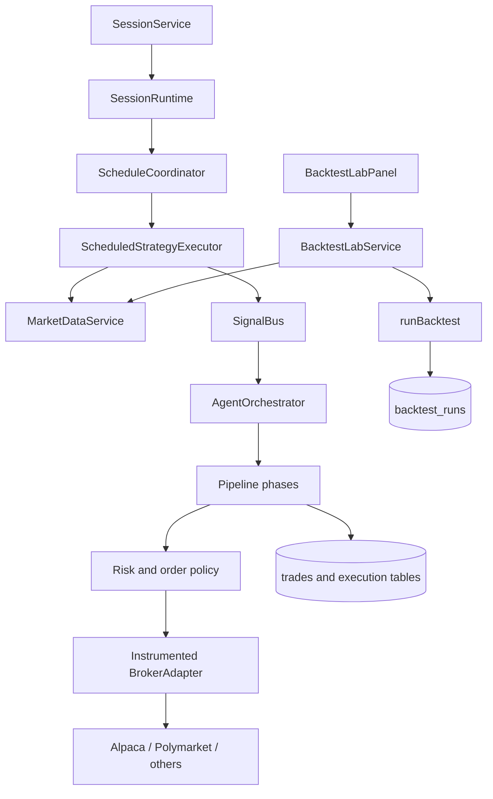
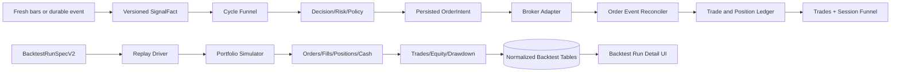

# Exva Trading Recovery and Backtest Lab - Deep Plan

> **Date:** 2026-07-27
> **Status:** Draft for implementation
> **Owner:** Kenneth / Exva
> **Audience:** Implementing engineers, reviewers, future maintainers, coding agents
> **Scope:** Paper-order proof, live trading funnel repair, event-source reliability, broker capability truth, Backtest Lab V2, observability, and replacement session matrix

Implements: docs/engineering/CODING_GUIDELINES.md

## 1. Executive Summary

Exva will be changed from a collection of nominally running sessions into a system that proves each
step from fresh input to reconciled paper fill. The first release is not a strategy improvement. It is
a paper-only execution certification vertical slice that creates one minimum-size order, records the
same order in Exva and Alpaca, follows it to a terminal state, and closes it. This establishes a known
good baseline before any signal threshold or AI behavior is discussed.

The live trading pipeline will then gain explicit freshness contracts, immutable deterministic signal
facts, catch-up delivery for event sources, bounded structured-output repair, early EDGAR tradability
gates, complete broker-adapter decoration, and resumable order reconciliation. Each session will show
its funnel and first divergence so “no trade” has an exact reason and count rather than a wall of logs.

The Backtest Lab will be rebuilt as a portfolio simulator rather than a basis-point trade sampler. It
will model cash, quantity, fees, fills, positions, realized/unrealized P&L, chronological multi-symbol
equity, and drawdown; persist the full run detail; and render dollar P&L, equity/drawdown, price bars
with trade markers, and a trade ledger. The old V1 run remains readable but cannot be promoted.

The difficult part is maintaining one contract across scheduling, live execution, backtesting,
broker reconciliation, analytics, and UI. This plan fixes that with versioned signal, order, and
backtest contracts, tracer-bullet phases, explicit rollback boundaries, and composition tests that
cross the same seams that failed in production.

## 2. Problem Statement

The July 27 paper run looked busy but produced no order. It persisted 189 signal events, 124
deliveries, and 260 execution steps, yet no decision trace, approval, reservation, position, or
executed trade. Rules paths could reuse stale bars. Options Flow had no reachable producer.
Polymarket lost its first event batch before subscription and later failed schema boundaries. EDGAR
spent work on poor candidates. The broker path was never proven as part of the Exva user journey.

The operational failure is not only zero trades. It is the inability to answer these questions from
one screen:

1. Did this session receive fresh input?
2. Did the strategy emit a signal on the current data window?
3. Which gate first rejected it?
4. Was an order submitted, accepted, partially filled, filled, canceled, or rejected?
5. Does Exva agree with the broker?
6. If no setup occurred, was that genuine or stale-data repetition?

The product failure is equally severe in the Lab. The current result cannot answer “how much money
did this strategy make?” because its contract contains no money. The UI cannot display durable trade
markers because trades are discarded after the immediate response. A weak five-trade verdict can
label an unrealistic same-close replay a pass, creating false confidence and bad launch decisions.

If nothing changes, more sessions and looser thresholds will increase cost and false confidence while
leaving the order path unproved. Account creation alone cannot fix unreachable or simulated adapters.

## 3. Goals, Non-Goals, and Invariants

### Goals

|   # | Goal                                     | Success Looks Like                                                                             |
| --: | ---------------------------------------- | ---------------------------------------------------------------------------------------------- |
|  G1 | Prove one paper order end to end         | Same client/broker IDs and terminal state appear in Exva and Alpaca                            |
|  G2 | Make no-trade causality visible          | Every cycle has one terminal funnel outcome and first-divergence reason                        |
|  G3 | Guarantee fresh scheduled inputs         | Scan records expected/latest bar, lag, fetch decision, and digest                              |
|  G4 | Preserve one deterministic decision fact | Scheduler, risk, order, and audit consume the same versioned signal payload                    |
|  G5 | Recover event-source startup gaps        | Eligible events emitted before subscription are catch-up delivered exactly once                |
|  G6 | Make broker capabilities truthful        | Routing and readiness use probed account/adapter capabilities, not static claims               |
|  G7 | Produce portfolio-grade backtests        | Dollar P&L, cash, positions, fees, fills, equity, drawdown, and trades are durable             |
|  G8 | Gate new alpha experiences on evidence   | Promotion evaluates the exact versioned research contract and dataset                          |
|  G9 | Launch a useful session matrix           | Every primary lane has a reachable producer and route; unfinished lanes are explicit sentinels |

### Non-Goals

|   # | Non-Goal                                            | Why It Is Out Of Scope                                                                |
| --: | --------------------------------------------------- | ------------------------------------------------------------------------------------- |
|  N1 | Guarantee strategy profitability                    | Integration proof and historical simulation cannot guarantee future returns           |
|  N2 | Enable live-money trading                           | All rollout and certification work remains paper-only                                 |
|  N3 | Build real Tradovate integration in this program    | It is a separate partner/data/order project; current recovery uses Mock sentinel only |
|  N4 | Launch options verticals before full handoff exists | Chain, OCC selection, legs, buying power, fill, and close must be composed first      |
|  N5 | Treat forced canary orders as alpha                 | Certification rows are excluded from strategy performance and promotion               |
|  N6 | Backtest historical options without chain snapshots | Options Flow remains forward-paper until point-in-time chains exist                   |
|  N7 | Tune thresholds before data/parity proofs           | Tuning broken inputs conceals root causes                                             |

### Invariants

|   # | Invariant                                                                                         | Why It Must Hold                                            |
| --: | ------------------------------------------------------------------------------------------------- | ----------------------------------------------------------- |
|  I1 | Certification can never route to a live broker                                                    | Diagnostic actions must not risk real capital               |
|  I2 | Every outbound order has a unique persisted client order ID before submission                     | Timeout-safe idempotency and reconciliation                 |
|  I3 | HTTP success never means filled                                                                   | Broker acknowledgement and fill are distinct states         |
|  I4 | A scheduled signal includes timeframe, parameters, implementation version, and bar digest         | Prevent downstream reinterpretation                         |
|  I5 | Cached row count never substitutes for freshness                                                  | Prevent repeated stale evaluation                           |
|  I6 | A source event is deduped after delivery eligibility is recorded, not before catch-up is possible | Prevent startup loss                                        |
|  I7 | Certification trades are visibly labeled and excluded from alpha metrics                          | Prevent false performance claims                            |
|  I8 | Backtest entry defaults to next-bar open                                                          | Avoid same-close look-ahead execution                       |
|  I9 | Portfolio equity is derived from cash plus marked positions                                       | One accounting source of truth                              |
| I10 | Old V1 backtest rows remain read-only and cannot satisfy V2 promotion                             | Preserve persisted history without false compatibility      |
| I11 | A session cannot resume without the same preflight/readiness checks as start                      | State may change while paused                               |
| I12 | Every phase leaves paper sessions safe to stop and restart                                        | Incremental rollout must remain supportable                 |
| I13 | No strategy is evaluated on fewer bars than its declared `requiredBarCount`                       | A starved evaluator did not decline to trade                |
| I14 | No provider call is made for a candidate a deterministic gate can reject for free                 | Spend must follow screening, not precede it                 |
| I15 | A no-trade conclusion is invalid without the day's uptime coverage                                | An absent system produces the same evidence as a broken one |

### Global Constraints

- Runtime: Bun `1.3.11`, Electron `33`, TypeScript `5.6`, React `18`, Zod `3`.
- Use existing IPC -> service -> repository layering from `docs/engineering/CODING_GUIDELINES.md`.
- Persist all timestamps as ISO-8601 UTC.
- No live broker route may be used by tests, certification, or rollout.
- New IPC contracts use shared Zod schemas; renderer/preload must not type them as `unknown`.
- Database changes are additive. Existing V1 `backtest_runs` rows remain readable.
- Every task includes a production-composition test with only external network/time faked.
- No new alpha experience is registered until its V2 backtest meets the versioned research contract.

## 4. Current State

### 4.1 Architecture and Components



Key current boundaries:

- Session lifecycle: `electron/main/services/session/session-service.ts`.
- Scheduled input: `electron/main/services/scheduling/`.
- Live bars: `electron/main/services/marketdata/market-data-service.ts`.
- Signal fanout: `electron/main/services/signals/signal-bus.ts`.
- Trade cycle: `electron/main/services/orchestration/cycle/trade/`.
- Broker decoration/routing: `electron/main/services/broker/`.
- Backtest engine: `electron/main/services/backtest/replay-engine.ts`.
- Lab service/UI: `electron/main/services/operator/backtest-lab-service.ts` and
  `src/hubs/panels/backtest-lab-panel.tsx`.

### 4.2 Data and State Model

Current trading state is spread across session events, source polls, signal events, deliveries,
execution steps, decision traces, approvals, trades, reservations, and broker caches. There is no
single cycle-funnel projection. A user must infer the first divergence across unrelated records.

`ohlcv_bars` and `data_coverage` record available rows and envelope coverage. They do not encode the
expected latest closed bar, interior gaps, feed entitlement, or whether a live read used stale cache.

`backtest_runs` stores one JSON spec fragment and aggregate metrics. It does not store orders, fills,
trades, positions, equity points, data inputs, or engine version. `contractHash` is overloaded with a
replay result hash.

### 4.3 Critical Runtime Flows

Scheduled flow:

1. Planner groups subscriptions.
2. Coordinator invokes `ScheduledStrategyExecutor`.
3. Executor asks for `warmupBars + 1`.
4. Market data returns cache immediately when count is sufficient.
5. Strategy evaluates and may emit a sparse payload.
6. Downstream pipeline can reconstruct different rule inputs.

Event flow:

1. Source starts and may poll immediately.
2. Bus persists/dedupes event.
3. Resolver finds current subscribers.
4. No subscribers means permanent pre-fanout drop.
5. Later session creation does not catch up the event.

Backtest flow:

1. UI accepts independent free-text experience/strategy/symbol/timeframe values.
2. Service loads any non-empty bar window.
3. Replay evaluates and fills on the same close.
4. Returns are computed in basis points without quantity/cash.
5. Aggregate JSON is persisted; detail is lost.

### 4.4 Observed Pain Points and Root Causes

See the full diagnosis. The highest-leverage current defects are stale cache reuse, signal contract
drift, unreachable options production, startup event loss, hard AI schema failures, incomplete broker
decoration, and non-portfolio backtesting.

## 5. Desired End State

### 5.1 Target Architecture



The same concepts exist live and in backtest, but implementations remain separate where simulation
assumptions differ. Both use versioned signal facts, order intents, fills, and ledger-derived P&L.

### 5.2 Ownership Boundaries

| Owner                        | Responsibility                                                         |
| ---------------------------- | ---------------------------------------------------------------------- |
| `LiveBarFreshnessService`    | Expected closed-bar time, freshness policy, cache/provider decision    |
| `HistoryProvisioningService` | Bar-depth contract, missing-interval planning, pre-scan backfill       |
| `ProviderHealthTracker`      | Per-route failure rates, circuit state, fallback eligibility           |
| `AiBudgetGuard`              | Cycle/session/workspace spend caps evaluated before the spend boundary |
| `ScheduledStrategyExecutor`  | Create immutable `DeterministicSignalFactV1` exactly once              |
| `SignalCatchupService`       | Deliver eligible historical source events to newly ready subscriptions |
| `CycleFunnelService`         | Persist one stage outcome and first divergence per cycle               |
| `OrderIntentService`         | Persist idempotent client order intent before broker call              |
| `OrderReconciliationService` | Stream/poll order events to terminal state and reconcile positions     |
| `PaperCertificationService`  | Paper-only canary lifecycle and certification records                  |
| `PortfolioReplayEngine`      | Chronological simulation and accounting                                |
| `BacktestResultRepo`         | Immutable V2 spec, data inputs, orders, fills, trades, equity          |
| `BacktestRunDetail`          | Typed durable result visualization                                     |

### 5.3 User-Visible Behavior

The Sessions surface shows, per session:

- latest input and freshness;
- last completed cycle;
- funnel counts by stage/reason;
- first divergence for the current no-trade streak;
- pending/reconciled broker orders;
- whether a lane is `proof`, `alpha`, or `sentinel`.

The Lab surface shows:

- starting and ending equity;
- net P&L dollars and percent;
- realized/unrealized P&L;
- fees and slippage;
- equity and drawdown charts;
- candlestick/price chart with entry, stop, target, partial-fill, and exit markers;
- chronological trade ledger;
- fold/segment metrics;
- data quality, execution assumptions, hashes, and promotion result.

## 6. Gap Analysis

| Area            | Current State                           | Target State                                | Required Change                                   |
| --------------- | --------------------------------------- | ------------------------------------------- | ------------------------------------------------- |
| Paper proof     | Broker-only force action, no Exva row   | Correlated open/close visible in both       | Certification service, schema, UI, reconciliation |
| Live bars       | Count-satisfied cache                   | Timeframe/calendar freshness contract       | Freshness service and telemetry                   |
| Rules signal    | Sparse scan payload, downstream rebuild | Immutable complete signal fact              | Shared schema and builder removal                 |
| Event startup   | Persist/drop before subscriber          | Bounded catch-up cursor                     | Durable eligibility and catch-up service          |
| AI output       | Schema throw kills stage/session        | Repair then typed skip                      | Bounded repair policy and outcome                 |
| EDGAR           | Broad expensive intake                  | Deterministic early screening               | Identity/tradability/materiality pipeline         |
| Broker wrapper  | Optional methods lost                   | Capability-preserving decorator             | Complete forwarding and contract tests            |
| Order lifecycle | Placement-centered                      | Intent/event/fill reconciliation            | New service and event tables                      |
| Resume          | Bypasses checks                         | Same checks as start                        | Shared `prepareForActivation()`                   |
| Backtest        | Same-close BPS sampler                  | Chronological portfolio simulation          | V2 engine and contracts                           |
| Persistence     | Aggregate JSON only                     | Durable normalized result                   | Add V2 result tables                              |
| UI              | JSON dump                               | Decision-grade visual analysis              | Typed detail route and charts                     |
| Session matrix  | Coverage-heavy sentinels                | Proof + reachable alpha + explicit blockers | New matrix and prompt rewrite                     |

## 7. Options Considered

### Option A: Loosen Thresholds and Expand the Universe

This keeps the architecture and changes strategy parameters and symbols.

| Dimension        | Assessment                               |
| ---------------- | ---------------------------------------- |
| Build complexity | Low                                      |
| Migration risk   | Low                                      |
| Runtime risk     | High; more bad/stale inputs reach orders |
| Reversibility    | High                                     |
| Team fit         | Easy but misleading                      |
| Testability      | Poor while contracts drift               |
| Maintainability  | Leaves root causes intact                |

Rejected because it can increase activity without proving freshness, parity, or broker lifecycle.

### Option B: Add Only an Order Smoke Button

This turns the existing `debugForceTrade` into a visible one-click test but leaves sessions and the Lab
unchanged.

| Dimension        | Assessment                         |
| ---------------- | ---------------------------------- |
| Build complexity | Low-medium                         |
| Migration risk   | Low                                |
| Runtime risk     | Low in paper-only mode             |
| Reversibility    | High                               |
| Team fit         | Good first slice                   |
| Testability      | High                               |
| Maintainability  | Insufficient as final architecture |

Selected as Phase 1 only. It proves the broker seam but does not solve stale inputs or false research.

### Option C: Full Recovery Program with Tracer Bullets

Build the certification slice first, then freshness/parity, event reliability, order reconciliation,
portfolio backtesting, and the replacement matrix.

| Dimension        | Assessment                                              |
| ---------------- | ------------------------------------------------------- |
| Build complexity | High                                                    |
| Migration risk   | Medium, additive and phased                             |
| Runtime risk     | Low when paper-only flags and shadow telemetry are used |
| Reversibility    | High per phase                                          |
| Team fit         | Best match for recurring composition failures           |
| Testability      | High through vertical proofs                            |
| Maintainability  | Establishes durable contracts                           |

Recommended.

### Option D: Replace the Trading Stack with a Third-Party Engine

Embed a platform such as LEAN or move all execution/backtesting out of Exva.

| Dimension        | Assessment                           |
| ---------------- | ------------------------------------ |
| Build complexity | Very high                            |
| Migration risk   | Very high                            |
| Runtime risk     | Medium                               |
| Reversibility    | Low                                  |
| Team fit         | Poor for immediate recovery          |
| Testability      | Engine improves; integration remains |
| Maintainability  | Two platform models or full rewrite  |

Rejected. It does not quickly prove the existing broker/UI journey and creates a much larger migration.

## 8. Recommendation

Choose Option C, beginning with Option B as its first tracer bullet. This wins over status quo because
it creates an immediate visible trade proof while fixing the systemic reasons normal sessions remain
silent. It wins over the smallest threshold change because the current data and signal contracts are
not trustworthy enough to tune. It wins over replacement because Exva already has useful domain,
session, broker, and UI infrastructure; the failures are boundary contracts and observability rather
than an irredeemable stack.

The recommendation assumes paper mode remains the safety boundary and that the existing single V1
backtest run can be preserved as read-only history. It would change only if a composition test proves
the current normal order path already creates and reconciles an Alpaca fill under current code; no
such evidence exists.

## 9. Detailed Design

### 9.1 Intended File Layout

```text
electron/shared/domain/
  deterministic-signal-fact.ts
  order-lifecycle.ts
  paper-certification.ts
  cycle-funnel.ts
  backtest-v2.ts

electron/main/services/
  certification/
    paper-certification-service.ts
  marketdata/
    live-bar-freshness-service.ts
    history-provisioning-service.ts
  llm/
    provider-health-tracker.ts
    worker-route-resolver.ts
    ai-budget-guard.ts
  signals/
    signal-catchup-service.ts
  orchestration/
    cycle-funnel-service.ts
  broker/
    order-intent-service.ts
    order-reconciliation-service.ts
  backtest/
    replay-driver-registry.ts
    ohlcv-replay-driver.ts
    portfolio-replay-engine.ts
    backtest-data-quality-service.ts
    research-contract-evaluator.ts

electron/main/db/repositories/
  certification/
  trading/order-lifecycle-repo.ts
  sessions/cycle-funnel-repo.ts
  research/backtest-v2-repo.ts

src/hubs/panels/
  paper-certification-panel.tsx
  session-funnel-panel.tsx
  backtest-lab-panel.tsx

src/components/backtest/
  BacktestRunDetail.tsx
  EquityDrawdownChart.tsx
  PriceTradeChart.tsx
  TradeLedger.tsx
  RunAssumptionsPanel.tsx
```

### 9.2 Immutable Deterministic Signal

```ts
export interface DeterministicSignalFactV1 {
  schemaVersion: 1;
  signalId: string;
  originKind: "strategy" | "certification";
  sessionInputGroupKey: string;
  strategyId: string;
  strategyImplementationVersion: number;
  strategyParameters: Record<string, unknown>;
  symbol: string;
  instrumentClass: InstrumentClass;
  timeframe: TradingTimeframe;
  evaluatedAt: string;
  newestBarTs: string;
  barWindowHash: string;
  action: "buy" | "sell";
  strength: number;
  evidence: Record<string, number>;
  lifecycle?: {
    initialStopPrice: number;
    firstTarget: { price: number; closeFraction: number };
    sessionEndTs: string;
    sameBarPriority: "stop_before_target";
  };
}
```

The scheduler creates this fact after evaluating fresh bars with `originKind = "strategy"`. The
paper-only planted pipeline proof uses the same schema with `originKind = "certification"`.
Downstream deterministic paths consume it directly, including any typed stop, partial-target, runner,
and session-exit lifecycle. They may validate quote, risk, size, and order policy, but they must not
re-run the rule or reconstruct its exit contract from a new timeframe or hidden defaults. AI
experiences retain separate research/review contracts.

### 9.3 Freshness Contract

`LiveBarFreshnessService.resolve()` accepts symbol, class, timeframe, calendar, requested count,
cached newest timestamp, and current time. It returns:

```ts
type FreshnessDecision =
  | { kind: "cache_fresh"; expectedClosedBarTs: string; newestBarTs: string }
  | {
      kind: "provider_refresh";
      expectedClosedBarTs: string;
      newestBarTs: string | null;
    }
  | {
      kind: "market_closed_fresh";
      expectedClosedBarTs: string;
      newestBarTs: string;
    }
  | { kind: "unavailable"; reason: string };
```

Freshness is timeframe- and calendar-aware. A 4h BTC bar and 1h NYSE bar do not share one 30-minute
threshold. The provider refresh path merges rows, then re-evaluates freshness. A stale result cannot be
reported as `no_setup`; it is `input_stale`.

### 9.4 Cycle Funnel

Add one `cycle_funnel_outcomes` row per terminal cycle:

```ts
interface CycleFunnelOutcome {
  cycleId: string;
  sessionId: string;
  inputId: string | null;
  originKind: "strategy" | "certification";
  terminalStage:
    | "input"
    | "signal"
    | "delivery"
    | "selector"
    | "research"
    | "decision"
    | "risk"
    | "approval"
    | "order"
    | "fill";
  outcome:
    | "advanced"
    | "no_setup"
    | "rejected"
    | "failed"
    | "expired"
    | "filled";
  reasonCode: string;
  detailJson: string;
  occurredAt: string;
}
```

Reason codes are stable enums; human messages are presentation. The UI aggregates by reason and
always highlights the earliest terminal stage in the current streak.

### 9.5 Paper Certification

Create experience `paper-execution-canary` with these fixed rules:

- `paper_only` only; service rejects any live broker assignment.
- Manual arming from the UI; arm expires after 15 minutes.
- Maximum one completed certification per broker account per UTC day.
- Default route: Alpaca paper, `SPY`, `$10` notional, regular market hours only.
- Submit market buy, wait for terminal fill, then submit closing sell for the filled quantity.
- Respect global kill switch and broker/account readiness.
- Bypass AI and strategy edge gates, but not environment, route, asset, market-hours, duplicate-order,
  or broker policy checks.
- Persist `originKind = "certification"` on the visible trade and exclude it from alpha analytics.
- If the market is closed, display the next eligible window; do not silently switch instruments.

The certification service creates `paper_certification_runs`, persists client order IDs before calls,
and delegates lifecycle tracking to `OrderReconciliationService`.

### 9.6 Order Lifecycle

Add `order_intents`, `broker_order_events`, and `broker_fills` tables. `OrderIntentService.create()` is
the only path that allocates a canonical client order ID. Add synchronous
`prepareClientOrderId(canonicalClientOrderId)` to the broker contract and move Alpaca's private
hashing into that method. Derive and transactionally persist both canonical and exact broker-wire IDs
before the HTTP submission. Add `findOrderByClientOrderId(wireClientOrderId)` to the broker contract
and implement it in the raw Alpaca adapter; neither public method exists today. Submission retries
query by the already persisted wire ID before any resend.

The intent contract includes the origin and source fact explicitly:

```ts
interface OrderIntentV1 {
  id: string;
  sessionId: string;
  signalId: string;
  originKind: "strategy" | "certification";
  brokerAccountId: string;
  canonicalClientOrderId: string;
  wireClientOrderId: string;
  status: "created" | "submitting" | "acknowledged" | "terminal";
}
```

`originKind` propagates without reinterpretation from signal fact to cycle, order intent, trade, and
analytics filters. Strategy facts remain alpha-eligible; certification facts are always excluded.

`OrderReconciliationService` prefers adapter streaming and falls back to bounded polling. It maps raw
broker states into shared states without discarding raw payload/status. Terminal states are `filled`,
`canceled`, `expired`, and `rejected`. `partially_filled` remains open and persists each fill.

The instrumented adapter must forward every optional member present on the inner adapter, including
the new client-ID lookup. Add a contract test that compares the known optional method set and fails
when a new member is omitted.

### 9.7 Event Catch-Up

Persist source events independently from subscriber delivery. A new or reactivated event subscription
stores `catchupFrom` as the later of source TTL boundary and last delivered source cursor. On readiness,
`SignalCatchupService` queries eligible events, applies the same delivery gate, and creates missing
delivery rows under a unique `(subscription_id, signal_event_id)` key.

Source-level dedupe remains by source/dedupe key. Delivery-level idempotency moves to the subscription
pair, allowing one event to be delivered to a subscriber created after event persistence.

### 9.8 AI Output Recovery

Worker output validation policy:

1. Parse strict schema.
2. If invalid, run one repair call containing only the schema issues and bounded original output.
3. Parse again.
4. If invalid, persist `model_output_invalid` with issue paths and terminate the cycle as a typed skip.
5. Increment provider/session health without throwing the whole runtime task.

Never default missing `pHat`; a probability is semantically required. Repair is bounded to one call to
avoid runaway cost.

### 9.9 EDGAR Intake

Create a deterministic pre-AI candidate service that preserves accession, issuer CIK, filing URL,
accepted time, form, and item codes. Enforce these default gates before AI:

- broker asset exists and is active/tradable;
- primary listed US equity venue, excluding OTC by default;
- price at least `$5`;
- 20-day average dollar volume at least `$500,000`;
- current spread at most `50` bps;
- filing age no more than six hours for immediate-entry profile;
- item code belongs to the configured materiality set.

Every gate is configurable and counted. SEC requests use one application-wide limiter capped at eight
requests per second and an identifying User-Agent sourced from `EXVA_SEC_CONTACT` or Settings. The
source checkpoints by accession and reconciles against submissions/index data.

### 9.10 Backtest V2 Contract

```ts
interface BacktestRunSpecV2 {
  schemaVersion: 2;
  experienceId: string;
  strategy: {
    id: string;
    implementationVersion: number;
    parameters: Record<string, unknown>;
  };
  instruments: Array<{
    symbol: string;
    instrumentClass: InstrumentClass;
    timeframe: TradingTimeframe;
  }>;
  window: { start: string; end: string };
  folds: { count: number; purgeBars: number };
  portfolio: {
    startingCapitalUsd: number;
    sizing:
      | { kind: "fixed_notional"; notionalUsd: number }
      | { kind: "fraction_of_equity"; fraction: number };
    maxGrossExposureUsd: number;
    allowOverlappingPositions: boolean;
  };
  execution: {
    entry: "next_bar_open" | "market_on_close";
    sameBarPriority: "stop_before_target";
    endOfData: "mark_open" | "liquidate_at_close";
  };
  costs: {
    spreadBps: number;
    commissionBps: number;
    slippageBps: number;
  };
}
```

The default is fixed `$500` notional, `$100,000` starting capital, next-bar open, mark-open at end of
data, and costs from the experience research contract. The UI exposes every assumption.

### 9.11 Portfolio Replay

Merge all instrument bars into one UTC event stream. Signals create pending simulated orders. Fills
update cash, quantity, average cost, realized P&L, fees, and positions. Every timestamp produces or
updates an equity point:

```ts
interface BacktestEquityPoint {
  ts: string;
  cashUsd: number;
  grossMarketValueUsd: number;
  netMarketValueUsd: number;
  realizedPnlUsd: number;
  unrealizedPnlUsd: number;
  feesUsd: number;
  equityUsd: number;
  drawdownUsd: number;
  drawdownPct: number;
}
```

Metrics derive from equity and closed trades, not additive return order. Open positions remain marked
at end-of-data unless the explicit liquidation policy is selected.

### 9.12 Backtest Persistence

Add:

- `backtest_run_specs_v2`
- `backtest_data_inputs`
- `backtest_orders`
- `backtest_fills`
- `backtest_trades_v2`
- `backtest_equity_points`

`backtest_runs` receives nullable `engine_version`, `spec_hash`, `dataset_hash`, and
`research_contract_hash`. Existing rows default logically to engine V1 in reads. V1 rows show a
legacy badge and are excluded from promotion.

### 9.13 Lab UI

Replace free-text strategy/experience combinations with metadata-driven controls. Add
`lightweight-charts` for the price/trade chart and equity/drawdown series. Keep the renderer typed via
shared schemas and load saved run details through a dedicated IPC query.

Run detail layout:

1. Hero metrics.
2. Equity/drawdown chart.
3. Price chart with markers.
4. Trade ledger.
5. Fold/segment table.
6. Data quality and assumptions.
7. Promotion criteria with pass/fail reason per criterion.

## 10. Migration and Implementation Plan

### Phase 0: Lock Evidence and Add Characterization Tests

**Objective:** Prevent current defects from being reinterpreted during implementation.

**Code changes:** Add failing characterization tests for stale cache, schedule/pipeline parity,
no-subscriber catch-up, options reachability, approval rejection, adapter optional methods, resume
preflight, V1 same-close behavior, and lost result detail.

**Data/API changes:** None.

**Validation:** Tests fail for the documented reason before production changes.

**Rollback:** Test-only commit can be removed without runtime impact.

**Done:** Every P0/P1 root cause has one reproduction at the narrowest boundary and at least one
composition reproduction.

### Phase 1: Paper Order Certification

**Objective:** Put one minimum paper trade in Exva and Alpaca.

**Code changes:** Add certification domain/schema/repo/service, order intent/event/fill persistence,
Alpaca reconciliation, `paper-execution-canary` descriptor, typed IPC, and certification panel.

**Data changes:** Add certification and order-lifecycle tables plus `trades.origin_kind` with default
`strategy` for existing rows.

**Contract changes:** Add adapter query-by-client-order-ID or equivalent open-order reconciliation.

**Rollout:** Mock composition first, then Alpaca paper during regular hours with `$10` SPY notional.

**Validation:** Exva row, Alpaca order, broker events, fill, close, and final reconciliation share IDs.

**Rollback:** Disable `paperExecutionCertification` feature flag; tables remain inert.

**Done:** `docs/solutions/01-prove-alpaca-paper-order-path.md` acceptance checklist passes.

### Phase 2: Fresh Scheduled Trading

**Objective:** Ensure every rules scan uses current bars and one immutable rule fact.

**Code changes:** Add freshness service, integrate provider refresh, use `requiredBarCount` as minimum
contract plus preferred context, add `DeterministicSignalFactV1`, and remove downstream re-evaluation.
Fix mean-reversion prior-window baseline after parity tests exist.

**Data changes:** Add freshness/fact details to cycle outcomes or signal payload JSON; no destructive
migration.

**Rollout:** Shadow-compute freshness for one day, compare decisions, then enforce stale rejection.

**Validation:** SPY/QQQ/BTC newest timestamps advance on schedule; a planted 4h breakout remains 4h
through risk; stale bars produce `input_stale`, never `no_setup`. A planted scheduled fact must traverse
the real production trade-cycle composition through risk, order intent, instrumented adapter, fill
reconciliation, and a visible certification-origin trade. Phase 2 is not complete if validation stops
at the order-intent boundary.

**Rollback:** Feature flag returns to legacy retrieval/fact consumption while telemetry remains.

**Done:** Current rules sessions each complete fresh evaluable scans, parity is byte-for-byte, and the
normal scheduled-trade composition has produced a reconciled paper fill. The planted runtime proof is
explicitly certification-origin and does not count as alpha performance.

### Phase 2.5: History Depth and Universe

**Objective:** Guarantee that a fresh scan also has enough history to mean anything.

**Code changes:** Enforce `requiredBarCount` as `minEvaluableBars`; add `preferredContextBars`; add
`HistoryProvisioningService` invoked from `prepareForActivation()`; add the
`input_insufficient_history` outcome; add eligible-evaluation and setup-rate counters; add a
universe-level backfill entry point over the existing `HistoricalBackfillService`.

**Data changes:** Evaluation-outcome counters; no destructive migration. Bar rows are additive.

**Rollout:** Provision the current three-instrument universe first and confirm depth, then widen the
liquid-equity set to the decided **20–25** target only after the setup rate is measured.

**Validation:** No scheduled evaluation runs below its declared minimum; an empty-store session either
provisions or reports a named block; setup rate and eligible-evaluation counts are queryable.

**Rollback:** Provisioning can be disabled independently; enforcement falls back to warn-only while the
counters keep recording.

**Done:** `docs/solutions/06-market-data-provisioning.md` acceptance checklist passes.

This phase runs after Phase 2 because provisioning against a cache that cannot detect staleness would
write history and still evaluate the same frozen window. It runs before Phase 7 because the session
matrix cannot be judged until its lanes have data.

### Phase 3: Event Reliability and Candidate Quality

**Objective:** Make Polymarket and EDGAR reliable without manufacturing weak trades.

**Code changes:** Add catch-up delivery, bounded AI output repair, null-safe review handling, EDGAR
identity preservation, SEC limiter/User-Agent, early tradability/materiality gates, and reason counts.
Add provider health/circuit state, one-hop worker fallback routes, and pre-spend budget guards per
`docs/solutions/07-ai-reliability-and-spend.md`; the schema repair from Workstream 6 is necessary but
not sufficient while a single failing route can still exhaust every worker.

**Data changes:** Add subscription event cursor and unique delivery pair; add EDGAR gate results to
cycle outcomes.

**Rollout:** Shadow EDGAR gates first; catch-up Polymarket in paper only; compare old/new acceptance.

**Validation:** Pre-subscription prediction fixture is delivered once; missing `pHat` becomes repaired
or typed skip; EDGAR analyst receives exact filing URL/accession; OTC fixture is rejected before AI.

**Rollback:** Disable catch-up and gate enforcement independently; retain metrics.

**Done:** One full day has zero unclassified model-output crashes and complete event funnel counts.

### Phase 4: Broker Capability and Lifecycle Hardening

**Objective:** Make readiness and order state truthful.

**Code changes:** Preserve optional adapter methods; probe Alpaca account status, buying power, data
feed, options levels, asset tradability; rerun preflight on resume; fix approval rejection/timeout;
disable false live-capable flags for adapters that cannot flatten positions.

**Data changes:** Persist capability snapshots with timestamp and evidence.

**Rollout:** Paper accounts first. Live remains disabled.

**Validation:** Capability matrix matches adapter/account responses; rejection resolves waiter; timeout
reconciles by client ID; resume fails when credentials/readiness fail.

**Rollback:** Capability enforcement can warn-only by feature flag; live remains blocked.

**Done:** Broker certification suite proves place, partial/filled status, close, positions, and restart.

### Phase 5: Backtest V2 Engine and Persistence

**Objective:** Produce honest durable portfolio results.

**Code changes:** Add V2 schemas, data-quality service, driver registry, portfolio engine, research
contract evaluator, normalized repositories, and V1 legacy read path.

**Data changes:** Add V2 tables and version/hash columns.

**Rollout:** Run V1 and V2 side by side on fixtures; do not compare P&L as equivalence because
execution semantics intentionally differ.

**Validation:** Hand-calculated fixtures, multi-symbol chronology, partial fills, fees, open marks,
hash sensitivity, restart persistence, and promotion criteria.

**Rollback:** Disable V2 creation; preserve V2 rows read-only.

**Done:** `docs/solutions/03-rebuild-backtest-lab.md` engine/persistence checklist passes.

### Phase 6: Lab UI and Promotion

**Objective:** Turn V2 results into an actionable product surface.

**Code changes:** Metadata-driven spec form, charts, ledger, assumptions, saved-run route, compare view,
and promotion breakdown.

**Contract changes:** Typed IPC returns paginated/downsampled result detail.

**Rollout:** V2 tab behind flag; V1 history remains visible as legacy.

**Validation:** Backfill -> run -> restart -> inspect -> compare journey passes E2E on desktop and
mobile-width layout.

**Rollback:** Hide V2 UI; engine data remains available.

**Done:** Dollar P&L, equity, drawdown, markers, trades, and assumptions survive restart.

### Phase 7: Replacement Session Matrix

**Objective:** Launch sessions that either trade or explain precisely why they did not.

**Code/docs changes:** Add canary experience; revise setup prompt; remove duplicate contender from the
default matrix; mark Options/Futures as sentinels; launch only V2-qualified new alpha experience.

**Rollout:** Canary, repaired liquid rules primary, Polymarket, one EDGAR lane, then sentinels.

**Validation:** One market-day report includes canary fill and complete funnels for every primary lane.

**Rollback:** Stop new sessions without open trades; leave descriptors available.

**Done:** `docs/solutions/05-session-matrix-and-observability.md` criteria pass.

## 11. Testing and Verification Strategy

### Unit Tests

- Freshness for NYSE regular, extended, holiday, weekend, and always-open timeframes.
- Signal fact schema/hash and parameter preservation.
- AI repair one-attempt bound and missing-`pHat` terminal skip.
- EDGAR identity, rate limiter, and each deterministic gate reason.
- Order lifecycle state mapping and idempotent client IDs.
- Portfolio cash/position/fee/P&L arithmetic.
- Drawdown from timestamped equity.
- Hash changes for data, params, timeframe, implementation, costs, and execution model.

### Integration Tests

- Source event persists before subscription, then catch-up delivers once.
- Scheduler -> signal fact -> risk -> order intent uses one digest.
- Approval reject and timeout release reservations and tasks.
- Instrumented Alpaca adapter exposes all inner optional capabilities.
- Backfill -> quality report -> V2 run -> normalized persistence.

### End-to-End Tests

- Create/arm canary -> Mock fill/close -> visible trade.
- Alpaca network remains faked in CI; recorded order lifecycle fixture drives UI.
- Backtest Lab run survives renderer remount and app restart.
- Saved run opens charts/ledger and compare aligns UTC timestamps.
- Session funnel displays first divergence and reason counts.

### Local Commands

Run focused suites during each phase, then:

```bash
bun run typecheck
bun run lint
bun run format:check
bun run test
bun run check:proof
bun run test:e2e
```

### Paper Smoke Checks

- Confirm workspace and broker are paper.
- Confirm kill switch is not bypassed.
- Arm one `$10` SPY certification during regular hours.
- Verify Exva and Alpaca IDs/status/fills.
- Close and reconcile.
- Export the certification receipt before any normal session soak.

## 12. Risks and Failure Modes

|   # | Risk                                  | Likelihood | Impact   | Detection                                | Mitigation                                          | Rollback                                  |
| --: | ------------------------------------- | ---------- | -------- | ---------------------------------------- | --------------------------------------------------- | ----------------------------------------- |
|  R1 | Certification routes live             | Low        | Critical | Environment/account assertion            | Double paper guard in IPC and service               | Disable flag and kill switch              |
|  R2 | Timeout duplicates order              | Medium     | High     | Duplicate client ID/open-order reconcile | Persist intent before submit; query before retry    | Halt certification and reconcile manually |
|  R3 | Freshness policy over-fetches         | Medium     | Medium   | Provider call rate and cache-hit metrics | Calendar/timeframe-aware expected bar               | Warn-only shadow mode                     |
|  R4 | Signal parity change increases orders | Medium     | High     | Old/new shadow decision diff             | Paper only, per-session caps, staged enable         | Return to legacy fact path                |
|  R5 | Event catch-up duplicates delivery    | Medium     | High     | Unique subscription/event key            | Transactional insertion and cursor                  | Disable catch-up                          |
|  R6 | EDGAR gates remove useful names       | Medium     | Medium   | Shadow rejection distribution            | Configurable gates with evidence                    | Warn-only gates                           |
|  R7 | AI repair increases cost              | Medium     | Medium   | Repair call count/cost                   | One bounded attempt                                 | Disable repair; typed skip                |
|  R8 | V2 accounting bug misstates P&L       | Medium     | High     | Hand fixtures and ledger reconciliation  | Ledger-derived totals only                          | Mark V2 experimental                      |
|  R9 | Chart downsampling hides events       | Medium     | Medium   | Marker/detail count mismatch             | Preserve raw detail; deterministic downsample       | Fall back to table                        |
| R10 | V1 rows misread as V2                 | Low        | High     | Engine version badge/check               | V1 default on null; promotion exclusion             | Disable legacy promotion entirely         |
| R11 | New canary pollutes alpha             | Medium     | Medium   | Origin filter tests                      | Explicit certification origin everywhere            | Hide/exclude certification rows           |
| R12 | Adapter claims unsafe live readiness  | Existing   | Critical | Capability certification                 | Force false until full close/position proof         | Keep live disabled                        |
| R13 | Provisioning floods the provider      | Medium     | Medium   | Provider call rate per symbol            | Coverage-diffed intervals; per-provider limiter     | Disable provisioning; warn-only depth     |
| R14 | Fallback route doubles AI spend       | Medium     | Medium   | Attempts and cost per cycle              | One hop per cycle; budget guard before spend        | Disable fallback; typed skip              |
| R15 | Circuit opens on a transient blip     | Medium     | Medium   | Open/close transitions with denominator  | Minimum attempt count before opening                | Raise thresholds; warn-only circuit       |
| R16 | Headless and GUI both own sessions    | Low        | High     | Instance lock and duplicate cycle IDs    | Existing lock/suppress files; verify, do not assume | Uninstall the LaunchAgent                 |
| R17 | Uptime metrics excuse real defects    | Medium     | Medium   | Coverage shown beside every funnel       | Report coverage and funnel together, never alone    | Reporting change only                     |

The top operational risk is duplicate submission after a network timeout. Persisting a client order
ID before submission and reconciling by that ID is mandatory; a blind retry is forbidden.

The top research risk is an attractive V2 UI lending confidence to poor assumptions. Every run detail
therefore displays data quality, fill model, costs, sizing, and engine version next to performance.

## 13. Operational Rollout

1. Run all code changes in local test/scratch DB.
2. Enable certification with Mock only.
3. Enable Alpaca paper certification for one account and one `$10` SPY round trip.
4. Run freshness and EDGAR gates in shadow telemetry.
5. Enforce freshness for one rules session, then all paper rules sessions.
6. Enable event catch-up and AI repair for Polymarket paper.
7. Enable V2 Lab for local backtests; keep promotion disabled.
8. Enable V2 promotion after accounting/hash/contract tests pass.
9. Launch the replacement paper matrix.

Abort conditions:

- Any route resolves to a live account.
- Broker and Exva disagree on open quantity after reconciliation window.
- Duplicate client order IDs or multiple broker orders for one intent.
- Freshness enforcement reports current provider data as stale across all instruments.
- V2 cash plus marked positions does not equal equity within one cent.
- A certification row enters alpha performance or promotion metrics.

## 14. Open Questions

|   # | Question                                                                                                                   | Why It Matters                                   | Owner                     | Resolution Needed By           |
| --: | -------------------------------------------------------------------------------------------------------------------------- | ------------------------------------------------ | ------------------------- | ------------------------------ |
|  O1 | Is paid SIP data desired, or is IEX acceptable for the initial liquid-ETF paper strategy?                                  | Determines feed coverage and data-quality labels | Kenneth                   | Before Phase 2 paper soak      |
|  O2 | Should EDGAR default material item codes include only `1.01`, `2.02`, `7.01`, and `8.01`, or use a broader configured set? | Controls volume and catalyst semantics           | Kenneth + strategy review | Before Phase 3 enforcement     |
|  O3 | Is the canary allowed to auto-close immediately after fill, or should the UI require a separate close confirmation?        | Changes proof speed and operator control         | Kenneth                   | Before Phase 1 UI finalization |
|  O4 | What minimum V2 research contract should qualify the first new alpha experience?                                           | Prevents ad hoc promotion                        | Kenneth + quant review    | Before Phase 7                 |

| O5 | Should the primary structured-output route be a direct first-party key, with OpenRouter as fallback? | Determines the dominant AI failure mode | Kenneth | Before Phase 3 enforcement |
| O6 | How many liquid equities should the rules universe hold once depth is provisioned? | **Decided: 20–25** liquidity-screened liquid equities (see Solution 06 WS3). Sets opportunity count and provider load | Kenneth | Resolved 2026-07-29; apply at Phase 2.5 widening |
| O7 | Is options or futures the next class after the funnel is green, or neither this quarter? | Both are multi-week projects; only one can be next | Kenneth | Before Phase 7 review |

These questions do not block Phase 0. Default implementation choices are IEX with explicit labeling,
the four listed EDGAR item codes, automatic paper close, no alpha promotion until O4 is decided, a
direct first-party primary route with OpenRouter fallback, universe widening to **20–25** liquid
equities only after the setup rate is measured (O6 decided), and both options and futures remaining
blocked sentinels.

## 15. Appendix

### 15.1 Release Evidence Receipt

Every phase produces a Markdown/JSON receipt containing:

- commit/worktree fingerprint;
- DB schema version;
- feature flags;
- exact commands and results;
- paper account IDs with secrets omitted;
- run/cycle/order IDs;
- metric before/after;
- known failures and rollback state.

### 15.2 Terminology

- **Certification:** Deliberate non-alpha paper order used to prove infrastructure.
- **Signal fact:** Immutable record that a strategy evaluated one data window and proposed one action.
- **First divergence:** Earliest stage where a cycle stopped advancing.
- **Order intent:** Persisted idempotent instruction before broker submission.
- **Fill:** Broker/simulator execution event for some quantity at a price.
- **Equity:** Cash plus marked net position value, after fees.
- **Sentinel:** Visible session documenting an unsupported path; not counted as working coverage.

### 15.3 Companion Documents

- `01-prove-alpaca-paper-order-path.md`
- `02-repair-live-trading-funnel.md`
- `03-rebuild-backtest-lab.md`
- `04-broker-account-setup.md`
- `05-session-matrix-and-observability.md`
- `06-market-data-provisioning.md`
- `07-ai-reliability-and-spend.md`
- `08-uptime-and-scan-cadence.md`
- `09-session-configuration-surface.md`
- `10-options-and-futures-enablement.md`

`README.md` carries the problem-ID coverage matrix. Any new diagnosis ID must appear there with an
owning document before implementation starts.
