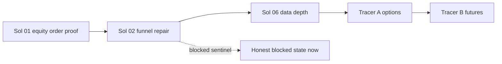

# Solution 10 - Options and Futures Class Enablement

> **Outcome:** A written, sequenced path to make options and futures actually tradeable — and, until
> that path is walked, an honest blocked state instead of sessions that appear configured and can never
> emit.
> **Status:** This is the deferred work. Solution 02 Workstream 4 chooses "mark it blocked" as the
> immediate action; Non-Goals N3 and N4 in the master plan defer the build. This document is the plan
> those deferrals point at, so the deferral is a decision rather than a gap.

Implements: docs/engineering/CODING_GUIDELINES.md

## Why Neither Class Is an Account Problem

Kenneth's stated belief was that options and futures do not trade because accounts were never created.
Verification says otherwise for both.

**Options.** `electron/main/services/strategies/definitions/options-flow.ts`:

```ts
evaluate(_bars: OhlcvBar[], ctx) {
  void parameters;
  void ctx;
  // Bar-only path cannot see option chains — skip.
  return null;
}
```

The registered scheduled evaluator returns `null` unconditionally, while the default profile schedules
it against stock-class AAPL/NVDA. `computeOptionsFlowSignal` and an option-chain detector exist, but
nothing in production composes chain data into that function. Alpaca paper options require no separate
approval. Creating an account changes nothing.

**Futures.** `tradovate-adapter.ts` is 139 lines against 1,421 for Alpaca. It checks that credential
strings are non-empty, returns a hard-coded `$250,000` balance labeled "simulated connectivity",
fabricates order IDs and fills, returns `[]` for positions, implements no OHLCV fetch, and no-ops
close. It correctly declares `launchCapable = false`. Opening and funding a Tradovate account today
would change nothing, because there is no order path to reach it.

Both classes are code projects. Each is larger than the entire trading-funnel repair, which is why both
are sequenced after it.

## Immediate State (Do This Now)

| Path              | Immediate action                                                                  |
| ----------------- | --------------------------------------------------------------------------------- |
| `options-flow`    | Mark `blocked`; remove from runnable scheduled experiences; sentinel session only |
| Futures/Tradovate | Keep `launchCapable = false`; assign Mock paper broker to the sentinel only       |

Both sentinels display their exact blocker text, per Solution 05:

```text
BLOCKED: OPTIONS_PRODUCER_UNREACHABLE
Scheduled options evaluator returns null; no option chain reaches the pipeline.

BLOCKED: FUTURES_ADAPTER_SIMULATED
Tradovate adapter reports a fabricated balance and cannot place, fill, or close.
```

Neither counts toward working coverage. Neither is reported green.

## Tracer A: Options Vertical

Prerequisites: Solutions 01, 02, and 04 green. This tracer needs a proven order lifecycle before it
adds a harder instrument class to it.

### Sequence

1. **Chain access.** Expose Alpaca (or Tradier sandbox) option-chain retrieval through the adapter
   contract, preserved through `createInstrumentedBrokerAdapter()` — the wrapper currently drops
   option-chain access entirely (Solution 01 prerequisite).
2. **Chain snapshot as an input.** The scheduled options producer receives a point-in-time chain, not
   only bars. This is a new input kind, not a parameter on the bar path.
3. **Unusual-activity computation.** Feed the chain into the existing `computeOptionsFlowSignal` and
   emit a `DeterministicSignalFactV1` with `instrumentClass: "options"`.
4. **Contract selection.** Resolve an OCC symbol: expiry rule, delta or moneyness rule, minimum open
   interest, maximum spread. Selection is deterministic and recorded in the fact.
5. **Leg construction.** Vertical spread legs with a defined max debit; the risk is the debit, and
   sizing is in whole contracts — never fractional.
6. **Buying power and level checks.** Read `options_approved_level`, `options_trading_level`, and
   `options_buying_power`; verify the contract is active and tradable.
7. **Multi-leg placement.** Preview then place, through the same `OrderIntentService` and client-order-ID
   discipline as every other order.
8. **Fill and position reconciliation.** Per-leg fills, net position, and a proven **close** — a
   canceled order is not a flattened position.

### Gate

The options lane may not be labeled `available` until a paper multi-leg round trip opens and closes with
correlated IDs, exactly as Solution 01 requires for equities. Backtesting options stays out of scope
until point-in-time chain snapshots exist (master plan N6); the lane is `forward_paper_only` in the
interim.

### User action

None yet. Do not create Tradier sandbox credentials until step 1 is implemented and needs a second
provider — Solution 04 already says this, and it remains true.

## Tracer B: Futures

Prerequisites: Tracer A complete, or an explicit decision to prioritize futures over options.

### Sequence

1. **Decision first.** Real Tradovate integration requires partner API access with organization
   credentials, CID, token renewal, market-data WebSockets, contract lookup, order/fill sync, positions,
   liquidation, reconnection, and conformance work. Confirm the strategy actually needs futures before
   committing to that.
2. **Delete or quarantine the simulator.** The current adapter's fabricated balance and fake fills are
   an active hazard: they can make a lane look healthy. Either replace it or make every method throw
   `UNSUPPORTED` behind the sentinel.
3. **Authentication and environments.** Demo, live, and market-data environments with token renewal.
4. **Market data.** Contract lookup and OHLCV/quote retrieval, including the front-month roll rule —
   `GC` and `CL` are continuous concepts, not fixed symbols, and the roll must be explicit in both live
   and backtest paths.
5. **Order lifecycle.** Place, partial fill, fill, cancel, positions, and a proven flatten.
6. **Reconnection and restart.** An open futures position must survive a process restart with correct
   reconciliation.

### Gate

`launchCapable` stays `false` until the capability certification table in Solution 04 passes every row
for the futures class, including Close and Restart.

### User action

Do not open or fund a Tradovate account for Exva. Add a Mock paper broker in Settings for the local
lifecycle sentinel only, and read its results as local simulation, never as Tradovate proof.

## Sequencing Rationale



Adding an instrument class before the equity order path is proven repeats the exact mistake this
program exists to correct: building breadth on an unverified foundation, then debugging the
combination. The blocked sentinels cost nothing and tell the truth in the meantime.

## Acceptance Criteria

### Now

- [ ] `options-flow` is `blocked` and unassignable to non-sentinel sessions.
- [ ] The Tradovate adapter cannot report a fabricated balance as a healthy connection.
- [ ] Both sentinels display exact blocker text and are excluded from working coverage.

### Tracer A

- [ ] Option-chain access survives adapter instrumentation.
- [ ] A chain snapshot reaches the producer as a first-class input.
- [ ] Contract selection is deterministic and recorded in the signal fact.
- [ ] Sizing is whole contracts with a bounded max debit.
- [ ] A paper multi-leg round trip opens and closes with correlated IDs.
- [ ] The lane is `forward_paper_only` until point-in-time chains exist.

### Tracer B

- [ ] The simulated adapter is replaced or throws behind the sentinel.
- [ ] Front-month roll is explicit in live and backtest paths.
- [ ] Every capability-certification row passes, including Close and Restart.
- [ ] No live futures route is enabled by this program.
