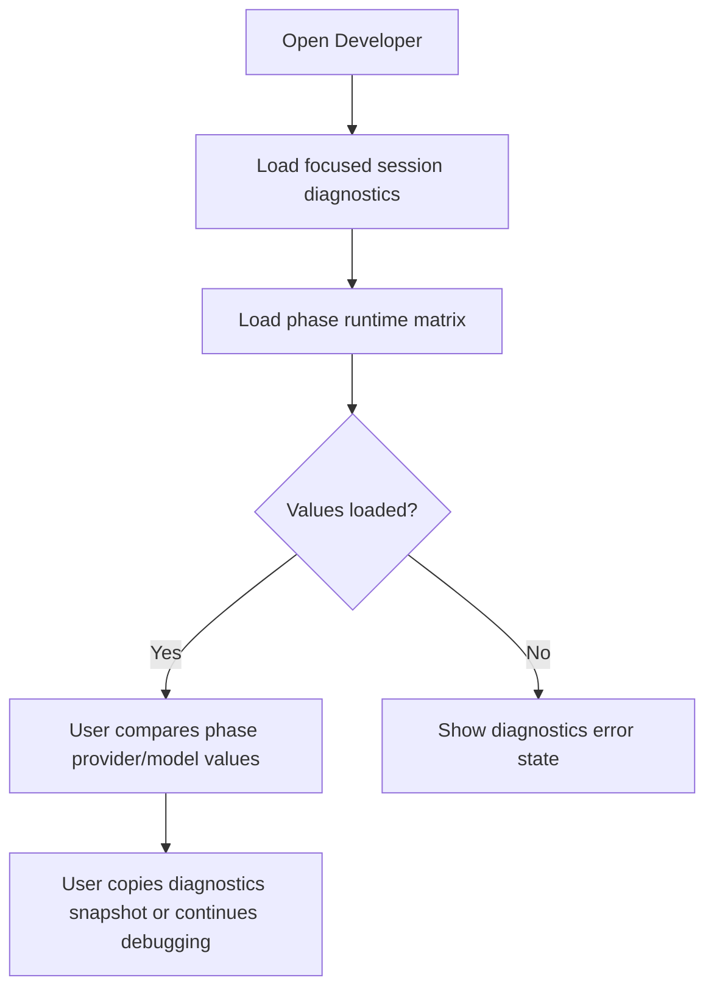
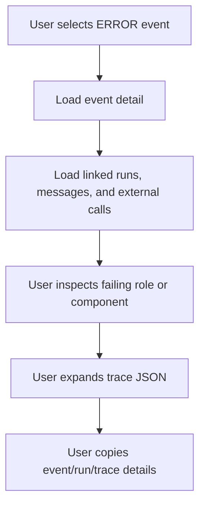
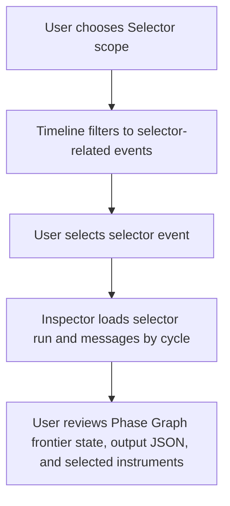

# Developer Menu Debug Observability — Feature Specification

> **Date:** 2026-05-08
> **Status:** Draft
> **Feature area:** Developer menu, runtime observability, AI trace inspection
> **Depends on:** `src/pages/DevPanel.tsx`, session focus state, strategy context service, events IPC, agent trace persistence, API call log persistence

## 1. Summary

The current `Developer` page is a useful shell, but it is not trustworthy enough for real debugging. It hardcodes values that should be live, such as the top-level model and session ID, only shows per-agent model information after a trade-linked event is clicked, and does not explain the actual action sequence that the runtime is taking. This feature turns the developer menu into a first-class observability console for the focused session, with live runtime identity, per-phase and per-worker model/provider resolution, richer event/action detail, copyable traces, API/search call visibility, explicit correlations between session, cycle, trade, event, run, and message records, and direct inspection of worker-level pipeline execution.

The goal is that when a trade cycle fails, stalls, or behaves unexpectedly, the user can answer four questions from one screen without opening SQLite manually: what session is running, what the runtime is doing now, which agent/model/provider combination was used, and what exact inputs/outputs/errors occurred at each step.

## 2. User Story

> **As a** user debugging Exva runtime behavior,
> **I want to** inspect live session diagnostics, action timelines, per-agent model/provider usage, and full trace payloads from the Developer menu,
> **So that** I can understand failures and unexpected behavior without guessing or reading raw database tables.

Secondary user stories:

> **As a** user,
> **I want to** see the exact model and provider assigned to each AI role for the focused session,
> **So that** I can verify the runtime is using the configuration I saved in Strategy.

> **As a** user,
> **I want to** copy structured trace data and event detail,
> **So that** I can paste reliable debugging evidence into issues, docs, or chat.

> **As a** user,
> **I want to** see cycle-level and trade-level action progress,
> **So that** I can distinguish normal waiting, in-flight work, and true failure states.

## 3. Scope

**In scope:**

- Replace hardcoded system diagnostics in `DevPanel` with live focused-session diagnostics.
- Show the focused session identity, status, uptime, execution mode, broker routing summary, and runtime health.
- Show the configured provider and model for every phase in the focused session, plus any worker-level overrides in that phase.
- Show the actual provider/model recorded on every agent run and message trace.
- Add an action-oriented event detail view that explains what the runtime was doing, not only the raw event message string.
- Add cycle correlation so events, agent runs, agent messages, selector output, and API/search calls can be grouped into one execution chain.
- Show worker-level execution inside a phase: worker IDs, dependency edges, frontier order, blocked/skipped states, and per-worker outcomes.
- Add copy actions for event detail, run summary, message trace JSON, tool calls JSON, output JSON, and API call rows.
- Add visibility into external call activity from `api_call_log`, including provider, endpoint, latency, cost, cache hit, and status.
- Add dedicated empty, loading, and error states for every developer panel subsection.
- Preserve local-only behavior; all observability data remains in SQLite/Electron.
- Support debugging both trade-linked runs and session-level runs that are not tied to a trade, especially the selector phase.

**Out of scope:**

- Remote log shipping, cloud tracing, or multi-user debug sharing.
- Full-text search across historical log files outside SQLite-backed observability records.
- Editing session strategy or AI role configuration from the Developer page.
- Automatic bug diagnosis or AI-generated root-cause conclusions.
- Persistent saved debug views, bookmarks, or custom dashboards.

## 4. Screens & Layout

### 4.1 Developer Page

**Route / location:** Top navigation item `Developer`, rendered by `src/pages/DevPanel.tsx`.

**When it appears:** User clicks `Developer` in `TopNav`.

**Layout:**

```text
Developer Page
├── Header
│   ├── Title: "Developer"
│   ├── Subtitle: "Focused session observability, traces, and diagnostics"
│   ├── Session chip: focused session name or "No session focused"
│   ├── Runtime status chip: idle | active | paused | stopping | error
│   └── Auto-refresh indicator / event stream health chip
├── Top Diagnostics Grid
│   ├── Runtime Identity Card
│   │   ├── Runtime: "Electron / TypeScript"
│   │   ├── Session ID
│   │   ├── Session name
│   │   ├── Session status
│   │   ├── Workspace mode
│   │   ├── Uptime
│   │   └── Current cycle state
│   ├── Phase Runtime Matrix Card
│   │   ├── selector -> provider + model + prompt source + worker count
│   │   ├── technical -> provider + model + prompt source + worker count
│   │   ├── fundamental -> provider + model + prompt source + worker count
│   │   ├── review -> provider + model + prompt source + worker count
│   │   └── decision -> provider + model + prompt source + worker count
│   ├── Execution Card
│   │   ├── Execution mode
│   │   ├── Default broker routing
│   │   ├── Search provider
│   │   ├── Open trades
│   │   └── Daily AI/data spend
│   └── Logging & Stream Card
│       ├── Event subscription status
│       ├── Last event received at
│       ├── Event count shown / total fetched
│       ├── Log file path
│       └── Copy diagnostics snapshot button
├── Main Split View
│   ├── Left: Event Timeline Panel
│   │   ├── Search input
│   │   ├── Level filter
│   │   ├── Role filter
│   │   ├── Scope filter: All | Session | Cycle | Trade | Selector
│   │   ├── Correlation filter chips: sessionId / cycleId / tradeId
│   │   └── Event rows with richer columns
│   └── Right: Inspector Panel
│       ├── Event Detail tab
│       ├── Agent Runs tab
│       ├── Phase Graph tab
│       ├── Message Trace tab
│       ├── External Calls tab
│       └── Raw JSON tab
└── Footer Hint
    └── "Select an event, cycle, trade, or run to inspect full trace data"
```

Layout rules:

- Desktop: top diagnostics renders as a 2x2 card grid above a two-column split view. Timeline column takes 60% width; inspector takes 40% width.
- Tablet and below: diagnostics cards stack vertically; timeline remains above inspector; inspector tabs become full-width accordion sections.
- The page defaults to the focused session. If no session is focused, diagnostics cards render an empty-state explanation and event querying falls back to global workspace view.
- The page must never display hardcoded values for `Model`, `Session ID`, broker label, or runtime cycle state.
- Event rows must stay scroll-performant at 500 rows loaded and must not fetch all detail payloads until selected.
- When the selected event changes, inspector tabs refetch only the detail linked to that event's correlation keys.

**Element inventory:**

| Element | Type | Label / Content | State | Action on Interact |
|---------|------|-----------------|-------|-------------------|
| Search input | Text input | Placeholder: "Search events, errors, trade IDs, cycle IDs…" | Empty by default | Filters event timeline client-side after current dataset load |
| Level filter | Segmented control | `DEBUG`, `INFO`, `WARN`, `ERROR` | `DEBUG` default | Filters event timeline |
| Role filter | Chip group | `all`, `selector`, `technical`, `fundamental`, `review`, `decision`, `system`, `orchestrator` | `all` default | Filters event timeline |
| Scope filter | Dropdown | `All activity`, `Focused session`, `Current cycle`, `Selected trade`, `Selector only` | `Focused session` default when a session is focused | Changes query scope |
| Event row | Selectable row | Time, level, role, action label, trade/cycle badges, message preview | Highlighted when selected | Opens inspector for that row |
| Copy snapshot | Button | "Copy diagnostics snapshot" | Enabled when diagnostics loaded | Copies top-card summary as JSON + readable text |
| Copy event | Button | "Copy event" | Enabled when an event is selected | Copies full event detail JSON |
| Copy run | Button | "Copy run" | Enabled when an agent run is selected | Copies selected run summary + raw payload |
| Copy trace | Button | "Copy trace" | Enabled when a message trace is selected | Copies full message/tool/output JSON |
| Copy external calls | Button | "Copy calls" | Enabled when external calls tab has rows | Copies current external call table as JSON |
| Open linked trade | Button | "Open trade" | Visible when selected detail has `tradeId` | Opens existing trade detail view |
| Retry detail load | Button | "Retry" | Visible on inspector load failure | Refetches selected subsection |

**States this screen can be in:**

| State | Condition | What the User Sees |
|-------|-----------|-------------------|
| Loading | Initial diagnostics and event query in progress | Skeleton cards, disabled filters, timeline skeleton rows |
| Default | Focused session exists and data loaded | Live diagnostics cards, timeline, inspector |
| No focused session | Workspace mode is global and no session is focused | Cards say "No session focused", timeline scope defaults to global events |
| Empty timeline | Query returns zero rows | Timeline empty state: "No developer events yet" |
| Filtered empty | Filters remove all rows | Timeline empty state: "No events match these filters" |
| Inspector idle | No event selected | Right panel shows overview cards and instruction text |
| Inspector loading | Event selected and detail fetch in progress | Tab skeletons/spinners |
| Error | Any section fetch fails | Inline error banner with failing section name and retry action |
| Stream degraded | Event subscription silent for more than 15 seconds while session is `active` | Stream chip turns amber and shows "Live stream delayed; polling fallback active" |

### 4.2 Event Detail Tab

**Route / location:** Inspector tab inside `Developer`.

**When it appears:** An event row is selected; `Event Detail` is the default tab.

**Layout:**

```text
Event Detail
├── Header
│   ├── Event level badge
│   ├── Source badge
│   ├── Action badge
│   ├── Copy event button
│   └── Timestamp
├── Identity block
│   ├── Session ID / name
│   ├── Trade ID
│   ├── Cycle ID
│   ├── Related run ID
│   └── Instrument symbol / class
├── Human-readable summary
│   ├── Primary message
│   └── "What happened" explanation
├── Action detail block
│   ├── Current step
│   ├── Previous step
│   ├── Next expected step
│   ├── Outcome
│   └── Error cause / validation summary if present
└── Linked records
    ├── Agent runs count
    ├── Message traces count
    ├── External calls count
    └── Open linked records buttons
```

Layout rules:

- If the selected cycle has linked `PhaseTraceV1` payloads, surface formatted key/value rows from the linked phase trace before raw JSON.
- If there is no structured phase trace for the selected event, the `What happened` text is derived from `events.message`, linked runs, and linked messages.
- Error events always surface the error category, failing phase or component, and fallback/retry outcome if known.

### 4.3 Agent Runs Tab

**When it appears:** A selected event has linked run data, or the selection is tied to a `tradeId`, `cycleId`, or selector run.

**Layout:**

```text
Agent Runs
├── Summary bar
│   ├── Total runs
│   ├── Total tokens
│   ├── Total cost
│   └── Total duration
└── Run cards
    ├── Role
    ├── Provider key
    ├── Model
    ├── Finish reason
    ├── Input / output tokens
    ├── Cost / duration
    ├── Parse fallback badge if applicable
    ├── Copy run button
    └── Expand for output text + linked message trace
```

Layout rules:

- Runs are ordered by `created_at` ascending.
- Session-level selector runs with `trade_id = null` must still appear when correlated by `cycle_id`.
- The model shown on each card comes from `agent_runs.model`; it must not be inferred from top-card role config.

### 4.3B Phase Graph Tab

**When it appears:** A selected event, cycle, or run has structured phase trace data.

**Layout:**

```text
Phase Graph
├── Summary bar
│   ├── Phase name
│   ├── Scheduling mode
│   ├── Frontier count
│   ├── Worker count
│   └── Aggregate status
├── Frontier list
│   ├── Frontier 0 -> worker chips
│   ├── Frontier 1 -> worker chips
│   └── Frontier N -> worker chips
└── Worker cards
    ├── Worker ID
    ├── Depends on
    ├── Outcome: succeeded | failed | skipped | blocked | degraded
    ├── Provider/model if overridden
    ├── Tool count / external call count
    ├── Duration / cost
    └── Copy worker trace button
```

Layout rules:

- The tab reads from structured phase trace payloads persisted by the pipeline runtime; it does not reconstruct the graph heuristically from free text.
- Workers that were blocked on dependencies must show the dependency IDs and the reason they did not run yet or were skipped.
- If the phase used flat scheduling, the tab still renders one frontier with all workers.
- The tab must degrade gracefully when older traces lack graph metadata; show an explicit "graph metadata unavailable" state instead of guessing.

### 4.4 Message Trace Tab

**When it appears:** A selected event or run has linked `agent_messages` rows.

**Layout:**

```text
Message Trace
├── Trace cards per message
│   ├── Role / provider / model / cycle
│   ├── Output schema name
│   ├── Parse fallback badge
│   ├── Copy trace button
│   ├── Prompt messages JSON
│   ├── Tool calls JSON
│   ├── Output JSON
│   ├── Thinking JSON (if present)
│   └── Market / strategy snapshot blocks
```

Layout rules:

- All JSON blocks are collapsible and syntax formatted.
- Long payloads show first 2,000 visible characters with an explicit `Show full payload` expansion.
- `Copy trace` copies the full untruncated payload, not the visible preview.

### 4.5 External Calls Tab

**When it appears:** A selected event, trade, run, or cycle has linked `api_call_log` rows.

**Layout:**

```text
External Calls
├── Summary bar
│   ├── Total calls
│   ├── Total cost
│   ├── Avg latency
│   └── Cache-hit count
└── Call rows
    ├── Time
    ├── Provider
    ├── Endpoint
    ├── Call type
    ├── Status
    ├── Latency
    ├── Cost
    ├── Cache badge
    └── Copy row button
```

Layout rules:

- Rows are ordered by `created_at` ascending.
- The tab must include search-provider calls as well as AI-provider calls where available.
- If no rows exist, show `No external calls recorded for this selection.` rather than hiding the tab.

## 5. User Flows

### 5.1 Verify Runtime Configuration

**Entry point:** User opens `Developer` while a session is focused.

**Exit point:** User confirms the session, providers, and models match Strategy config.



Happy path:

1. User opens `Developer`.
2. The page resolves the focused session and loads live diagnostics.
3. The Phase Runtime Matrix lists each phase with provider, model, prompt source, and worker count.
4. The user verifies the runtime configuration before inspecting a failure.

If no focused session: show `No session focused. Developer view is showing global activity only.`

### 5.2 Investigate Failed Trade Cycle

**Entry point:** User sees an `ERROR` row in the event timeline.

**Exit point:** User identifies the failing step and copies evidence.



Happy path:

1. User filters to `ERROR`.
2. User selects an error row such as `Trade cycle failed`.
3. Inspector shows the failing action, session, cycle, trade, and related runs.
4. User opens the relevant agent run and message trace.
5. User copies the trace payload and external call rows for reporting.

If the event has no linked run: inspector says `No agent run was recorded for this failure. This error occurred before AI execution.`

### 5.3 Inspect Selector Activity

**Entry point:** User wants to debug selector-phase behavior.

**Exit point:** User sees selector inputs, selected instruments, and any failure reason.



## 6. Data & Field Mapping

### 6.1 Top Diagnostics Card Mapping

| UI Label / Element | Field Name in DB/API | Type | Required | Validation Rules | Notes |
|-------------------|---------------------|------|----------|-----------------|-------|
| Session ID | `sessions.id` | `string` | Yes when focused session exists | Non-empty | Replaces current hardcoded value |
| Session name | `sessions.name` | `string` | Yes when focused session exists | Non-empty | New on Developer page |
| Session status | `dashboardStats.session_status` or `sessions.status` | `enum` | Yes | Must match runtime state | Live value only |
| Workspace mode | `workspaceViewMode` | `enum: session|global` | Yes | Must be valid enum | New on Developer page |
| Uptime | `dashboardStats.session_uptime_min` | `number` | Yes when stats loaded | `>= 0` | Existing source |
| Open trades | `dashboardStats.open_trades` | `number` | Yes | `>= 0` | Existing source |
| Daily AI/data spend | `dashboardStats.daily_api_spend` | `number` | Yes | `>= 0` | Existing source |
| Search provider | `defaultSearchProviderId` or `workspaceDefaultSearchProviderId` from `strategy.get` | `string | null` | No | — | Show `Workspace default` when inherited |
| Phase provider | `strategy.get.aiPhases[].providerKey` | `string` | Yes per phase | Non-empty when configured | Phase-runtime matrix source |
| Phase model | `strategy.get.aiPhases[].modelId` | `string` | Yes per phase | Non-empty when configured | Phase-runtime matrix source |
| Prompt source | `strategy.get.aiPhases[].promptSource` | `enum` | Yes per phase | `default|session_override` | Phase-runtime matrix source |
| Worker overrides | `strategy.get.aiPhases[].workerOverrides[]` | `array` | No | Worker IDs unique per phase | Used for worker detail |

### 6.2 Event Timeline Row Mapping

| UI Label / Element | Field Name in DB/API | Type | Required | Validation Rules | Notes |
|-------------------|---------------------|------|----------|-----------------|-------|
| Time | `events.created_at` | `timestamp` | Yes | ISO timestamp | Existing |
| Level | `events.level` | `enum` | Yes | `DEBUG|INFO|WARN|ERROR` | Existing |
| Source | `events.agent_type` | `string` | No | — | Existing field |
| Action | derived from `events.message` prefix and current stage context | `string` | Yes | Non-empty display label | No new DB column required in v1 |
| Session badge | `events.session_id` | `string | null` | No | — | Existing |
| Trade badge | `events.trade_id` | `string | null` | No | — | Existing |
| Cycle badge | `events.cycle_id` | `string | null` | No | — | New |
| Instrument badge | derived from selected trace or event message when available | `string | null` | No | — | Optional in v1 |
| Message preview | `events.message` | `string` | Yes | Non-empty | Existing |

### 6.3 Agent Run Card Mapping

| UI Label / Element | Field Name in DB/API | Type | Required | Validation Rules | Notes |
|-------------------|---------------------|------|----------|-----------------|-------|
| Role | `agent_runs.agent_type` | `enum` | Yes | Valid role | Existing |
| Provider | `agent_runs.provider_key` | `string` | Yes | Non-empty | Existing |
| Model | `agent_runs.model` | `string` | Yes | Non-empty | Existing |
| Finish reason | `agent_runs.finish_reason` | `enum` | Yes | Valid finish reason | Existing |
| Input tokens | `agent_runs.input_tokens` | `number` | Yes | `>= 0` | Existing |
| Output tokens | `agent_runs.output_tokens` | `number` | Yes | `>= 0` | Existing |
| Cost | `agent_runs.cost_usd` | `number` | Yes | `>= 0` | Existing |
| Duration | `agent_runs.duration_ms` | `number` | Yes | `>= 0` | Existing |
| Cycle ID | joined from `agent_messages.cycle_id` via `AgentRunsRepo.listByCycle()` | `string | null` | No | — | Existing cycle-based load path |
| Parse fallback | derived from linked `agent_messages.parse_fallback` | `boolean` | No | — | Display-level derived field |

### 6.4 Phase Graph Mapping

| UI Label / Element | Field Name in DB/API | Type | Required | Validation Rules | Notes |
|-------------------|---------------------|------|----------|-----------------|-------|
| Phase name | `PhaseTraceV1.phase` | `enum` | Yes | Valid `PipelinePhase` | Parsed from `agent_messages.tool_calls_json` |
| Scheduling mode | `PhaseTraceV1.schedulingMode` | `enum` | Yes | `flat_parallel|dependency_graph` | Parsed from trace |
| Frontier count | `PhaseTraceV1.frontiers.length` | `number` | Yes | `>= 1` | Parsed from trace |
| Worker count | `PhaseTraceV1.workers.length` | `number` | Yes | `>= 1` | Parsed from trace |
| Worker depends on | `PhaseTraceV1.workers[].dependsOn` | `string[]` | Yes | Worker IDs must exist in same trace | Parsed from trace |
| Worker outcome | `PhaseTraceV1.workers[].status` | `enum` | Yes | Allowed lifecycle states only | Parsed from trace |
| Worker cost/duration | `PhaseTraceV1.workers[].costUsd`, `durationMs` | `number | null` | No | `>= 0` when present | Parsed from trace |
| Frontier worker chips | `PhaseTraceV1.frontiers[].workerIds` | `string[]` | Yes | Worker IDs must exist in same trace | Parsed from trace |

**Schema changes required:**

| Table | Change | Column Name | Type | Default | Nullable |
|-------|--------|------------|------|---------|----------|
| `agent_messages` | Reuse existing column with new contract | `tool_calls_json` | `text` | existing | Yes |
| `agent_messages` | Reuse existing column with canonical phase output | `output_json` | `text` | existing | Yes |
| `agent_messages` | Reuse existing column with phase output schema name | `output_schema_name` | `text` | existing | Yes |
| `session_ai_phases` | Existing table becomes DevPanel-visible through `strategy.get` | n/a | n/a | n/a | n/a |
| `session_ai_phase_workers` | Existing table becomes DevPanel-visible through `strategy.get` | n/a | n/a | n/a | n/a |

## 7. API Contract

### IPC / bridge contract

The minimal implementation should extend existing IPC surfaces instead of creating a parallel `developer:*` namespace.

Required calls:

| Existing / Extended API | Purpose | Notes |
|---|---|---|
| `session.list()` | Resolve focused session + workspace view mode | Already used by `DevPanel` |
| `strategy.get(sessionId)` | Top diagnostics + phase runtime matrix | Extend response to include `aiPhases` with grouped worker overrides |
| `events.list({ sessionId, minLevel, agentType, search, limit })` | Event timeline | Existing |
| `events.getAgentTracesByCycle(cycleId)` | Aggregate phase runs for selected cycle | Existing |
| `events.getMessagesByCycle(cycleId)` | Aggregate phase messages and `PhaseTraceV1` payloads | Existing |
| `events.getApiCallLog({ sessionId, cycleId, tradeId })` | External Calls tab | Existing |

### `strategy.get(sessionId)` extension

`StrategyGetResponse` should be extended with phase runtime configuration so DevPanel can render the phase matrix without a new endpoint:

```ts
interface StrategyGetResponse {
  researchPosture: SessionResearchPosture;
  rules: SessionTradeRules;
  riskConfig: SessionRiskConfig;
  timeframe: SessionTimeframeConfig;
  selectorSettings: SessionSelectorSettings;
  providers: ProviderAccount[];
  sessionStatus: SessionStatus;
  selectionMode: SelectionMode;
  defaultSearchProviderId: string | null;
  workspaceDefaultSearchProviderId: string | null;
  workspaceDefaultModelProviderKey: string;
  workspaceDefaultModelModelId: string;
  aiPhases: PhaseRuntimeSummary[];
}

interface PhaseRuntimeSummary {
  phase: "selector" | "technical" | "fundamental" | "review" | "decision";
  providerKey: string;
  modelId: string;
  temperature: number;
  maxTokens: number;
  promptSource: "default" | "session_override";
  workerOverrides: Array<{
    workerId: string;
    providerKey: string | null;
    modelId: string | null;
    maxSteps: number | null;
    spendLimitUsd: number | null;
    promptMarkdown: string | null;
  }>;
}
```

### `events.getMessagesByCycle(cycleId)` contract

`AgentMessage` stays structurally the same, but for pipeline phases the payload contract becomes:

```ts
interface AgentMessage {
  output_json: string | null;        // canonical phase output payload
  output_schema_name: string | null; // e.g. technicalSignal, reviewSignal
  tool_calls_json: string | null;    // PhaseTraceV1 JSON when produced by pipeline runtime
}
```

The DevPanel Phase Graph tab should parse `tool_calls_json` as `PhaseTraceV1` when available.

**Side effects:** None. All developer-facing endpoints remain read-only.

## 8. Permissions & Access Control

| User Type / Role | Can View | Can Create | Can Edit | Can Delete | Notes |
|-----------------|----------|-----------|---------|-----------|-------|
| Local desktop user | Yes | No | No | No | Current Exva permission model is single local user |

If a linked record no longer exists, show the data section with an inline message: `Record not found. It may have been deleted or filtered out.`

## 9. Error States & Edge Cases

| Scenario | Trigger | What the User Sees | What the System Does |
|----------|---------|-------------------|---------------------|
| Hardcoded model mismatch eliminated | Developer page opens | Top cards show live phase matrix, not a single hardcoded model string | Fetches strategy context instead of static strings |
| Selected event has no trade | `trade_id = null` | Inspector still shows session/cycle detail | Uses `cycle_id` correlation paths |
| Selector-phase run exists with no trade | Selector phase run saved with `trade_id = null` | Selector runs appear in `Agent Runs` and `Phase Graph` tabs | Queries by `cycle_id` and linked `agent_messages` |
| Event detail fetch fails | IPC error | Error banner: `Failed to load event detail.` | Keeps selected row and offers retry |
| Stream subscription stalls | No event seen for 15s while active session is running | Amber stream chip and note about polling fallback | Keeps polling-based data refresh active |
| External call rows missing | No `api_call_log` rows for selection | `No external calls recorded for this selection.` | No error state |
| Old rows missing new trace/config payloads | Pre-migration records | Missing badges render as `—` and structured detail blocks are hidden | Backfill optional; UI must be null-safe |
| Trace payload is very large | JSON field > 2,000 visible chars | Preview with `Show full payload` control | Copy action still uses full raw payload |
| Focused session changes while Developer page open | User focuses another session elsewhere | Cards and timeline refresh and selection clears | Prevents stale cross-session inspector data |

## 10. Copy & Labels

| Location | String | Notes |
|----------|--------|-------|
| Page subtitle | "Focused session observability, traces, and diagnostics" | Replaces current generic subtitle |
| Search placeholder | "Search events, errors, trade IDs, cycle IDs…" | Final copy |
| Empty timeline | "No developer events yet" | When unfiltered query is empty |
| Filtered empty | "No events match these filters" | Existing concept, final string |
| No focused session headline | "No session focused" | Shown in diagnostics cards |
| No focused session body | "Developer view is showing global activity only. Focus a session to inspect live runtime configuration." | Final copy |
| Stream degraded chip | "Live stream delayed" | Amber state |
| Stream degraded hint | "Live stream delayed; polling fallback active" | Final copy |
| Copy diagnostics button | "Copy diagnostics snapshot" | Final copy |
| Copy event button | "Copy event" | Final copy |
| Copy run button | "Copy run" | Final copy |
| Copy trace button | "Copy trace" | Final copy |
| Copy calls button | "Copy calls" | Final copy |
| External calls empty | "No external calls recorded for this selection." | Final copy |
| Missing linked run | "No agent run was recorded for this failure. This error occurred before AI execution." | Final copy |

## 11. Open Questions

| # | Question | Impact if Unresolved | Owner |
|---|----------|---------------------|-------|
| 1 | Should `PhaseTraceV1.toolTrace.summary` include short prompt/input summaries for each worker, or should it stay tool/output-only in v1? | Affects trace size and DevPanel usefulness | Ken |
| 2 | Should external call visibility include only `api_call_log`, or should we also surface local log-file excerpts for the same correlation keys? | Changes UI complexity for the `External Calls` tab | Ken |
| 3 | Do we need a dedicated `events.getPhaseTraceByCycle(cycleId)` convenience endpoint later, or is parsing `agent_messages.tool_calls_json` in the renderer sufficient for v1? | Affects where parsing lives and how much main-process aggregation we add | Ken |
| 4 | Should copy actions place human-readable text, raw JSON, or both on the clipboard by default? | Affects UX and issue-reporting workflow | Ken |
