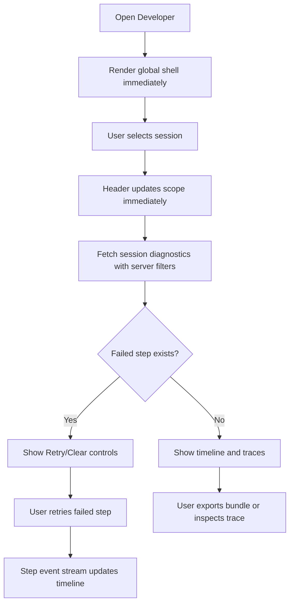
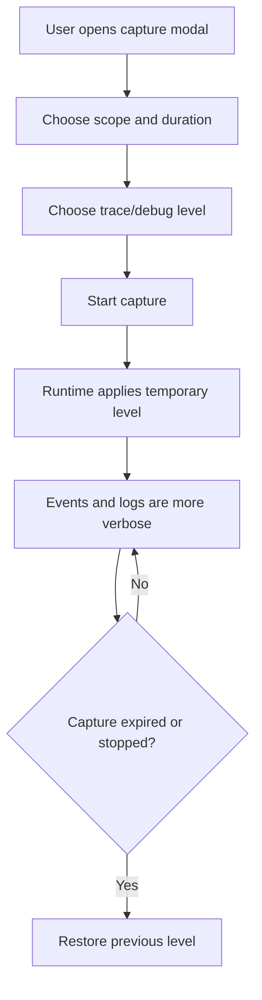
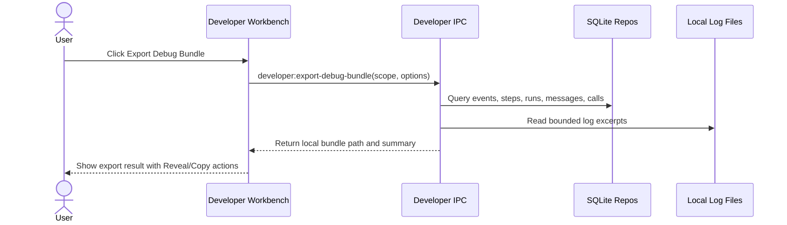

# Developer Workbench Redesign - Feature Specification

> **Date:** 2026-05-19
> **Status:** Draft
> **Feature area:** Developer Menu, Observability, Session Runtime, Logging
> **Depends on:** Existing `DevPanel`, session runtime controls, events IPC, agent run/message trace storage, API call log storage, Pino main-process logger

---

## 1. Summary

The current Developer page is primarily a passive observability panel. It shows focused-session runtime facts, recent events, traces, and raw payloads, but it does not let the user change diagnostic behavior, control a broken runtime step, or capture a useful debug bundle from the screen where the problem is visible.

This feature redesigns Developer into a **Developer Workbench**: a fast, scope-aware control center for debugging sessions, runtime steps, logs, external calls, AI traces, and local app health. The user can switch between global and session scopes without losing context, change log verbosity at runtime, run targeted diagnostics, retry or clear failed execution steps, and export a complete debug packet for the selected scope.

---

## 2. User Story

> **As a** developer/operator running Exva locally,  
> **I want to** inspect and control runtime diagnostics from one Developer page,  
> **So that** I can debug a failing or slow session without leaving the app, restarting Electron, or manually digging through SQLite and log files.

Secondary user stories:

> **As a** developer investigating a focused session,  
> **I want to** see the current cycle, failed step, retry state, relevant logs, AI calls, and external calls in one screen,  
> **So that** I can understand what is broken and take the next debugging action immediately.

> **As a** developer debugging noisy or missing logs,  
> **I want to** temporarily change log levels by scope, category, and session,  
> **So that** I can capture detail for one failing path without flooding the whole app.

> **As a** developer comparing active sessions,  
> **I want to** keep a global workspace view even when a session is focused,  
> **So that** I can detect whether a problem is isolated to one session or shared across runtime, provider, broker, or search systems.

---

## 3. Scope

### In Scope

- Replace the current Developer page layout with a Developer Workbench made of a scope rail, action header, timeline, inspector, and diagnostics drawers.
- Add explicit scope modes: `Global`, `Focused Session`, `Session Picker`, `Cycle`, `Trade`, and `Provider/Broker`.
- Keep the current focused session as a default scope, but do not make Developer unusable when no session is focused.
- Make session switching fast by server-filtering events, paginating results, virtualizing the timeline, and cancelling stale focus requests.
- Add runtime log-level controls for global process logging and scoped event capture.
- Add fine-grained filters for event source, level, session, cycle, trade, provider, broker, and time window.
- Add actionable runtime controls for existing session execution operations: retry failed step, pause after current step, clear failed step, start, pause, resume, and stop.
- Add diagnostic actions: copy selected trace, copy cycle packet, export debug bundle, open log file location, test provider/search/broker connection where existing APIs are available.
- Add a structured debug capture mode that temporarily increases verbosity for selected scopes and then automatically expires.
- Add searchable trace views for agent runs, prompt messages, tool calls, external API calls, execution steps, and raw events.
- Add explicit empty, loading, stale, error, and no-session states.
- Add IPC/API contracts for developer settings, log-level changes, event pagination, and debug bundle export.

### Out of Scope

- Remote telemetry or cloud upload of debug data.
- Multi-user permission models. Exva is a local desktop app for one operator.
- Editing strategy prompts or session strategy configuration directly from Developer. Developer can deep-link to Strategy but does not duplicate Strategy forms.
- Full deterministic replay of AI/provider calls. Developer can inspect and export traces, but replay remains a separate feature.
- Secret display. API keys, broker secrets, and authorization headers remain redacted and never become visible in debug bundles.
- Changing live broker account credentials from Developer. Developer can test configured broker connections through existing safe APIs only.

---

## 4. Screens & Layout

### 4.1 Developer Workbench

**Route / location:** Main navigation item `Developer`, replacing the current `DevPanel` page.

**When it appears:** Always. It must render in global scope even when no session is focused.

**Layout:**

```text
Developer Workbench
+-- Header
|   +-- Title: "Developer Workbench"
|   +-- Scope summary: [Global | Session: name | Cycle: id | Trade: id]
|   +-- Stream health badge
|   +-- Button: "Capture Debug Window"
|   +-- Button: "Export Debug Bundle"
|   +-- Button: "Open Logs Folder"
+-- Scope Rail (left, sticky)
|   +-- Global workspace
|   +-- Focused session
|   +-- Active sessions list
|   +-- Recent failed cycles
|   +-- Providers
|   +-- Brokers
+-- Action Strip (top of main pane)
|   +-- Runtime status cards
|   +-- Log level control
|   +-- Time window selector
|   +-- Source filters
|   +-- Step controls for selected session/cycle
+-- Main Content
|   +-- Timeline Pane (left/main)
|   |   +-- Search input
|   |   +-- Filter chips
|   |   +-- Virtualized event list
|   |   +-- Pagination/load-more footer
|   +-- Inspector Pane (right)
|       +-- Overview tab
|       +-- Execution tab
|       +-- AI Trace tab
|       +-- Tool Calls tab
|       +-- External Calls tab
|       +-- Logs tab
|       +-- Raw tab
+-- Footer
    +-- Query timing
    +-- Result count
    +-- Last refresh timestamp
```

**Layout rules:**

- Desktop width `>= 1200px`: scope rail fixed left, timeline and inspector split 60/40.
- Medium width `900px-1199px`: scope rail collapses to a dropdown, inspector remains right pane.
- Small width `< 900px`: inspector opens as a full-screen drawer after selecting an event/cycle/run.
- Timeline rows must be virtualized once more than 200 rows are loaded.
- Scope changes must preserve the previous selection in history so the user can go back to the prior scope.
- Selecting a session must update visible controls immediately with a skeleton for async data; it must not freeze while events load.
- Header, action strip, and scope selector remain sticky while the timeline scrolls.

**Element inventory:**

| Element | Type | Label / Content | State | Action on Interact |
|---------|------|-----------------|-------|--------------------|
| Scope rail item | Button | `Global workspace` | Active when no specific session/cycle/trade scope is selected | Loads global events and workspace diagnostics |
| Scope rail item | Button | Focused session name | Disabled when no focused session exists | Loads focused-session diagnostics |
| Session picker | Search/select | `Jump to session...` | Enabled when sessions exist | Changes Developer scope without changing workspace focus unless user confirms |
| Stream health badge | Badge | `Live`, `Delayed`, `Disconnected` | Derived from event stream watchdog | No action |
| Capture button | Button | `Capture Debug Window` | Disabled while capture is active for selected scope | Opens debug capture modal |
| Export button | Button | `Export Debug Bundle` | Disabled until scope is loaded | Creates local redacted bundle and shows file path |
| Open logs button | Button | `Open Logs Folder` | Enabled if log directory exists | Opens `~/.exva/logs` or configured `EXVA_LOG_DIR` in Finder |
| Log level selector | Select | `Log level` | Shows effective current level | Calls developer log-level API |
| Time window selector | Select | `15m`, `1h`, `6h`, `24h`, `All` | Defaults to `1h` | Reloads timeline with server-side filter |
| Source filters | Multi-select chips | `Session`, `Selector`, `Technical`, `Fundamental`, `Review`, `Decision`, `Broker`, `Capital`, `Preflight`, `Orchestrator` | Multi-select | Reloads timeline with server-side filter |
| Search input | Text input | Placeholder `Search message, id, symbol, provider, error...` | Debounced 250ms | Reloads timeline with server-side search |
| Retry step button | Button | `Retry Failed Step` | Enabled only when selected session/cycle has retryable failed step | Calls existing retry-step API and refreshes execution state |
| Pause-after-step button | Button | `Pause After Current Step` | Enabled for active selected session | Calls existing pause-after-current-step API |
| Clear failed button | Button | `Clear Failed Step` | Enabled when selected step is failed | Calls existing clear-failed-step API |
| Session lifecycle button | Button group | `Start`, `Pause`, `Resume`, `Stop` | Based on selected session status | Calls existing session lifecycle APIs |
| Inspector tabs | Tabs | `Overview`, `Execution`, `AI Trace`, `Tool Calls`, `External`, `Logs`, `Raw` | Enabled based on selected entity | Changes inspector view without reloading timeline |

**States this screen can be in:**

| State | Condition | What the User Sees |
|-------|-----------|--------------------|
| Loading shell | Initial page load | Header and scope rail skeletons; timeline skeleton rows; inspector says `Select a scope to inspect` |
| Global empty | No events exist | Message: `No developer events have been recorded yet.` plus `Start a session or run a diagnostic to create events.` |
| No focused session | Workspace has no focused session | Global scope remains usable; focused-session item says `No focused session` |
| Scope loading | User selects session/cycle/trade/provider | Scope header updates immediately; timeline shows lightweight skeleton; previous data remains dimmed until new data arrives |
| Default | Data loaded | Timeline, action controls, and inspector are interactive |
| Stale stream | No event push for 15 seconds while app is expected to stream | Badge: `Live stream delayed - polling fallback active`; polling continues |
| Query error | Event or trace query fails | Inline error panel: `Developer data failed to load.` with `Retry` button |
| Action running | User runs a retry/test/export action | Relevant button shows spinner and controls that would conflict are disabled |
| Action failed | Runtime action returns error | Toast and inline card show exact safe error message; no local state is faked as successful |

---

### 4.2 Debug Capture Modal

**Route / location:** Modal launched from `Capture Debug Window`.

**When it appears:** User clicks `Capture Debug Window` from any Developer scope.

**Layout:**

```text
Debug Capture Modal
+-- Title: "Capture Debug Window"
+-- Scope summary
+-- Duration selector
|   +-- 5 minutes
|   +-- 15 minutes
|   +-- 30 minutes
|   +-- Until stopped
+-- Verbosity controls
|   +-- Main process log level
|   +-- Event capture min level
|   +-- Include prompt messages toggle
|   +-- Include tool payloads toggle
|   +-- Include external call payload metadata toggle
+-- Safety note
+-- Button: "Start Capture"
+-- Button: "Cancel"
```

**Element inventory:**

| Element | Type | Label / Content | State | Action on Interact |
|---------|------|-----------------|-------|--------------------|
| Duration selector | Radio group | `5 minutes`, `15 minutes`, `30 minutes`, `Until stopped` | Defaults to `15 minutes` | Sets capture expiry |
| Main log level | Select | `trace`, `debug`, `info`, `warn`, `error` | Defaults to current effective level | Sets temporary Pino level during capture |
| Event min level | Select | `DEBUG`, `INFO`, `WARN`, `ERROR` | Defaults to current timeline filter | Sets event capture/query visibility |
| Include prompts toggle | Switch | `Include prompt messages` | Off by default | Includes redacted `messages_json` in export bundle |
| Include tool payloads toggle | Switch | `Include tool payloads` | On by default | Includes redacted tool args/results |
| Start button | Button | `Start Capture` | Disabled while submit is pending | Calls capture API |
| Cancel button | Button | `Cancel` | Always enabled | Closes modal without changes |

**States:**

| State | Condition | What the user sees |
|-------|-----------|--------------------|
| Default | Modal opened | Current scope, controls, safety copy |
| Validation error | Duration or log level invalid | Inline field error; submit blocked |
| Starting | API call pending | `Start Capture` becomes `Starting...` |
| Active | Capture created | Modal closes; header shows `Capture active - ends in Xm` |
| Failure | API returns error | Error text: `Could not start capture. [safe error]` |

---

### 4.3 Export Debug Bundle Result

**Route / location:** Inline drawer or toast after `Export Debug Bundle` completes.

**When it appears:** User exports a bundle for the current scope.

**Layout:**

```text
Export Result
+-- Title: "Debug bundle exported"
+-- Path: [local file path]
+-- Included sections list
+-- Redaction summary
+-- Button: "Reveal in Finder"
+-- Button: "Copy Path"
```

**Element inventory:**

| Element | Type | Label / Content | State | Action on Interact |
|---------|------|-----------------|-------|--------------------|
| Reveal button | Button | `Reveal in Finder` | Enabled if file exists | Opens Finder at exported file |
| Copy path button | Button | `Copy Path` | Enabled | Copies path to clipboard |
| Included sections | List | `Events`, `Execution steps`, `Agent runs`, `Messages`, `External calls`, `Runtime settings`, `Log excerpts` | Read-only | No action |

---

## 5. User Flows

### 5.1 Fast Session Debugging

**Entry point:** User opens Developer, then selects a session from the scope rail or jumps from another page with a session/cycle focus.

**Exit point:** User either retries/clears a failed step, exports a debug bundle, or navigates away.



Happy path:

1. User opens Developer. The page renders global scope immediately.
2. User selects a session. The header changes to `Session: [name]` without waiting for the event query.
3. The timeline loads server-filtered session events for the selected time window.
4. The action strip shows status, active cycle, failed step, retry state, and lifecycle controls.
5. User clicks `Retry Failed Step` if a retryable step exists.
6. The timeline receives `step:retrying`, `step:started`, and final success/failure events in place.
7. User selects the relevant event and reviews trace, tool, external call, and raw tabs.

Deviations:

**If the user selects a different session before the previous query completes:** the previous request is cancelled or ignored; only the latest scope may update the UI.

**If the selected session has no events in the selected window:** show `No events found for this session and time window.` with actions `Expand to 24h` and `Clear Filters`.

**If the failed step is non-retryable:** show `This failed step is not retryable.` and disable `Retry Failed Step`; keep `Clear Failed Step` available only if clearing is safe for that stage.

---

### 5.2 Temporary Log-Level Increase

**Entry point:** User clicks `Capture Debug Window` or changes the log level selector in the action strip.

**Exit point:** Capture expires, user stops capture, or user restores default log level.



Happy path:

1. User opens the capture modal from session scope.
2. User selects `15 minutes`, main log level `debug`, and event min level `DEBUG`.
3. System stores the prior effective log level and applies the temporary override.
4. Header shows `Capture active - ends in 15m`.
5. When the timer expires, the system restores the previous level and writes an event `Debug capture ended.`

Deviations:

**If Electron restarts during capture:** temporary captures do not auto-resume. The next boot uses persisted default developer settings only.

**If the user selects `trace`:** show confirmation copy: `Trace logs can include large payload metadata and may slow the app.` User must confirm.

---

### 5.3 Export Debug Bundle

**Entry point:** User clicks `Export Debug Bundle`.

**Exit point:** Redacted bundle is written to disk and shown in Finder or copied path.



Happy path:

1. User exports a bundle from a session/cycle scope.
2. System gathers scoped events, execution steps, agent runs, messages, external calls, runtime settings, and bounded log excerpts.
3. System redacts secrets and writes a JSON or zipped JSON bundle under `~/.exva/debug-bundles/`.
4. UI shows `Debug bundle exported.` with path, included sections, and redaction summary.

Deviations:

**If log files are missing:** bundle still exports DB-backed sections and includes warning `Log file excerpt unavailable.`

**If bundle exceeds 25 MB:** UI asks whether to export without prompt messages or tool payloads.

---

## 6. Data & Field Mapping

### 6.1 Existing Data Used

| UI Label / Element | Field Name in DB/API | Type | Required | Validation Rules | Notes |
|--------------------|----------------------|------|----------|------------------|-------|
| Session name | `sessions.name` via `api.listSessions()` | string | Yes | Read-only in Developer | Used in scope rail/header |
| Session status | `sessions.status` | enum | Yes | Must match `SessionStatus` | Drives lifecycle buttons |
| Execution mode | `sessions.executionMode` | enum | Yes | `paper` / `live` as currently defined | Read-only |
| Event level | `events.level` | enum | Yes | `DEBUG`, `INFO`, `WARN`, `ERROR` | Server-filtered |
| Event source | `events.agent_type` | enum nullable | No | Existing `agentTypeSchema` | Filter chip source |
| Event message | `events.message` | string | Yes | Searchable text | Displayed in timeline |
| Event session | `events.session_id` | string nullable | No | Must match session ID when scoped | Scope filter |
| Event cycle | `events.cycle_id` | string nullable | No | Optional | Cycle scope and inspector |
| Agent run model | `agent_runs.model` | string | Yes | Read-only | AI trace tab |
| Agent run provider | `agent_runs.provider_key` | string | Yes | Read-only | AI trace tab |
| Agent run output | `agent_runs.output_text` | string nullable | No | Redacted only if future redaction rules require | Collapsible text |
| Agent message prompt | `agent_messages.messages_json` | string nullable | No | Redacted in bundles | Prompt trace |
| API call endpoint | `api_call_log.endpoint` | string | Yes | Redacted where needed | External tab |
| Execution step status | `session_execution_steps.status` via execution progress API | enum | Yes | Existing execution step status enum | Action strip |

### 6.2 New Data Entities

#### Developer Settings

| UI Label / Element | Field Name in DB/API | Type | Required | Validation Rules | Notes |
|--------------------|----------------------|------|----------|------------------|-------|
| Default Developer min event level | `developer_settings.defaultEventMinLevel` | enum | Yes | `DEBUG`, `INFO`, `WARN`, `ERROR` | Persisted local preference |
| Default time window | `developer_settings.defaultTimeWindowMinutes` | number | Yes | One of `15`, `60`, `360`, `1440`, `0` | `0` means all |
| Default source filters | `developer_settings.defaultSourceFiltersJson` | string | No | JSON array of event source IDs | Empty means all |
| Include prompts in exports | `developer_settings.includePromptsInExports` | boolean | Yes | Defaults false | Safety default |
| Include tool payloads in exports | `developer_settings.includeToolPayloadsInExports` | boolean | Yes | Defaults true | Redacted |

#### Runtime Log Override

| UI Label / Element | Field Name in DB/API | Type | Required | Validation Rules | Notes |
|--------------------|----------------------|------|----------|------------------|-------|
| Override ID | `runtime_log_overrides.id` | string | Yes | UUID | For active capture/session override tracking |
| Scope type | `runtime_log_overrides.scopeType` | enum | Yes | `global`, `session`, `cycle`, `provider`, `broker` | Controls matching |
| Scope ID | `runtime_log_overrides.scopeId` | string nullable | No | Required except global | Session/cycle/provider/broker ID |
| Main log level | `runtime_log_overrides.mainLogLevel` | enum | Yes | `trace`, `debug`, `info`, `warn`, `error` | Maps to Pino level |
| Event min level | `runtime_log_overrides.eventMinLevel` | enum | Yes | `DEBUG`, `INFO`, `WARN`, `ERROR` | For DB/event capture/query defaults |
| Expires at | `runtime_log_overrides.expiresAt` | timestamp nullable | No | Future timestamp or null | Null only for `Until stopped` |
| Created at | `runtime_log_overrides.createdAt` | timestamp | Yes | ISO timestamp | Audit display |

#### Debug Bundle Export

| UI Label / Element | Field Name in DB/API | Type | Required | Validation Rules | Notes |
|--------------------|----------------------|------|----------|------------------|-------|
| Bundle path | `path` response field | string | Yes | Must be under `~/.exva/debug-bundles` unless overridden by app config | UI display only |
| Included sections | `includedSections` | string[] | Yes | Known section IDs only | Result drawer |
| Redaction count | `redactionCount` | number | Yes | Integer >= 0 | Safety confirmation |
| Size bytes | `sizeBytes` | number | Yes | Integer > 0 | Warn above 25 MB |

### 6.3 Schema Changes Required

| Table | Change | Column Name | Type | Default | Nullable |
|-------|--------|-------------|------|---------|----------|
| `developer_settings` | Add table | `id` | text | `singleton` | No |
| `developer_settings` | Add column | `default_event_min_level` | text | `INFO` | No |
| `developer_settings` | Add column | `default_time_window_minutes` | integer | `60` | No |
| `developer_settings` | Add column | `default_source_filters_json` | text | `[]` | No |
| `developer_settings` | Add column | `include_prompts_in_exports` | integer boolean | `0` | No |
| `developer_settings` | Add column | `include_tool_payloads_in_exports` | integer boolean | `1` | No |
| `runtime_log_overrides` | Add table | `id` | text | generated UUID | No |
| `runtime_log_overrides` | Add column | `scope_type` | text | none | No |
| `runtime_log_overrides` | Add column | `scope_id` | text | null | Yes |
| `runtime_log_overrides` | Add column | `main_log_level` | text | none | No |
| `runtime_log_overrides` | Add column | `event_min_level` | text | none | No |
| `runtime_log_overrides` | Add column | `expires_at` | text | null | Yes |
| `runtime_log_overrides` | Add column | `created_at` | text | current timestamp | No |
| `events` | Add index | `idx_events_scope_created` | `(session_id, cycle_id, created_at)` | n/a | n/a |
| `events` | Add index | `idx_events_level_created` | `(level, created_at)` | n/a | n/a |
| `api_call_log` | Add index if absent | `idx_api_call_log_scope_created` | `(session_id, cycle_id, trade_id, created_at)` | n/a | n/a |

---

## 7. API Contract

### GET `developer:get-settings`

**Purpose:** Load persisted Developer Workbench preferences and current runtime logging state.

**When called:** On Developer page load.

**Request:** No body.

**Response:**

```typescript
{
  settings: {
    defaultEventMinLevel: "DEBUG" | "INFO" | "WARN" | "ERROR";
    defaultTimeWindowMinutes: 15 | 60 | 360 | 1440 | 0;
    defaultSourceFilters: string[];
    includePromptsInExports: boolean;
    includeToolPayloadsInExports: boolean;
  };
  effectiveLogLevel: "trace" | "debug" | "info" | "warn" | "error";
  activeOverrides: Array<{
    id: string;
    scopeType: "global" | "session" | "cycle" | "provider" | "broker";
    scopeId: string | null;
    mainLogLevel: "trace" | "debug" | "info" | "warn" | "error";
    eventMinLevel: "DEBUG" | "INFO" | "WARN" | "ERROR";
    expiresAt: string | null;
    createdAt: string;
  }>;
  logDirectory: string;
}
```

**Side effects:** None.

---

### PATCH `developer:update-settings`

**Purpose:** Persist Developer Workbench defaults.

**When called:** User changes default filters/export preferences in Developer settings.

**Request:**

```typescript
{
  defaultEventMinLevel?: "DEBUG" | "INFO" | "WARN" | "ERROR";
  defaultTimeWindowMinutes?: 15 | 60 | 360 | 1440 | 0;
  defaultSourceFilters?: string[];
  includePromptsInExports?: boolean;
  includeToolPayloadsInExports?: boolean;
}
```

**Response:** Same `settings` object as `developer:get-settings`.

**Side effects:** Updates local SQLite developer settings only.

---

### POST `developer:set-log-level`

**Purpose:** Change runtime logging level immediately, optionally as a temporary scoped override.

**When called:** User changes log level selector or starts debug capture.

**Request:**

```typescript
{
  scopeType: "global" | "session" | "cycle" | "provider" | "broker";
  scopeId?: string;
  mainLogLevel: "trace" | "debug" | "info" | "warn" | "error";
  eventMinLevel: "DEBUG" | "INFO" | "WARN" | "ERROR";
  durationMinutes?: 5 | 15 | 30;
  untilStopped?: boolean;
}
```

**Response:**

```typescript
{
  overrideId: string;
  effectiveLogLevel: "trace" | "debug" | "info" | "warn" | "error";
  expiresAt: string | null;
}
```

**Errors:**

```typescript
// 400 Bad Request - invalid scoped request
{ error: "Scope ID is required for session, cycle, provider, and broker log overrides." }

// 409 Conflict - trace needs confirmation
{ error: "Trace logging requires confirmation." }
```

**Side effects:** Mutates in-memory Pino base logger level and persists temporary override metadata. Inserts an event: `Developer log level changed.`

---

### POST `developer:stop-log-override`

**Purpose:** Stop a temporary log override and restore the prior effective level.

**When called:** User clicks `Stop Capture` or override expires.

**Request:**

```typescript
{ overrideId: string }
```

**Response:**

```typescript
{
  stopped: true;
  effectiveLogLevel: "trace" | "debug" | "info" | "warn" | "error";
}
```

**Side effects:** Clears override. Inserts an event: `Debug capture ended.`

---

### GET `events:list-v2`

**Purpose:** Replace current bulk event loading with server-side filtered pagination.

**When called:** Timeline loads, filters change, scope changes, user loads next page.

**Request:**

```typescript
{
  scope?: {
    type: "global" | "session" | "cycle" | "trade" | "provider" | "broker";
    id?: string;
  };
  minLevel?: "DEBUG" | "INFO" | "WARN" | "ERROR";
  sourceTypes?: string[];
  search?: string;
  timeWindowMinutes?: 15 | 60 | 360 | 1440 | 0;
  cursor?: string | null;
  limit: number; // max 200
}
```

**Response:**

```typescript
{
  events: EventRow[];
  nextCursor: string | null;
  queryMs: number;
  totalEstimate?: number;
}
```

**Side effects:** None.

**Implementation requirement:** Filtering must happen in SQLite query predicates, not by fetching `limit * 3` rows and filtering in memory.

---

### GET `developer:get-scope-diagnostics`

**Purpose:** Load the action-strip and inspector summary for the selected scope.

**When called:** Scope changes or runtime events indicate progress changed.

**Request:**

```typescript
{
  scope: {
    type: "global" | "session" | "cycle" | "trade" | "provider" | "broker";
    id?: string;
  };
}
```

**Response:**

```typescript
{
  scopeLabel: string;
  session?: SessionSummary;
  activeCycleId?: string | null;
  executionProgress?: SessionExecutionProgressResponse;
  counts: {
    events: number;
    errors: number;
    warnings: number;
    agentRuns: number;
    externalCalls: number;
    failedSteps: number;
  };
  latestError?: {
    message: string;
    createdAt: string;
    eventId: string;
  } | null;
}
```

**Side effects:** None.

---

### POST `developer:export-debug-bundle`

**Purpose:** Write a redacted local debug bundle for the selected scope.

**When called:** User clicks `Export Debug Bundle`.

**Request:**

```typescript
{
  scope: {
    type: "global" | "session" | "cycle" | "trade" | "provider" | "broker";
    id?: string;
  };
  includePrompts: boolean;
  includeToolPayloads: boolean;
  timeWindowMinutes: 15 | 60 | 360 | 1440 | 0;
}
```

**Response:**

```typescript
{
  path: string;
  sizeBytes: number;
  includedSections: Array<"events" | "executionSteps" | "agentRuns" | "messages" | "externalCalls" | "settings" | "logs">;
  redactionCount: number;
  warnings: string[];
}
```

**Side effects:** Writes local file under `~/.exva/debug-bundles/`.

---

### POST `developer:open-path`

**Purpose:** Open logs folder or reveal exported debug bundle in Finder.

**When called:** User clicks `Open Logs Folder` or `Reveal in Finder`.

**Request:**

```typescript
{
  kind: "logsDirectory" | "debugBundle";
  path?: string;
}
```

**Response:**

```typescript
{ opened: true }
```

**Errors:**

```typescript
{ error: "Path is not allowed." }
```

**Side effects:** Opens Finder for an allowlisted local Exva path only.

---

## 8. Permissions & Access Control

Exva is currently a local-only desktop app. There are no multi-user roles.

| User Type / Role | Can View | Can Create | Can Edit | Can Delete | Notes |
|------------------|----------|------------|----------|------------|-------|
| Local operator | Yes | Yes, for captures and bundles | Yes, for developer settings and log overrides | Yes, for stopping overrides | Must never see unredacted secrets |

Access-control rules:

- Developer Workbench is visible to the local operator at all times.
- Any action that can affect runtime behavior must show clear scope and target session before execution.
- `trace` log level requires explicit confirmation.
- Live session lifecycle controls must preserve existing live-readiness and session-transition rules.
- File opening is allowlisted to Exva-owned paths only: `~/.exva/logs`, configured log dir, and `~/.exva/debug-bundles`.

---

## 9. Error States & Edge Cases

| Scenario | Trigger | What the User Sees | What the System Does |
|----------|---------|--------------------|----------------------|
| Session switch feels stale | User selects session while old query is pending | New scope header immediately, timeline skeleton, stale previous rows dimmed | Cancels or ignores old request result |
| Events query fails | IPC handler throws | `Developer data failed to load.` with `Retry` | Keeps last good rows if available |
| Event stream stalls | No push event for 15 seconds | Badge `Live stream delayed - polling fallback active` | Starts/continues polling |
| No focused session | Workspace is global | `No focused session` in rail; global diagnostics still visible | Does not redirect user to Sessions |
| Sparse focused session events | Selected session has few recent events | `No events found for this session and time window.` | Offers `Expand to 24h` and `Clear Filters` |
| Log override expires | Capture duration ends | Toast `Debug capture ended. Log level restored.` | Restores previous effective level |
| App restarts during capture | Electron process exits | No active capture badge after restart | Expired/non-persistent overrides are ignored at boot |
| Export too large | Bundle estimated above 25 MB | Modal: `This bundle may be large. Export without prompt messages?` | Requires confirmation or narrower export |
| Secret-like field found | Bundle redactor detects sensitive key | Redaction summary count increments | Replaces value with `[REDACTED]` |
| Retry failed step cannot run | Runtime manager has no active runtime | Error toast `Cannot retry because the session runtime is not active.` | No local optimistic update |
| Stop session during running step | User clicks stop | Existing session stop confirmation/state applies | Disables retry/pause controls until status refreshes |
| Provider test unsupported | Selected provider has no safe test API | Button hidden | No fake test action |
| Log folder missing | User opens logs before logger created directory | Error `Log folder is not available yet.` | Does not create unrelated directories from UI action |

---

## 10. Copy & Labels

| Location | String | Notes |
|----------|--------|-------|
| Page title | `Developer Workbench` | Replaces `Developer` |
| Page subtitle | `Debug sessions, runtime steps, logs, traces, and external calls from one local control center.` | Header copy |
| Global scope | `Global workspace` | Scope rail |
| Focused session empty | `No focused session` | Scope rail |
| Session picker placeholder | `Jump to session...` | Search/select |
| Capture CTA | `Capture Debug Window` | Header button |
| Capture active badge | `Capture active - ends in {time}` | Header badge |
| Stop capture | `Stop Capture` | Header or modal action |
| Export CTA | `Export Debug Bundle` | Header button |
| Open logs | `Open Logs Folder` | Header button |
| Retry failed step | `Retry Failed Step` | Action strip |
| Clear failed step | `Clear Failed Step` | Action strip |
| Pause after step | `Pause After Current Step` | Action strip |
| Event search placeholder | `Search message, id, symbol, provider, error...` | Timeline search |
| Empty global events | `No developer events have been recorded yet.` | Timeline empty |
| Empty filtered events | `No events match these filters.` | Timeline empty |
| Empty session events | `No events found for this session and time window.` | Timeline empty |
| Expand time window | `Expand to 24h` | Empty action |
| Clear filters | `Clear Filters` | Empty action |
| Query error | `Developer data failed to load.` | Error panel |
| Retry load | `Retry` | Error action |
| Trace confirmation | `Trace logs can include large payload metadata and may slow the app.` | Confirmation copy |
| Export success | `Debug bundle exported.` | Toast/result drawer |
| Export failure | `Debug bundle export failed.` | Toast/error panel |
| Log override restored | `Debug capture ended. Log level restored.` | Toast |
| Secret redaction note | `Secrets are redacted before export. API keys and authorization headers are never shown.` | Capture/export modal |

---

## 11. Open Questions

| # | Question | Impact if Unresolved | Owner |
|---|----------|----------------------|-------|
| 1 | Should runtime log overrides be persisted across app restart, or should they always be temporary/in-memory? | Determines whether `runtime_log_overrides` is durable operational state or only audit metadata | Product/Engineering |
| 2 | Should Developer include direct lifecycle controls for live sessions, or only deep-link to Sessions for start/stop/pause/resume? | Affects risk posture and confirmation requirements for live trading sessions | Product |
| 3 | Should exported debug bundles be JSON files, zip archives, or both? | Affects implementation, bundle size, and ease of sharing with another tool | Engineering |
| 4 | Should prompt messages be excluded from exports by default even in local-only mode? | Affects debuggability vs privacy/safety defaults | Product/Engineering |
| 5 | Should scope-specific log levels affect actual Pino emission, DB event capture, or only UI query visibility? | Determines complexity of logger/event plumbing and performance profile | Engineering |

---

## 12. Acceptance Criteria

- [ ] Selecting a session updates the Developer header and visible action controls in under 100 ms on a normal local workspace.
- [ ] Selecting a session with 500+ events does not block typing, clicking filters, or changing scope.
- [ ] Event filtering for session, cycle, trade, source, level, search, and time window happens in SQLite query predicates.
- [ ] Timeline supports cursor pagination with a maximum page size of 200 rows.
- [ ] Timeline virtualizes rows when loaded rows exceed 200.
- [ ] Focused-session mode still works, but global mode remains useful when no session is focused.
- [ ] User can temporarily set log level to `debug` or `trace` from Developer without restarting Electron.
- [ ] Temporary log-level captures expire and restore the prior effective level.
- [ ] User can retry a retryable failed step from Developer and see resulting step events in the timeline.
- [ ] User can export a redacted debug bundle for global, session, cycle, or trade scope.
- [ ] Exported bundles never include unredacted keys matching `api_key`, `apiKey`, `secret_key`, `secretKey`, `authorization`, `headers.authorization`, `password`, or broker credential fields.
- [ ] Errors from Developer actions are shown inline and as toasts without optimistic success states.
- [ ] The old passive diagnostics cards are either removed or converted into actionable status cards with clear next actions.
