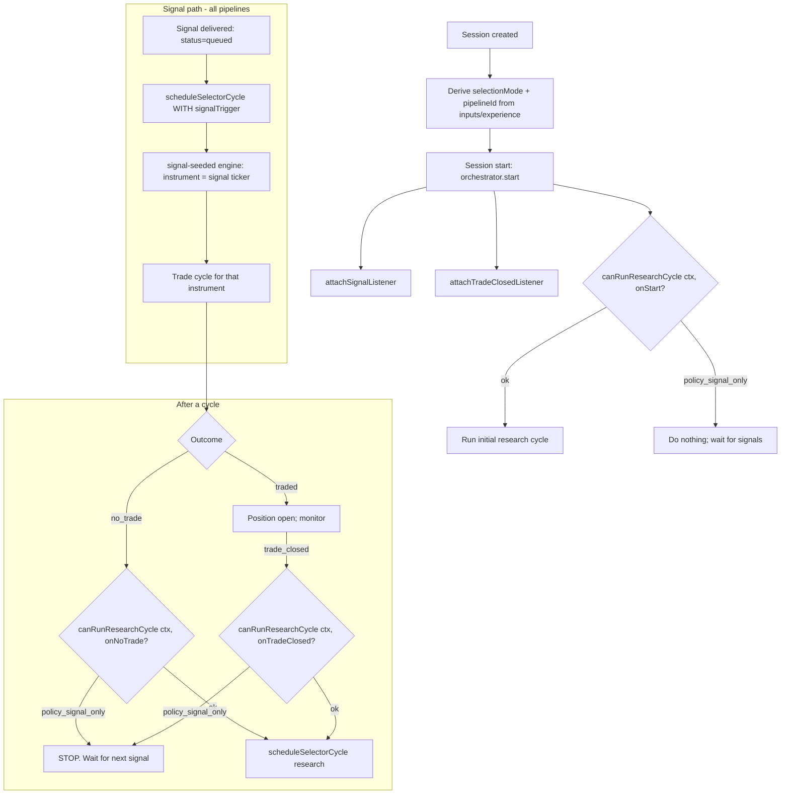

# Instrument Sourcing & Researcher-Kickoff Decoupling — Feature Specification

> **Date:** 2026-06-18
> **Status:** Draft
> **Feature area:** Session orchestration, pipeline registry, instrument sourcing, signal delivery
> **Depends on:** Existing orchestrator (`AgentOrchestrator`), pipeline descriptor registry, signal source system, `docs/specs/signal-driven-architecture.md`

---

> **Architecture Principle — No Backward Compatibility**
>
> There are no production sessions or users to preserve. Backward compatibility is **not a goal**. When existing code conflicts with this design, delete and redesign it — no shims, no optional chaining around removed fields. If a path must be gutted to fit, gut it. This spec exists because the *last* migration left coupling and half-applied guards behind (and left dead plumbing like the unwired `manual` signal source); do not repeat that. (Note: this principle does **not** mean delete `manual_shortlist` — it is live and stays; see §3.)

---

> **Migration Discipline (the root-cause rule this spec exists to enforce)**
>
> The repeated failure mode in this codebase is the **half-dead migration**: a new system is built, the old path is left *wired but dormant*, and the dormant path later wakes up and executes — silently — causing bugs (the no-trade researcher kickoff; the default-pipeline fallthrough; `injectManualTickers`). Dormant-but-reachable is the trap.
>
> **Rules, enforced by CI, not by memory:**
> 1. **Replace = delete, same change.** When a path is superseded, the old path is removed in the same change. Never "keep it for now."
> 2. **No second live entry point for one capability.** One feature ⇒ one reachable code path. If two exist, one is a bug waiting to fire.
> 3. **Dormant code is illegal.** Code that is exported/registered/type-wired but has no reachable caller fails the build. There is no "we'll wire it later" — wire it now or don't add it.
> 4. **If it must be staged, it is OFF and unreachable** (behind a flag whose disabled branch is provably dead), never a parallel live path.
>
> See §15 for the enforcement mechanism.

---

## 1. Summary

Today, the decision "should this session autonomously kick off a researcher to go hunt for new instruments?" is made ad-hoc in **five+ different places** inside the orchestrator, each with its own inline logic. Some places check `selectionMode`; others don't. Because of one missing guard, a **signal-driven** session (e.g. Rules: Mean Reversion) that returns *no trade* on a signal incorrectly launches an autonomous LLM web-search research cycle — borrowing the **default pipeline's** researcher, even though the session's own pipeline declares **zero** selector workers.

This feature **extracts the instrument-sourcing policy into declarative per-pipeline config** (`PipelineDescriptor.instrumentSourcing`), routes every orchestrator kickoff site through a **single policy gate** that reads that config, and makes the orchestrator/selector consult the **session's own pipeline** rather than a global default. After this change, whether and when a researcher runs is a property of the pipeline definition — not scattered imperative code. `manual_shortlist` is **kept as-is** (it is the only live fixed-ticker path — see §3 / §6.3); retiring it is deferred.

---

## 2. User Story

> **As a** trader running a signal-driven experience (Mean Reversion, EDGAR 8-K, etc.),
> **I want** the system to process my signals one at a time and do nothing else between signals,
> **So that** it never wanders off to research and trade unrelated instruments I never asked for.

Secondary:

> **As an** engineer extending Exva with a new experience/pipeline,
> **I want** to declare "this pipeline gets its instruments from signals" vs "this pipeline researches its own universe" in one config object,
> **So that** I don't have to find and patch five orchestrator branches and hope I got them all.

> **As a** trader running an `ai_selected_universe` (web-search) experience,
> **I want** the researcher to run on the cadence the pipeline declares (start, after a flat cycle, after a trade closes),
> **So that** autonomous discovery keeps working exactly as before for the experiences that actually want it.

---

## 3. Scope

**In scope:**

1. New declarative field `instrumentSourcing` on `PipelineDescriptor`.
2. A single `InstrumentSourcingPolicy` resolver + one orchestrator gate (`canRunResearchCycle`) that replaces all scattered kickoff conditionals.
3. Fixing the no-trade refill bug (`cycle-refill.ts` / `canScheduleSelector`) by routing it through the gate.
4. Making `shouldRunInitialSelectorCycle`, the trade-closed handler, attention-restart, and resolved-instrument retry all consult the same gate.
5. Making the selector resolve the **session's own pipeline descriptor**, never the global default, when there is no signal trigger.
6. Tests that lock the invariants so this class of bug cannot regress.

**Explicitly NOT deleted (corrected 2026-06-18):** `manual_shortlist` is **kept**. It is the *only live* path for fixed-ticker sessions — the `manual-shortlist` entry engine reads `instrumentScope` directly in the selector phase. The `manual` **signal source** (`injectManualTickers` / `MANUAL_SOURCE_ID`) is **dead code** — it has no caller and `session-runtime-manager.test.ts` asserts `injectManualTickers` is never called. The two were conflated in the first draft; they are different implementations and only the entry-engine one runs. Retiring `manual_shortlist` in favor of the manual signal source is a separate future effort (see §13 Q5), not part of this fix.

**Out of scope:**

- Changing how signal-seeded selection materializes an instrument from a signal (the `signal-seeded` entry engine stays as-is).
- Changing the LLM selector worker prompts or the `submit_result` terminal-tool mechanics (the gemma failure was a *symptom*; the root fix is not running the researcher at all for signal-driven sessions).
- Model/provider assignment per role.
- Deleting `manual_shortlist` or wiring the dormant `manual` signal source (deferred — §13 Q5).
- The broader signal-source vision already covered by `signal-driven-architecture.md`.

---

## 4. Architecture & Components

### 4.1 Current state (the problem)

**Where instruments come from today** is implied by a tangle of three things that must agree but are checked independently:

| Layer | Field | Values | Authority for… |
|-------|-------|--------|----------------|
| Session (derived) | `selectionMode` | `signal_driven` \| `ai_selected_universe` \| `manual_shortlist` | UI labeling, *some* orchestrator guards |
| Pipeline descriptor | `selectorWorkerIds` | `string[]` (empty ⇒ no researcher) | Which selector workers exist |
| Pipeline descriptor | `signalSources` | `SignalSourceType[]` | Signal→pipeline routing |

**Researcher-kickoff sites (every place that can launch an autonomous selector cycle):**

| # | Site | File | Reads `selectionMode`? | Correct today? |
|---|------|------|------------------------|----------------|
| 1 | Initial cycle on start | `agent-orchestrator.ts` `shouldRunInitialSelectorCycle()` | No — checks `instrumentScope` + source-requires-scope | Partially |
| 2 | No-trade refill | `cycle-refill.ts` via `canScheduleSelector()` | **No** | ❌ **the bug** |
| 3 | Trade-closed restart | `trade-closed-handler.ts` | **Yes** (`signal_driven` skip) | ✅ |
| 4 | Restart from attention | `agent-orchestrator.ts` `restartFromAttention()` | No | Unverified |
| 5 | Resolved-instrument retry | `agent-orchestrator.ts` `handleResolvedInstruments()` | No | Unverified |
| 6 | Signal delivery (signal-seeded) | `attachSignalListener()` | N/A — always carries a `signalTrigger` | ✅ (different path) |

Sites 1–5 all call `scheduleSelectorCycle(label)` **without a `signalTrigger`**. With no trigger, `runSelector` → `ai.runPlan("selector")` resolves its entry engine to the **AI picker** (autonomous discovery) using the **default** pipeline's `selectorWorkerIds`, because `resolvePipelineIdForSource(undefined)` returns `default-trade-cycle`. **The session's own pipeline is never consulted.** That is how a Mean Reversion session (pipeline `rules-mean-reversion-cycle`, `selectorWorkerIds: []`) ran the web-search researcher from `default-trade-cycle`.

The single guard that *is* correct (site 3) hardcodes `selectionMode === "signal_driven"` inline. It was added in the trade-closed path and never propagated to the no-trade path. That divergence is the literal bug.

### 4.2 Target state (the fix)

**One declarative policy, one gate, consulted everywhere.**

```
PipelineDescriptor.instrumentSourcing   ← single source of truth (config)
            │
            ▼
resolveInstrumentSourcingPolicy(sessionId)  ← resolves session → its pipeline → policy
            │
            ▼
canRunResearchCycle(ctx, trigger)       ← the ONE gate
            │
   ┌────────┴───────────────────────────────────┐
   ▼            ▼            ▼            ▼         ▼
 start     no-trade    trade-closed  attention  retry
(site 1)   (site 2)     (site 3)     (site 4)  (site 5)
```

Every kickoff site asks `canRunResearchCycle`. No site reads `selectionMode` directly. No site falls through to the default pipeline.

**Pipeline classification under the new policy:**

| Pipeline | `signalSources` | `selectorWorkerIds` | `instrumentSourcing.mode` | Researcher runs? |
|----------|-----------------|---------------------|---------------------------|------------------|
| `rules-mean-reversion-cycle` | `["timer"]` | `[]` | `signal` | **Never** |
| `rules-trend-following-cycle` | `["timer"]` | `[]` | `signal` | Never |
| `rules-breakout-cycle` | `["timer"]` | `[]` | `signal` | Never |
| `edgar-8k-cycle` | `["edgar_8k","mock"]` | `[]` | `signal` | Never |
| `prediction-event-cycle` | `["prediction_event"]` | `event` | `signal` | Never (signal supplies the market) |
| `default-trade-cycle` | `["web_search","manual"]` | `standard` | `autonomous_research` | Per declared triggers |

> Note: `selectorWorkerIds` non-empty is **necessary but not sufficient** to define a researcher pipeline. `prediction-event-cycle` carries event-selector workers yet is still signal-fed (the prediction event *is* the signal). The explicit `instrumentSourcing.mode` removes this ambiguity instead of inferring it from `selectorWorkerIds.length`.

### 4.3 New component: `InstrumentSourcingPolicy`

A pure resolver, no orchestrator state. Lives in `electron/main/services/pipeline/implementations/registry/` (next to the descriptor store) or a new `instrument-sourcing/` module under orchestration. It takes a session, finds its pipeline descriptor, and returns the policy.

```
resolveInstrumentSourcingPolicy(deps, sessionId)
  → load session
  → resolve pipelineId for session   (experience.pipelineId — NOT the default fallback)
  → requirePipelineDescriptor(pipelineId).instrumentSourcing
  → return policy
```

### 4.4 New component: `canRunResearchCycle` gate

Replaces `canScheduleSelector` (renamed + widened) and the inline guard in `trade-closed-handler`. Returns a typed result so callers can log *why* it declined.

```
canRunResearchCycle(ctx, { triggerEvent }) → { ok: true } | { ok: false; reason }
  reasons:
    "policy_signal_only"        → pipeline is signal-fed; researcher never runs
    "trigger_not_enabled"       → autonomous pipeline, but this trigger (onNoTrade/…) is off
    "open_trades_remain"        → capacity guard (existing)
    "capacity_full"             → capacity guard (existing)
    "session_attention"         → existing attention_required guard
    "runtime_inactive"          → stopped / not active
```

---

## 5. End-to-End Flows

### 5.1 Canonical session lifecycle (target)



**Happy path — Mean Reversion (signal pipeline):**

1. Session created subscribed to the `timer` mean-reversion source → `selectionMode = signal_driven`, `pipelineId = rules-mean-reversion-cycle`, whose descriptor declares `instrumentSourcing.mode = "signal"`.
2. `orchestrator.start()`: attaches signal + trade-closed listeners. Calls `canRunResearchCycle(ctx, { triggerEvent: "onStart" })` → `{ ok: false, reason: "policy_signal_only" }`. No initial research cycle. Emits info log, **not** an error.
3. Every 15m the timer source emits a signal for SPY/QQQ. Delivery gate passes → delivery `queued`.
4. Signal listener fires → `scheduleSelectorCycle("Signal delivery queued", signalTrigger)` → `signal-seeded` engine returns the signal's ticker directly (no LLM discovery) → one trade cycle.
5. Trade cycle runs the deterministic `rules-mean-reversion-cycle` pipeline. Returns **no trade**.
6. `finishWithoutOpenPosition` → `scheduleCycleRefillAfterDelayIfIdle` → `canRunResearchCycle(ctx, { triggerEvent: "onNoTrade" })` → `{ ok: false, reason: "policy_signal_only" }`. **Nothing scheduled.** Cycle ends. System idles until the next 15m signal.

No researcher. No COIN/STRK/IOTX. No gemma verification failure. No session-stopping error.

**Happy path — Web Search (autonomous_research pipeline):** identical wiring, but the policy is `{ mode: "autonomous_research", researchTriggers: { onStart: true, onNoTrade: true, onTradeClosed: true, onAttentionRestart: true } }`, so each gate returns `{ ok: true }` (subject to capacity) and the researcher runs exactly as it does today.

### 5.2 Deviations

- **If the session has open trades / is at capacity:** gate returns `open_trades_remain` / `capacity_full` (existing behavior preserved), regardless of policy.
- **If the session is `attention_required`:** gate returns `session_attention`; no cycle (existing behavior preserved).
- **If a signal arrives for a signal pipeline while a research cycle is somehow in flight:** signal path is independent of the research gate; signal-seeded cycles always run (they are the *point* of a signal pipeline). The gate governs only **autonomous** (trigger-less) cycles.
- **If `instrumentSourcing` is missing on a descriptor:** registry validation fails at startup (see §8). The app refuses to boot rather than silently defaulting — a missing policy is a developer error, not a runtime fallback.

---

## 6. Data & Config Mapping

### 6.1 New config type: `InstrumentSourcing`

Add to `PipelineDescriptor` (`pipeline-descriptor-store.ts`):

```typescript
export type InstrumentSourcingMode = "signal" | "autonomous_research";

export interface InstrumentSourcing {
  /**
   * Where this pipeline's instruments come from.
   * - "signal": instruments are supplied by signal deliveries only. The
   *   orchestrator NEVER autonomously launches a research/selector cycle.
   * - "autonomous_research": the pipeline runs a selector to discover its own
   *   instrument universe, on the cadence declared in researchTriggers.
   */
  mode: InstrumentSourcingMode;

  /**
   * Only consulted when mode === "autonomous_research". For mode === "signal"
   * this MUST be omitted (validation enforces it). Declares which lifecycle
   * events are allowed to (re)launch the researcher.
   */
  researchTriggers?: {
    onStart: boolean;          // initial cycle when the session starts
    onNoTrade: boolean;        // after a cycle completes with no open position
    onTradeClosed: boolean;    // after an open position closes and none remain
    onAttentionRestart: boolean; // when restarting from attention_required
  };
}

export interface PipelineDescriptor {
  id: string;
  displayName: string;
  automation: PipelineAutomation;
  phases: readonly PipelinePhase[];
  signalSources: readonly SignalSourceType[];
  isDefault?: boolean;
  plan: InstrumentAnalysis<InstrumentAnalysisState>;
  phaseWorkers: Partial<Record<PipelinePhase, readonly string[]>>;
  selectorWorkerIds?: readonly string[];
  instrumentSourcing: InstrumentSourcing; // NEW — required
}
```

### 6.2 Per-pipeline values to set

| Pipeline | `instrumentSourcing` |
|----------|----------------------|
| `rules-mean-reversion-cycle` | `{ mode: "signal" }` |
| `rules-trend-following-cycle` | `{ mode: "signal" }` |
| `rules-breakout-cycle` | `{ mode: "signal" }` |
| `edgar-8k-cycle` | `{ mode: "signal" }` |
| `prediction-event-cycle` | `{ mode: "signal" }` |
| `default-trade-cycle` | `{ mode: "autonomous_research", researchTriggers: { onStart: true, onNoTrade: true, onTradeClosed: true, onAttentionRestart: true } }` |

### 6.3 `selectionMode` — unchanged

`SelectionMode` keeps all three members: `signal_driven | ai_selected_universe | manual_shortlist`. `selectionMode` stays a derived/UI concept. The runtime authority for "does the researcher run" is `instrumentSourcing` on the **pipeline** — and the mapping holds because of how sessions route to pipelines:

| selectionMode | Pipeline it rides | `instrumentSourcing.mode` | Selector cycle behavior |
|---------------|-------------------|---------------------------|-------------------------|
| `signal_driven` | a signal pipeline (timer/edgar/prediction) | `signal` | Runs only on signal delivery (signal-seeded). **No autonomous refill.** |
| `manual_shortlist` | `default-trade-cycle` | `autonomous_research` | Refills autonomously, but the selector resolves to the **deterministic `manual-shortlist` entry engine** (re-lists `instrumentScope`, no LLM). |
| `ai_selected_universe` | `default-trade-cycle` | `autonomous_research` | Refills autonomously; selector runs the LLM discovery workers. |

So `manual_shortlist` and `ai_selected_universe` both legitimately run autonomous refill cycles — the difference is which entry engine matches inside the selector phase (deterministic vs LLM). Only `signal_driven` must be blocked from autonomous refill. **That is exactly what the gate enforces via `policy_signal_only` (pipeline `mode === "signal"`).** No `manual_shortlist` deletion is required for the fix.

> ⚠️ Fragility to track (§13 Q5): the mapping above relies on `signal_driven` sessions never riding the `default-trade-cycle` pipeline. The dormant `manual` signal source, if ever wired, would make a manual-ticker session `signal_driven` on the `default-trade-cycle` (autonomous_research) pipeline — at which point pipeline-level mode and session selectionMode disagree. Until that path is wired, the invariant holds. The robust long-term model derives a session-level sourcing classification at config time; deferred.

### 6.4 Schema changes required

**None.** `selection_mode` column, default (`manual_shortlist`), and enum are unchanged by this fix.

### 6.5 Code touched for `manual_shortlist` (audit, not delete)

These existing `manual_shortlist` references are **left as-is** unless the §13 Q3 audit finds them obsolete. They are listed so the implementer does not mistake them for the bug:

| File | Status |
|------|--------|
| `electron/main/services/pipeline/engines/entry-mode/manual-shortlist.ts` | **Keep.** Live path for fixed-ticker sessions. |
| `electron/main/services/signals/signal-service.ts` `injectManualTickers` | Dead code (no caller; test asserts not-called). Leave for now; remove only as part of Q5. |
| `candidate-validation-service.ts:127`, `instrument-conflict-check.ts:19` | Audit during implementation (Q3); leave if still meaningful. |

---

## 7. Internal Contracts / Interfaces

### 7.1 `resolveInstrumentSourcingPolicy`

```typescript
function resolveInstrumentSourcingPolicy(
  deps: { sessionRepo: SessionRepo; /* experience → pipelineId resolver */ },
  sessionId: string,
): InstrumentSourcing;
```

**Resolution rule:** session → `experienceId` → `requireExperience(experienceId).pipelineId` → `requirePipelineDescriptor(pipelineId).instrumentSourcing`. **Never** `resolvePipelineIdForSource(undefined)` — that default fallback is the coupling bug and is forbidden in this path.

### 7.2 `canRunResearchCycle` (replaces `canScheduleSelector`)

```typescript
type ResearchTriggerEvent =
  | "onStart" | "onNoTrade" | "onTradeClosed" | "onAttentionRestart";

type ResearchGateResult =
  | { ok: true }
  | { ok: false; reason:
        | "policy_signal_only" | "trigger_not_enabled"
        | "open_trades_remain" | "capacity_full"
        | "session_attention" | "runtime_inactive" };

function canRunResearchCycle(
  ctx: TradingCycleContext,
  input: { triggerEvent: ResearchTriggerEvent },
): ResearchGateResult;
```

**Order of checks (first failing wins):**
1. `runtime_inactive` — `ctx.stopped || !ctx.runtimeIsActive()`
2. `session_attention` — status `attention_required`
3. `policy_signal_only` — `policy.mode === "signal"`
4. `trigger_not_enabled` — `!policy.researchTriggers[triggerEvent]`
5. `open_trades_remain` — any open trade
6. `capacity_full` — open+pending ≥ `max_concurrent_trades`
7. else `{ ok: true }`

### 7.3 Call-site changes

| Site | Before | After |
|------|--------|-------|
| `shouldRunInitialSelectorCycle()` | bespoke `instrumentScope`/source check | `canRunResearchCycle(ctx, { triggerEvent: "onStart" }).ok` |
| `cycle-refill.ts` (`canScheduleSelector`) | open-trade + capacity only | call `canRunResearchCycle(ctx, { triggerEvent: "onNoTrade" })` |
| `trade-closed-handler.ts` | inline `signal_driven` skip | `canRunResearchCycle(ctx, { triggerEvent: "onTradeClosed" })` |
| `restartFromAttention()` | unguarded research enqueue | `canRunResearchCycle(ctx, { triggerEvent: "onAttentionRestart" })` |
| `handleResolvedInstruments()` retry | unguarded | route retry through the gate (`onNoTrade` semantics) |

### 7.4 `selector` resolution change

In `runSelector` / `ai.runPlan("selector")`, when there is **no** `signalTrigger`, the selector workers used MUST come from the **session's resolved pipeline descriptor** (`selectorWorkerIds` of *that* pipeline), not the default. If that pipeline has `mode === "signal"` (hence empty `selectorWorkerIds`), a trigger-less selector cycle is unreachable by construction (the gate blocked it) — but as defense in depth, `runSelector` throws `AppError("research cycle requested for signal-only pipeline", "INVARIANT_VIOLATION")` if it is ever entered without a trigger for a signal pipeline.

---

## 8. Invariants & Runtime Guarantees

| # | Invariant | Enforced where |
|---|-----------|----------------|
| 1 | Every `PipelineDescriptor` has an `instrumentSourcing`. | `validatePipelineDescriptor` throws at registration if missing. |
| 2 | `mode: "signal"` descriptors MUST NOT declare `researchTriggers` and MUST have empty `selectorWorkerIds`. | `validatePipelineDescriptor`. |
| 3 | `mode: "autonomous_research"` descriptors MUST declare all four `researchTriggers` and non-empty `selectorWorkerIds`. | `validatePipelineDescriptor`. |
| 4 | A signal-only pipeline never enters a trigger-less selector cycle. | `canRunResearchCycle` (gate) + `runSelector` invariant throw (defense in depth). |
| 5 | No orchestrator code reads `selectionMode` to decide kickoff. | Lint/grep check in CI + code review; `selectionMode` references in `orchestration/` are forbidden. |
| 6 | The selector never resolves to the default pipeline when sourcing instruments for a session; it uses the session's experience pipeline. | `resolveInstrumentSourcingPolicy` + selector worker resolution. |
| 7 | A session whose pipeline is `signal` with `automation: deterministic` makes **zero** LLM calls across its entire lifecycle. | Covered by integration test (§9 / §12). |

There is no per-user permission dimension to this feature; access is governed by existing session ownership.

---

## 9. Error States & Edge Cases

| Scenario | Trigger | System behavior | User-visible |
|----------|---------|-----------------|--------------|
| Signal pipeline returns no trade | `no_trade` outcome | Gate → `policy_signal_only`; nothing scheduled | Info log: "research cycle skipped: signal-driven pipeline waits for next delivery". **No ERROR event.** |
| Signal pipeline, position closes | `trade_closed` | Gate → `policy_signal_only`; nothing scheduled | Info log (same family). |
| Autonomous pipeline, no trade, `onNoTrade: true` | `no_trade` | Gate → `ok` (if capacity) → research cycle | Existing "scheduling selector research cycle" info event. |
| Autonomous pipeline, no trade, `onNoTrade: false` | `no_trade` | Gate → `trigger_not_enabled`; nothing scheduled | Info log: "research cycle skipped: onNoTrade disabled for pipeline". |
| Descriptor missing `instrumentSourcing` | App boot, `validatePipelineRegistry` | Throw; app refuses to start | Startup crash with explicit message (developer error). |
| Trigger-less selector somehow reached for signal pipeline | Programming error | `runSelector` throws `INVARIANT_VIOLATION` | ERROR event surfaced; cycle fails loudly (no silent fallback). |
| `manual_shortlist` session, no trade | `no_trade` on `default-trade-cycle` | Gate → `ok` (autonomous_research, `onNoTrade: true`); selector reruns and resolves to the **deterministic** `manual-shortlist` entry engine | Re-lists `instrumentScope`; no LLM; keeps cycling as today. |
| Open trades remain when a cycle would refill | refill path | Gate → `open_trades_remain` | Existing info log preserved. |

---

## 10. Build sequence (phased)

1. **Config plumbing (no behavior change):** add `instrumentSourcing` to the type + all descriptors; add registry validation (invariants 1–3). App still behaves as today because nothing reads the field yet. Land + verify boot.
2. **Gate introduction:** implement `resolveInstrumentSourcingPolicy` + `canRunResearchCycle`. Unit-test the gate matrix exhaustively.
3. **Route call sites:** replace `canScheduleSelector`, the trade-closed inline guard, `shouldRunInitialSelectorCycle`, attention-restart, and resolved-instrument retry to use the gate. This is the step that **fixes the bug**.
4. **Selector pipeline correctness:** make trigger-less selection use the session's pipeline; add the `runSelector` invariant throw (invariant 4/6).
5. **CI guard:** add the grep/lint check for invariant 5.

Each phase is independently landable and testable; the bug is gone after phase 3. `manual_shortlist` is untouched throughout.

---

## 11. Log & Event Messages (final strings)

| Location | String | Level | Notes |
|----------|--------|-------|-------|
| Gate: signal-only skip | `research cycle skipped: signal-driven pipeline waits for next delivery` | INFO log | Replaces the prior silent/incorrect kickoff. Not an emitted session ERROR. |
| Gate: trigger disabled | `research cycle skipped: {triggerEvent} disabled for pipeline {pipelineId}` | INFO log | — |
| Gate: open trades | `research cycle skipped: open trades remain` | INFO log | Preserve existing wording where present. |
| Autonomous kickoff (unchanged) | `{label}; scheduling selector research cycle.` | INFO event | Only emitted when gate returns `ok`. |
| Invariant violation | `Research cycle requested for signal-only pipeline {pipelineId}` | ERROR event | Should be unreachable; fail loud if reached. |
| Registry validation | `Pipeline '{id}' is missing instrumentSourcing.` / `…declares researchTriggers but mode is "signal".` | Throw | Startup. |

---

## 12. Tests (lock the invariants)

| Test | Asserts |
|------|---------|
| Gate matrix unit test | Every `(mode, triggerEvent, openTrades, capacity, status)` combination → expected `ResearchGateResult`. |
| Mean-reversion no-trade integration test | Signal → no-trade cycle → **no** selector/research cycle scheduled; **zero** LLM calls recorded for the whole session (invariant 7). This test is the regression guard for the reported bug. |
| Trade-closed signal pipeline test | Position closes on a `signal` pipeline → no research cycle (parity with the pre-existing trade-closed guard, now via the gate). |
| Autonomous pipeline test | `default-trade-cycle` with `onNoTrade: true` → research cycle scheduled after no-trade (no regression for web-search experiences). |
| Registry validation test | Descriptor missing `instrumentSourcing` / mismatched `mode`+`researchTriggers` → registration throws. |
| No-`selectionMode`-in-orchestration test | Static check: no `selectionMode` reference under `services/orchestration/` (invariant 5). |
| Selector default-pipeline test | Trigger-less selection for a session resolves that session's pipeline, never `default-trade-cycle` (invariant 6). |

---

## 13. Open Questions

| # | Question | Impact if unresolved | Recommendation |
|---|----------|----------------------|----------------|
| 1 | Should `researchTriggers` be per-pipeline only, or also per-session overridable (e.g. a user toggling "keep researching between trades")? | If session-overridable, the policy resolver must merge session settings over pipeline defaults; adds a field + UI. | Pipeline-only for now (matches "decouple, declarative"). Add session override later behind a new spec if a real need appears. |
| 2 | Does `prediction-event-cycle` ever need an autonomous discovery mode (hunt prediction markets without an event signal), or is it always signal-fed? | Determines whether it stays `mode: "signal"` or becomes `autonomous_research`. | Treat as `signal` now; the prediction event *is* the trigger. Revisit if a "browse all markets" experience is built. |
| 3 | Do the `candidate-validation-service:127` and `instrument-conflict-check:19` `manual_shortlist` guards still have a real purpose, or are they dead branches? | Could leave dead branches or remove needed validation. | Audit during implementation; repoint to `mode === "autonomous_research"` if the check is about discovered (vs supplied) instruments, else delete. Do not leave them ambiguous. |
| 4 | Should `automation: "deterministic"` imply `mode: "signal"` automatically (a deterministic pipeline can't research via LLM), or stay independent and validated? | Affects whether mode is inferred or always explicit. | Keep explicit + validated (invariants 2/3). Explicit config is the whole point; no inference. |
| 5 | Retire `manual_shortlist` by wiring the dormant `manual` signal source (so fixed-ticker sessions become `signal_driven` fed by manual signals), then delete the `manual-shortlist` entry engine? | Removes the §6.3 fragility (pipeline mode vs session mode divergence) and collapses two manual implementations into one. Non-trivial: must wire `injectManualTickers`, re-route the default pipeline, migrate sessions. | Defer to its own spec. Out of scope here. The current fix is correct without it. |

---

## 14. Dead-code that this fix must also remove

The bug investigation surfaced dormant code that is part of *this* problem family. Remove or wire it as part of this work (don't leave it for "later" — that is the exact pattern we are killing):

| Item | State | Action |
|------|-------|--------|
| `SignalService.injectManualTickers` + its interface entry in `session-types.ts` | Exported, type-wired, **zero runtime callers**; a test asserts it is never called | Delete it (and the never-called test assertion), OR wire it as part of Q5 — but not both-and-dormant. Default: **delete**. |
| Selector fallthrough to `resolvePipelineIdForSource(undefined)` → `default-trade-cycle` for trigger-less cycles | Reachable, wrong | Removed by §7.4 (selector uses the session's pipeline). |

---

## 15. Enforcement: stop half-dead migrations at CI

Willpower has failed repeatedly. Add tooling so a dormant path **fails the build**:

1. **Add `knip`** (`bun add -D knip`) with a config covering `electron/` and `src/`. `knip` reports unused files, unused exports, and unused dependencies — i.e. exactly the "exported but never called" signature of `injectManualTickers`. Wire it into the `check` script (`bun run check` already runs typecheck + lint + format + test; append `knip`).
2. **CI gate:** `knip --no-progress` in the pipeline; non-zero exit fails the build. Seed an allowlist only for genuinely-public API surfaces (preload bridge, IPC handlers registered by string) and document each entry — an allowlist entry is a deliberate decision, not a dumping ground.
3. **Invariant-5 grep guard** (already in §12): no `selectionMode` references under `services/orchestration/`. Generalize the idea: when a concept is relocated to a single authority, add a grep guard forbidding the old access pattern in the layers that must not use it.
4. **Definition-of-done for any migration PR** (checklist in PR template): (a) old path deleted in this PR, (b) `knip` clean, (c) no new exported symbol without a reachable caller, (d) one capability = one reachable path.

This section is the actual deliverable that prevents recurrence. The instrument-sourcing fix removes *this* instance; `knip` + the guards stop the *next* one.
