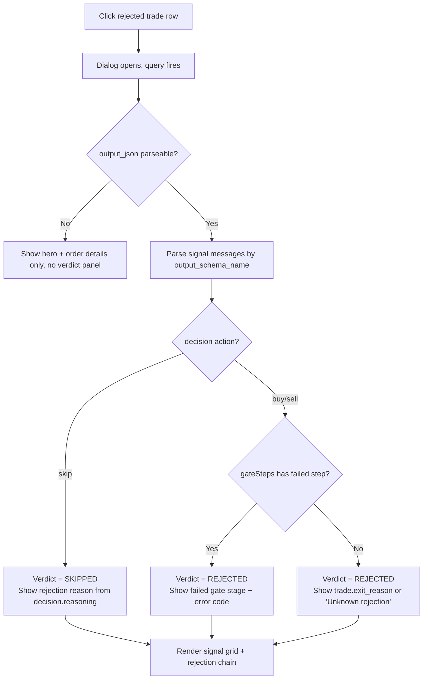

# Trade Verdict Panel — Feature Specification

> **Date:** 2026-06-18
> **Status:** Draft
> **Feature area:** Dashboard → Trade Detail Dialog (`src/pages/TradeDetail.tsx`)
> **Depends on:** Existing `getTradeDetail` IPC (`trades.getDetail`), `AgentMessage.output_json`, `AgentMessage.output_schema_name`, `Trade.exit_reason`

---

## 1. Summary

When a user clicks a trade row on the Dashboard, a dialog opens (`TradeDetail.tsx`). Currently it shows P&L, order details, agent run traces, and gate timeline — but gives no single readable verdict explaining *why* the trade was accepted, rejected, or is pending. A user looking at four rejected BTC-USD trades with `$0` size cannot tell from the current UI what signal fired, what gate blocked it, or what the AI reasoning was.

This feature adds a **Verdict Panel** — a prominent, human-readable section at the top of the trade detail dialog (below the hero block) that surfaces the structured outcome chain: signal-by-signal verdict, confidence with its source, the rejection or acceptance reason in plain language, and position sizing rationale. All data already exists in `AgentMessage.output_json`; this is purely a frontend parsing and display change.

---

## 2. User Story

> **As a** session operator reviewing trades,
> **I want to** open any trade and immediately see a clear, structured explanation of why it was accepted or rejected — with signal scores and the exact reason chain,
> **So that** I can diagnose patterns, tune session config, and understand system behavior without reading raw JSON or log files.

Secondary:

> **As a** session operator reviewing a rejected trade,
> **I want to** see the exact threshold or gate that blocked execution,
> **So that** I can decide whether to adjust `waitForOpenThreshold`, position size config, or strategy rules.

---

## 3. Scope

**In scope:**

- New `TradeVerdictPanel` component rendered in `TradeDetail.tsx` between the hero block and the `TradeOrderDetails` section.
- Parse `output_json` from `AgentMessage[]` (already returned by `getTradeDetail`) by `output_schema_name` to extract structured signal data.
- Display: overall verdict badge, signal-by-signal breakdown (technical, fundamental, review, decision), rejection reason chain for rejected trades, position sizing rationale for accepted/open trades.
- No new IPC calls, no new DB columns. Pure frontend.
- Works for all `trade.status` values: `pending`, `open`, `closed`, `rejected`.

**Out of scope:**

- Changing how the backend computes or stores signals.
- Persisting rejection reasons to a dedicated DB column (may come later).
- Showing signal breakdown for the *selector* phase (instrument picker runs are not tied to a trade and use a separate repo path).
- Autopsy view — that is a separate page (`AutopsyPage.tsx`).
- Any UI changes outside `TradeDetail.tsx` and its immediate sub-components.

---

## 4. Screens & Layout

### 4.1 Trade Detail Dialog — with Verdict Panel

**Route / location:** Dialog triggered by clicking any `TradeRow` on the Dashboard. Rendered by `TradeDetail` component in `src/pages/TradeDetail.tsx`.

**When it appears:** User clicks a trade row → `tradeStore.setSelected(id)` → dialog opens → `useQuery(["trade-detail", tradeId])` fetches `getTradeDetail`. Verdict panel renders once `detail` is non-null.

**Layout (full dialog, top to bottom):**

```
TradeDetail Dialog (480px wide, 92vh)
├── Header
│   ├── Symbol + badges (side, status)
│   └── "⚕ Review Trade" button (non-open trades only)
├── Display name (if present)
├── TradeHero — P&L + Confidence (unchanged)
├── TradePositionBar — stop/entry/TP bar (open trades with full price data, unchanged)
├── [NEW] TradeVerdictPanel
│   ├── Verdict Header Row
│   │   ├── Verdict Badge (ACCEPTED / REJECTED / PENDING / SKIPPED)
│   │   └── Verdict Summary Line (one sentence, see §10)
│   ├── Signal Grid (2-column, one card per agent: technical, fundamental, review, decision)
│   │   └── Each SignalCard:
│   │       ├── Agent label + color bar (matches existing PALETTE)
│   │       ├── Key score bar (0–100%)
│   │       ├── Key label (e.g. "Trend", "Catalyst", "Recommendation", "Action")
│   │       └── rawSummary text (truncated to 2 lines, expandable)
│   └── Rejection Reason Chain (rejected trades only)
│       └── Ordered list of reasons, each as a pill row
├── TradeOrderDetails (unchanged)
├── TradeExitAnalytics (unchanged)
├── TradeGateTimeline (unchanged)
├── TradeHarnessMessages (unchanged)
├── TradeAgentRuns (unchanged)
└── Force Close button (open trades only, unchanged)
```

**Layout rules:**

- `TradeVerdictPanel` sits between hero block and `TradeOrderDetails`. It is not behind a tab or toggle — it is always visible when data is available.
- Signal grid is `grid-cols-2 gap-3`. On the 480px dialog width this gives ~220px per card.
- `TradeVerdictPanel` renders nothing (returns `null`) if no `AgentMessage` has a parseable `output_json`. This maintains compatibility with trades that predate this feature.
- The panel does not scroll independently — it is part of the dialog's single scrolling body.

**Element inventory:**

| Element | Type | Content | State | Notes |
|---------|------|---------|-------|-------|
| Verdict badge | `<Badge>` | "ACCEPTED" / "REJECTED" / "PENDING" / "SKIPPED" | Static | Variant: `success` (accepted/open), `danger` (rejected), `warning` (pending), `default` (skipped) |
| Verdict summary | `<p>` | One-sentence summary (see §10) | Static | Max 1 line, truncate with ellipsis |
| SignalCard — technical | `<div>` | Trend direction + strength bar | Shows only if `output_schema_name === "TechnicalSignal"` message exists | Left border = `var(--color-success)` |
| SignalCard — fundamental | `<div>` | Catalyst type + catalyst score bar | Shows only if `output_schema_name === "FundamentalSignal"` message exists | Left border = `var(--color-error)` |
| SignalCard — review | `<div>` | Recommendation chip + conflict score | Shows only if `output_schema_name === "ReviewSignal"` message exists | Left border = `var(--color-info)` |
| SignalCard — decision | `<div>` | Action chip + confidence bar | Shows only if `output_schema_name === "TradeSignal"` message exists | Left border = `var(--color-market)` |
| rawSummary text | `<p>` | `signal.rawSummary` | Clamped to 2 lines (`line-clamp-2`), tap to expand | Italic, `text-[var(--text3)]`, `text-[12px]` |
| Rejection reason pill | `<div>` | Reason string | Shown only when `trade.status === "rejected"` | Red left border, monospace text |

**Signal card key metric per agent:**

| Agent | Primary metric label | Primary metric value | Score bar source |
|-------|---------------------|---------------------|-----------------|
| `technical` | Trend | `trendDirection` as text (`bullish` / `bearish` / `neutral`) | `trendStrength` (0–1) |
| `fundamental` | Catalyst | `catalystType ?? "none"` | `catalystScore` (0–1), fallback `catalystStrength` |
| `review` | Recommendation | `recommendation` as chip | `1 - contradictionRisk` (proxy for "alignment score") |
| `decision` | Action | `action` as chip (`buy` / `sell` / `skip`) | `confidence` (0–1) |

**States this panel can be in:**

| State | Condition | What the User Sees |
|-------|-----------|-------------------|
| No data | No `AgentMessage` has parseable `output_json` | Panel renders nothing (null) |
| Partial data | Some signals present, some missing | Only cards with data render; missing agents are omitted silently |
| Rejected — skip signal | `trade.status === "rejected"` and decision `action === "skip"` | Verdict badge = SKIPPED; rejection chain shows decision reasoning |
| Rejected — risk gate | `trade.status === "rejected"` and `gateSteps` has a `failed` step | Verdict badge = REJECTED; rejection chain shows the failed gate stage + error code |
| Accepted/Open | `trade.status === "open"` or `"closed"` with `action !== "skip"` | Verdict badge = ACCEPTED; sizing rationale section shown |
| Pending | `trade.status === "pending"` | Verdict badge = PENDING; no rejection chain |

---

## 5. User Flows

### 5.1 View rejected trade verdict

**Entry point:** User sees a rejected trade row on Dashboard (status badge = "rejected").

**Exit point:** User reads the verdict, closes dialog, or navigates to autopsy.



**Happy path (skip-signal rejection):**

1. User clicks a rejected BTC-USD row.
2. Dialog opens. Query fetches `{ trade, runs, messages, gateSteps }`.
3. Frontend parses `messages` — finds message with `output_schema_name === "TradeSignal"` and `output_json` containing `{ action: "skip", confidence: 0.20, reasoning: "Confidence 0.2 is below wait-for-open threshold 0.7..." }`.
4. Verdict badge renders as SKIPPED (default variant).
5. Verdict summary line: "Skipped — confidence below wait-for-open threshold."
6. Signal grid renders all four agent cards with their scores.
7. Decision card shows: Action = `skip`, confidence bar at 20%.
8. Rejection reason chain renders one pill: the `decision.reasoning` string, truncated to 120 chars with full text on hover via `title` attribute.

**If trade is rejected by risk gate (not skip):**

1. Signal grid renders normally.
2. Decision card shows action = `buy` (trade was going to execute).
3. `gateSteps` contains a step with `status === "failed"` at stage `"risk_gate"`.
4. Verdict = REJECTED. Rejection chain shows: `Stage: risk_gate` · `Error: [lastErrorCode]`.

**If no `output_json` is parseable:**

Verdict panel returns null. The rest of the dialog (hero, order details, gate timeline, agent runs) renders as today.

### 5.2 View open/closed trade verdict

**Entry point:** User clicks an open or closed trade.

**Exit point:** User closes dialog or clicks "⚕ Review Trade".

The verdict panel renders with badge ACCEPTED (open) or ACCEPTED (closed, if `action` was buy/sell). No rejection chain. Instead, a small sizing rationale line shows: "Position sized at `{fmt.usd(trade.position_size_usd)}` · `{Math.round(confidence * 100)}%` confidence · `{executionStrategy}` strategy."

---

## 6. Data & Field Mapping

### 6.1 Signal parsing (frontend only)

All data comes from `AgentMessage.output_json` (already in `TradeDetail.messages`). Parse by `output_schema_name`:

| `output_schema_name` value | Maps to | Key fields used |
|---------------------------|---------|----------------|
| `"TechnicalSignal"` | Technical card | `trendDirection`, `trendStrength`, `momentumScore`, `patternName`, `rawSummary` |
| `"FundamentalSignal"` | Fundamental card | `catalystType`, `catalystScore`, `catalystStrength`, `catalystSummary`, `rawSummary` |
| `"ReviewSignal"` | Review card | `recommendation`, `technicalFundamentalConflict`, `contradictionRisk`, `overallRisk`, `rawSummary` |
| `"TradeSignal"` | Decision card + verdict | `action`, `confidence`, `reasoning`, `executionStrategy`, `entryPrice` |

If multiple messages share the same `output_schema_name` (e.g. retry runs), use the **last** one by `AgentMessage.created_at`.

**Rejection reason chain sources (in priority order):**

1. If `action === "skip"` in the parsed `TradeSignal`: use `TradeSignal.reasoning`.
2. Else if `gateSteps` contains a step with `status === "failed"`: use `"Stage: {stage} failed"` + `lastErrorCode` if non-null.
3. Else if `trade.exit_reason` is non-null: use `trade.exit_reason`.
4. Else: `"Rejection reason not recorded."` (static fallback string).

### 6.2 Verdict badge logic

| Condition | Badge label | Badge variant |
|-----------|-------------|--------------|
| `trade.status === "open"` | `OPEN` | `success` |
| `trade.status === "closed"` and `trade.final_pnl_usd != null` | `CLOSED` | `default` |
| `trade.status === "rejected"` and parsed `action === "skip"` | `SKIPPED` | `default` |
| `trade.status === "rejected"` and parsed `action !== "skip"` (or no parsed signal) | `REJECTED` | `danger` |
| `trade.status === "pending"` | `PENDING` | `warning` |

### 6.3 Sizing rationale (accepted/open trades)

Displayed as a single line of text inside the verdict panel, below the signal grid. Not shown for rejected/skipped trades.

| UI element | Source field | Format |
|-----------|-------------|--------|
| Position size | `trade.position_size_usd` | `fmt.usd(trade.position_size_usd)` |
| Confidence | `trade.confidence_score` | `Math.round(score * 100)%` |
| Strategy | `trade.execution_strategy` | Raw string (e.g. `trend_momentum`) |
| Entry type | Parsed `TradeSignal.entryPrice` | `"limit @ {fmt.usd(entryPrice)}"` if non-null, else `"market order"` |

**No schema changes required.** All fields already exist.

---

## 7. API Contract

No new IPC channels. The existing `trades.getDetail` already returns `messages` with `output_json` and `output_schema_name`. No changes to the backend handler at `electron/main/ipc/trading/trades.ts`.

If, after investigation, a trade's messages are missing `output_schema_name` (trades from before this field was populated), the panel renders nothing (null). No error state needed.

---

## 8. Permissions & Access Control

No change from current trade detail behavior. Access is gated by the existing `assertSessionInWorkspaceEnvironment` check in the IPC handler. This feature adds no new access controls.

---

## 9. Error States & Edge Cases

| Scenario | Trigger | What the User Sees | What the System Does |
|----------|---------|-------------------|---------------------|
| `output_json` is null or unparseable | Old trade, parse error, or schema mismatch | Verdict panel renders null; rest of dialog unchanged | `JSON.parse` wrapped in try/catch; failure = skip card |
| `output_schema_name` is null | Pre-schema-name trade | No signal cards rendered; verdict section absent | Same null guard as above |
| Multiple messages with same schema | Retry runs present | Last message by `created_at` wins | Sort descending, take first |
| Trade has no messages at all | Trade record created before agent ran | Verdict panel renders null | `messages.length === 0` guard |
| Rejected trade with no `exit_reason` and no failed gate step | Skip-signal path missing from messages | Shows "Rejection reason not recorded." | Fallback string (see §6.1) |
| `trade.confidence_score` is null | Pre-confidence-score trade | Confidence bar renders at 0%, `"—"` label | `?? 0` null coalesce, same as today's TradeHero |
| `rawSummary` is empty string | Agent returned no summary | Line is hidden (`rawSummary.trim() === ""` → don't render) | Conditional render |

---

## 10. Copy & Labels

| Location | String | Notes |
|----------|--------|-------|
| Verdict section title | `"Verdict"` | `secTitleClass` (uppercase tracking, same as "Order Details") |
| Verdict badge — open | `"OPEN"` | `variant="success"` |
| Verdict badge — closed | `"CLOSED"` | `variant="default"` |
| Verdict badge — skipped | `"SKIPPED"` | `variant="default"` |
| Verdict badge — rejected | `"REJECTED"` | `variant="danger"` |
| Verdict badge — pending | `"PENDING"` | `variant="warning"` |
| Verdict summary — skipped (confidence) | `"Skipped — confidence below wait-for-open threshold."` | Only when reasoning includes "wait-for-open" |
| Verdict summary — skipped (generic) | `"AI decided not to trade this instrument."` | Default skip |
| Verdict summary — rejected (gate) | `"Blocked by {stage} gate."` | `stage` from the failed `gateStep.stage` value |
| Verdict summary — rejected (unknown) | `"Trade was rejected."` | Fallback |
| Verdict summary — accepted | `"Decision to trade was approved through all gates."` | Open and closed trades with action buy/sell |
| Verdict summary — pending | `"Awaiting pipeline completion or human approval."` | Pending trades |
| Rejection reason chain header | `"Why it was blocked"` | `secTitleClass`, shown above pill list |
| Rejection reason fallback | `"Rejection reason not recorded."` | Italic, `text-[var(--text3)]` |
| Sizing rationale label | `"Position sized at"` | Inline sentence, no header |
| Signal card — no data label | *(not rendered)* | Missing agents are silently omitted, no "N/A" cards |
| Technical card agent label | `"Technical"` | Use existing `AgentLabel` component |
| Fundamental card agent label | `"Fundamental"` | Use existing `AgentLabel` component |
| Review card agent label | `"Review"` | Use existing `AgentLabel` component |
| Decision card agent label | `"Decision"` | Use existing `AgentLabel` component |
| Technical — metric label | `"Trend"` | |
| Fundamental — metric label | `"Catalyst"` | |
| Review — metric label | `"Review"` | |
| Decision — metric label | `"Action"` | |
| `trendDirection` values | `"bullish"` / `"bearish"` / `"neutral"` | Display as-is, no transformation |
| `recommendation` values | `"proceed"` / `"reduce_size"` / `"skip"` | Display as-is |
| `action` values | `"buy"` / `"sell"` / `"skip"` | Display as-is |

---

## 11. Open Questions

| # | Question | Impact if Unresolved | Owner |
|---|----------|---------------------|-------|
| 1 | Should `rawSummary` be expandable (click to see full text), or just always clamped? | Affects card height and whether a toggle button is needed in each card | — |
| 2 | For trades older than `output_schema_name` was introduced, should we show a "No verdict data — trade predates this feature" message, or silently show nothing? | Copy and fallback state in §9 | — |
| 3 | The rejection reason from `TradeSignal.reasoning` can be 200+ chars (e.g., confidence threshold message + full AI reasoning). Should it be truncated in the pill with expand, or shown in full? | Layout — pill height varies significantly | — |
| 4 | Is `action` on `AgentMessage.output_schema_name` exactly the string `"TradeSignal"`, `"TechnicalSignal"`, `"FundamentalSignal"`, `"ReviewSignal"`? Needs confirmation against actual DB values before assuming schema name strings. | If strings differ, parsing will silently fail for all trades | — |
