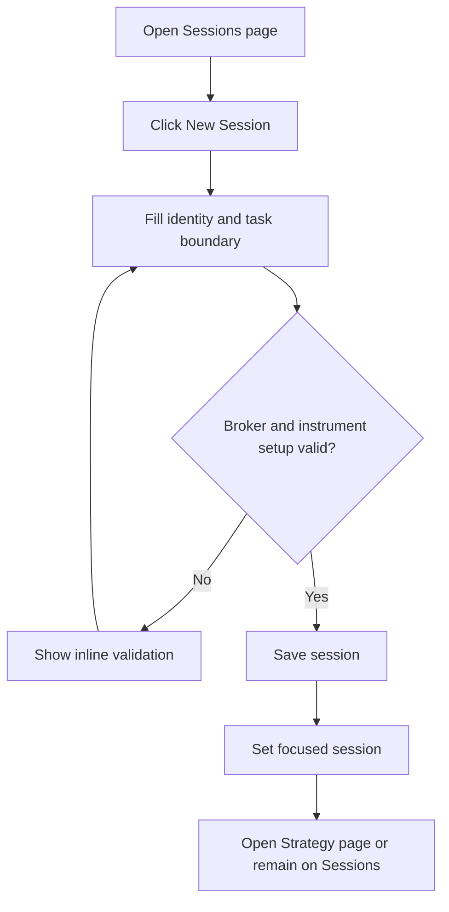
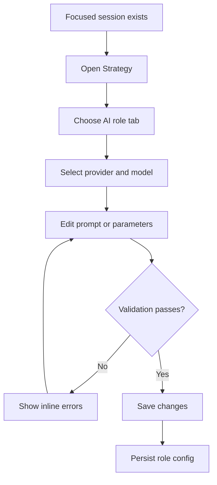
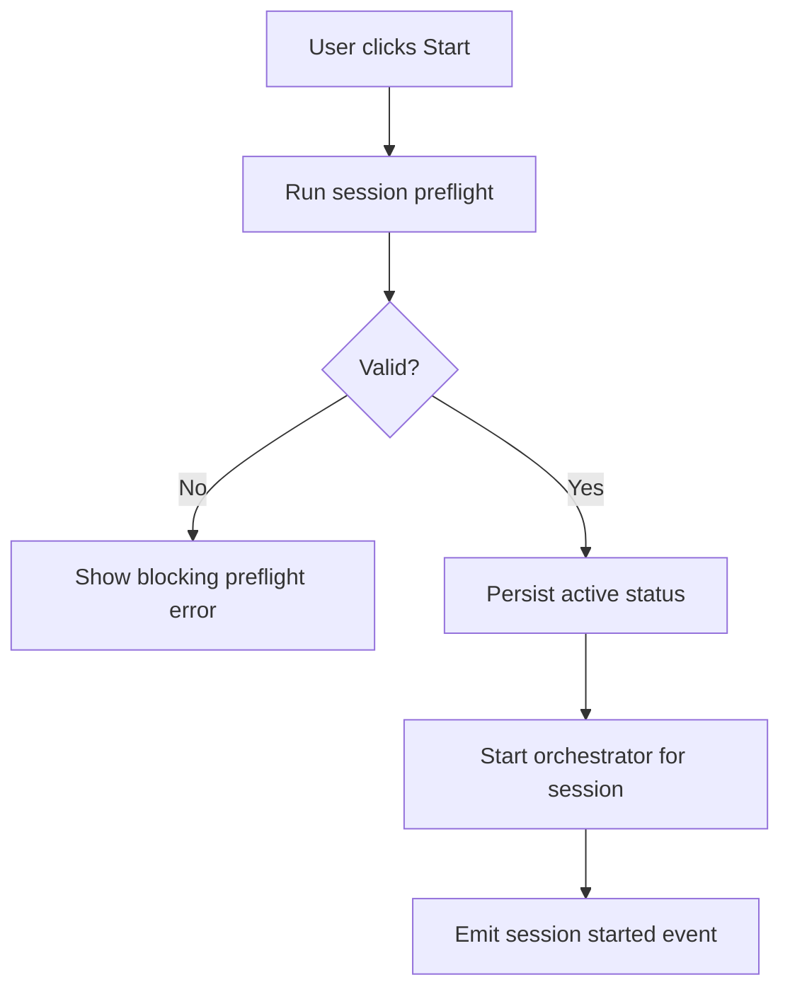
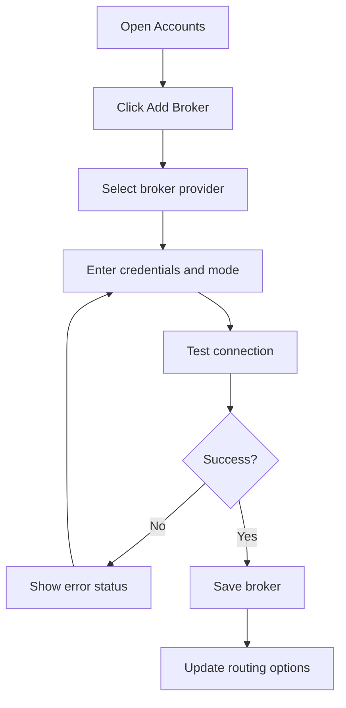

# Workspace, Session, and Model Management — Feature Specification

> **Date:** 2026-04-25
> **Status:** Draft
> **Feature area:** Strategy, sessions, accounts, AI runtime, broker orchestration
> **Depends on:** Electron IPC surface, SQLite schema migrations, OS keychain secrets, broker adapter abstraction, AI SDK provider abstraction

## 1. Summary

Exva currently operates as a single-session, single-provider, mostly stock-oriented desktop app. The current implementation stores one global `session_config` row, one global `session_state` row, one broker connection, and a hardcoded Anthropic model map, while the orchestrator still builds watchlists from fixed stock symbols like `SPY` and `QQQ`. This feature introduces a task-based workspace model where users can run multiple sessions in parallel, each session can target its own instrument universe and execution setup, and the Strategy tab becomes the place where users configure both trading rules and per-agent AI behavior. The goal is to make the product flexible enough for stocks, crypto, and futures without losing operational clarity or allowing session behavior to become ambiguous.

## 2. User Story

> **As a** power user running autonomous trading strategies,
> **I want to** create and manage multiple focused sessions, choose how instruments are selected, connect multiple brokers and AI providers, and customize the AI roles used inside each session,
> **So that** I can run different trading tasks safely in parallel without the product forcing one global setup onto every trade.

Secondary user stories:

> **As a** user,
> **I want to** define the task boundary of a session before it starts,
> **So that** each session is operating on one clear objective instead of mixing unrelated trades.

> **As a** user,
> **I want to** override the model, provider, and system prompt for each AI role,
> **So that** I can tune quality, cost, and behavior per workflow instead of accepting one hardcoded model stack.

> **As a** user,
> **I want to** connect more than one broker and more than one instrument type,
> **So that** I can route orders through the right venue for stocks, crypto, and futures.

## 3. Scope

**In scope:**

- Introduce a first-class `workspace session` concept that replaces the current single global session model.
- Define a mandatory task boundary for every session before it can be started.
- Add a dedicated `Sessions` tab to create, view, pause, stop, archive, and switch focus between sessions.
- Expand the `Strategy` tab so it manages both trading configuration and AI role configuration for the currently selected session.
- Replace stock-centric naming with instrument-centric naming in UI, shared types, and persistence.
- Support multiple instrument classes in the domain model: stocks, crypto, and futures.
- Support multiple brokers per user account, with each broker declaring which instrument classes it supports.
- Support multiple AI providers and provider-specific model choices, starting with Anthropic, OpenAI, and OpenCode-compatible providers.
- Support per-role AI configuration for `researcher_bull`, `researcher_bear`, `reviewer`, `decision_maker`, and `instrument_selector`.
- Move system prompts from inline strings in service code to versioned Markdown prompt assets.
- Introduce internet search capability as an explicit provider/tool configuration instead of an implied future feature.
- Restructure the services layer into subfolders and modules so session, AI, broker, and instrument logic are no longer centered in single top-level files.
- Preserve local-only behavior: secrets remain in the OS keychain and session/trade metadata remains in SQLite.

**Out of scope:**

- Multi-user accounts, cloud sync, or shared team workspaces.
- Cross-session portfolio netting or capital allocation optimization.
- Automated migration of historical trade records to perfectly normalized multi-instrument analytics in this same feature.
- Full options support, forex support, or broker-specific advanced order types.
- Backtesting, paper performance simulation beyond current paper/live mode, or strategy optimization research tooling.
- User-authored arbitrary tools or arbitrary code execution inside AI agents.
- Remote orchestration workers or server-hosted execution.

## 4. Screens & Layout

### 4.1 Sessions Page

**Route / location:** Top navigation item `Sessions`, added to the existing `TopNav` alongside `Dashboard`, `Trades`, `Strategy`, `API Usage`, `Developer`, and `Accounts`.

**When it appears:** User clicks `Sessions` in the top navigation, or the app redirects here on first launch when no session exists.

**Layout:**

```text
Sessions Page
├── Header
│   ├── Title: "Sessions"
│   ├── Subtitle: "Manage focused trading workspaces"
│   └── Primary button: "New Session"
├── Active Session Summary Card
│   ├── Session name
│   ├── Status badge
│   ├── Task boundary summary
│   ├── Broker routing summary
│   ├── AI stack summary
│   └── Quick actions: Start | Pause | Stop | Open Strategy
├── Session Table
│   ├── Toolbar
│   │   ├── Search input
│   │   ├── Status filter
│   │   ├── Instrument class filter
│   │   └── Archive toggle
│   ├── Columns: Focus | Status | Instrument Scope | Selection Mode | Broker Set | AI Preset | Open Trades | Updated | Actions
│   └── Row actions: Focus | Duplicate | Pause/Resume | Stop | Archive
├── Session Detail Drawer
│   ├── Task Definition
│   ├── Instrument Scope
│   ├── Session Risk Limits
│   ├── Assigned Brokers
│   ├── Assigned AI Roles
│   └── Activity Timeline
└── Empty / onboarding panel
    ├── Headline
    ├── Explanation of what a session is
    └── CTA: "Create Your First Session"
```

Layout rules:

- Desktop: header and summary card stay fixed at top of the page body; the session table scrolls vertically.
- Tablet and below: summary card collapses into a stacked card above the table; the detail drawer becomes a full-screen modal.
- The page always shows exactly one focused session. Focusing a different session updates the data shown on `Dashboard`, `Trades`, and `Strategy`.
- Empty state appears when the database has zero non-archived sessions.
- Loading state renders skeletons for the summary card, table rows, and detail drawer.

**Element inventory:**

| Element | Type | Label / Content | State | Action on Interact |
|---------|------|-----------------|-------|-------------------|
| New Session | Button | "New Session" | Always enabled | Opens Create Session modal |
| Search input | Text input | Placeholder: "Search sessions" | Empty by default | Filters session table by name and objective |
| Status filter | Dropdown | `All`, `Draft`, `Idle`, `Active`, `Paused`, `Stopped`, `Archived` | `All` default | Filters session table |
| Instrument class filter | Dropdown | `All`, `Stocks`, `Crypto`, `Futures`, `Mixed` | `All` default | Filters session table |
| Archive toggle | Toggle | "Show archived" | Off by default | Includes archived rows when enabled |
| Focus action | Button | "Focus" | Disabled on currently focused row | Sets the row session as the focused session in renderer and main process |
| Duplicate action | Button | "Duplicate" | Enabled for non-archived rows | Creates a new draft session copied from the selected row |
| Pause/Resume action | Button | "Pause" or "Resume" | Based on row status | Calls session lifecycle action for that row |
| Stop action | Button | "Stop" | Enabled for `active` and `paused` rows | Stops the selected session |
| Archive action | Button | "Archive" | Hidden for active session | Archives the selected session after confirmation |
| Open Strategy | Button | "Open Strategy" | Enabled when a focused session exists | Navigates to `Strategy` page for the focused session |

**States this screen can be in:**

| State | Condition | What the User Sees |
|-------|-----------|-------------------|
| Loading | Sessions query in progress | Skeleton header card, skeleton table, disabled actions |
| Empty | No sessions exist | Empty state panel with explanation and CTA |
| Default | At least one session exists | Summary card, filters, session table |
| Filtered empty | Filters remove all rows | Table area shows "No sessions match these filters." |
| Error | Sessions query fails | Inline error banner: "Failed to load sessions." and button "Retry" |
| Creating | Create modal submit in progress | Modal buttons disabled, primary button text changes to "Creating..." |

### 4.2 Create / Edit Session Modal

**Route / location:** Modal launched from `Sessions` page.

**When it appears:** User clicks `New Session`, `Duplicate`, or opens edit from a session row.

**Layout:**

```text
Create / Edit Session Modal
├── Header
│   ├── Title: "New Session" or "Edit Session"
│   └── Close button
├── Section: Identity
│   ├── Session name input
│   └── Objective textarea
├── Section: Task Boundary
│   ├── Selection mode segmented control
│   ├── Instrument class multiselect
│   ├── Instrument scope input
│   ├── AI picker toggle
│   └── Boundary rules checklist
├── Section: Execution Setup
│   ├── Allowed brokers multiselect
│   ├── Default broker per instrument class
│   ├── Capital limit input
│   └── Paper/live lock
├── Footer
│   ├── Cancel
│   └── Save Session
```

Layout rules:

- Modal width is 760px on desktop and full-screen on small screens.
- Footer remains sticky inside the modal.
- Validation errors render inline below each field.
- The modal cannot be submitted until task boundary, broker compatibility, and capital limit validation pass.

**Element inventory:**

| Element | Type | Label / Content | State | Action on Interact |
|---------|------|-----------------|-------|-------------------|
| Session name | Text input | Placeholder: "e.g. Crypto Breakout Scanner" | Required | Updates local draft |
| Objective | Textarea | Placeholder: "Describe what this session is trying to do." | Required | Updates local draft |
| Selection mode | Segmented control | `Manual shortlist`, `AI-selected universe` | One required | Determines which downstream fields are required |
| Instrument classes | Multiselect | `Stocks`, `Crypto`, `Futures` | At least one required | Limits broker and instrument validation |
| Instrument scope | Textarea | Placeholder differs by mode | Required | Stores manual watchlist or AI selector instructions |
| AI picker toggle | Toggle | "Allow instrument selector agent" | Auto-on for `AI-selected universe` | Enables `instrument_selector` role on save |
| Allowed brokers | Multi-select list | Connected broker names | At least one required | Assigns broker access to the session |
| Default broker mapping | Inline select rows | One select per selected instrument class | Required when multiple compatible brokers exist | Sets routing default |
| Capital limit | Currency input | "Max capital allocated to this session" | Required | Used in risk validation |
| Execution mode lock | Segmented control | `Paper only`, `Live allowed` | Required | Restricts eligible brokers on start |
| Save Session | Button | "Create Session" or "Save Session" | Disabled when invalid or unchanged | Persists session |

**States this screen can be in:**

| State | Condition | What the User Sees |
|-------|-----------|-------------------|
| Default | Opening a valid draft | Inputs editable, save enabled when complete |
| Validation error | Required field missing or incompatible setup | Inline field errors and save disabled |
| Compatibility error | No connected broker supports chosen instrument classes | Error panel: "No connected broker can execute this session." |
| Saving | Save mutation in progress | Footer buttons disabled, spinner in primary action |
| API error | Save fails | Inline banner with exact failure message |

### 4.3 Strategy Page

**Route / location:** Existing `Strategy` page in `src/pages/StrategyConfig.tsx`, repurposed for the currently focused session.

**When it appears:** User clicks `Strategy` in the top navigation after a focused session has been selected.

**Layout:**

```text
Strategy Page
├── Header
│   ├── Title: "Strategy"
│   ├── Focused session chip
│   ├── Status badge
│   └── Save button
├── Left Column
│   ├── Card: Session Trade Rules
│   │   ├── Strategy profile
│   │   ├── Research depth
│   │   ├── Human approval
│   │   └── Max concurrent trades
│   ├── Card: Risk Limits
│   │   ├── Max position size
│   │   ├── Stop loss
│   │   ├── Take profit
│   │   ├── Daily loss limit
│   │   ├── Profit target
│   │   └── Max AI spend per day
│   └── Card: Instrument Policy
│       ├── Instrument classes
│       ├── User-picked vs AI-picked source
│       └── Allowed symbols / query rules summary
├── Right Column
│   ├── Card: AI Role Configuration
│   │   ├── Tabs: Bull Researcher | Bear Researcher | Reviewer | Decision Maker | Instrument Selector
│   │   ├── Provider selector
│   │   ├── Model selector
│   │   ├── Temperature input
│   │   ├── Max tokens input
│   │   ├── Web search toggle
│   │   ├── Prompt source dropdown
│   │   └── System prompt editor
│   ├── Card: Prompt Assets
│   │   ├── Markdown file path
│   │   ├── Version label
│   │   └── "Reset to Default Prompt" action
│   └── Card: Cost / latency summary
│       ├── Estimated provider mix
│       ├── Estimated parallel call count
│       └── Warnings
```

Layout rules:

- Desktop keeps the Save button aligned top-right, matching the current Strategy page pattern.
- The focused session chip is always visible; if no focused session exists the page does not show editable controls.
- The AI role card uses tabs. Tab content scrolls within the card if the prompt editor exceeds viewport height.
- On small screens, the two columns collapse into a single column and the AI role tabs become a segmented row with horizontal scroll.
- Empty state shows when the app has no focused session: "Select or create a session to configure strategy."

**Element inventory:**

| Element | Type | Label / Content | State | Action on Interact |
|---------|------|-----------------|-------|-------------------|
| Focused session chip | Chip | Current session name | Always visible when selected | Opens session switcher popover |
| Save button | Button | "Save Changes" | Disabled when no dirty fields | Saves strategy and AI settings for focused session |
| Strategy profile | Segmented control | `Passive Income`, `Growth`, `Conservative`, `Custom` | One selected | Updates session strategy profile |
| Research depth | Segmented control | `Light`, `Balanced`, `Deep` | One selected | Updates runtime depth preset |
| Human approval | Toggle | "Human Approval Required" | Boolean | Enables approval gate |
| Instrument policy summary | Read-only panel with edit action | Shows selection mode and scope | Depends on session draft | Opens session modal at task boundary section |
| AI role tabs | Tabs | 5 role labels | Selector role tab disabled when session uses manual shortlist | Switches active role form |
| Provider selector | Dropdown | Connected providers | Required | Filters available model options |
| Model selector | Combobox | Provider-specific models | Required | Sets role runtime model |
| Temperature | Number input | `0.0` to `1.0` | Required | Updates role generation params |
| Max tokens | Number input | Integer | Required | Updates role output cap |
| Web search | Toggle | "Allow Internet Search" | Enabled only for roles with tool support | Toggles search tool availability for the role |
| Prompt source | Dropdown | `Default`, `Session override` | Required | Changes prompt editor mode |
| System prompt editor | Markdown textarea | Full prompt body | Required | Saves role prompt override |
| Reset prompt | Button | "Reset to Default Prompt" | Enabled for overridden roles | Restores default prompt asset |

**States this screen can be in:**

| State | Condition | What the User Sees |
|-------|-----------|-------------------|
| Loading | Focused session config query in progress | Skeleton cards and disabled header actions |
| Empty | No focused session | Empty state with button "Go to Sessions" |
| Default | Config loaded | Full editable cards |
| Dirty | Local changes present | Save button enabled, unsaved dot on changed cards |
| Saving | Save request in progress | Inputs disabled, save button text "Saving..." |
| Validation error | Provider/model mismatch or invalid prompt | Inline card errors and save blocked |

### 4.4 Accounts Page

**Route / location:** Existing `Accounts` page in `src/pages/AccountsPage.tsx`.

**When it appears:** User clicks `Accounts` in the top navigation.

**Layout:**

```text
Accounts Page
├── Header
│   ├── Title: "Accounts"
│   └── Subtitle about local secret storage
├── Left Column
│   ├── Card: AI Providers
│   │   ├── Provider rows
│   │   ├── Connected status
│   │   ├── Save key action
│   │   └── Test action
│   └── Card: Web Search Providers
│       ├── Brave row
│       ├── Tavily row
│       └── Default provider selector
├── Right Column
│   ├── Card: Broker Accounts
│   │   ├── Broker list
│   │   ├── Supported instrument classes badges
│   │   ├── Paper/live badge
│   │   ├── Edit action
│   │   ├── Remove action
│   │   └── Add Broker button
│   └── Card: Routing Rules Overview
│       ├── Stocks default broker
│       ├── Crypto default broker
│       └── Futures default broker
└── Footer actions
    ├── Test All Connections
    └── Save Changes
```

Layout rules:

- Retain the existing two-column structure and security messaging.
- The current single `Anthropic` card becomes a repeatable provider list.
- The current single `Broker — Alpaca` card becomes a connected brokers list plus modal.
- Provider secrets remain write-only in the UI: once saved, keys are never displayed back to the user.

**Element inventory:**

| Element | Type | Label / Content | State | Action on Interact |
|---------|------|-----------------|-------|-------------------|
| Add AI provider | Button | "Add Provider" | Always enabled | Opens Add Provider modal |
| Provider type | Dropdown | `Anthropic`, `OpenAI`, `OpenCode-compatible` | Required | Determines credential fields |
| Provider key input | Password input | Placeholder varies by provider | Required | Saves provider credential to keychain |
| Test provider | Button | "Test" | Disabled while request runs | Calls provider connectivity test |
| Add broker | Button | "Add Broker" | Always enabled | Opens Add Broker modal |
| Broker provider | Dropdown | Broker adapter types | Required | Determines credential fields and supported instrument classes |
| Instrument class badges | Display badges | `Stocks`, `Crypto`, `Futures` | Read only | Indicates broker support |
| Routing overview edit | Button | "Edit Routing" | Enabled when >1 compatible broker exists | Opens routing rules modal |
| Save Changes | Button | "Save Changes" | Disabled when no dirty state | Persists accounts and routing updates |

**States this screen can be in:**

| State | Condition | What the User Sees |
|-------|-----------|-------------------|
| Default | Existing accounts loaded | Provider list, broker list, routing overview |
| Empty providers | No AI providers configured | Empty provider card with CTA |
| Empty brokers | No brokers configured | Empty broker card with CTA |
| Testing | Connection test in progress | Row spinner, action disabled |
| Error | Save or test fails | Inline row status badge `Error` and banner with details |

## 5. User Flows

### 5.1 Create a Focused Session

**Entry point:** User clicks `New Session` on the `Sessions` page.

**Exit point:** New session is saved as a draft and becomes the focused session.



1. User lands on `Sessions` and clicks `New Session`.
2. They enter a session name and objective.
3. They choose `Manual shortlist` or `AI-selected universe`.
4. They select one or more instrument classes and provide either a manual shortlist or selector instructions.
5. They assign one or more brokers and choose a default broker per instrument class where required.
6. They click `Create Session`.
7. The system saves the session as `draft`, focuses it, and shows the success toast `Session created.`

**If no compatible broker exists:** The modal shows `No connected broker can execute this session.` and prevents save.

**If AI-selected universe is chosen without selector instructions:** The modal shows `Add selection instructions for the instrument selector agent.` and prevents save.

### 5.2 Configure AI Roles for a Session

**Entry point:** User focuses a session and opens the `Strategy` page.

**Exit point:** AI role settings and prompt overrides are saved to the focused session.



1. User opens `Strategy` for the focused session.
2. They select an AI role tab such as `Reviewer`.
3. They choose the provider and model for that role.
4. They update prompt source, prompt body, search tool access, and generation parameters.
5. They click `Save Changes`.
6. The app validates that the provider is configured, the model field is non-empty, and the prompt body is non-empty.
7. The app persists the role configuration and shows `Strategy changes saved.`

**If the selected provider has no saved credential:** The role card shows `Connect this provider in Accounts before assigning it to a role.` and blocks save.

**If the role enables web search but no search provider is configured:** The card shows `Connect a web search provider to enable internet search for this role.`

### 5.3 Start a Session

**Entry point:** User clicks `Start` in the `Sessions` page summary card or the top session controls.

**Exit point:** Session enters `active` state and the orchestrator starts only that session's tasks.



1. User clicks `Start`.
2. The app validates task boundary completeness, broker compatibility, provider credentials, search tool availability, capital limit, and risk controls.
3. If validation passes, the system marks the session `active`.
4. The orchestrator creates work only for the selected session and uses that session's brokers, instruments, and AI role settings.
5. Dashboard and Trades pages switch to that focused session if they are not already showing it.

**If another active session already uses the same broker in live mode and concurrent use is disallowed by broker capabilities:** The app blocks start and shows `This broker is already reserved by another active live session.`

**If the session is `draft`:** Starting the session automatically promotes it to `idle` first, then to `active` after preflight passes.

### 5.4 Add a Broker and Route Instrument Classes

**Entry point:** User opens `Accounts` and clicks `Add Broker`.

**Exit point:** Broker is saved, tested, and becomes available to session routing.



1. User opens `Accounts` and adds a broker.
2. They select the broker provider and enter credentials.
3. They test the connection.
4. On success, the app saves broker secrets in the OS keychain and broker metadata in SQLite.
5. The routing overview refreshes and newly compatible sessions can use the broker.

**If the broker supports only one instrument class:** The routing rules modal omits unsupported classes.

## 6. Data & Field Mapping

### 6.1 Session Identity and Task Boundary

| UI Label / Element | Field Name in DB/API | Type | Required | Validation Rules | Notes |
|-------------------|---------------------|------|----------|-----------------|-------|
| Session name | `sessions.name` | `string` | Yes | 3-80 chars, trimmed, unique among non-archived sessions | Used in nav chips and tables |
| Objective | `sessions.objective` | `string` | Yes | 10-500 chars | Plain language description of the session's goal |
| Status | `sessions.status` | `enum: draft\|idle\|active\|paused\|stopped\|archived` | Yes | Must be valid enum | Replaces global `session_state` usage |
| Focus flag | `sessions.is_focused` | `boolean` | Yes | Exactly one non-archived row can be true | Renderer and main process must agree |
| Selection mode | `sessions.selection_mode` | `enum: manual_shortlist\|ai_selected_universe` | Yes | Must be valid enum | Defines whether selector role is used |
| Instrument classes | `sessions.instrument_classes` | `json array<instrument_class>` | Yes | At least one item | `stock`, `crypto`, `futures` |
| Instrument scope | `sessions.instrument_scope` | `text` | Yes | Non-empty | Stores symbol list or selector instructions |
| Capital limit | `sessions.capital_limit_usd` | `number` | Yes | Positive | Session-level capital cap |
| Execution mode | `sessions.execution_mode` | `enum: paper_only\|live_allowed` | Yes | Must be valid enum | Used during start preflight |

### 6.2 Strategy and Risk Configuration

| UI Label / Element | Field Name in DB/API | Type | Required | Validation Rules | Notes |
|-------------------|---------------------|------|----------|-----------------|-------|
| Strategy profile | `session_strategies.strategy_profile` | `string` | Yes | Non-empty | Carries forward current `strategy` concept |
| Max position size | `session_strategies.max_position_usd` | `number` | Yes | Positive | Session-specific |
| Stop loss | `session_strategies.stop_loss_pct` | `number` | Yes | `> 0` and `< 100` | Session-specific |
| Take profit | `session_strategies.take_profit_pct` | `number` | Yes | `> 0` and `< 100` | Session-specific |
| Max concurrent trades | `session_strategies.max_concurrent_trades` | `integer` | Yes | 1-50 | Used to set orchestrator concurrency for that session |
| Research depth | `session_strategies.research_depth` | `enum: light\|balanced\|deep` | Yes | Must be valid enum | Reuses current concept |
| Daily loss limit | `session_strategies.daily_loss_limit_usd` | `number` | Yes | Positive | Per-session instead of global singleton |
| Profit target | `session_strategies.profit_target_usd` | `number` | Yes | Positive | Per-session |
| Max AI spend per day | `session_strategies.max_ai_spend_usd` | `number` | Yes | Positive | Per-session |
| Human approval required | `session_strategies.human_approval_required` | `boolean` | Yes | Boolean only | Per-session |

### 6.3 AI Role Configuration

| UI Label / Element | Field Name in DB/API | Type | Required | Validation Rules | Notes |
|-------------------|---------------------|------|----------|-----------------|-------|
| Role name | `session_ai_roles.role` | `enum: researcher_bull\|researcher_bear\|reviewer\|decision_maker\|instrument_selector` | Yes | Must be valid enum | One row per role per session |
| Provider | `session_ai_roles.provider_key` | `string` | Yes | Must reference configured provider account | Examples: `anthropic-main`, `openai-prod` |
| Model | `session_ai_roles.model_id` | `string` | Yes | Non-empty | Provider-specific model identifier |
| Temperature | `session_ai_roles.temperature` | `number` | Yes | `0.0` to `1.0` | Defaults defined by prompt preset |
| Max tokens | `session_ai_roles.max_tokens` | `integer` | Yes | Positive | Per role |
| Web search enabled | `session_ai_roles.web_search_enabled` | `boolean` | Yes | Boolean only | Allowed only for supported roles |
| Prompt source | `session_ai_roles.prompt_source` | `enum: default\|session_override` | Yes | Must be valid enum | Determines prompt resolution |
| Prompt markdown | `session_ai_roles.prompt_markdown` | `text` | Yes | Non-empty | Saved only for override mode |
| Prompt asset path | `session_ai_roles.prompt_asset_path` | `string` | No | Must reference bundled Markdown file when present | Read-only for default mode |

### 6.4 Providers, Brokers, and Routing

| UI Label / Element | Field Name in DB/API | Type | Required | Validation Rules | Notes |
|-------------------|---------------------|------|----------|-----------------|-------|
| AI provider name | `provider_accounts.name` | `string` | Yes | 2-60 chars | User-facing label |
| AI provider type | `provider_accounts.provider_type` | `enum: anthropic\|openai\|opencode` | Yes | Must be valid enum | Determines auth strategy |
| Provider keychain ref | `provider_accounts.secret_ref` | `string` | Yes | Non-empty | Secret value remains in OS keychain |
| Search provider type | `provider_accounts.provider_type` | `enum: brave\|tavily` | Yes | Must be valid enum | Stored in same table with category |
| Broker name | `broker_accounts.name` | `string` | Yes | 2-60 chars | User-facing label |
| Broker provider | `broker_accounts.broker_type` | `string` | Yes | Registered adapter key | Example: `alpaca` |
| Supported classes | `broker_accounts.supported_instrument_classes` | `json array<instrument_class>` | Yes | At least one item | Declared by adapter |
| Broker mode | `broker_accounts.mode` | `enum: paper\|live` | Yes | Must be valid enum | Per broker account |
| Routing rule | `broker_routing.default_broker_account_id` | `string` | Yes | Must reference connected compatible broker | One per instrument class |

**Schema changes required:**

| Table | Change | Column Name | Type | Default | Nullable |
|-------|--------|------------|------|---------|----------|
| `session_config` | Replace with new table family | — | — | — | — |
| `session_state` | Replace with new table family | — | — | — | — |
| `trades` | Rename column | `asset` -> `instrument_symbol` | `text` | — | No |
| `trades` | Add column | `instrument_type` | `text` | `'stock'` | No |
| `trades` | Add column | `session_id` | `text` | — | No |
| `trades` | Add column | `broker_account_id` | `text` | — | Yes |
| `agent_runs` | Add column | `session_id` | `text` | — | No |
| `events` | Add column | `session_id` | `text` | — | Yes |
| `sessions` | Add table | all columns in 6.1 | mixed | see spec | see spec |
| `session_strategies` | Add table | all columns in 6.2 | mixed | see spec | No |
| `session_ai_roles` | Add table | all columns in 6.3 | mixed | see spec | No |
| `provider_accounts` | Add table | provider metadata columns | mixed | — | No |
| `broker_accounts` | Add table | broker metadata columns | mixed | — | No |
| `broker_routing` | Add table | routing rule columns | mixed | — | No |
| `session_broker_assignments` | Add table | `session_id`, `broker_account_id` | mixed | — | No |

## 7. API Contract

All contracts below are renderer-to-main bridge methods today. They should remain typed preload APIs, even if they are described with REST-like semantics for clarity.

#### GET `/api/sessions`

**Purpose:** Return all sessions, optionally filtered, including focused session metadata.

**When called:** On `Sessions` page load and after create/update/archive actions.

**Request:**

```typescript
{
  status?: "draft" | "idle" | "active" | "paused" | "stopped" | "archived";
  instrumentClass?: "stock" | "crypto" | "futures";
  search?: string;
  includeArchived?: boolean;
}
```

**Response:**

```typescript
{
  focusedSessionId: string | null;
  sessions: Array<{
    id: string;
    name: string;
    objective: string;
    status: "draft" | "idle" | "active" | "paused" | "stopped" | "archived";
    selectionMode: "manual_shortlist" | "ai_selected_universe";
    instrumentClasses: Array<"stock" | "crypto" | "futures">;
    brokerCount: number;
    openTradeCount: number;
    updatedAt: string;
  }>;
}
```

**Side effects:** None.

#### POST `/api/sessions`

**Purpose:** Create a new session.

**When called:** User submits `Create Session`.

**Request:**

```typescript
{
  name: string;
  objective: string;
  selectionMode: "manual_shortlist" | "ai_selected_universe";
  instrumentClasses: Array<"stock" | "crypto" | "futures">;
  instrumentScope: string;
  capitalLimitUsd: number;
  executionMode: "paper_only" | "live_allowed";
  brokerAccountIds: string[];
  defaultBrokerByInstrumentClass: Partial<Record<"stock" | "crypto" | "futures", string>>;
}
```

**Response:**

```typescript
// 201 Created
{ id: string; status: "draft" }

// 400 Bad Request
{ error: "Session task boundary is incomplete." }

// 409 Conflict
{ error: "A non-archived session with this name already exists." }
```

**Side effects:** Creates `sessions`, `session_strategies`, default `session_ai_roles`, and broker assignment rows.

#### PATCH `/api/sessions/:sessionId/focus`

**Purpose:** Set the focused session.

**When called:** User clicks `Focus` or session switcher.

**Request:**

```typescript
{}
```

**Response:**

```typescript
// 200 OK
{ focusedSessionId: string }
```

**Side effects:** Clears previous `is_focused` row and sets a new focused row.

#### PATCH `/api/sessions/:sessionId/strategy`

**Purpose:** Save strategy and AI role configuration for one session.

**When called:** User clicks `Save Changes` on the `Strategy` page.

**Request:**

```typescript
{
  strategy: {
    strategyProfile: string;
    maxPositionUsd: number;
    stopLossPct: number;
    takeProfitPct: number;
    maxConcurrentTrades: number;
    researchDepth: "light" | "balanced" | "deep";
    dailyLossLimitUsd: number;
    profitTargetUsd: number;
    maxAiSpendUsd: number;
    humanApprovalRequired: boolean;
  };
  aiRoles: Array<{
    role: "researcher_bull" | "researcher_bear" | "reviewer" | "decision_maker" | "instrument_selector";
    providerKey: string;
    modelId: string;
    temperature: number;
    maxTokens: number;
    webSearchEnabled: boolean;
    promptSource: "default" | "session_override";
    promptMarkdown: string;
  }>;
}
```

**Response:**

```typescript
// 200 OK
{ savedAt: string }

// 400 Bad Request
{ error: "Reviewer role must have a configured provider and model." }

// 409 Conflict
{ error: "Session cannot enable web search because no search provider is configured." }
```

**Side effects:** Updates session strategy row and all AI role rows for that session.

#### POST `/api/sessions/:sessionId/start`

**Purpose:** Start one session.

**When called:** User clicks `Start` for a given session.

**Request:**

```typescript
{}
```

**Response:**

```typescript
// 200 OK
{ status: "active" }

// 400 Bad Request
{ error: "Session is missing a compatible live or paper broker." }

// 409 Conflict
{ error: "This session cannot start because another active session already holds the same broker lock." }
```

**Side effects:** Runs preflight, changes session status, starts session-scoped orchestrator work, emits `session_started`.

#### GET `/api/accounts/providers`

**Purpose:** Return configured AI and search providers.

**When called:** `Accounts` page load and after provider updates.

**Response:**

```typescript
{
  providers: Array<{
    id: string;
    name: string;
    category: "ai" | "search";
    providerType: string;
    isConfigured: boolean;
    lastTestStatus: "unknown" | "ok" | "error";
    updatedAt: string;
  }>;
}
```

#### POST `/api/accounts/brokers`

**Purpose:** Add a broker account.

**When called:** User saves broker modal.

**Request:**

```typescript
{
  brokerType: string;
  name: string;
  mode: "paper" | "live";
  credentials: Record<string, string>;
}
```

**Response:**

```typescript
// 201 Created
{
  id: string;
  supportedInstrumentClasses: Array<"stock" | "crypto" | "futures">;
}
```

**Side effects:** Saves secrets in keychain, saves broker metadata in SQLite, refreshes routing options.

## 8. Permissions & Access Control

Exva is currently a local single-user desktop application. Until multi-user support exists, all signed-in behavior is effectively `local_owner`.

| User Type / Role | Can View | Can Create | Can Edit | Can Delete | Notes |
|-----------------|----------|-----------|---------|-----------|-------|
| `local_owner` | Yes | Yes | Yes | Archive only | Full local access to sessions, strategy, accounts, and prompts |

If a user lacks permission for an action:

- Not applicable in v1 because there is only one local owner role.
- Hidden/disabled controls must not be implemented as fake future permission placeholders.

## 9. Error States & Edge Cases

| Scenario | Trigger | What the User Sees | What the System Does |
|----------|---------|-------------------|---------------------|
| No focused session | User opens `Strategy` with zero sessions | Empty state: "Select or create a session to configure strategy." | No save actions available |
| Name conflict | User creates a session with duplicate active name | Inline error: "A session with this name already exists." | No records created |
| Missing provider secret | Session role references provider with no saved secret | Inline card error and save blocked | Does not persist invalid role assignment |
| Incompatible broker routing | Session includes `futures` but no connected futures broker exists | Modal error: "No connected broker can execute this session." | Start and save blocked |
| Session started without task boundary | Required task fields absent | Preflight error banner: "Complete the session task boundary before starting." | Session remains non-active |
| Focused session archived | User archives currently focused session | Toast: "Focused session archived. Select another session." | Clears focused flag and picks next most recently updated session if available |
| Prompt reset while unsaved edits exist | User clicks reset prompt on dirty role tab | Confirmation dialog: "Discard your custom prompt for this role?" | On confirm, restores default prompt markdown |
| Provider test fails | Invalid credential or network error | Status badge `Error`, banner `Provider test failed.` | Secret is not marked healthy |
| Two active sessions exceed capital allocation | Combined active session capital limits exceed available configured capital pool | Blocking start error with exact overage | Prevents second session from starting |
| Trade/event data without session link during migration | Existing legacy rows have no `session_id` | UI groups them under `Legacy Session` until migration completes | Migration script backfills where possible |

## 10. Copy & Labels

| Location | String | Notes |
|----------|--------|-------|
| Sessions nav item | "Sessions" | New top-level tab |
| Sessions page title | "Sessions" | — |
| Sessions page subtitle | "Manage focused trading workspaces" | — |
| New session button | "New Session" | — |
| Empty state headline | "No sessions yet" | Sessions page |
| Empty state subtext | "Create a focused trading workspace before you start the system." | Sessions page |
| Empty state CTA | "Create Your First Session" | Sessions page |
| Focus action | "Focus" | Session row |
| Duplicate action | "Duplicate" | Session row |
| Archive action | "Archive" | Session row |
| Strategy save button | "Save Changes" | Changes to `Saving...` while request runs |
| Strategy success toast | "Strategy changes saved." | — |
| Session create success toast | "Session created." | — |
| Session start preflight error | "Complete the session task boundary before starting." | Blocking banner |
| Missing provider message | "Connect this provider in Accounts before assigning it to a role." | AI role card |
| Search provider message | "Connect a web search provider to enable internet search for this role." | AI role card |
| Broker compatibility error | "No connected broker can execute this session." | Session modal and start preflight |

## 11. Open Questions

| # | Question | Impact if Unresolved | Owner |
|---|----------|---------------------|-------|
| 1 | Should multiple sessions be allowed to trade live through the same broker account at the same time, or must a live broker account be locked to one active session? | Changes session start validation, broker locking, and UI copy | Product |
| 2 | Is `OpenCode-compatible` meant to be a local OpenAI-compatible endpoint, a managed gateway, or a branded provider with its own auth requirements? | Changes provider schema and account UI | Product / Engineering |
| 3 | Should the `instrument_selector` agent be mandatory whenever selection mode is `AI-selected universe`, or optional if the user provides a screening query? | Changes task boundary validation and role defaults | Product |
| 4 | Do we want one global cash/capital pool across all sessions, or should each session only validate against its own cap with no cross-session guardrails? | Changes risk engine and start/preflight behavior | Product |
| 5 | Are sessions intended to be long-lived reusable strategies, or short-lived task runs that should snapshot prompts and model versions permanently at start time? | Changes persistence model and auditability | Product / Engineering |
| 6 | Which instrument classes are required in the first delivery phase: stocks only with renamed abstractions, or real stock + crypto + futures execution support? | Changes scope and adapter requirements materially | Product |
| 7 | Should prompt Markdown live inside the app bundle only, inside the user data directory, or both with a layered override system? | Changes prompt asset loading and versioning behavior | Engineering |
| 8 | Do we need session-level dashboards and trades pages immediately, or is focused-session filtering sufficient for the first release? | Changes navigation and query surface | Product |

## 12. Recommended Delivery Order

1. Define task boundaries and session ownership model first. The app cannot support multiple sessions safely until `what a session is` is explicit.
2. Replace singleton persistence with session-scoped tables and focused-session state. This is the foundation for every UI and orchestration change.
3. Rename `asset`/`stock` concepts to `instrument` across shared types, DB schema, repositories, and UI copy. Do this before adding more instrument classes.
4. Add the `Sessions` page and focused-session selection. Keep `Dashboard`, `Trades`, and `Strategy` filtered to one focused session in the first pass.
5. Expand the `Strategy` page to include per-role AI configuration and prompt Markdown storage.
6. Generalize AI providers and move prompts out of inline service strings into versioned Markdown assets.
7. Generalize broker accounts and routing so sessions can target compatible brokers per instrument class.
8. Add the `instrument_selector` role and AI-selected universe mode after the session model, prompt assets, and provider abstraction are stable.
9. Refactor the services layer into domain subfolders before adding much more orchestration complexity. Suggested split: `services/session/`, `services/ai/`, `services/broker/`, `services/instrument/`, `services/risk/`.
