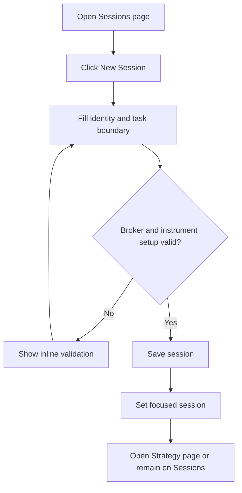
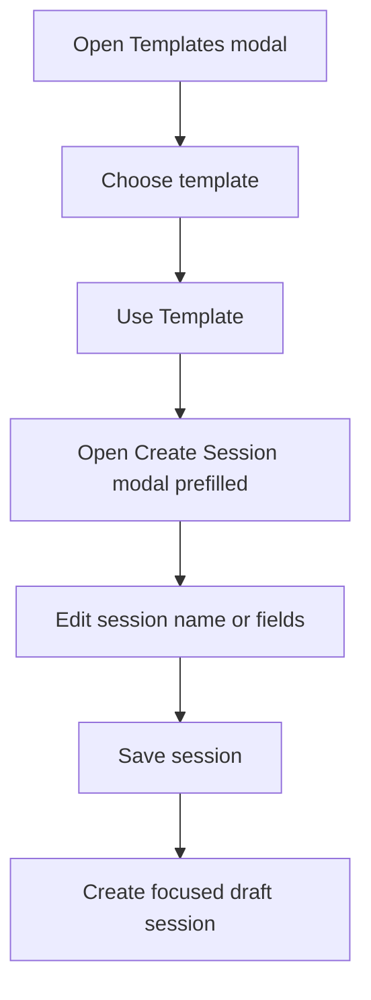
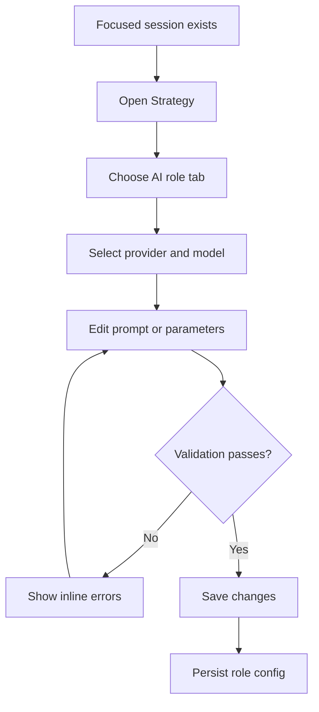
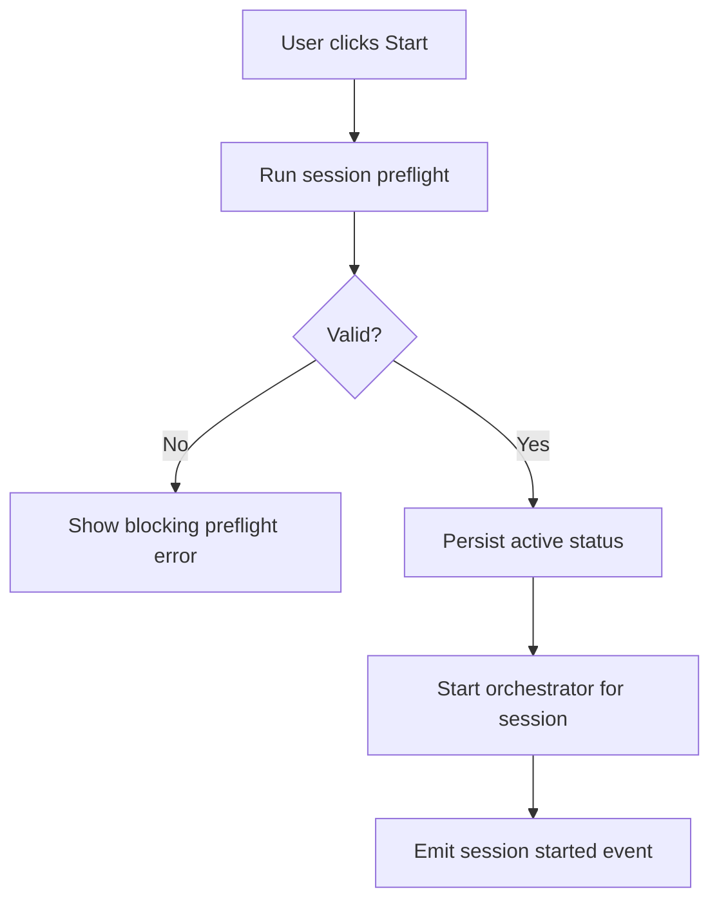
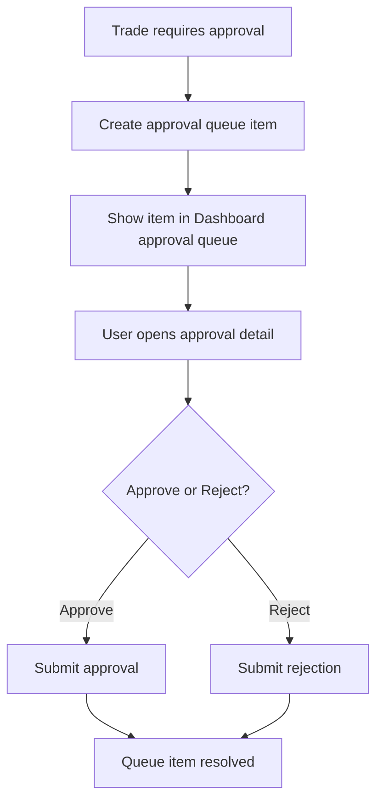
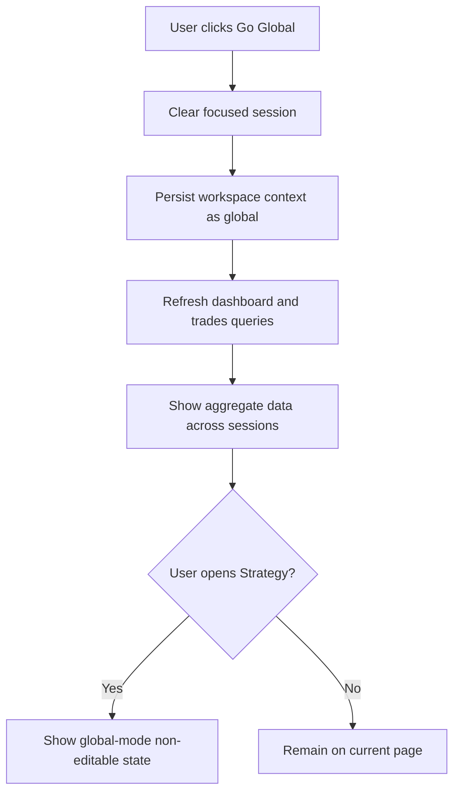
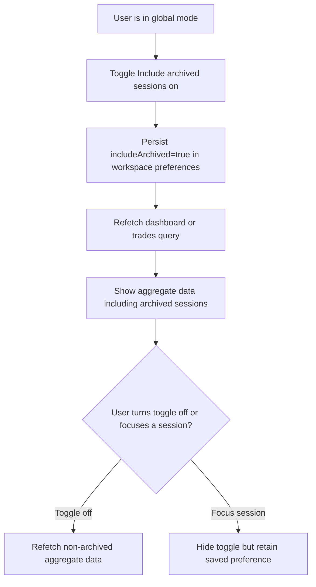
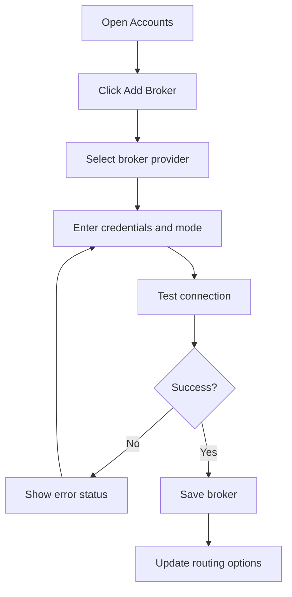

# Workspace, Session, and Model Management — Feature Specification

> **Date:** 2026-04-25
> **Status:** Draft
> **Feature area:** Strategy, sessions, accounts, AI runtime, broker orchestration
> **Depends on:** Electron IPC surface, SQLite schema reset or migrations, OS keychain secrets, broker adapter abstraction, AI SDK provider abstraction

## 1. Summary

Exva currently operates as a single-session, single-provider, mostly stock-oriented desktop app. The current implementation stores one global `session_config` row, one global `session_state` row, one broker connection, and a hardcoded Anthropic model map, while the orchestrator still builds watchlists from fixed stock symbols like `SPY` and `QQQ`. This feature introduces a task-based workspace model where users can run multiple sessions in parallel, each session can target its own instrument universe and execution setup, and the app can switch between a session-focused view and a global workspace view. Session configuration is atomic for a run: once a session is `active` or `paused`, its editable configuration is locked until the run is stopped. The Strategy tab becomes the place where users configure both trading rules and per-agent AI behavior for one selected session, while `Dashboard` and `Trades` can either follow that selected session or aggregate across all sessions in global mode. The feature also introduces a shared approval queue for trades awaiting human approval and first-class session templates for repeatable testing. The goal is to make the product flexible enough for stocks, crypto, and futures without losing operational clarity or allowing session behavior to become ambiguous.

## 2. User Story

> **As a** power user running autonomous trading strategies,
> **I want to** create and manage multiple focused sessions, choose how instruments are selected, connect multiple brokers and AI providers, and customize the AI roles used inside each session,
> **So that** I can run different trading tasks safely in parallel without the product forcing one global setup onto every trade.

Secondary user stories:

> **As a** user,
> **I want to** define the task boundary of a session before it starts,
> **So that** each session is operating on one clear objective instead of mixing unrelated trades.

> **As a** user,
> **I want to** override the model, provider, and system prompt for each AI role,
> **So that** I can tune quality, cost, and behavior per workflow instead of accepting one hardcoded model stack.

> **As a** user,
> **I want to** connect more than one broker and more than one instrument type,
> **So that** I can route orders through the right venue for stocks, crypto, and futures.

## 3. Scope

**In scope:**

- Introduce a first-class `workspace session` concept that replaces the current single global session model.
- Introduce an explicit workspace context mode: `session` or `global`.
- Define a mandatory task boundary for every session before it can be started.
- Add a dedicated `Sessions` tab to create, view, pause, stop, archive, and switch focus between sessions.
- Add first-class session templates so full session configuration can be saved and reused during testing and production setup.
- Expand the `Strategy` tab so it manages both trading configuration and AI role configuration for the currently selected session.
- Allow users to exit session focus and enter `global` mode, where `Dashboard` and `Trades` show aggregate data across all non-archived sessions.
- Add a global-mode archived-data toggle so users can optionally include archived sessions in aggregate `Dashboard` and `Trades` views.
- Persist workspace view preferences locally across app restarts, including the global archived-data toggle.
- Support two app-level capital allocation guardrail modes: `per-session only` and `shared global pool`.
- Add a global approval queue that aggregates pending human-approval decisions across sessions.
- Keep approval queue items pending until the user resolves them; no automatic expiration is applied in v1.
- Lock session editing while a session run is `active` or `paused`; the user must stop the run before changing strategy, prompts, brokers, or task boundary settings.
- Replace stock-centric naming with instrument-centric naming in UI, shared types, and persistence.
- Support multiple instrument classes in the domain model: stocks, crypto, and futures.
- Deliver real proof-of-concept support for stocks, crypto, and futures in the first implementation phase rather than stocks-only renamed abstractions.
- Support multiple brokers per user account, with each broker declaring which instrument classes it supports.
- Support multiple AI providers and provider-specific model choices, starting with Anthropic, OpenAI, and OpenCode-compatible providers.
- Support per-role AI configuration for `researcher_bull`, `researcher_bear`, `reviewer`, `decision_maker`, and `instrument_selector`.
- Allow the user to choose either an AI instrument selector flow or a self-directed/manual session-definition flow; the `instrument_selector` role is optional rather than mandatory.
- Keep AI runtime context isolated to the current session and current workflow chain only. The app must not inject unrelated concurrent-agent or cross-session context into prompts.
- Move system prompts from inline strings in service code to versioned Markdown prompt assets.
- Introduce internet search capability as an explicit provider/tool configuration instead of an implied future feature.
- Restructure the services layer into subfolders and modules so session, AI, broker, and instrument logic are no longer centered in single top-level files.
- Deny order placement when another active session already has the same `instrument_symbol` open or pending on the same `broker_account_id`.
- Preserve local-only behavior: secrets remain in the OS keychain and session/trade metadata remains in SQLite.
- Accept development-stage breaking changes: no backward-compatibility layer is required for existing local DB contents, and local state may be reset during rollout.

**Out of scope:**

- Multi-user accounts, cloud sync, or shared team workspaces.
- Cross-session portfolio netting or capital allocation optimization.
- Backward compatibility with existing local SQLite session, trade, event, or strategy data.
- Full options support, forex support, or broker-specific advanced order types.
- Backtesting, paper performance simulation beyond current paper/live mode, or strategy optimization research tooling.
- User-authored arbitrary tools or arbitrary code execution inside AI agents.
- Remote orchestration workers or server-hosted execution.
- Global default strategy or prompt settings outside the session/template model.

## 4. Screens & Layout

### 4.1 Sessions Page

**Route / location:** Top navigation item `Sessions`, added to the existing `TopNav` alongside `Dashboard`, `Trades`, `Strategy`, `API Usage`, `Developer`, and `Accounts`.

**When it appears:** User clicks `Sessions` in the top navigation, or the app redirects here on first launch when no session exists.

**Layout:**

```text
Sessions Page
├── Header
│   ├── Title: "Sessions"
│   ├── Subtitle: "Manage focused trading workspaces"
│   ├── Secondary button: "Templates"
│   ├── Secondary button: "Go Global"
│   └── Primary button: "New Session"
├── Active Context Summary Card
│   ├── Context label: "Focused Session" or "Global Workspace"
│   ├── Session name or aggregate scope label
│   ├── Status badge or aggregate badge
│   ├── Task boundary summary or global coverage summary
│   ├── Broker routing summary
│   ├── AI stack summary or note that strategy is session-specific
│   └── Quick actions: Session mode -> Start | Pause | Stop | Open Strategy; Global mode -> no session lifecycle actions
├── Session Table
│   ├── Toolbar
│   │   ├── Search input
│   │   ├── Status filter
│   │   ├── Instrument class filter
│   │   └── Archive toggle
│   ├── Columns: Focus | Status | Instrument Scope | Selection Mode | Broker Set | AI Preset | Open Trades | Updated | Actions
│   └── Row actions: Focus | Edit | Duplicate | Save as Template | Pause/Resume | Stop | Archive
├── Session Detail Drawer
│   ├── Task Definition
│   ├── Instrument Scope
│   ├── Session Risk Limits
│   ├── Assigned Brokers
│   ├── Assigned AI Roles
│   └── Activity Timeline
└── Empty / onboarding panel
    ├── Headline
    ├── Explanation of what a session is
    └── CTA: "Create Your First Session"
```

Layout rules:

- Desktop: header and summary card stay fixed at top of the page body; the session table scrolls vertically.
- Tablet and below: summary card collapses into a stacked card above the table; the detail drawer becomes a full-screen modal.
- The page always shows exactly one workspace context: either one focused session or `global` mode.
- Focusing a different session updates the data shown on `Dashboard`, `Trades`, and `Strategy`.
- Clicking `Go Global` clears focused-session context and updates `Dashboard` and `Trades` to aggregate all non-archived sessions.
- In `global` mode, `Strategy` remains available in navigation but renders a non-editable empty state instructing the user to select a session.
- Session rows in `active` or `paused` state remain focusable and duplicatable, but editing is disabled until the run is stopped.
- Empty state appears when the database has zero non-archived sessions.
- Loading state renders skeletons for the summary card, table rows, and detail drawer.

**Element inventory:**

| Element | Type | Label / Content | State | Action on Interact |
|---------|------|-----------------|-------|-------------------|
| New Session | Button | "New Session" | Always enabled | Opens Create Session modal |
| Templates | Button | "Templates" | Always enabled | Opens Session Templates modal |
| Search input | Text input | Placeholder: "Search sessions" | Empty by default | Filters session table by name and objective |
| Status filter | Dropdown | `All`, `Draft`, `Idle`, `Active`, `Paused`, `Stopped`, `Archived` | `All` default | Filters session table |
| Instrument class filter | Dropdown | `All`, `Stocks`, `Crypto`, `Futures`, `Mixed` | `All` default | Filters session table |
| Archive toggle | Toggle | "Show archived" | Off by default | Includes archived rows when enabled |
| Go Global | Button | "Go Global" | Enabled when at least one non-archived session exists and app is not already in global mode | Switches workspace context to global and clears focused session |
| Focus action | Button | "Focus" | Disabled on currently focused row | Sets the row session as the focused session in renderer and main process |
| Edit action | Button | "Edit" | Enabled for `draft`, `idle`, and `stopped`; disabled for `active` and `paused` | Opens edit modal for the selected session |
| Duplicate action | Button | "Duplicate" | Enabled for non-archived rows | Creates a new draft session copied from the selected row, including AI roles and prompts |
| Save as Template | Button | "Save as Template" | Enabled for non-archived rows | Saves the selected session configuration as a reusable template |
| Pause/Resume action | Button | "Pause" or "Resume" | Based on row status | Calls session lifecycle action for that row |
| Stop action | Button | "Stop" | Enabled for `active` and `paused` rows | Stops the selected session |
| Archive action | Button | "Archive" | Hidden for active session | Archives the selected session after confirmation |
| Open Strategy | Button | "Open Strategy" | Enabled when a focused session exists | Navigates to `Strategy` page for the focused session |

**States this screen can be in:**

| State | Condition | What the User Sees |
|-------|-----------|-------------------|
| Loading | Sessions query in progress | Skeleton header card, skeleton table, disabled actions |
| Empty | No sessions exist | Empty state panel with explanation and CTA |
| Default | At least one session exists | Summary card, filters, session table |
| Global | App workspace context is `global` | Summary card labeled `Global Workspace`, `Go Global` disabled, session rows still available for `Focus` |
| Filtered empty | Filters remove all rows | Table area shows "No sessions match these filters." |
| Error | Sessions query fails | Inline error banner: "Failed to load sessions." and button "Retry" |
| Creating | Create modal submit in progress | Modal buttons disabled, primary button text changes to "Creating..." |

### 4.1A Session Templates Modal

**Route / location:** Modal launched from the `Templates` button on the `Sessions` page or from `Save as Template` on a session row.

**When it appears:** User clicks `Templates` or `Save as Template`.

**Layout:**

```text
Session Templates Modal
├── Header
│   ├── Title: "Session Templates"
│   └── Close button
├── Toolbar
│   ├── Search input
│   ├── Instrument class filter
│   └── Save Template button (contextual when launched from session row)
├── Template List
│   ├── Template name
│   ├── Description
│   ├── Instrument classes
│   ├── Source session name
│   ├── Updated at
│   └── Actions: Use Template | Edit Metadata | Delete
└── Empty state
    ├── Headline
    ├── Supporting text
    └── CTA: "Save a Template"
```

Layout rules:

- Modal width is 860px on desktop and full-screen on small screens.
- `Use Template` opens the Create Session modal with all configuration fields prefilled from the template.
- Template payload includes full session configuration except runtime state, run history, and session name uniqueness.
- Templates are latest-snapshot only in v1. Saving a template update replaces the current payload and no history is retained.

**Element inventory:**

| Element | Type | Label / Content | State | Action on Interact |
|---------|------|-----------------|-------|-------------------|
| Search input | Text input | Placeholder: "Search templates" | Empty by default | Filters template list by name and description |
| Instrument class filter | Dropdown | `All`, `Stocks`, `Crypto`, `Futures`, `Mixed` | `All` default | Filters template list |
| Use Template | Button | "Use Template" | Enabled for all template rows | Opens Create Session modal with prefilled data |
| Edit Metadata | Button | "Edit Metadata" | Enabled for all template rows | Opens inline metadata editor |
| Delete | Button | "Delete" | Enabled for all template rows | Deletes selected template after confirmation |
| Save Template | Button | "Save Template" | Enabled when launched from a session row | Persists selected session config as template |

**States this screen can be in:**

| State | Condition | What the User Sees |
|-------|-----------|-------------------|
| Loading | Template query in progress | Skeleton list rows |
| Empty | No templates exist | Empty state with save-template CTA |
| Default | Templates exist | Search, filters, and template list |
| Saving | Template create/update in progress | Buttons disabled, spinner on primary action |
| Error | Template query or save fails | Inline error banner with retry |

### 4.2 Create / Edit Session Modal

**Route / location:** Modal launched from `Sessions` page.

**When it appears:** User clicks `New Session`, `Duplicate`, `Use Template`, or opens edit from a session row.

**Layout:**

```text
Create / Edit Session Modal
├── Header
│   ├── Title: "New Session" or "Edit Session"
│   └── Close button
├── Section: Identity
│   ├── Session name input
│   └── Objective textarea
├── Section: Task Boundary
│   ├── Selection mode segmented control
│   ├── Instrument class multiselect
│   ├── Instrument scope input
│   ├── AI picker toggle
│   └── Boundary rules checklist
├── Section: Execution Setup
│   ├── Allowed brokers multiselect
│   ├── Default broker per instrument class
│   ├── Capital limit input
│   └── Paper/live lock
├── Footer
│   ├── Cancel
│   └── Save Session
```

Layout rules:

- Modal width is 760px on desktop and full-screen on small screens.
- Footer remains sticky inside the modal.
- Validation errors render inline below each field.
- The modal cannot be submitted until task boundary, broker compatibility, and capital limit validation pass.
- When opened from `Use Template`, all session fields except `Session name` are prefilled from the selected template and remain editable.
- When the target session status is `active` or `paused`, this modal must not open.

**Element inventory:**

| Element | Type | Label / Content | State | Action on Interact |
|---------|------|-----------------|-------|-------------------|
| Session name | Text input | Placeholder: "e.g. Crypto Breakout Scanner" | Required | Updates local draft |
| Objective | Textarea | Placeholder: "Describe what this session is trying to do." | Required | Updates local draft |
| Selection mode | Segmented control | `Manual shortlist`, `AI-selected universe` | One required | Determines which downstream fields are required |
| Instrument classes | Multiselect | `Stocks`, `Crypto`, `Futures` | At least one required | Limits broker and instrument validation |
| Instrument scope | Textarea | Placeholder differs by mode | Required | Stores manual watchlist or AI selector instructions |
| AI picker toggle | Toggle | "Allow instrument selector agent" | User-controlled; available when session definition supports selector flow | Enables `instrument_selector` role on save |
| Allowed brokers | Multi-select list | Connected broker names | At least one required | Assigns broker access to the session |
| Default broker mapping | Inline select rows | One select per selected instrument class | Required when multiple compatible brokers exist | Sets routing default |
| Capital limit | Currency input | "Max capital allocated to this session" | Required | Used in risk validation |
| Execution mode lock | Segmented control | `Paper only`, `Live allowed` | Required | Restricts eligible brokers on start |
| Template source banner | Read-only banner | "Using template: [template name]" | Visible only for template-derived create flow | Indicates the draft was prefilled from a template |
| Save Session | Button | "Create Session" or "Save Session" | Disabled when invalid or unchanged | Persists session |

**States this screen can be in:**

| State | Condition | What the User Sees |
|-------|-----------|-------------------|
| Default | Opening a valid draft | Inputs editable, save enabled when complete |
| Validation error | Required field missing or incompatible setup | Inline field errors and save disabled |
| Compatibility error | No connected broker supports chosen instrument classes | Error panel: "No connected broker can execute this session." |
| Saving | Save mutation in progress | Footer buttons disabled, spinner in primary action |
| Locked | User attempts to edit an `active` or `paused` session | Banner: "Stop this session before editing its configuration." and no editable modal opens |
| API error | Save fails | Inline banner with exact failure message |

### 4.3 Dashboard Page

**Route / location:** Existing `Dashboard` page in `src/pages/Dashboard.tsx`.

**When it appears:** User clicks `Dashboard` in the top navigation.

**Layout rules:**

- The page follows the current dashboard layout and metrics cards already present in the renderer.
- When workspace context is `session`, every metric, event feed item, and trade list on the page is filtered to the focused session.
- When workspace context is `global`, every metric, event feed item, and trade list on the page aggregates across all non-archived sessions.
- Global dashboard KPI aggregation is intentionally naive in v1: matching numeric fields are simple sums across included sessions.
- In global mode, an `Include archived sessions` toggle appears near the context chip. It is off by default.
- When the toggle is on, every metric, event feed item, and trade list on the page aggregates across archived and non-archived sessions.
- The toggle restores its last saved value on app launch and whenever the user returns to global mode.
- The top of the page shows a context chip: focused session name in session mode, or `Global Workspace` in global mode.
- Any controls that mutate or start/stop one session remain hidden or disabled in global mode unless the action can be applied safely to all sessions, which is out of scope for this feature.
- A pending approvals panel appears on the dashboard. In global mode it shows a single aggregated queue across sessions.

**Element inventory:**

| Element | Type | Label / Content | State | Action on Interact |
|---------|------|-----------------|-------|-------------------|
| Context chip | Chip | Focused session name or `Global Workspace` | Always visible when sessions exist | Opens session switcher popover |
| Include archived sessions | Toggle | "Include archived sessions" | Visible only in global mode, off by default | Refetches dashboard data including archived sessions when enabled |
| Dashboard stats cards | Read-only cards | Portfolio value, P&L, AI spend, uptime, and related metrics | Values depend on workspace context | No direct action |
| Event feed | Read-only list | Session events or aggregate events | Filtered in session mode, aggregated in global mode | Optional row click opens source record when supported |
| Trades panel | Read-only list | Open trades summary | Filtered in session mode, aggregated in global mode | Navigates to `Trades` page when existing affordance is used |
| Pending approvals panel | Queue list | Pending trade approvals | Filtered to focused session in session mode; aggregated across sessions in global mode | Opens approval detail and allows approve/reject |

**States this screen can be in:**

| State | Condition | What the User Sees |
|-------|-----------|-------------------|
| Loading | Dashboard query in progress | Existing loading skeletons/placeholders |
| Empty | No sessions exist | Empty state directing user to create a session |
| Session | Workspace context is `session` | Dashboard data for one focused session |
| Global | Workspace context is `global` | Aggregate dashboard across all non-archived sessions |
| Global with archived | Workspace context is `global` and archived toggle is on | Aggregate dashboard across all sessions including archived |
| Error | Dashboard query fails | Existing inline error or fallback state |

### 4.4 Trades Page

**Route / location:** Existing `Trades` page in `src/pages/TradesPage.tsx`.

**When it appears:** User clicks `Trades` in the top navigation.

**Layout rules:**

- The page follows the current trades list layout and summary cards already present in the renderer.
- When workspace context is `session`, open and closed trade rows are filtered to the focused session.
- When workspace context is `global`, open and closed trade rows aggregate all non-archived sessions.
- In global mode, an `Include archived sessions` toggle appears near the context chip. It is off by default.
- When the toggle is on, open and closed trade rows aggregate archived and non-archived sessions.
- The toggle restores its last saved value on app launch and whenever the user returns to global mode.
- The page exposes comprehensive filters for `status`, `session`, `broker`, `instrument class`, `execution mode`, and free-text symbol search.
- In global mode, the table must expose a `Session` column so users can see which session owns each trade.
- Existing trade detail drill-down remains available in both modes.

**Element inventory:**

| Element | Type | Label / Content | State | Action on Interact |
|---------|------|-----------------|-------|-------------------|
| Context chip | Chip | Focused session name or `Global Workspace` | Always visible when sessions exist | Opens session switcher popover |
| Include archived sessions | Toggle | "Include archived sessions" | Visible only in global mode, off by default | Refetches trades data including archived sessions when enabled |
| Session filter | Dropdown | Session names + `All Sessions` | Visible in global mode | Filters trades by owning session |
| Broker filter | Dropdown | Connected broker names + `All Brokers` | Visible in session and global mode | Filters trades by broker account |
| Instrument class filter | Dropdown | `All`, `Stocks`, `Crypto`, `Futures` | Visible in session and global mode | Filters trades by instrument class |
| Execution mode filter | Dropdown | `All`, `Paper`, `Live` | Visible in session and global mode | Filters trades by broker execution mode |
| Symbol search | Text input | Placeholder: "Search symbol" | Empty by default | Filters trades by instrument symbol |
| Trade summary cards | Read-only cards | Total trades, open, closed, P&L, and similar metrics | Values depend on workspace context | No direct action |
| Trades table | Data table | Trade rows | Filtered in session mode, aggregated in global mode | Opens trade detail on row click |
| Session column | Table column | Session name | Hidden in session mode, visible in global mode | Allows user to understand trade ownership |

**States this screen can be in:**

| State | Condition | What the User Sees |
|-------|-----------|-------------------|
| Loading | Trades query in progress | Existing loading placeholders |
| Empty | No trades match current workspace context | Empty state message scoped to session or global mode |
| Session | Workspace context is `session` | Trades for one focused session |
| Global | Workspace context is `global` | Trades across all non-archived sessions with `Session` column visible |
| Global with archived | Workspace context is `global` and archived toggle is on | Trades across all sessions including archived with `Session` column visible |
| Error | Trades query fails | Existing inline error or fallback state |

### 4.5 Strategy Page

**Route / location:** Existing `Strategy` page in `src/pages/StrategyConfig.tsx`, repurposed for the currently focused session.

**When it appears:** User clicks `Strategy` in the top navigation.

**Layout:**

```text
Strategy Page
├── Header
│   ├── Title: "Strategy"
│   ├── Focused session chip
│   ├── Status badge
│   └── Save button
├── Left Column
│   ├── Card: Session Trade Rules
│   │   ├── Strategy profile
│   │   ├── Research depth
│   │   ├── Human approval
│   │   └── Max concurrent trades
│   ├── Card: Risk Limits
│   │   ├── Max position size
│   │   ├── Stop loss
│   │   ├── Take profit
│   │   ├── Daily loss limit
│   │   ├── Profit target
│   │   └── Max AI spend per day
│   └── Card: Instrument Policy
│       ├── Instrument classes
│       ├── User-picked vs AI-picked source
│       └── Allowed symbols / query rules summary
├── Right Column
│   ├── Card: AI Role Configuration
│   │   ├── Tabs: Bull Researcher | Bear Researcher | Reviewer | Decision Maker | Instrument Selector
│   │   ├── Provider selector
│   │   ├── Model selector
│   │   ├── Temperature input
│   │   ├── Max tokens input
│   │   ├── Web search toggle
│   │   ├── Prompt source dropdown
│   │   └── System prompt editor
│   ├── Card: Prompt Assets
│   │   ├── Markdown file path
│   │   ├── Version label
│   │   └── "Reset to Default Prompt" action
│   └── Card: Cost / latency summary
│       ├── Estimated provider mix
│       ├── Estimated parallel call count
│       └── Warnings
```

Layout rules:

- Desktop keeps the Save button aligned top-right, matching the current Strategy page pattern.
- The focused session chip is visible in session mode. In global mode the chip is replaced by a `Global Workspace` badge.
- If no focused session exists because the app is in global mode, the page does not show editable controls.
- If the focused session is `active` or `paused`, all strategy and AI inputs are read-only and the page shows a lock banner instructing the user to stop the session before editing.
- The AI role card uses tabs. Tab content scrolls within the card if the prompt editor exceeds viewport height.
- On small screens, the two columns collapse into a single column and the AI role tabs become a segmented row with horizontal scroll.
- Empty state shows when the app has no sessions: "Select or create a session to configure strategy."
- Global-mode state shows when sessions exist but workspace context is `global`: "Global view does not have strategy settings. Select a session to configure strategy."

**Element inventory:**

| Element | Type | Label / Content | State | Action on Interact |
|---------|------|-----------------|-------|-------------------|
| Focused session chip | Chip | Current session name | Always visible when selected | Opens session switcher popover |
| Save button | Button | "Save Changes" | Disabled when no dirty fields or session is `active`/`paused` | Saves strategy and AI settings for focused session |
| Lock banner | Banner | "Stop this session before editing its strategy or AI configuration." | Visible when session is `active` or `paused` | No direct action |
| Strategy profile | Segmented control | `Passive Income`, `Growth`, `Conservative`, `Custom` | One selected | Updates session strategy profile |
| Research depth | Segmented control | `Light`, `Balanced`, `Deep` | One selected | Updates runtime depth preset |
| Human approval | Toggle | "Human Approval Required" | Boolean | Enables approval gate |
| Instrument policy summary | Read-only panel with edit action | Shows selection mode and scope | Depends on session draft | Opens session modal at task boundary section |
| AI role tabs | Tabs | 5 role labels | Selector role tab disabled when session uses manual shortlist | Switches active role form |
| Provider selector | Dropdown | Connected providers | Required | Filters available model options |
| Model selector | Combobox | Provider-specific models | Required | Sets role runtime model |
| Temperature | Number input | `0.0` to `1.0` | Required | Updates role generation params |
| Max tokens | Number input | Integer | Required | Updates role output cap |
| Web search | Toggle | "Allow Internet Search" | Enabled only for roles with tool support | Toggles search tool availability for the role |
| Prompt source | Dropdown | `Default`, `Session override` | Required | Changes prompt editor mode |
| System prompt editor | Markdown textarea | Full prompt body | Required | Saves role prompt override |
| Reset prompt | Button | "Reset to Default Prompt" | Enabled for overridden roles | Restores default prompt asset |

**States this screen can be in:**

| State | Condition | What the User Sees |
|-------|-----------|-------------------|
| Loading | Focused session config query in progress | Skeleton cards and disabled header actions |
| Empty | No sessions exist | Empty state with button "Go to Sessions" |
| Global | Workspace context is `global` | Non-editable state with message `Global view does not have strategy settings. Select a session to configure strategy.` and button `Choose Session` |
| Locked | Focused session is `active` or `paused` | Full config visible but inputs disabled and lock banner shown |
| Default | Config loaded | Full editable cards |
| Dirty | Local changes present | Save button enabled, unsaved dot on changed cards |
| Saving | Save request in progress | Inputs disabled, save button text "Saving..." |
| Validation error | Provider/model mismatch or invalid prompt | Inline card errors and save blocked |

### 4.6 Accounts Page

**Route / location:** Existing `Accounts` page in `src/pages/AccountsPage.tsx`.

**When it appears:** User clicks `Accounts` in the top navigation.

**Layout:**

```text
Accounts Page
├── Header
│   ├── Title: "Accounts"
│   └── Subtitle about local secret storage
├── Left Column
│   ├── Card: AI Providers
│   │   ├── Provider rows
│   │   ├── Connected status
│   │   ├── Save key action
│   │   └── Test action
│   └── Card: Web Search Providers
│       ├── Brave row
│       ├── Tavily row
│       └── Default provider selector
├── Right Column
│   ├── Card: Broker Accounts
│   │   ├── Broker list
│   │   ├── Supported instrument classes badges
│   │   ├── Paper/live badge
│   │   ├── Edit action
│   │   ├── Remove action
│   │   └── Add Broker button
│   ├── Card: Routing Rules Overview
│   │   ├── Stocks default broker
│   │   ├── Crypto default broker
│   │   └── Futures default broker
│   └── Card: Capital Allocation Guardrails
│       ├── Allocation mode
│       └── Shared pool amount
└── Footer actions
    ├── Test All Connections
    └── Save Changes
```

Layout rules:

- Retain the existing two-column structure and security messaging.
- The current single `Anthropic` card becomes a repeatable provider list.
- The current single `Broker — Alpaca` card becomes a connected brokers list plus modal.
- Provider secrets remain write-only in the UI: once saved, keys are never displayed back to the user.
- Capital allocation guardrails are app-level settings, not session-level settings. When `shared global pool` is selected, the pool amount is required.

**Element inventory:**

| Element | Type | Label / Content | State | Action on Interact |
|---------|------|-----------------|-------|-------------------|
| Add AI provider | Button | "Add Provider" | Always enabled | Opens Add Provider modal |
| Provider type | Dropdown | `Anthropic`, `OpenAI`, `OpenCode-compatible` | Required | Determines credential fields |
| Provider key input | Password input | Placeholder varies by provider | Required | Saves provider credential to keychain |
| Test provider | Button | "Test" | Disabled while request runs | Calls provider connectivity test |
| Add broker | Button | "Add Broker" | Always enabled | Opens Add Broker modal |
| Broker provider | Dropdown | Broker adapter types | Required | Determines credential fields and supported instrument classes |
| Instrument class badges | Display badges | `Stocks`, `Crypto`, `Futures` | Read only | Indicates broker support |
| Routing overview edit | Button | "Edit Routing" | Enabled when >1 compatible broker exists | Opens routing rules modal |
| Allocation mode | Segmented control | `Per-session only`, `Shared global pool` | Required | Changes capital guardrail behavior for session start preflight |
| Shared pool amount | Currency input | "Total capital pool" | Required when allocation mode is `Shared global pool` | Sets the shared capital cap across all active sessions |
| Save Changes | Button | "Save Changes" | Disabled when no dirty state | Persists accounts and routing updates |

**States this screen can be in:**

| State | Condition | What the User Sees |
|-------|-----------|-------------------|
| Default | Existing accounts loaded | Provider list, broker list, routing overview |
| Empty providers | No AI providers configured | Empty provider card with CTA |
| Empty brokers | No brokers configured | Empty broker card with CTA |
| Validation error | Shared global pool selected without a valid pool amount | Inline field error and save blocked |
| Testing | Connection test in progress | Row spinner, action disabled |
| Error | Save or test fails | Inline row status badge `Error` and banner with details |

## 5. User Flows

### 5.1 Create a Focused Session

**Entry point:** User clicks `New Session` on the `Sessions` page.

**Exit point:** New session is saved as a draft and becomes the focused session.



1. User lands on `Sessions` and clicks `New Session`.
2. They enter a session name and objective.
3. They choose `Manual shortlist` or `AI-selected universe`.
4. They select one or more instrument classes and provide either a manual shortlist or selector instructions.
5. They assign one or more brokers and choose a default broker per instrument class where required.
6. They click `Create Session`.
7. The system saves the session as `draft`, focuses it, and shows the success toast `Session created.`

**If no compatible broker exists:** The modal shows `No connected broker can execute this session.` and prevents save.

**If AI-selected universe is chosen with the selector toggle enabled but no selector instructions are provided:** The modal shows `Add selection instructions for the instrument selector agent.` and prevents save.

**If AI-selected universe is chosen with the selector toggle disabled:** The user must provide self-directed screening or universe-definition rules in `Instrument scope` instead of a selector-agent prompt.

### 5.2 Create a Session From Template

**Entry point:** User clicks `Templates`, then `Use Template`.

**Exit point:** New session draft is created from the template, with all copied configuration preserved and a user-provided session name.



1. User opens the `Session Templates` modal.
2. They choose an existing template and click `Use Template`.
3. The Create Session modal opens with all strategy, AI role, broker, and task-boundary fields prefilled from the template.
4. The user provides a unique session name and optionally edits any non-runtime field.
5. The app saves a new `draft` session, focuses it, and keeps the template unchanged.

**If the template references a provider or broker that no longer exists:** The create modal opens with those selections cleared and inline validation errors shown.

### 5.3 Configure AI Roles for a Session

**Entry point:** User focuses a session and opens the `Strategy` page.

**Exit point:** AI role settings and prompt overrides are saved to the focused session.



1. User opens `Strategy` for the focused session.
2. They select an AI role tab such as `Reviewer`.
3. They choose the provider and model for that role.
4. They update prompt source, prompt body, search tool access, and generation parameters.
5. They click `Save Changes`.
6. The app validates that the provider is configured, the model field is non-empty, and the prompt body is non-empty.
7. The app persists the role configuration and shows `Strategy changes saved.`

**If the selected provider has no saved credential:** The role card shows `Connect this provider in Accounts before assigning it to a role.` and blocks save.

**If the role enables web search but no search provider is configured:** The card shows `Connect a web search provider to enable internet search for this role.`

**If the session is `active` or `paused`:** The page shows `Stop this session before editing its strategy or AI configuration.` and blocks save.

### 5.4 Start a Session

**Entry point:** User clicks `Start` in the `Sessions` page summary card or the top session controls.

**Exit point:** Session enters `active` state and the orchestrator starts only that session's tasks.



1. User clicks `Start`.
2. The app validates task boundary completeness, broker compatibility, provider credentials, search tool availability, capital limit, and risk controls, including shared-pool constraints when `shared global pool` mode is enabled.
3. If validation passes, the system marks the session `active`.
4. The orchestrator creates work only for the selected session and uses that session's brokers, instruments, and AI role settings.
5. The session configuration becomes immutable for the duration of the run. Editing remains blocked while status is `active` or `paused`.
6. Dashboard and Trades pages switch to that focused session if they are not already showing it.

**If the session is `draft`:** Starting the session automatically promotes it to `idle` first, then to `active` after preflight passes.

**If a manual shortlist already overlaps another active session on the same broker and same instrument:** Start preflight blocks the run immediately.

**If a same-broker, same-instrument conflict is discovered later during runtime candidate generation or order placement:** The specific trade is rejected and the session remains active.

### 5.5 Review Global Approval Queue

**Entry point:** One or more active sessions produce trades that require human approval.

**Exit point:** User approves or rejects a queued trade decision. The queue updates without changing workspace mode.



1. A session with `Human Approval Required` enabled produces a trade candidate.
2. The system creates a pending approval record instead of placing the order immediately.
3. The Dashboard approval queue shows the pending item. In global mode, this queue aggregates all sessions.
4. The user opens the item, reviews trade details, and approves or rejects it.
5. The queue refreshes and the trade either proceeds or is discarded based on the decision.

**If multiple sessions are active:** All pending approvals appear in one global queue with session labels.

### 5.6 Switch to Global Workspace Mode

**Entry point:** User clicks `Go Global` on the `Sessions` page or uses the context switcher from `Dashboard` or `Trades`.

**Exit point:** App enters `global` workspace context. `Dashboard` and `Trades` show aggregate data. `Strategy` becomes non-editable until a session is selected again.



1. User is on `Sessions`, `Dashboard`, or `Trades` and clicks `Go Global`.
2. The system clears the focused session flag.
3. The app updates workspace context to `global` in renderer and main process.
4. `Dashboard` reloads aggregate metrics across all non-archived sessions.
5. `Trades` reloads aggregate trade rows across all non-archived sessions.
6. If the user opens `Strategy`, the app shows a non-editable state telling them to choose a session.

**If no non-archived sessions exist:** `Go Global` is not shown because there is nothing to aggregate.

### 5.7 Include Archived Sessions In Global Mode

**Entry point:** User is already in `global` mode on `Dashboard` or `Trades` and turns on `Include archived sessions`.

**Exit point:** Aggregate queries include archived sessions until the toggle is turned off. The toggle value persists across app restarts and is restored the next time global mode is shown.



1. User enters `global` mode.
2. They enable `Include archived sessions` from `Dashboard` or `Trades`.
3. The renderer saves `globalIncludeArchived = true` through the workspace preferences API and mirrors it in local UI state.
4. The current page refetches its aggregate query with archived inclusion enabled.
5. The UI updates to include archived-session metrics or trade rows.
6. If the user focuses a session, the archived toggle disappears because it is only available in global mode, but the saved preference remains unchanged.

**If there are no archived sessions:** Turning the toggle on does not change the result set, but the toggle state remains on.

**If the app is closed and reopened while global mode is active or later re-entered:** The toggle restores the last saved value from local persistence.

### 5.8 Add a Broker and Route Instrument Classes

**Entry point:** User opens `Accounts` and clicks `Add Broker`.

**Exit point:** Broker is saved, tested, and becomes available to session routing.



1. User opens `Accounts` and adds a broker.
2. They select the broker provider and enter credentials.
3. They test the connection.
4. On success, the app saves broker secrets in the OS keychain and broker metadata in SQLite.
5. The routing overview refreshes and newly compatible sessions can use the broker.

**If the broker supports only one instrument class:** The routing rules modal omits unsupported classes.

## 6. Data & Field Mapping

### 6.1 Session Identity and Task Boundary

| UI Label / Element | Field Name in DB/API | Type | Required | Validation Rules | Notes |
|-------------------|---------------------|------|----------|-----------------|-------|
| Session name | `sessions.name` | `string` | Yes | 3-80 chars, trimmed, unique among non-archived sessions | Used in nav chips and tables |
| Objective | `sessions.objective` | `string` | Yes | 10-500 chars | Plain language description of the session's goal |
| Status | `sessions.status` | `enum: draft\|idle\|active\|paused\|stopped\|archived` | Yes | Must be valid enum | Replaces global `session_state` usage |
| Focus flag | `sessions.is_focused` | `boolean` | Yes | Zero or one non-archived rows can be true | Zero focused rows means workspace context is `global` |
| Selection mode | `sessions.selection_mode` | `enum: manual_shortlist\|ai_selected_universe` | Yes | Must be valid enum | Defines whether selector role is used |
| Instrument classes | `sessions.instrument_classes` | `json array<instrument_class>` | Yes | At least one item | `stock`, `crypto`, `futures` |
| Instrument scope | `sessions.instrument_scope` | `text` | Yes | Non-empty | Stores symbol list or selector instructions |
| Capital limit | `sessions.capital_limit_usd` | `number` | Yes | Positive | Session-level capital cap |
| Execution mode | `sessions.execution_mode` | `enum: paper_only\|live_allowed` | Yes | Must be valid enum | Used during start preflight |
| Session edit lock | derived from `sessions.status` | `boolean` | Yes | `true` when status is `active` or `paused` | Blocks task-boundary, broker, strategy, and AI edits until stopped |

### 6.2 Strategy and Risk Configuration

| UI Label / Element | Field Name in DB/API | Type | Required | Validation Rules | Notes |
|-------------------|---------------------|------|----------|-----------------|-------|
| Strategy profile | `session_strategies.strategy_profile` | `string` | Yes | Non-empty | Carries forward current `strategy` concept |
| Max position size | `session_strategies.max_position_usd` | `number` | Yes | Positive | Session-specific |
| Stop loss | `session_strategies.stop_loss_pct` | `number` | Yes | `> 0` and `< 100` | Session-specific |
| Take profit | `session_strategies.take_profit_pct` | `number` | Yes | `> 0` and `< 100` | Session-specific |
| Max concurrent trades | `session_strategies.max_concurrent_trades` | `integer` | Yes | 1-50 | Used to set orchestrator concurrency for that session |
| Research depth | `session_strategies.research_depth` | `enum: light\|balanced\|deep` | Yes | Must be valid enum | Reuses current concept |
| Daily loss limit | `session_strategies.daily_loss_limit_usd` | `number` | Yes | Positive | Per-session instead of global singleton |
| Profit target | `session_strategies.profit_target_usd` | `number` | Yes | Positive | Per-session |
| Max AI spend per day | `session_strategies.max_ai_spend_usd` | `number` | Yes | Positive | Per-session |
| Human approval required | `session_strategies.human_approval_required` | `boolean` | Yes | Boolean only | Per-session; routes trade candidates into the shared approval queue |

### 6.3 AI Role Configuration

| UI Label / Element | Field Name in DB/API | Type | Required | Validation Rules | Notes |
|-------------------|---------------------|------|----------|-----------------|-------|
| Role name | `session_ai_roles.role` | `enum: researcher_bull\|researcher_bear\|reviewer\|decision_maker\|instrument_selector` | Yes | Must be valid enum | One row per role per session |
| Provider | `session_ai_roles.provider_key` | `string` | Yes | Must reference configured provider account | Examples: `anthropic-main`, `openai-prod` |
| Model | `session_ai_roles.model_id` | `string` | Yes | Non-empty | Provider-specific model identifier |
| Temperature | `session_ai_roles.temperature` | `number` | Yes | `0.0` to `1.0` | Defaults defined by prompt preset |
| Max tokens | `session_ai_roles.max_tokens` | `integer` | Yes | Positive | Per role |
| Web search enabled | `session_ai_roles.web_search_enabled` | `boolean` | Yes | Boolean only | Allowed only for supported roles |
| Prompt source | `session_ai_roles.prompt_source` | `enum: default\|session_override` | Yes | Must be valid enum | Determines prompt resolution |
| Prompt markdown | `session_ai_roles.prompt_markdown` | `text` | Yes | Non-empty | Saved only for override mode |
| Prompt asset path | `session_ai_roles.prompt_asset_path` | `string` | No | Must reference bundled Markdown file when present | Read-only for default mode |

**AI context isolation rules:**

- Agent prompts may include explicit upstream outputs from the same session workflow when that role depends on them.
- Agent prompts must not include summaries of other active sessions, unrelated concurrent candidate trades, or runtime state from separate workflows.
- The approval queue, open positions in other sessions, and concurrent-agent deliberation are not injected into prompts unless that information belongs to the same in-flight workflow by design.

### 6.4 Providers, Brokers, and Routing

| UI Label / Element | Field Name in DB/API | Type | Required | Validation Rules | Notes |
|-------------------|---------------------|------|----------|-----------------|-------|
| AI provider name | `provider_accounts.name` | `string` | Yes | 2-60 chars | User-facing label |
| AI provider type | `provider_accounts.provider_type` | `enum: anthropic\|openai\|opencode` | Yes | Must be valid enum | Determines auth strategy |
| Provider keychain ref | `provider_accounts.secret_ref` | `string` | Yes | Non-empty | Secret value remains in OS keychain |
| Search provider type | `provider_accounts.provider_type` | `enum: brave\|tavily` | Yes | Must be valid enum | Stored in same table with category |
| Broker name | `broker_accounts.name` | `string` | Yes | 2-60 chars | User-facing label |
| Broker provider | `broker_accounts.broker_type` | `string` | Yes | Registered adapter key | Example: `alpaca` |
| Supported classes | `broker_accounts.supported_instrument_classes` | `json array<instrument_class>` | Yes | At least one item | Declared by adapter |
| Broker mode | `broker_accounts.mode` | `enum: paper\|live` | Yes | Must be valid enum | Per broker account |
| Routing rule | `broker_routing.default_broker_account_id` | `string` | Yes | Must reference connected compatible broker | One per instrument class |

### 6.5 Workspace View Preferences

| UI Label / Element | Field Name in DB/API | Type | Required | Validation Rules | Notes |
|-------------------|---------------------|------|----------|-----------------|-------|
| Workspace mode | derived from `sessions.is_focused` plus workspace APIs | `enum: session\|global` | Yes | Must resolve to exactly one mode | `global` when no non-archived session row is focused |
| Include archived sessions | `workspace_preferences.global_include_archived` | `boolean` | Yes | Boolean only | Applies only in global `Dashboard` and `Trades` views; persists across app restarts |
| Capital allocation mode | `workspace_preferences.capital_allocation_mode` | `enum: per_session_only\|shared_global_pool` | Yes | Must be valid enum | App-level risk setting used by session start preflight |
| Shared global capital pool | `workspace_preferences.global_capital_pool_usd` | `number` | Required when allocation mode is `shared_global_pool` | Positive | Ignored when allocation mode is `per_session_only` |
| Preference updated at | `workspace_preferences.updated_at` | `timestamp` | Yes | System-managed | Used for debugging and sync between renderer and main process |

### 6.6 Session Templates

| UI Label / Element | Field Name in DB/API | Type | Required | Validation Rules | Notes |
|-------------------|---------------------|------|----------|-----------------|-------|
| Template name | `session_templates.name` | `string` | Yes | 3-80 chars, unique | User-visible template label |
| Template description | `session_templates.description` | `string` | No | Max 300 chars | Optional purpose note |
| Source session | `session_templates.source_session_id` | `string` | No | Must reference existing session when created from session row | Used for provenance only |
| Template payload | `session_templates.template_payload_json` | `json` | Yes | Must include full session strategy, AI role, broker, and task-boundary config | Runtime state, trades, and events are excluded; latest snapshot only in v1 |
| Updated at | `session_templates.updated_at` | `timestamp` | Yes | System-managed | For sorting and auditing |

### 6.7 Trade Approvals

| UI Label / Element | Field Name in DB/API | Type | Required | Validation Rules | Notes |
|-------------------|---------------------|------|----------|-----------------|-------|
| Approval ID | `trade_approvals.id` | `string` | Yes | Unique | Primary key |
| Session | `trade_approvals.session_id` | `string` | Yes | Must reference existing session | Used for queue scoping |
| Trade candidate | `trade_approvals.trade_id` | `string` | Yes | Must reference pending trade row | One approval item per pending decision |
| Broker account | `trade_approvals.broker_account_id` | `string` | Yes | Must reference existing broker | Used for collision checks |
| Instrument symbol | `trade_approvals.instrument_symbol` | `string` | Yes | Non-empty | Used for display and collision checks |
| Status | `trade_approvals.status` | `enum: pending\|approved\|rejected` | Yes | Must be valid enum | Drives queue behavior; pending items remain until user resolution |
| Requested at | `trade_approvals.requested_at` | `timestamp` | Yes | System-managed | Queue ordering field |
| Resolved at | `trade_approvals.resolved_at` | `timestamp` | No | Null until resolved | Set on approve/reject |
| Decision note | `trade_approvals.decision_note` | `string` | No | Max 500 chars | Optional user note |

**Schema changes required:**

| Table | Change | Column Name | Type | Default | Nullable |
|-------|--------|------------|------|---------|----------|
| `session_config` | Replace with new table family | — | — | — | — |
| `session_state` | Replace with new table family | — | — | — | — |
| `trades` | Rename column | `asset` -> `instrument_symbol` | `text` | — | No |
| `trades` | Add column | `instrument_type` | `text` | `'stock'` | No |
| `trades` | Add column | `session_id` | `text` | — | No |
| `trades` | Add column | `broker_account_id` | `text` | — | Yes |
| `agent_runs` | Add column | `session_id` | `text` | — | No |
| `events` | Add column | `session_id` | `text` | — | Yes |
| `sessions` | Add table | all columns in 6.1 | mixed | see spec | see spec |
| `session_strategies` | Add table | all columns in 6.2 | mixed | see spec | No |
| `session_ai_roles` | Add table | all columns in 6.3 | mixed | see spec | No |
| `provider_accounts` | Add table | provider metadata columns | mixed | — | No |
| `broker_accounts` | Add table | broker metadata columns | mixed | — | No |
| `broker_routing` | Add table | routing rule columns | mixed | — | No |
| `session_broker_assignments` | Add table | `session_id`, `broker_account_id` | mixed | — | No |
| `workspace_preferences` | Add table | `id`, `global_include_archived`, `capital_allocation_mode`, `global_capital_pool_usd`, `updated_at` | mixed | see spec | No |
| `session_templates` | Add table | template metadata + `template_payload_json` | mixed | see spec | No |
| `trade_approvals` | Add table | approval queue columns | mixed | see spec | No |

**Derived workspace context rules:**

- If one non-archived session row has `is_focused = true`, workspace context is `session` for that row.
- If zero non-archived session rows have `is_focused = true` and at least one non-archived session exists, workspace context is `global`.
- If zero non-archived sessions exist, the app shows empty states instead of global aggregates.
- Session configuration is editable only when status is `draft`, `idle`, or `stopped`.
- Multiple sessions may use the same broker concurrently, but the runtime must deny a new trade if the same broker already has an `open` or `pending` trade for the same instrument in another active session.

## 7. API Contract

All contracts below are renderer-to-main bridge methods today. They should remain typed preload APIs, even if they are described with REST-like semantics for clarity.

#### GET `/api/workspace/view`

**Purpose:** Return the current workspace context and persisted workspace view preferences.

**When called:** App launch, renderer bootstrap, and after session-focus or workspace-preference mutations when the UI needs canonical state.

**Response:**

```typescript
{
  workspaceViewMode: "session" | "global";
  focusedSessionId: string | null;
  preferences: {
    globalIncludeArchived: boolean;
    capitalAllocationMode: "per_session_only" | "shared_global_pool";
    globalCapitalPoolUsd: number | null;
  };
}
```

**Side effects:** None.

#### GET `/api/sessions`

**Purpose:** Return all sessions, optionally filtered, including focused session metadata.

**When called:** On `Sessions` page load and after create/update/archive actions.

**Request:**

```typescript
{
  status?: "draft" | "idle" | "active" | "paused" | "stopped" | "archived";
  instrumentClass?: "stock" | "crypto" | "futures";
  search?: string;
  includeArchived?: boolean;
}
```

**Response:**

```typescript
{
  workspaceViewMode: "session" | "global";
  focusedSessionId: string | null;
  sessions: Array<{
    id: string;
    name: string;
    objective: string;
    status: "draft" | "idle" | "active" | "paused" | "stopped" | "archived";
    selectionMode: "manual_shortlist" | "ai_selected_universe";
    instrumentClasses: Array<"stock" | "crypto" | "futures">;
    brokerCount: number;
    openTradeCount: number;
    updatedAt: string;
  }>;
}
```

**Side effects:** None.

#### PATCH `/api/sessions/:sessionId`

**Purpose:** Edit task-boundary and execution-setup fields for a session.

**When called:** User edits a `draft`, `idle`, or `stopped` session from the `Sessions` page.

**Request:**

```typescript
{
  name: string;
  objective: string;
  selectionMode: "manual_shortlist" | "ai_selected_universe";
  instrumentClasses: Array<"stock" | "crypto" | "futures">;
  instrumentScope: string;
  capitalLimitUsd: number;
  executionMode: "paper_only" | "live_allowed";
  brokerAccountIds: string[];
  defaultBrokerByInstrumentClass: Partial<Record<"stock" | "crypto" | "futures", string>>;
}
```

**Response:**

```typescript
// 200 OK
{ savedAt: string }

// 409 Conflict
{ error: "Stop this session before editing its configuration." }
```

**Side effects:** Updates the session row and broker assignments. Does not alter runtime state.

#### POST `/api/sessions`

**Purpose:** Create a new session.

**When called:** User submits `Create Session`.

**Request:**

```typescript
{
  name: string;
  objective: string;
  selectionMode: "manual_shortlist" | "ai_selected_universe";
  instrumentClasses: Array<"stock" | "crypto" | "futures">;
  instrumentScope: string;
  capitalLimitUsd: number;
  executionMode: "paper_only" | "live_allowed";
  brokerAccountIds: string[];
  defaultBrokerByInstrumentClass: Partial<Record<"stock" | "crypto" | "futures", string>>;
}
```

**Response:**

```typescript
// 201 Created
{ id: string; status: "draft" }

// 400 Bad Request
{ error: "Session task boundary is incomplete." }

// 409 Conflict
{ error: "A non-archived session with this name already exists." }
```

**Side effects:** Creates `sessions`, `session_strategies`, default `session_ai_roles`, and broker assignment rows.

#### GET `/api/session-templates`

**Purpose:** Return reusable session templates.

**When called:** `Templates` modal load and after template create, update, or delete actions.

**Response:**

```typescript
{
  templates: Array<{
    id: string;
    name: string;
    description: string | null;
    instrumentClasses: Array<"stock" | "crypto" | "futures">;
    sourceSessionId: string | null;
    sourceSessionName: string | null;
    updatedAt: string;
  }>;
}
```

#### POST `/api/session-templates`

**Purpose:** Create or overwrite a session template from a session configuration snapshot.

**When called:** User clicks `Save as Template` or saves metadata in the Templates modal.

**Request:**

```typescript
{
  name: string;
  description?: string;
  sourceSessionId?: string;
}
```

**Response:**

```typescript
// 201 Created
{ id: string; savedAt: string }
```

**Side effects:** Saves a full configuration snapshot into `session_templates.template_payload_json`.

#### POST `/api/session-templates/:templateId/create-session`

**Purpose:** Start a new draft session from a template.

**When called:** User clicks `Use Template` and submits the prefilled create modal.

**Request:**

```typescript
{
  name: string;
  objective?: string;
  overrides?: Partial<{
    instrumentScope: string;
    capitalLimitUsd: number;
    executionMode: "paper_only" | "live_allowed";
  }>;
}
```

**Response:**

```typescript
// 201 Created
{ id: string; status: "draft" }
```

**Side effects:** Creates a new session plus strategy, AI roles, and broker assignments using the template snapshot as the base payload.

#### PATCH `/api/sessions/:sessionId/focus`

**Purpose:** Set the focused session.

**When called:** User clicks `Focus` or session switcher.

**Request:**

```typescript
{}
```

**Response:**

```typescript
// 200 OK
{ workspaceViewMode: "session"; focusedSessionId: string }
```

**Side effects:** Clears previous `is_focused` row and sets a new focused row.

#### PATCH `/api/workspace/view`

**Purpose:** Switch the app between `session` and `global` workspace context.

**When called:** User clicks `Go Global` or chooses a session from a cross-page context switcher.

**Request:**

```typescript
{
  mode: "global";
}
```

**Response:**

```typescript
// 200 OK
{ workspaceViewMode: "global"; focusedSessionId: null }

// 400 Bad Request
{ error: "Global view requires at least one non-archived session." }
```

**Side effects:** Clears all `is_focused` rows, refreshes session-scoped caches in renderer, and causes `Dashboard` and `Trades` to refetch in aggregate mode.

#### PATCH `/api/workspace/preferences`

**Purpose:** Persist local workspace-view preferences used by global-mode pages.

**When called:** User toggles `Include archived sessions` on `Dashboard` or `Trades`.

**Request:**

```typescript
{
  globalIncludeArchived: boolean;
  capitalAllocationMode?: "per_session_only" | "shared_global_pool";
  globalCapitalPoolUsd?: number | null;
}
```

**Response:**

```typescript
// 200 OK
{
  globalIncludeArchived: boolean;
  capitalAllocationMode: "per_session_only" | "shared_global_pool";
  globalCapitalPoolUsd: number | null;
  savedAt: string;
}
```

**Side effects:** Updates the singleton `workspace_preferences` row in SQLite so the next app launch restores the same toggle value.

#### GET `/api/dashboard`

**Purpose:** Return dashboard metrics, events, and trade summaries for the current workspace context.

**When called:** `Dashboard` page load, session focus change, or switch into `global` mode.

**Request:**

```typescript
{
  includeArchived?: boolean;
}
```

If `includeArchived` is omitted in global mode, the app uses the persisted `workspace_preferences.global_include_archived` value. In session mode this field is ignored.

Global aggregation uses simple numeric summation in v1; no weighting, normalization, or cross-session deduplication algorithm is applied.

**Response:**

```typescript
// 200 OK
{
  workspaceViewMode: "session" | "global";
  focusedSessionId: string | null;
  sessionName: string | null;
  metrics: Record<string, number | string | null>;
  recentEvents: Array<{
    id: string;
    sessionId: string | null;
    sessionName: string;
    type: string;
    createdAt: string;
  }>;
  openTradesPreview: Array<{
    id: string;
    sessionId: string;
    sessionName: string;
    instrumentSymbol: string;
    side: "buy" | "sell";
    status: string;
  }>;
}
```

**Side effects:** None.

#### GET `/api/trades`

**Purpose:** Return trade list and summary metrics for the current workspace context.

**When called:** `Trades` page load, session focus change, or switch into `global` mode.

**Request:**

```typescript
{
  status?: "open" | "closed" | "all";
  sessionId?: string;
  brokerAccountId?: string;
  instrumentClass?: "stock" | "crypto" | "futures";
  executionMode?: "paper" | "live";
  symbolSearch?: string;
  includeArchived?: boolean;
}
```

If `includeArchived` is omitted in global mode, the app uses the persisted `workspace_preferences.global_include_archived` value. In session mode this field is ignored.

**Response:**

```typescript
// 200 OK
{
  workspaceViewMode: "session" | "global";
  focusedSessionId: string | null;
  trades: Array<{
    id: string;
    sessionId: string;
    sessionName: string;
    instrumentSymbol: string;
    instrumentType: "stock" | "crypto" | "futures";
    status: string;
    side: "buy" | "sell";
    openedAt: string;
    closedAt: string | null;
  }>;
  summary: {
    total: number;
    open: number;
    closed: number;
  };
}
```

**Side effects:** None.

#### GET `/api/approvals`

**Purpose:** Return pending or resolved approval queue items for the current workspace context.

**When called:** Dashboard load, global/session context switch, and after approval actions.

**Request:**

```typescript
{
  status?: "pending" | "approved" | "rejected";
}
```

**Response:**

```typescript
{
  workspaceViewMode: "session" | "global";
  approvals: Array<{
    id: string;
    sessionId: string;
    sessionName: string;
    tradeId: string;
    instrumentSymbol: string;
    brokerAccountId: string;
    brokerName: string;
    status: "pending" | "approved" | "rejected";
    requestedAt: string;
  }>;
}
```

Pending approval items remain open until the user explicitly approves or rejects them.

#### POST `/api/approvals/:approvalId/decision`

**Purpose:** Approve or reject a queued human-approval item.

**When called:** User acts on a queue item from the dashboard approval panel or approval detail.

**Request:**

```typescript
{
  decision: "approved" | "rejected";
  decisionNote?: string;
}
```

**Response:**

```typescript
// 200 OK
{ status: "approved" | "rejected"; resolvedAt: string }
```

**Side effects:** Marks the queue item resolved and either submits or suppresses the underlying trade action.

#### PATCH `/api/sessions/:sessionId/strategy`

**Purpose:** Save strategy and AI role configuration for one session.

**When called:** User clicks `Save Changes` on the `Strategy` page.

**Request:**

```typescript
{
  strategy: {
    strategyProfile: string;
    maxPositionUsd: number;
    stopLossPct: number;
    takeProfitPct: number;
    maxConcurrentTrades: number;
    researchDepth: "light" | "balanced" | "deep";
    dailyLossLimitUsd: number;
    profitTargetUsd: number;
    maxAiSpendUsd: number;
    humanApprovalRequired: boolean;
  };
  aiRoles: Array<{
    role: "researcher_bull" | "researcher_bear" | "reviewer" | "decision_maker" | "instrument_selector";
    providerKey: string;
    modelId: string;
    temperature: number;
    maxTokens: number;
    webSearchEnabled: boolean;
    promptSource: "default" | "session_override";
    promptMarkdown: string;
  }>;
}
```

**Response:**

```typescript
// 200 OK
{ savedAt: string }

// 400 Bad Request
{ error: "Reviewer role must have a configured provider and model." }

// 409 Conflict
{ error: "Session cannot enable web search because no search provider is configured." }
```

**Side effects:** Updates session strategy row and all AI role rows for that session.

If the target session is `active` or `paused`, the endpoint must return:

```typescript
// 409 Conflict
{ error: "Stop this session before editing its strategy or AI configuration." }
```

#### POST `/api/sessions/:sessionId/start`

**Purpose:** Start one session.

**When called:** User clicks `Start` for a given session.

**Request:**

```typescript
{}
```

**Response:**

```typescript
// 200 OK
{ status: "active" }

// 400 Bad Request
{ error: "Session is missing a compatible live or paper broker." }

// 409 Conflict
{ error: "Another active session already has this broker trading the same instrument." }
```

**Side effects:** Runs preflight, changes session status, starts session-scoped orchestrator work, emits `session_started`.

#### GET `/api/accounts/providers`

**Purpose:** Return configured AI and search providers.

**When called:** `Accounts` page load and after provider updates.

**Response:**

```typescript
{
  providers: Array<{
    id: string;
    name: string;
    category: "ai" | "search";
    providerType: string;
    isConfigured: boolean;
    lastTestStatus: "unknown" | "ok" | "error";
    updatedAt: string;
  }>;
}
```

#### POST `/api/accounts/brokers`

**Purpose:** Add a broker account.

**When called:** User saves broker modal.

**Request:**

```typescript
{
  brokerType: string;
  name: string;
  mode: "paper" | "live";
  credentials: Record<string, string>;
}
```

**Response:**

```typescript
// 201 Created
{
  id: string;
  supportedInstrumentClasses: Array<"stock" | "crypto" | "futures">;
}
```

**Side effects:** Saves secrets in keychain, saves broker metadata in SQLite, refreshes routing options.

## 8. Permissions & Access Control

Exva is currently a local single-user desktop application. Until multi-user support exists, all signed-in behavior is effectively `local_owner`.

| User Type / Role | Can View | Can Create | Can Edit | Can Delete | Notes |
|-----------------|----------|-----------|---------|-----------|-------|
| `local_owner` | Yes | Yes | Yes | Archive only | Full local access to sessions, strategy, accounts, and prompts |

If a user lacks permission for an action:

- Not applicable in v1 because there is only one local owner role.
- Hidden/disabled controls must not be implemented as fake future permission placeholders.

## 9. Error States & Edge Cases

| Scenario | Trigger | What the User Sees | What the System Does |
|----------|---------|-------------------|---------------------|
| No sessions exist | User opens `Strategy` with zero sessions | Empty state: "Select or create a session to configure strategy." | No save actions available |
| Name conflict | User creates a session with duplicate active name | Inline error: "A session with this name already exists." | No records created |
| Missing provider secret | Session role references provider with no saved secret | Inline card error and save blocked | Does not persist invalid role assignment |
| Incompatible broker routing | Session includes `futures` but no connected futures broker exists | Modal error: "No connected broker can execute this session." | Start and save blocked |
| Session started without task boundary | Required task fields absent | Preflight error banner: "Complete the session task boundary before starting." | Session remains non-active |
| Global mode opens Strategy | User enters `global` mode and opens `Strategy` | Non-editable state: "Global view does not have strategy settings. Select a session to configure strategy." | No save actions available |
| Edit attempted during active run | User tries to edit an `active` or `paused` session | Banner: "Stop this session before editing its configuration." | Save/edit APIs return `409 Conflict` |
| Global archived toggle enabled with no archived sessions | User turns on `Include archived sessions` but there are no archived sessions | No visible data change; toggle stays on | Query still succeeds with same aggregate result |
| Focused session archived | User archives currently focused session | Toast: "Focused session archived. Switched to global view." | Clears focused flag and enters global mode if other sessions remain; otherwise shows empty state |
| Prompt reset while unsaved edits exist | User clicks reset prompt on dirty role tab | Confirmation dialog: "Discard your custom prompt for this role?" | On confirm, restores default prompt markdown |
| Provider test fails | Invalid credential or network error | Status badge `Error`, banner `Provider test failed.` | Secret is not marked healthy |
| Two active sessions exceed capital allocation | Combined active session capital limits exceed the configured shared global capital pool | Blocking start error with exact overage | Prevents the next session from starting while shared-pool mode is enabled |
| Same broker + same instrument collision | An active session attempts to place a trade where another active session already has the same instrument open or pending on the same broker | Event row and rejection message: "Another active session already has this broker trading the same instrument." | New trade is rejected, existing trade remains unchanged |
| Persisted archived toggle conflicts with session mode | App restores `globalIncludeArchived = true` while a focused session is active | Toggle is hidden and no archived aggregation is applied | Saved preference is preserved until user re-enters global mode |

## 10. Copy & Labels

| Location | String | Notes |
|----------|--------|-------|
| Sessions nav item | "Sessions" | New top-level tab |
| Sessions page title | "Sessions" | — |
| Sessions page subtitle | "Manage focused trading workspaces" | — |
| New session button | "New Session" | — |
| Templates button | "Templates" | Sessions page |
| Go global button | "Go Global" | Sessions page and context switcher |
| Empty state headline | "No sessions yet" | Sessions page |
| Empty state subtext | "Create a focused trading workspace before you start the system." | Sessions page |
| Empty state CTA | "Create Your First Session" | Sessions page |
| Focus action | "Focus" | Session row |
| Edit action | "Edit" | Session row |
| Duplicate action | "Duplicate" | Session row |
| Save as template action | "Save as Template" | Session row |
| Archive action | "Archive" | Session row |
| Strategy save button | "Save Changes" | Changes to `Saving...` while request runs |
| Strategy success toast | "Strategy changes saved." | — |
| Session create success toast | "Session created." | — |
| Template create success toast | "Template saved." | — |
| Global summary label | "Global Workspace" | Summary card and context chip |
| Global archived toggle | "Include archived sessions" | Visible only in global mode on `Dashboard` and `Trades` |
| Strategy global-state message | "Global view does not have strategy settings. Select a session to configure strategy." | Strategy page |
| Strategy global-state CTA | "Choose Session" | Strategy page |
| Strategy locked message | "Stop this session before editing its strategy or AI configuration." | Strategy page |
| Session locked message | "Stop this session before editing its configuration." | Sessions page / modal |
| Approval queue title | "Pending Approvals" | Dashboard |
| Approval approve action | "Approve" | Approval queue item |
| Approval reject action | "Reject" | Approval queue item |
| Allocation mode label | "Capital Allocation" | Accounts page |
| Allocation mode option | "Per-session only" | Accounts page |
| Allocation mode option | "Shared global pool" | Accounts page |
| Shared pool amount label | "Total capital pool" | Accounts page |
| Session start preflight error | "Complete the session task boundary before starting." | Blocking banner |
| Missing provider message | "Connect this provider in Accounts before assigning it to a role." | AI role card |
| Search provider message | "Connect a web search provider to enable internet search for this role." | AI role card |
| Broker compatibility error | "No connected broker can execute this session." | Session modal and start preflight |

## 11. Resolved Decisions

| # | Decision | Notes |
|---|----------|-------|
| 1 | `OpenCode-compatible` means a user-configured OpenAI-compatible endpoint stored as provider metadata (`baseUrl`) and authenticated with the user's own key. | Treat it as a local or user-chosen compatible endpoint, not a managed Exva gateway. |
| 2 | `shared global pool` is enforced against a user-entered fixed amount in v1. | Do not depend on broker-reported buying power/cash for the first implementation. Broker-aware capital sync can be a later enhancement. |
| 3 | Prompt Markdown lives in the app bundle by default, with session-level DB overrides for custom prompts. | Do not add a user-data layered prompt file system in v1. |
| 4 | v1 approval UX uses the dashboard panel plus existing app-level badge/event refresh only. | No sounds, OS notifications, or extra cross-page notification surfaces are required in v1. |
## 12. Recommended Delivery Order

1. Define task boundaries and session ownership model first. The app cannot support multiple sessions safely until `what a session is` is explicit.
2. Replace singleton persistence with session-scoped tables and focused-session state. This is the foundation for every UI and orchestration change.
3. Rename `asset`/`stock` concepts to `instrument` across shared types, DB schema, repositories, and UI copy. Do this before adding more instrument classes.
4. Add the `Sessions` page, focused-session selection, first-class templates, and explicit `global` workspace mode. `Dashboard` and `Trades` should support both session-filtered and global aggregate queries in the first pass, while `Strategy` stays session-only.
5. Expand the `Strategy` page to include per-role AI configuration, prompt Markdown storage, and active-run edit locks.
6. Add the shared approval queue so human-reviewed sessions have one clear place for pending decisions.
7. Generalize AI providers and move prompts out of inline service strings into versioned Markdown assets.
8. Generalize broker accounts and routing so sessions can target compatible brokers per instrument class and enforce same-broker/same-instrument collision denial.
9. Add the `instrument_selector` role and AI-selected universe mode after the session model, prompt assets, and provider abstraction are stable.
10. Refactor the services layer into domain subfolders before adding much more orchestration complexity. Suggested split: `services/session/`, `services/ai/`, `services/broker/`, `services/instrument/`, `services/risk/`.
