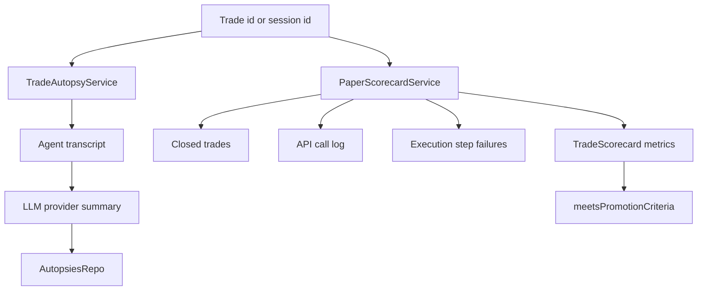

# analytics

This folder explains completed trading behavior after the fact. It turns trades, agent transcripts, API spend, execution steps, and mock scenarios into autopsies and paper scorecards that help decide what to improve before trusting a strategy more.

## How it works

- `trade-autopsy-service.ts` creates post-trade narrative summaries. It loads the trade, gathers all agent messages for that trade, builds a transcript prompt, and asks the provider used by the latest agent message to summarize what worked, what failed, and one process improvement.
- Autopsy generation defaults to OpenRouter/Gemma constants only when the trade transcript does not identify a provider/model. If the model call fails, the service stores a fallback summary using recent agent outputs and final PnL instead of failing the user action.
- Generated autopsies are persisted with `created_by: "user"`, the model id used, the trade id, session id, summary text, and timestamp.
- `paper-scorecard-service.ts` aggregates closed trades for one session. It computes win/loss counts, win rate, average win/loss, expectancy, profit factor, net PnL, AI/data spend, net PnL after costs, max drawdown, trade frequency, average hold time, exit reasons, rejection reasons, and mock scenario coverage.
- API spend comes from `apiCallLog.listByScope({ sessionId })` split by `call_type` of `ai` and `data`.
- Rejection reason breakdown comes from failed session execution steps and their `lastErrorCode`, so scorecards can show whether strategy failures were from risk gates, broker errors, provider issues, or validation.
- `meetsPromotionCriteria` is a deterministic threshold helper for paper-to-live evaluation. Defaults require at least 100 trades, at least 40% win rate, non-negative expectancy, and no more than 20% max drawdown, with optional scenario coverage requirements.
- Analytics code should read historical records and write analytics artifacts only. It should not influence a live trade currently in progress.

## Flow

## Terms

- **Trade autopsy** — saved post-mortem summary for one trade using agent transcripts and final PnL.
- **Paper scorecard** — aggregate performance report for a paper/mock session.
- **Expectancy** — expected PnL per trade: win-rate-weighted average win minus loss-rate-weighted average loss.
- **Profit factor** — gross wins divided by gross losses.
- **Scenario coverage** — count of closed trades tagged with each mock scenario kind.
- **Promotion criteria** — threshold set used to decide whether paper results are good enough for the next environment.
