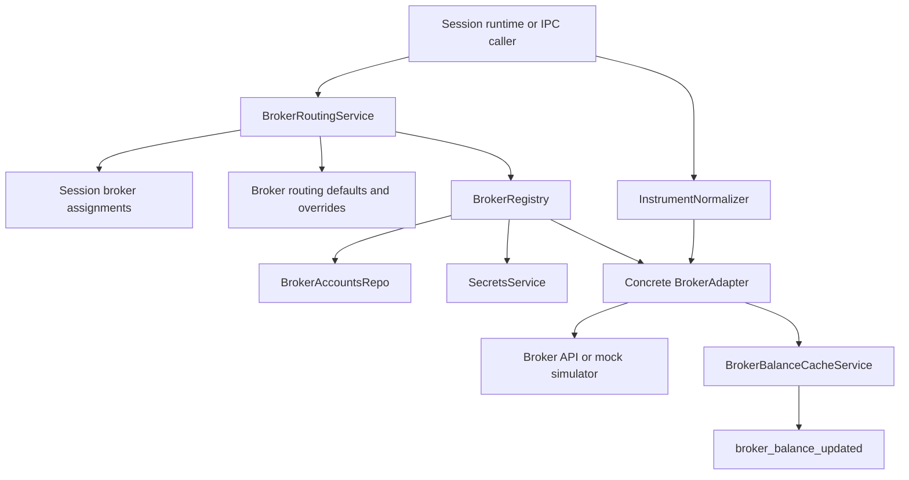

# broker

This folder is the broker doorway for the main process. Everything that needs to talk to an exchange, route a trade to the right account, cache account balance, or translate Exva's symbol into a broker-specific symbol comes through here first.

## How it works

- `broker-registry.ts` builds and caches a `BrokerAdapter` for a broker account. It reads the broker account row, fetches the saved secret from `SecretsService`, validates the payload for the broker type, and returns the concrete adapter.
- Supported adapter targets are Alpaca for stocks, Coinbase Advanced Trade for crypto, Tradovate for futures, Polymarket for prediction markets, and the mock simulator for paper/dev scenarios.
- `broker-routing-service.ts` chooses which broker account a session should use for an `InstrumentClass`. The order is session override, workspace/default routing, then a single compatible assignment fallback. If multiple accounts are compatible and no route is configured, it throws `ROUTING_AMBIGUOUS` instead of guessing.
- `broker-capital-service.ts` describes broker account capacity from persisted assignments and cached balances. It reports allocated capital, free capital, stale balance state, active session count, and whether a broker has hit its session cap.
- `broker-balance-cache-service.ts` refreshes balances through the adapter and stores the cached value on the broker account row. `broker-balance-ticker.ts` periodically refreshes stale balances and emits `broker_balance_updated`.
- `instrument-normalizer.ts` is the last translation layer before adapter calls. Exva uses canonical symbols internally, while adapters may need wire formats such as `BTC-USD` for Coinbase, stock symbols without dashes for Alpaca, or untouched condition IDs for prediction markets.
- `broker-service.ts` is intentionally thin. It exists for legacy IPC paths that close by broker account and order id, while old single-Alpaca save/test/remove methods return guidance to use the broker account list.
- Broker services should not decide trading intent. They receive an already-approved order, normalize/reroute it, and delegate execution or account reads to the selected adapter.

## Flow

## Terms

- **Broker account** — persisted account configuration for one broker connection, including mode, supported instrument classes, balance cache settings, and a secret reference.
- **Broker adapter** — the concrete implementation that satisfies `BrokerAdapter` for one broker type.
- **Routing default** — broker selection rule used when a session has more than one compatible broker account.
- **Assignment** — a broker account attached to a session with an allocated USD amount.
- **Wire symbol** — the broker-specific symbol sent to the external API after normalization.
