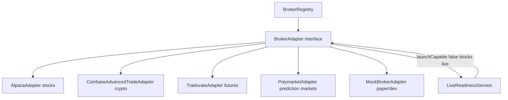

# broker/adapters

This folder is where broker-specific APIs are forced into one shape. The rest of Exva asks for balances, quotes, positions, order placement, order status, and closes through `BrokerAdapter`; these files handle the broker quirks.

## How it works

- `broker-adapter.ts` defines the contract. Every adapter must expose `brokerType`, `supportedInstrumentClasses`, `launchCapable`, `testConnection`, `placeOrder`, `cancelOrder`, `getPositions`, `getAccountBalance`, `getMarketSnapshot`, `getOrderStatus`, and `closeOrder`.
- `AlpacaAdapter` is stock-only and launch-capable. It talks to Alpaca's paper or live REST API, places notional market orders, reads account value, fetches latest stock trades, and closes by flattening the filled order's symbol.
- `CoinbaseAdvancedTradeAdapter` is crypto-only through CCXT's `coinbaseadvanced` exchange. It rejects paper mode because Coinbase Advanced Trade has no paper API in this adapter. It is not launch-capable yet because close/positions are not complete enough for live sessions.
- `TradovateAdapter` is futures-only and **quarantined** — credentials are validated but trading methods throw `UNSUPPORTED` until a real API integration ships. It is marked not launch-capable.
- `PolymarketAdapter` is prediction-market-only and also implements `MarketDiscoveryAdapter`. It uses the Polymarket CLOB client for authenticated trading and read-only market data, and uses metadata to identify the outcome token to buy or sell.
- The `launchCapable` flag is part of the safety boundary. `LiveReadinessService` blocks live sessions when any assigned adapter reports `launchCapable = false`.
- `MarketDiscoveryAdapter` is optional and currently used for adapters that can enumerate market candidates, such as Polymarket.
- Adapter methods should throw broker/domain errors rather than swallowing failures, except `testConnection`, which returns a structured `ConnectionTestResult` so preflight can show a useful message.

## Flow

## Terms

- **BrokerAdapter** — the shared interface the orchestrator, risk gates, monitors, and balance cache use for all broker work.
- **launchCapable** — adapter safety flag meaning close/flatten/order-status semantics are good enough for live launch.
- **MarketSnapshot** — normalized quote-like market state with price, timestamp, and optional bid/ask/spread/volume.
- **MarketDiscoveryAdapter** — optional extension for brokers that can list tradable markets.
- **CloseResult** — normalized result of closing or flattening an order, including realized PnL when the adapter can report it.
