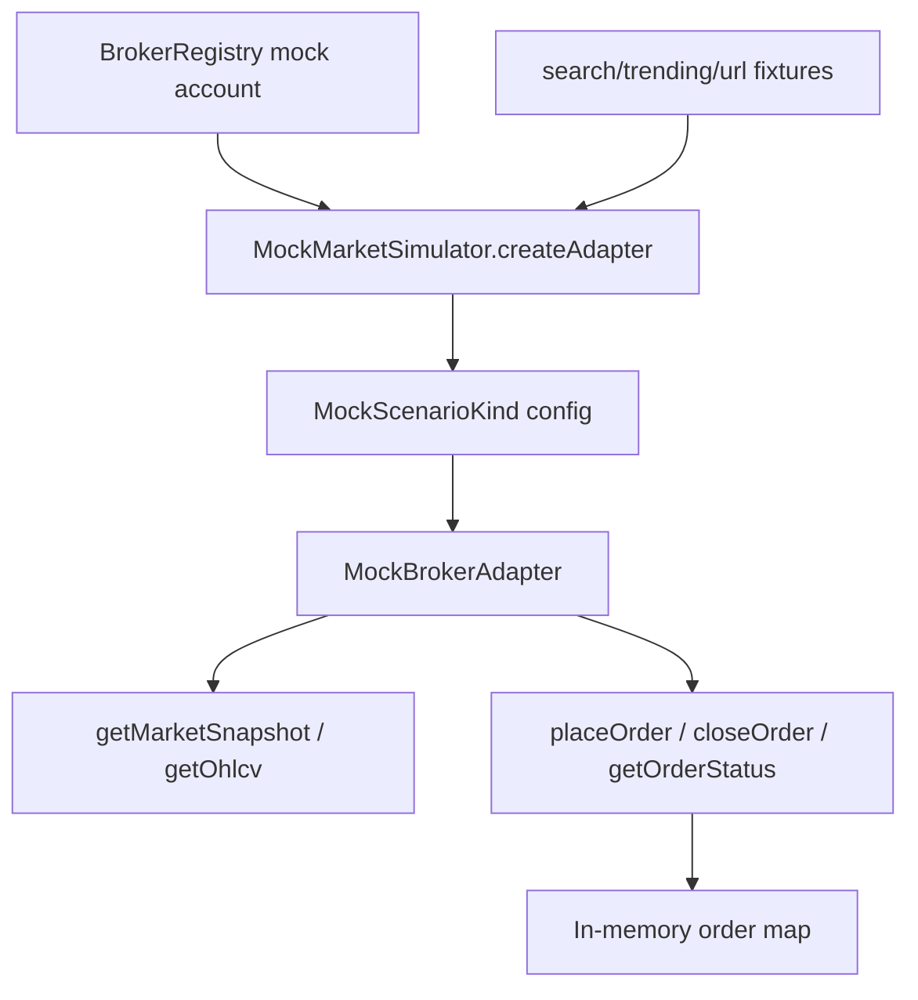

# broker/mock

This folder gives Exva a broker that behaves like a market without touching money or an external API. It is used for paper workflows, tests, and rehearsals where deterministic bad and good market conditions are more useful than live data.

## How it works

- `MockBrokerAdapter` implements the same `BrokerAdapter` interface as live adapters, so orchestration, risk gates, approvals, balance caching, and trade monitoring do not need mock-specific branches.
- The adapter supports all instrument classes: stock, crypto, futures, and prediction markets. It is intentionally `launchCapable = false`, so live-readiness blocks it for live sessions.
- `testConnection` always returns a successful mock connection with a 100,000 USD balance unless a scenario is exercising downstream broker behavior.
- `getMarketSnapshot` uses deterministic symbol-derived prices and scenario settings to produce current, stale, or wide-spread quotes.
- `placeOrder` stores orders in memory and can simulate partial fills, broker rejection, rate limiting, market-closed failures, and request timeouts.
- `closeOrder` computes simple realized PnL from the stored entry price and a scenario-shaped close price, then removes the order from memory.
- `getOhlcv` produces synthetic bars, including shaped clean-breakout behavior for scenario tests that need realistic technical inputs.
- `mock-market-simulator.ts` maps each `MockScenarioKind` to adapter settings and companion fixtures for trending symbols, web search, URL content, and primary symbols.
- Fixture files are part of the scenario contract. When adding a scenario, update the simulator config, expected outcome map, and the research fixtures together.

## Flow

## Terms

- **Mock broker** — local `BrokerAdapter` implementation with no real money and no live external orders.
- **MockScenarioKind** — named scenario such as `clean_breakout`, `stale_quote`, `wide_spread`, or `broker_reject`.
- **Scenario fixture** — deterministic research or market-data input paired with a mock scenario.
- **Partial fill** — simulated broker response where only part of the requested USD size is filled.
- **Stale quote** — scenario where the returned timestamp is intentionally old so policy gates can reject it.
