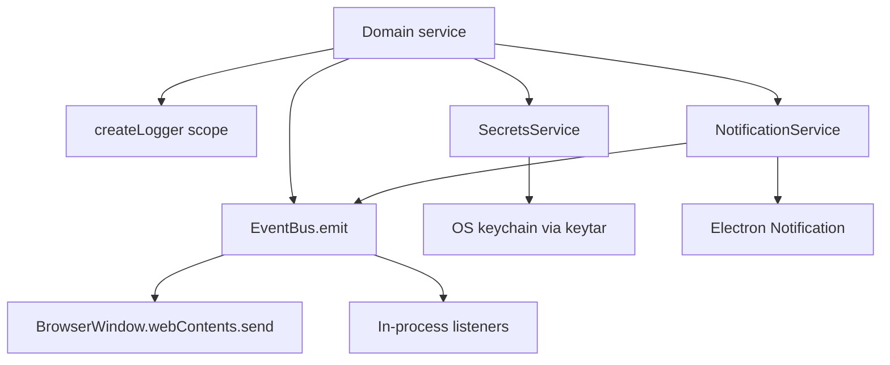

# infra

This folder contains the main-process plumbing that other services lean on but should not each reimplement. It handles structured logging, safe log metadata, in-process and renderer-facing events, OS keychain secrets, and desktop notifications.

## How it works

- `event-bus.ts` defines `ExvaEventMap`, the typed event payload contract for trade, agent, approval, session, research, execution-step, broker-balance, stats, and notification events.
- `EventBus.attach(window)` registers an Electron `BrowserWindow` and removes it when the window closes. `emit` sends the event to all non-destroyed renderer windows and then invokes in-process listeners registered through `on`.
- The event bus also stores per-session runtime status in memory. Session/orchestration code uses this to decide whether a runtime is active, paused, stopping, or absent without reading the DB every time.
- `log.ts` creates the shared Pino logger. Logs go to stdout and a daily log file under `env.logDir` or `~/.exva/logs`, with 7-day file retention.
- Logger redaction covers common credential fields such as API keys, secret keys, authorization headers, and passwords. Do not add raw secrets under different field names without updating redaction.
- `log-safety.ts` provides metadata helpers for payloads and text. It reports serialized size, oversize flags, sensitive-key counts, text length, and whether a string looks sensitive without logging the raw sensitive value.
- `secrets-service.ts` stores and retrieves secrets through `keytar` under the `exva` service name. It logs metadata such as account id and secret length, not secret content.
- `notification-service.ts` emits an in-app `notification` event and, when the platform supports it, shows an Electron desktop notification.
- Infra services should stay generic. They should not know trading strategy, broker routing, or AI pipeline details beyond typed event payloads.

## Flow

## Terms

- **EventBus** — typed event fanout for renderer windows and in-process listeners.
- **Runtime status** — in-memory status tracked by session id, separate from the persisted session status.
- **Redaction** — Pino configuration that removes known secret fields from logs.
- **Keytar** — native library used to store credentials in the OS keychain.
- **Payload metadata** — safe summary of a payload's size and sensitivity risk without logging the payload itself.
