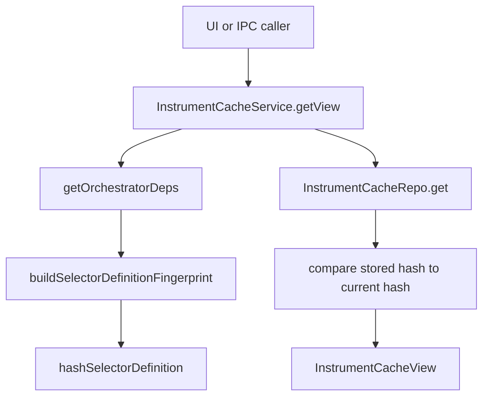

# instrument

This folder exposes the selector instrument cache in a UI-friendly way. It tells the rest of the app which instruments were last selected for a session and whether that cached selection still matches the session's current selector definition.

## How it works

- `instrument-cache-service.ts` is a thin service around `InstrumentCacheRepo`, but it adds an important correctness check: it rebuilds the current selector-definition fingerprint before returning the cache view.
- `getView(session)` calls `buildSelectorDefinitionFingerprint(session, deps)` and `hashSelectorDefinition(...)`, then compares that current hash to the hash stored with the cached selector instruments.
- If no cache row exists, the service returns `instruments: null`, `selectedAt: null`, and `definitionHashMatches: true`. No cache is not treated as a stale cache; it simply means selector has not produced cached instruments for that session.
- If a row exists, `instruments` is parsed from the repo's JSON string, `selectedAt` is copied from the row, and `definitionHashMatches` tells the caller whether the cached list was produced under the same selector definition the session has now.
- `clear(sessionId)` delegates to the repo and removes the cached instrument list for that session.
- The service deliberately depends on a `getOrchestratorDeps` callback so it can build the same selector fingerprint the pipeline uses without duplicating every dependency in its constructor.
- This folder does not fetch quotes, discover instruments, validate candidates, or run AI. Those responsibilities live in broker, selector pipeline, and orchestration policy code.

## Flow

## Terms

- **Instrument cache** — saved selector output for a session.
- **Selector definition fingerprint** — deterministic representation of the session inputs that affect selector output.
- **Definition hash** — compact hash of the selector fingerprint stored beside cached instruments.
- **Cache view** — UI-facing object containing parsed instruments, selected timestamp, and hash-match status.
