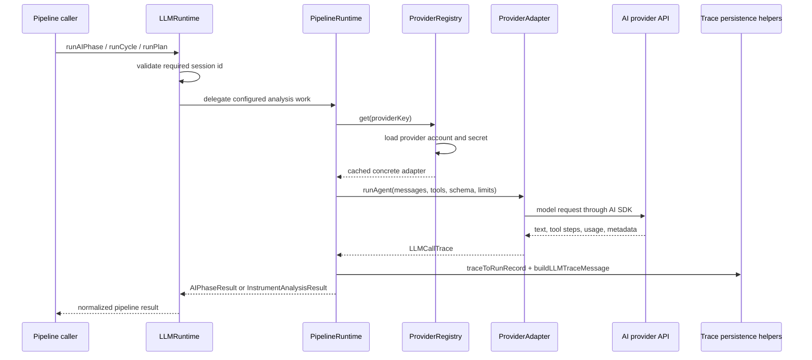

# llm

This folder is the model boundary for the main process: it resolves a configured AI provider, sends the prompt/tool/schema payload to that provider, and turns the response into the run records the rest of Exva can audit later. It does not decide what analysis should run; it is the reliable delivery layer that lets the pipeline ask an LLM for one worker result and get back text, structured output, traces, tokens, and cost.

## How it works

- `LLMRuntime` in `runtime.ts` is the public service entry point used by pipeline callers. It owns a `PipelineRuntime` instance and exposes methods such as `runAIPhase`, `runCycle`, `runPlan`, `resolveEffectivePipelineConfig`, and `assertValidEffectivePipelineConfig`.
- `LLMRuntime` validates required identifiers before delegating. For example, `runAIPhase`, `runCycle`, and `runPlan` throw `AppError` validation failures when `sessionId` is missing.
- `ProviderRegistry` in `provider-registry.ts` turns a saved provider account into a concrete provider adapter. It checks that the account is configured, belongs to the `ai` category, loads the secret from `SecretsService`, builds the adapter, and caches it by provider key.
- Supported direct provider adapter types are `anthropic`, `openai`, and `openrouter`. The `opencode` provider type is routed through the `OpenRouterAdapter` and can use `metadataJson.baseUrl` when a custom compatible endpoint is configured.
- `llm-types.ts` defines the normalized message, tool-call trace, full call trace, and run-result shapes shared between adapters and persistence code.
- `runtime-trace.ts` converts a normalized `LLMCallTrace` into persisted `AgentRun` and `AgentMessage` records. It stores provider/model identifiers, token counts, cost, finish reason, raw audit messages, tool-call JSON, optional thinking text, schema output JSON, and strategy/market snapshots.
- `runtime-retry.ts` owns retry policy for provider requests. It applies a 60 second timeout, up to four retries, exponential backoff of 1s/2s/4s/8s, and retry decisions based on provider status codes, network errors, timeout errors, and known non-retryable validation/configuration failures.
- `tool-loop-guard.ts` canonicalizes recent tool inputs so the shared agent executor can stop repeated tool loops. Search and Reddit queries are normalized into a query family, fetch URLs are reduced to their domain, and market-data tools are reduced to normalized symbols.
- `model-pricing.ts` provides fallback per-million-token rates. `resolve-run-cost.ts` prefers provider-reported usage cost when available, especially OpenRouter metadata, and falls back to estimated cost when the provider does not report a usable value.
- This folder is intentionally not responsible for prompt construction, worker scheduling, deterministic signal aggregation, broker access, or search-provider HTTP details. Those live in `pipeline/`, `signal/`, `broker/`, and `search/`.

## Flow

## Terms

- **LLMRuntime** - Main service facade for AI execution from the rest of the main process. It delegates to `PipelineRuntime` rather than calling provider APIs directly.
- **ProviderRegistry** - Resolver and cache that maps a configured provider key to a concrete `ProviderAdapter`.
- **ProviderAdapter** - Provider-specific implementation of the normalized LLM contract. Concrete adapters live in `llm/adapters/`.
- **LLMMessage** - Minimal message shape passed to providers: `system`, `user`, `assistant`, or `tool`, plus optional tool metadata.
- **LLMCallTrace** - Complete normalized record of one provider call, including assistant text, optional structured output, audit messages, tool steps, thinking text, finish reason, token usage, duration, and cost.
- **LLMToolStepTrace** - One model step that may contain one or more tool calls plus step-level token and latency data.
- **LLMRunResult** - Persisted `AgentRun`, persisted `AgentMessage`, and parsed output returned after a worker run is stored.
- **Cost source** - Whether run cost came from provider metadata (`provider`) or the local pricing table fallback (`estimated`).
