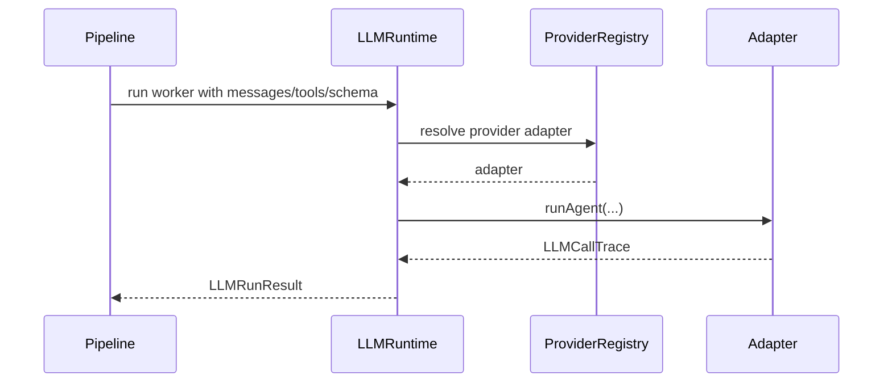

# llm

Talks to LLM providers — one call at a time with retries, streaming, cost tracking, and tool-loop guards.

## Technical

- `LLMRuntime` is the main entry; `PipelineRuntime` delegates worker runs here.
- `adapters/` normalize Anthropic, OpenAI, and OpenRouter request/response shapes.
- `llm-types.ts` defines the shared message, trace, and run-result contracts.
- `provider-registry.ts` resolves a configured provider account to the correct adapter.
- `model-pricing.ts` and `resolve-run-cost.ts` keep token/cost accounting out of the provider adapters themselves.

## Flow

## Terms

- **LLMCallTrace** — full record of one model invocation including tool steps.
- **LLMRunResult** — parsed output plus the trace/cost metadata the pipeline needs downstream.
