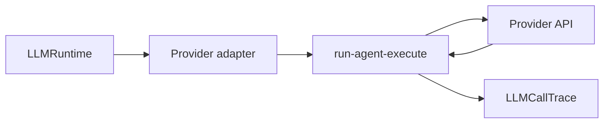

# llm/adapters

Turns Anthropic, OpenAI, and OpenRouter into one adapter contract. The rest of the app hands over messages, tools, and schemas without caring which provider is underneath.

## Technical

- `provider-adapter.ts` defines the common adapter interface.
- `run-agent-execute.ts` hosts the shared agent-execution loop used by provider adapters.
- `reasoning-options.ts` normalizes provider-specific reasoning knobs.
- Each concrete adapter is responsible for model listing, connection testing, and `runAgent()` execution for its provider.

## Flow

## Terms

- **Provider adapter** — provider-specific implementation of the shared LLM adapter contract.
