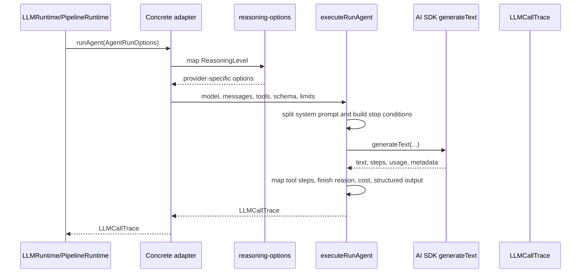

# llm/adapters

These files make Anthropic, OpenAI, and OpenRouter look like the same kind of model service to the rest of Exva. Callers hand over normalized messages, tools, schema, model settings, and limits; the adapter chooses the right SDK client shape and returns one normalized `LLMCallTrace`.

## How it works

- `provider-adapter.ts` defines the shared contract for all model providers. The contract includes plain text generation, object generation, agent-style tool execution, connection testing, and model listing.
- `AgentRunOptions` is the important runtime input shape. It carries model id, worker/session/cycle/trade context, normalized messages, optional AI SDK tools, max tool steps, spend limit, temperature, max tokens, reasoning level, optional output schema, terminal tool names, and optional per-step preparation.
- `run-agent-execute.ts` is the common execution loop used by the concrete adapters. The provider-specific files build the AI SDK `LanguageModel` and provider options, then delegate the actual model call to `executeRunAgent`.
- `executeRunAgent` separates system messages from the rest of the conversation, logs the prompt context, configures stop conditions, invokes `generateText`, optionally asks the AI SDK for schema-shaped output, and converts SDK steps into `LLMToolStepTrace` records.
- Stop conditions include the configured max tool steps, terminal tool names, a spend guard based on estimated token cost, and a loop fingerprint guard that detects repeated searches, repeated fetches, or repeated market-data calls.
- `reasoning-options.ts` maps Exva's `ReasoningLevel` values into provider-specific controls. Anthropic uses thinking options and falls back to adaptive thinking when tools are enabled; OpenAI uses reasoning effort; OpenRouter receives an injected `reasoning` body field.
- `anthropic-adapter.ts`, `openai-adapter.ts`, and `openrouter-adapter.ts` each handle provider client creation, one-shot `generateText`, one-shot `generateObject`, model listing, connection tests, and `runAgent` delegation.
- Provider adapters normalize token usage from either `inputTokens`/`outputTokens` or `promptTokens`/`completionTokens` depending on the SDK/provider response shape.
- OpenRouter supports a custom base URL and lists model context lengths from `/models`. The `opencode` provider type is built as an `OpenRouterAdapter` by `ProviderRegistry` outside this folder.
- Adapter code should stay thin. Provider branching belongs here, but retries, persistence, tool definitions, prompt construction, and deterministic signal logic should stay outside the adapter layer.

## Flow

## Terms

- **ProviderAdapter** - The common interface every concrete LLM provider implements.
- **AgentRunOptions** - Normalized input for one tool-capable model run.
- **RunAgentExecuteParams** - Internal input to the shared executor after a concrete adapter has chosen the provider SDK model.
- **ReasoningLevel** - Exva-level reasoning setting (`off`, `auto`, `low`, `medium`, `high`, `max`) that adapters translate into provider-specific options.
- **Terminal tool** - A tool name that stops the run after the model calls it.
- **Loop fingerprint guard** - Stop condition that prevents repeated tool calls from burning steps and spend without adding new information.
- **Spend guard** - Stop condition that estimates accumulated token spend and stops when it exceeds the configured run budget.
