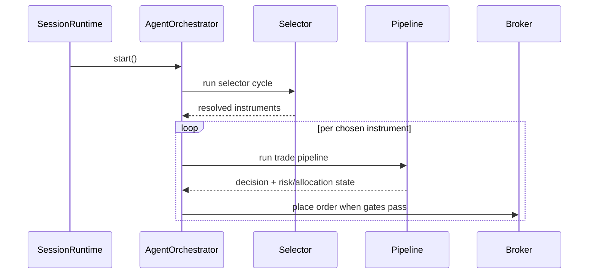

# orchestration

Runs the live trading loop for one session. It decides when to research, when to analyze a chosen instrument, when to wait for approval, and when to place or monitor real trades.

## Technical

- `cycle/agent-orchestrator.ts` drives the per-session queue.
- `TradingCycleContext` holds step runners and deps for one cycle.
- `cycle/` owns the active tick-by-tick workflow.
- `policy/` holds deterministic pre-trade validation.
- `lifecycle/` owns runtime start/stop behavior and open-trade monitoring.

## Flow

## Terms

- **Trading cycle** — one live loop iteration for a session.
- **Resolved instrument** — a selector-approved instrument ready for full trade analysis.
