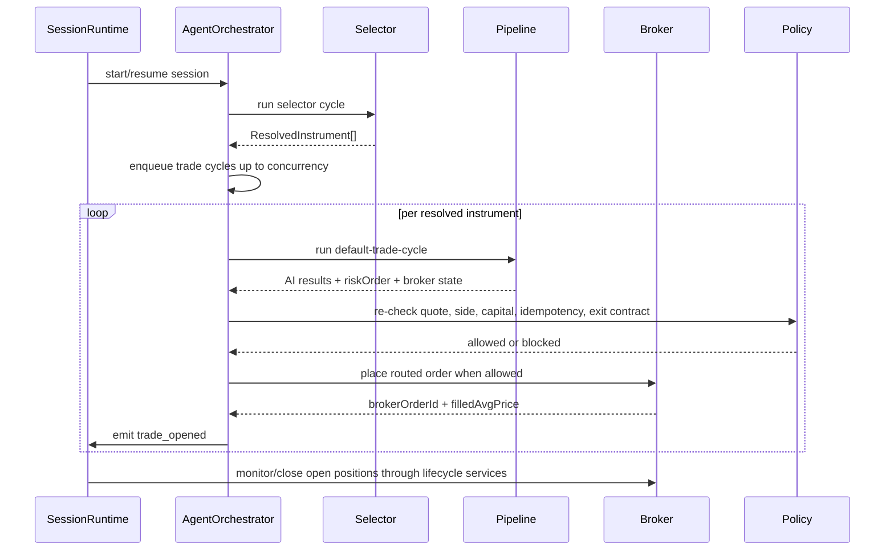

# orchestration

Runs the live trading loop for one session. It decides when to research, when to analyze a chosen instrument, when to wait for approval, and when to place or monitor real trades.

## How it works

- `cycle/agent-orchestrator.ts` is the live intake coordinator. It starts the selector cycle, enqueues trade cycles for selected instruments, pauses/resumes/stops the queue, retries failed steps, and delegates approval resolution.
- `cycle/trading-cycle-context.ts` carries mutable session-loop state: `PQueue`, approval callbacks, pending approval ids, cycle contexts, step runners, pause flags, retry timers, and helpers for status/event updates.
- `cycle/trading-step-runner.ts` persists execution-step status, attempts, retryability, retry timestamps, and step bus events. This is what makes a failed selector, AI stage, risk gate, or broker order visible and retryable.
- `cycle/selector/` runs the selector analysis and turns it into bounded, tradable `ResolvedInstrument` records.
- `cycle/trade/` handles the per-instrument path after selection: AI pipeline, trade record creation, risk/order policy gates, human approval, capital reservation, broker placement, and final open-trade event.
- `cycle/scheduling/` owns queue refill logic. No instruments means a delayed selector retry; a closed trade means capacity is free and a new research cycle can start.
- `policy/` holds deterministic validation and order gates. This code is deliberately not LLM judgment; it blocks stale quotes, unsupported classes, duplicate orders, side-bias violations, and missing exit contracts.
- `lifecycle/` owns what happens outside the intake loop: monitoring open positions, enforcing max-hold/exposure exits, and closing trades at the broker.
- Orchestration does not define AI prompts or broker-specific behavior. It coordinates services that already know how to analyze, validate, reserve capital, and place orders.

## Flow

## Terms

- **Trading cycle** — one live loop iteration for a session.
- **Resolved instrument** — a selector-approved instrument ready for full trade analysis.
- **Execution stage** — persisted step label such as `selector`, `technical`, `risk_gate`, or `broker_order`.
- **Attention required** — session status used when a non-retryable orchestration step fails and operator action is needed.
- **Approval recheck** — fresh AI and deterministic gate pass that runs after a user approves a pending trade, before broker placement.
