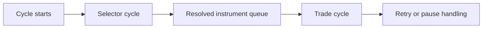

# orchestration/cycle

Runs one live session tick. It owns the work queue, selector scheduling, trade-cycle execution, and the retry/pause mechanics around those steps.

## Technical

- `agent-orchestrator.ts` is the main coordinator.
- `trading-cycle-context.ts` holds the mutable runtime state for the active session loop.
- `trading-step-runner.ts` persists and classifies step progress.
- `selector/`, `trade/`, and `scheduling/` split the cycle into focused subdomains.

## Flow

## Terms

- **Trading cycle** — one loop iteration for one session runtime.
