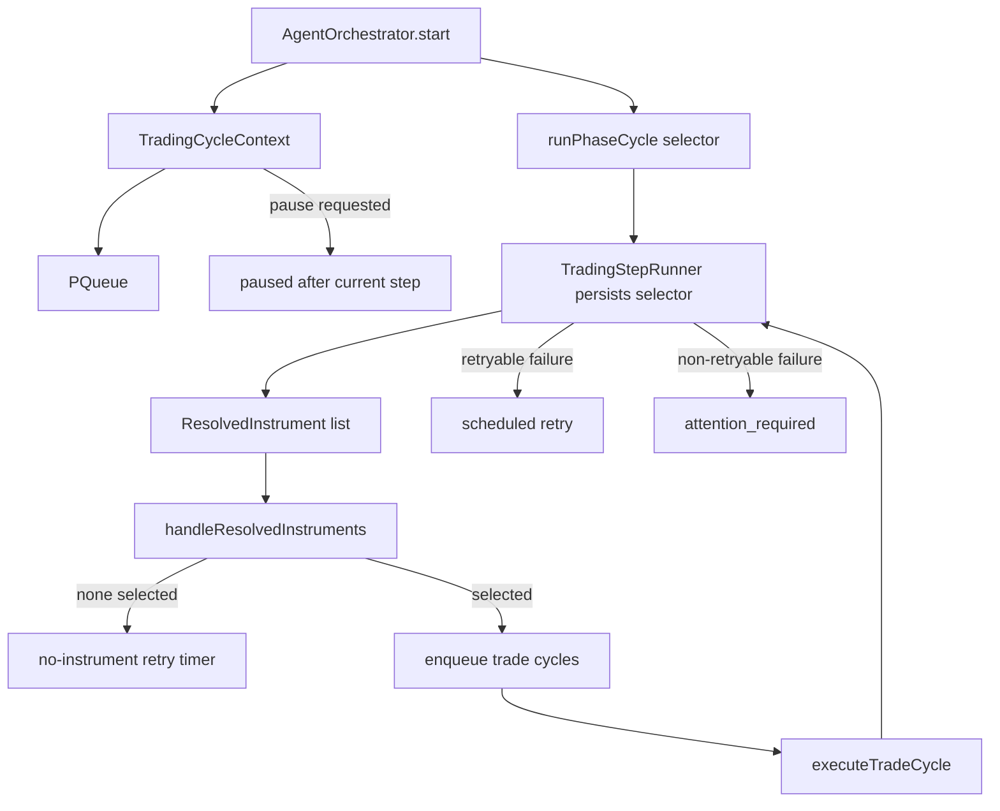

# orchestration/cycle

Runs one live session tick. It owns the work queue, selector scheduling, trade-cycle execution, and the retry/pause mechanics around those steps.

## How it works

- `AgentOrchestrator.start()` initializes queue concurrency from `max_concurrent_trades`, attaches the `trade_closed` listener, and enqueues the first selector cycle.
- `TradingCycleContext` wraps the runtime state shared by selector, trade, scheduling, and retry code. It is where cycle contexts, approval callbacks, retry timers, and step runners live.
- `runPhaseCycle` is the helper for one-step selector/research style cycles. It emits research-phase bus events, runs the step through `TradingStepRunner`, handles pause/failure, and calls success callbacks.
- `runOrchestratorStep` is the shared wrapper around each persisted execution stage. It pauses after a step when requested, classifies failures through the step runner, and returns `ok`, `paused`, or `failed`.
- `TradingStepRunner` stores each stage attempt in `sessionExecutionStepsRepo`, emits `step:*` events, classifies retryable errors, and schedules retries using `RUNTIME_DEFAULTS.retry.stepBackoffMs`.
- Retryable errors include HTTP 408/429/5xx and timeout/reset/transient messages. Validation, missing provider, and lock-style errors are treated as non-retryable.
- `MarketHoursService` filters selector output so crypto and prediction markets are always tradable, while stocks/futures are blocked on UTC weekends.
- Stop/pause semantics are conservative: stopping clears the queue, releases pending approvals/capital, disposes step runners, detaches listeners, and waits for the queue to become idle.

## Flow

## Terms

- **Trading cycle** — one loop iteration for one session runtime.
- **Cycle context** — in-memory record for a selector or trade cycle, keyed by `cycleId`, used for retry and resume within the active runtime.
- **Step runner** — per-cycle object that records stage status and schedules retries.
- **No-instrument retry** — delayed selector rerun when AI selection returns no tradable instruments.
- **Runtime active** — bus runtime status of `active`; most cycle work exits early when the session is paused, stopping, or stopped.
