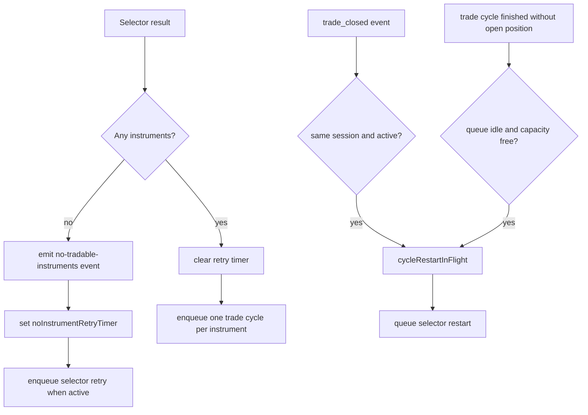

# orchestration/cycle/scheduling

Manages how selector output turns into queued work. This is where the live loop tracks which instruments are waiting, active, or freed up after a trade closes.

## How it works

- `instrument-queue.ts` receives the final `ResolvedInstrument[]` from selector execution and decides whether to enqueue trade cycles or schedule another selector pass later.
- When selector returns no tradable instruments, `handleResolvedInstruments` emits an operator-visible event and schedules a retry using `ctx.getNoInstrumentRetryMinutes()`.
- Only one no-instrument retry timer can be active. `scheduleNoInstrumentRetry` exits if a timer already exists and clears the timer before queueing the next selector cycle.
- When selector returns instruments, any no-instrument retry timer is cleared, an event records how many cycles were enqueued, and each instrument is added to the shared orchestration queue.
- `trade-closed-handler.ts` listens to `trade_closed` bus events for the same session. When an open trade closes and the runtime is still active, it queues a fresh selector cycle so the session can refill capacity.
- `cycle-refill.ts` schedules a selector cycle after a trade cycle finishes without opening a position (skip, confidence rejection, user rejection, or broker failure) when the orchestrator queue is idle and trade capacity remains available.
- The `cycleRestartInFlight` flag prevents multiple simultaneous trade-closed restarts when several events arrive close together.
- Scheduling does not decide whether a symbol is valid, how AI analyzes it, or whether an order should be placed. It only moves work into the queue at the right time.

## Flow

## Terms

- **Queue slot** — one available unit of concurrent trade-analysis capacity.
- **No-instrument retry timer** — delayed selector retry used when the selector found nothing tradable.
- **Trade-closed restart** — selector cycle triggered after a trade closes so the session can refill capacity.
- **No-trade refill** — selector cycle triggered after a trade cycle completes without opening a position, when capacity is still available.
- **Cycle restart in flight** — guard flag that prevents duplicate selector restarts from overlapping close events.
