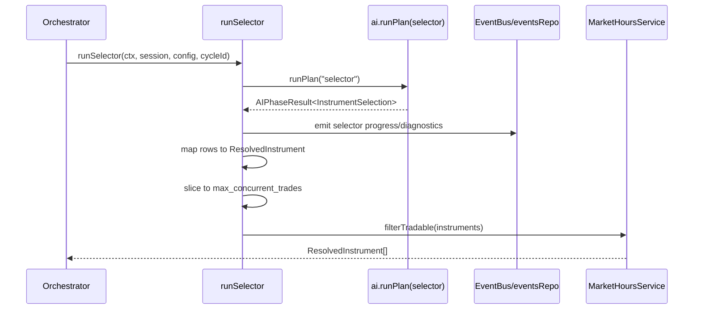

# orchestration/cycle/selector

Triggers the selector analysis inside the live runtime. It takes the selector result and turns it into concrete instruments the trade loop can queue next.

## How it works

- `run-selector.ts` calls `ctx.deps.ai.runPlan("selector", { sessionId, cycleId, input: {} })` and expects an `AIPhaseResult<InstrumentSelection>`.
- The selector output is converted into `ResolvedInstrument` records with symbol, instrument class, display name, prediction outcome, metadata JSON, and selector evidence.
- When the result source is `ai_picker`, the runner emits human-readable `agent_event` rows and `research_phase_step` bus events so the UI can show that discovery/verification workers started and how many instruments were selected.
- If AI selection returns only rejected candidates, the diagnostics are summarized into a warning event. The message includes up to five rejected symbols and their first rejection reason.
- The final list is capped to `config.max_concurrent_trades` before scheduling, so selector output cannot overfill the session queue.
- `MarketHoursService.filterTradable` then removes instruments that are not tradable now. Crypto and prediction markets pass through at all times; stock/futures candidates are blocked on UTC weekends.
- This folder does not validate deep candidate evidence itself. Deterministic candidate validation lives under `orchestration/policy`, and selector phase definition/cache logic lives in `pipeline/definitions/selector.phase.ts` and `pipeline/engines/`.

## Flow

## Terms

- **Resolved instrument** — selector-approved instrument normalized for the trade cycle.
- **InstrumentSelection** — typed selector output containing accepted instruments and optional diagnostics.
- **Selector evidence** — structured or trace-derived support explaining why the selector picked an instrument.
- **AI picker** — selector source that came from AI workers rather than a manual/static list.
