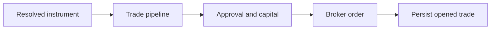

# orchestration/cycle/trade

Handles everything after the selector picks an instrument. This folder runs the full trade pipeline, deals with approvals and capital, places orders, and records the final trade state.

## Technical

- `run-trade-pipeline.ts` runs the analysis portion and applies pipeline state back to the live context.
- `trade-cycle.ts` is the end-to-end coordinator for one selected instrument.
- `effect-runner.ts`, `order-placer.ts`, and the approval files handle side effects after the decision is known.
- `post-decision-gates.ts` and `order-policy-task.ts` enforce the final deterministic checks before order placement.

## Flow

## Terms

- **Trade cycle** — the full pipeline and side-effect path for one chosen instrument.
