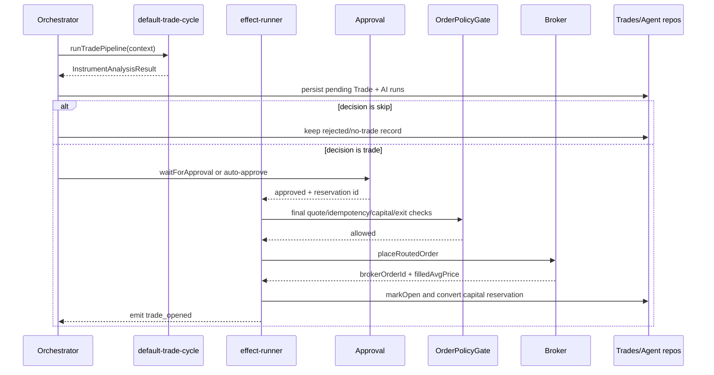

# orchestration/cycle/trade

Handles everything after the selector picks an instrument. This folder runs the full trade pipeline, deals with approvals and capital, places orders, and records the final trade state.

## How it works

- `trade-cycle.ts` is the end-to-end coordinator for one selected instrument. It creates a `TradeCycleContext`, runs the trade pipeline, persists a pending trade, handles skip decisions, reserves capital, places the broker order, and finalizes the open trade.
- `run-trade-pipeline.ts` calls `ctx.deps.ai.runPlan("default-trade-cycle", ...)` with session config, effective instrument classes, the selected instrument, and any seed state from a previous failed/retried context.
- Pipeline stages are wrapped with `runOrchestratorStep`, so `technical`, `fundamental`, `review`, `decision`, `risk_gate`, and later broker steps are visible in `sessionExecutionStepsRepo`.
- `applyTradePipelineToContext` copies reusable outputs such as AI phase results and `riskOrder` back into `TradeCycleContext`. This lets retries resume without rerunning already-captured state when possible.
- `effect-runner.ts` owns the post-pipeline side effects: creating the trade record, persisting agent runs/messages, waiting for approval, reserving capital, running the final order policy gate, calling the broker placement helper, and marking the trade open.
- `approval-flow.ts` creates pending approval rows, reserves approval capital, emits `approval_required`, and resolves or rejects through in-memory callbacks. A rejected approval releases capital and closes the pending trade as rejected.
- `approval-recheck.ts` reruns the AI pipeline and deterministic gates after human approval. This prevents stale approved decisions from being placed without a fresh quote and policy pass.
- `order-placer.ts` resolves the broker adapter, checks cross-session instrument conflicts on that broker, normalizes the symbol for the adapter, calls `placeOrder`, and patches the trade with the resolved broker account.
- `post-decision-gates.ts` reruns the configured risk-gate engine chain for approval rechecks.
- `order-policy-task.ts` adapts session config, stats, quote snapshots, confidence, side bias, broker support, and exit policy into the `OrderPolicyGate` input shape.
- `trade-record-builder.ts` converts a `TradeSignal` plus strategy risk settings into a `Trade` row. It computes position size and stop/take-profit levels through `computeTradeTradeExecutionProfile`, and remaps prediction-market metadata for the selected outcome.

## Flow

## Terms

- **Trade cycle** — the full pipeline and side-effect path for one chosen instrument.
- **Risk order** — broker-neutral `OrderRequest` produced by the risk gate and used for final placement.
- **Seed state** — previous pipeline outputs copied into a retry so completed analysis does not have to be reconstructed from scratch.
- **Approval callback** — in-memory resolver waiting for the UI/user to approve or reject a pending trade.
- **Client order id** — deterministic id `${cycleId}:${tradeId}` used for idempotency checks before broker placement.
- **Prediction metadata remap** — outcome-specific metadata adjustment for prediction-market trades.
