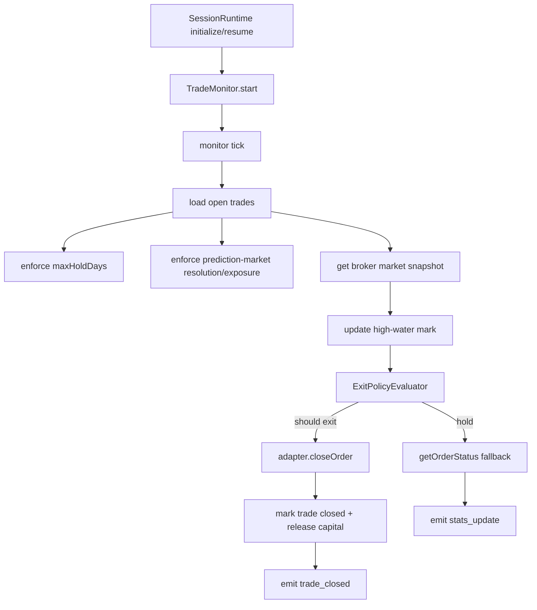

# orchestration/lifecycle

Owns what happens when a session starts, pauses, stops, or keeps watching open positions. This is the part that keeps the long-lived runtime honest between trading cycles.

## How it works

- `trade-monitor.ts` runs while a session is active and also while it is paused. Pausing blocks new intake through the orchestrator, but the monitor keeps managing open positions so stops, take-profit, max-hold, and event-resolution exits can still fire.
- Poll interval is based on holding style: `intraday_flat` checks every 5 seconds, `multi_day_swing` every 60 seconds, and longer/custom styles every 5 minutes.
- Each monitor tick loads open trades, refreshes the current strategy context, enforces max hold days, enforces prediction-market exposure/resolution rules, then evaluates remaining trades against current market snapshots.
- For normal instruments, the monitor updates the high-water mark before evaluating exits. It uses adapter OHLCV when available for ATR trailing stops and falls back to fixed stops/take-profit/max-hold when bars are unavailable.
- When an exit is triggered, `closeTradeAtBroker` calls the broker adapter, stores an optional close snapshot, marks the trade closed, releases capital, and emits `trade_closed`.
- If a broker close fails, the trade stays open and the next tick can retry. The monitor does not silently mark a trade closed without broker confirmation.
- `trade_closed` events are important beyond lifecycle: scheduling listens for them to restart selector research and fill freed capacity.

## Flow

## Terms

- **Trade monitor** — long-lived service that watches open positions after entry.
- **High-water mark** — best favorable price tracked for stop logic while a trade is open.
- **ATR trailing stop** — exit rule using recent OHLCV bars to compute a volatility-adjusted trailing threshold.
- **Event resolution** — prediction-market exit condition when metadata says the market resolution time has arrived.
- **Paused-with-monitoring** — session state where new entries stop but open positions are still watched and closable.
