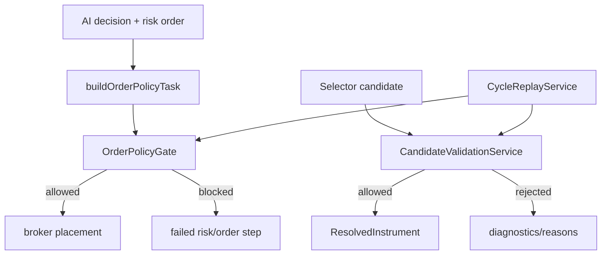

# orchestration/policy

Holds deterministic checks that block bad trades before they hit a broker. These rules are local TypeScript logic, not AI judgment.

## How it works

- `candidate-validation-service.ts` validates selector candidates before they become trade-cycle work. It checks for a symbol, enabled instrument class, broker route availability, a positive quote, quote freshness, symbol-specific evidence, non-empty rationale, liquidity, spread, and strategy side-bias compatibility.
- Candidate quote freshness is class- and timeframe-aware. Intraday crypto/futures quotes are allowed only briefly, while prediction-market quotes can be older because those markets move differently.
- Evidence can come from tool traces (`search_web`, `fetch_url`) or structured selector evidence. When neither trace nor structured evidence proves symbol-specific support, the candidate is rejected.
- `order-policy-gate.ts` runs just before broker placement. It checks runtime pause state, strategy side bias, quote freshness, price drift between analysis and placement, spread, max position size, broker support/market-open state, duplicate client order id, and whether an enforceable exit policy exists.
- The order gate returns all failed gate names but exposes a single primary reason for operator/UI display.
- Policy code should stay deterministic and side-effect free. It receives snapshots, callbacks, config, and stats; it should not fetch live broker data or mutate repos itself.
- Orchestration uses these policies in two places: normal trade placement and post-approval recheck. Replay also uses them to compare historical outcomes with current deterministic rules.

## Flow

## Terms

- **Policy gate** — deterministic rule set that can allow, warn, or block a trade path.
- **Candidate validation** — pre-trade-screening of selector output before a full trade analysis runs.
- **Quote freshness** — maximum allowed age for the market snapshot used in a decision or candidate.
- **Price collar** — maximum allowed drift between the analysis quote and the pre-placement quote.
- **Exit contract** — requirement that the trade has at least one enforceable exit such as stop loss, take profit, or max hold days.
