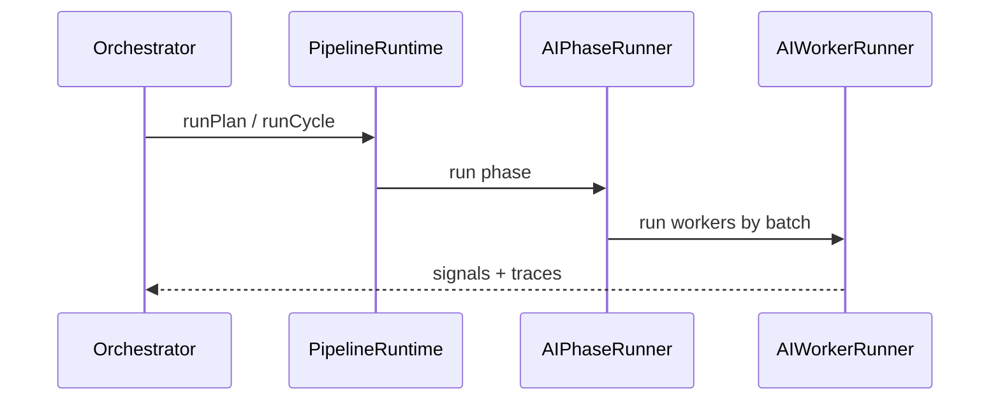

# pipeline

Runs multi-phase AI analysis: selector discovery, then per-instrument technical → fundamental → review → decision.

## Technical

- `PipelineRuntime` orchestrates `AIPhaseRunner` (single phase) and `InstrumentAnalysisRunner` (full trade analysis).
- `implementations/` holds trading-specific plans; `core/`, `phases/`, `analysis/`, `execution/` are generic framework.
- Worker prompts are inlined in `worker-prompts.ts`; `buildWorkerPrompt` assembles system/user messages.

## Flow

## Terms

- **AIPhase** — definition of one analysis phase (workers, batches, finalize).
- **InstrumentAnalysis** — ordered steps analyzing one instrument through multiple phases.
