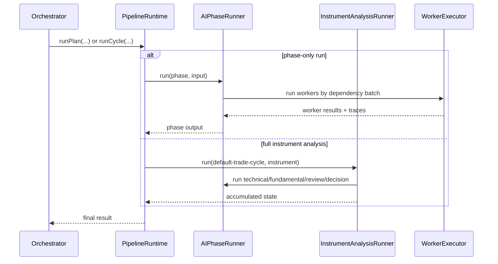

# pipeline

Runs the structured AI analysis pipeline. It can run one phase by itself, or run a full instrument analysis that chains technical -> fundamental -> review -> decision and the deterministic gates around them.

## Technical

- `core/pipeline-runtime.ts` is the composition root. It owns `runPlan`, `runCycle`, and `runAIPhase`.
- `phases/` runs one `AIPhase`; `analysis/` runs one `InstrumentAnalysis`.
- `implementations/` holds the trading-specific selector/trade wiring; `core/`, `phases/`, `analysis/`, `execution/`, `prompting/`, and `worker-tools/` are the reusable machinery.
- Prompt text is bundled in `worker-prompts.ts`; message assembly happens in `prompting/worker-prompt-builder.ts`.
- Deterministic engines are part of the pipeline contract. Some enrich worker context, others run as analysis steps after AI output exists.

## Flow

## Terms

- **AIPhase** — definition of one analysis phase (workers, batches, finalize).
- **InstrumentAnalysis** — ordered sequence of phase runs and deterministic engine steps for one instrument.
- **WorkerDefinition** — one AI worker's prompt, tools, output mode, and schema.
